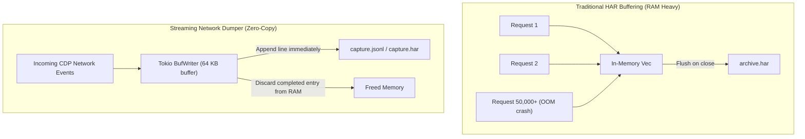

# Zero-Copy Streaming Network Capture

Traditional browser automation frameworks record HTTP traffic by accumulating every request, response, header, and payload in an in-memory array until the recording session is stopped. In long-running web crawler runs or heavy asset-intensive single-page apps (SPAs), this buffering pattern easily consumes gigabytes of heap memory and triggers Out-Of-Memory (OOM) process crashes.



---

## Memory Profiles: Buffered vs. Streaming

| Parameter | Standard In-Memory HAR Recorder | Zero-Copy Streaming Dumper (`HarStreamWriter`) |
| :--- | :--- | :--- |
| **Memory Footprint** | Grows linearly with traffic (up to several GBs) | Constant bounded memory (approx. 64 KB per stream) |
| **Crash Resistance** | High risk of OOM on large captures | Crash-safe: completed requests are already on disk |
| **Format Support** | Monolithic JSON HAR 1.2 | JSON Lines (`.jsonl`), Streaming HAR Chunks, Raw CDP Events |
| **Concurrency** | Bounded by process virtual memory | Arbitrary concurrency across thousands of pooled tabs |

---

## Direct Usage

```rust
// Stream traffic directly to an append-only JSONL file on disk
let capture = page.stream_to_jsonl("crawl_traffic.jsonl").await?;

page.goto("https://example.com").await?;

// Memory for previous requests is automatically released while streaming
assert!(capture.entries_streamed() > 0);
capture.finish().await?;
```
