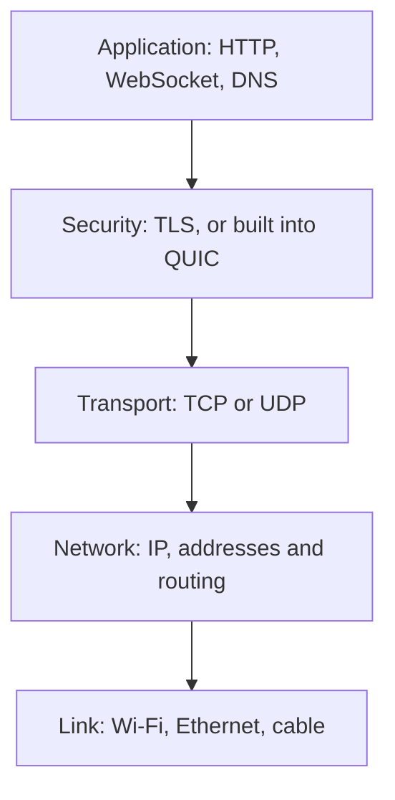
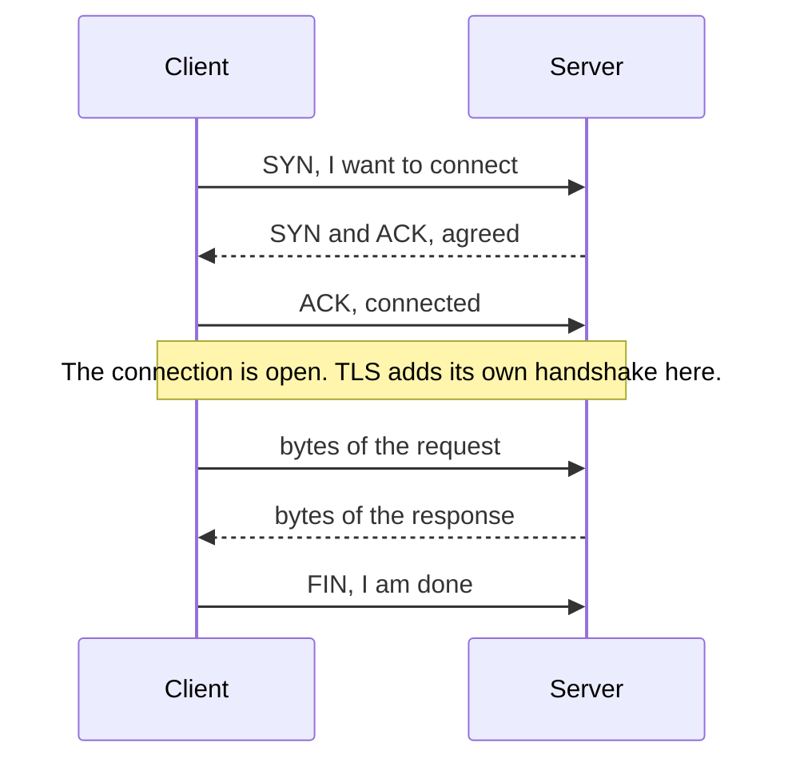
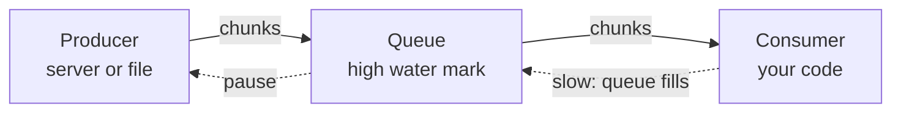

<Info>

**In short:** every web page arrives as a stream of bytes over a connection
between two programs, each identified by an IP address and a port. TCP makes
that connection reliable and ordered, UDP and QUIC trade some of that for speed,
and streams let a page start working on data before all of it has arrived. A
test that waits for "the network to be quiet" has to know that some connections
are meant to stay open forever.

</Info>

## Addresses and ports

Two numbers say where a message goes.

- An **IP address** names a machine on a network: `93.184.216.34` (IPv4, four
  numbers) or `2606:2800:220:1::1` (IPv6, eight groups). The name
  `example.com` is turned into one of these by [DNS](/concepts/how-a-page-loads).
  The address `127.0.0.1` (or `::1`) is the **loopback**: it always means "this
  same machine", and the name `localhost` points to it.
- A **port** is a number from 0 to 65535 that says which program on that machine
  should get the message. Web servers use 80 for HTTP and 443 for HTTPS by
  default. A client does not choose a well-known port for itself: its operating
  system gives it a free one from a high range for each connection.

A connection is therefore named by four numbers: source address, source port,
destination address, destination port. That is how a browser keeps a hundred
connections to the same server on port 443 apart.



*The layers a request passes through. Each layer only talks to its neighbours.*

## TCP: a reliable pipe

**TCP** (Transmission Control Protocol) gives two programs a connection that acts
like a pipe: bytes put in at one end come out at the other, **complete and in
order**, or the connection reports an error. The network underneath loses and
reorders packets all the time; TCP numbers the bytes, asks for the missing ones
again and slows down when the network is crowded.



*The three-way handshake opens a TCP connection, one round trip before any data.*

Two properties matter every day:

- **TCP has no message boundaries.** It delivers a stream of bytes, not a list
  of messages. When a client writes two messages, the reader may get them as
  one chunk, or one message in three pieces. Every protocol on top of TCP must say
  where a message ends: HTTP uses a length or a chunk marker, a WebSocket uses
  frames.
- **A lost packet stalls everything behind it.** TCP must deliver in order, so one
  missing packet holds back all the bytes after it until it is resent. This
  *head-of-line blocking* is the weakness QUIC was built to remove.

## UDP and QUIC

**UDP** sends independent **datagrams** with no handshake, no ordering and no
resend. A datagram may arrive twice or never. That is bad for a web page and
good when speed matters more than completeness: DNS lookups, voice and video
calls, games.

**QUIC** is a modern transport built on top of UDP. It adds what TCP gave, plus
TLS 1.3 encryption, in one handshake, and it carries many independent
**streams** in one connection, so a lost packet delays only the stream it
belonged to. HTTP/3 is HTTP over QUIC. A server announces it with an `Alt-Svc`
response header and the browser switches on a later visit.

| | TCP | UDP | QUIC |
|---|---|---|---|
| Runs on | IP | IP | UDP |
| Connection | Yes, with a handshake | None | Yes, with a handshake that includes TLS |
| Delivery | Reliable and in order | Best effort | Reliable, in order per stream |
| Message boundaries | None | Each datagram | Per stream, none; the application adds them |
| Head-of-line blocking | Yes | Not applicable | Only inside one stream |
| Typical use | HTTP/1.1 and HTTP/2, email, SSH | DNS, calls, games | HTTP/3 |

## Sockets

A **socket** is the handle that an operating system gives a program for one end
of a connection. A server creates a socket, **binds** it to an address and a
port, **listens**, and **accepts** each client that connects. A client creates a
socket and **connects**. After that, both sides read and write bytes, and
closing the socket ends the connection.

Binding port 0 asks the system for any free port, which is how a test can start
a server without picking a port that another program already uses. Binding a
port that is taken fails with "address already in use".

<Accordion title="What do the network errors in Chrome mean?">

Chrome names its connection failures `net::ERR_...`, and each one points to a
layer:

- `ERR_NAME_NOT_RESOLVED`: DNS found no address for the name.
- `ERR_CONNECTION_REFUSED`: the machine answered, but no program listens on that
  port. Typical when a local test server is not running yet.
- `ERR_CONNECTION_TIMED_OUT`: nothing answered the first packet at all, often a
  firewall or a wrong address.
- `ERR_CONNECTION_RESET`: the other side closed the connection abruptly in the
  middle of a conversation.
- `ERR_CERT_AUTHORITY_INVALID`: the connection worked, but the TLS certificate
  was not trusted.

</Accordion>

## Where HTTP puts a message boundary

On HTTP/1.1 the client has to know when a response body ends. There are two
ways. With `Content-Length` the server states the size first. When it does not
know the size yet, because it generates the page as it goes, it uses
**chunked transfer encoding**: the body is sent in pieces, each preceded by its
size in hexadecimal, and a piece of size zero ends it.

```text
HTTP/1.1 200 OK
Transfer-Encoding: chunked

5
Hello
7
, world
0

```

A chunked response lets the browser start parsing and rendering the first part
of a page while the server is still producing the rest. HTTP/2 and HTTP/3 do not
need chunked encoding, because their frames carry the boundaries, but the idea of
a response that arrives in pieces is the same.

## Server-Sent Events

A **Server-Sent Event** stream (SSE) is an HTTP response that never finishes.
The server answers with `Content-Type: text/event-stream` and keeps writing
small text records, and the browser's `EventSource` object turns each into an
event in JavaScript:

```text
event: price
data: 42.17

event: price
data: 42.31

```

```js
const source = new EventSource("/prices");
source.addEventListener("price", (event) => console.log(event.data));
```

The channel is **one-way**, server to page, over plain HTTP, and `EventSource`
reconnects by itself and tells the server the last event it saw. A
[WebSocket](/concepts/modern-web) starts as an HTTP request with an `Upgrade`
header, answered by `101 Switching Protocols`, and from then on carries frames in
both directions over the same TCP connection.

<Warning>

A page with an open SSE stream or WebSocket **never has an idle network**. A
test that waits for "no requests for 500 ms" will wait until it times out.
Wait for something the page shows instead, such as a number, a row or a status
text.

</Warning>

## The Streams API

Inside the page, the **Streams API** gives JavaScript the same idea: handle data
as it arrives in pieces instead of waiting for all of it. There are three kinds
of stream. A **ReadableStream** produces chunks, a **WritableStream** consumes
them, and a **TransformStream** sits between and changes them. `fetch` returns a
response whose `body` is a ReadableStream:

```js
const response = await fetch("/big-report.csv");
const reader = response.body
  .pipeThrough(new TextDecoderStream())
  .getReader();

for (;;) {
  const { done, value } = await reader.read();
  if (done) break;
  console.log("got", value.length, "characters");
}
```

### Backpressure

A producer that is faster than its consumer would fill memory with data nobody
has read yet. **Backpressure** is the signal that travels backwards and says "slow
down". A stream has an internal queue with a size goal (the **high water mark**).
When the queue is full, the stream reports it, and a well-behaved producer pauses
until the consumer catches up.



*Backpressure: a full queue tells the producer to wait.*

The same rule works at every level. If a page reads a stream slowly, the
browser stops reading from the socket, the operating system's receive buffer
fills, TCP tells the server to stop sending, and the server's own stream pauses.
Where a chain has no backpressure, something must decide what to throw away
instead: a buffer that grows without limit, or the oldest data.

## How seleniumbase-rs uses it

The pure CDP engine ([CDP](/concepts/cdp)) is a program built on exactly these
pieces. The code is in `src/sb_cdp/client.rs`.

- **One long-lived connection.** Chrome listens for the DevTools Protocol on a
  TCP port on `127.0.0.1`, and the client opens a single WebSocket to it with
  the `tokio-tungstenite` library (`connect_async_with_config`). That one
  connection carries the traffic of every tab, so commands for different tabs
  never wait for new handshakes. It stays open for the whole browser session.
- **Matching by id.** Because a WebSocket is a stream of frames, not a series of
  separate requests, each command carries an `id`. A background task reads the
  socket, finds the waiting request for that `id` and hands it the reply. Other
  messages are events.
- **Backpressure policy.** Events go into a bounded channel with room for 1024
  messages (`EVENT_BACKLOG`). A subscriber that falls further behind **misses
  events** rather than slowing the reader task down, so one slow listener cannot
  stall the whole connection. This is the "throw away" choice from the section
  above, made on purpose.
- **Limits.** One command may take 30 seconds (`COMMAND_TIMEOUT`) before it is
  abandoned. One message may be up to 256 MiB (`MAX_MESSAGE_BYTES`), because
  Chrome sends a response body such as an image as a single frame, and a message
  over the limit closes the connection for every tab.
- **Ports.** `sbrs devtools` checks that its port is free before it starts
  Chrome, by trying to bind a TCP listener to it, and `--port 0` lets Chrome pick
  a free port, as described under sockets.

There is no library API for chunked transfer or SSE: the browser handles both,
and a test only sees their results. For waiting on a streamed page, use the
usual waits for an element or its text, as described in
[JavaScript and events](/concepts/javascript-and-events).

<Note>

CDP uses a WebSocket because it needs two-way traffic: commands go out and
events come in on the same pipe. SSE could carry the events but not the
commands, which is why the protocol did not choose it.

</Note>

## Where to go next

<Columns cols={2}>

<Card title="The DevTools Protocol" icon="bolt" href="/concepts/cdp">
  The messages that travel over that WebSocket.
</Card>

<Card title="How a page loads" icon="globe" href="/concepts/how-a-page-loads">
  DNS, connection, TLS and the load events, step by step.
</Card>

<Card title="Network" icon="network-wired" href="/concepts/network">
  Requests, proxies and HAR recordings.
</Card>

<Card title="Modern web" icon="rocket" href="/concepts/modern-web">
  WebSockets, service workers and other tools of today's pages.
</Card>

</Columns>
