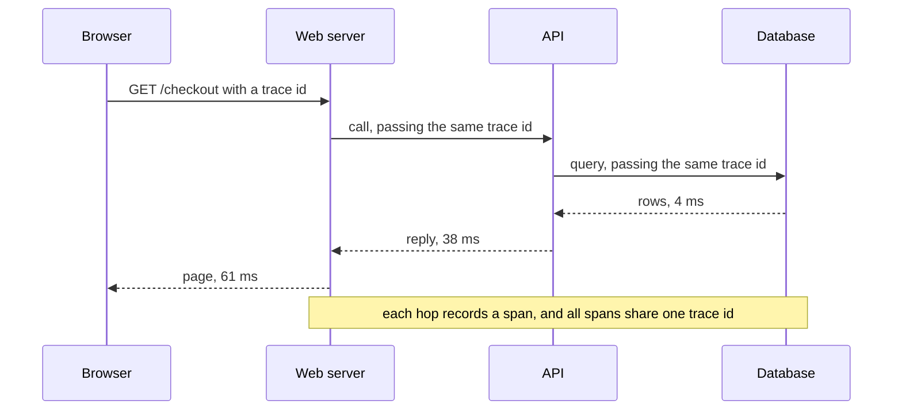

<Info>

**In short:** *Telemetry* is data a program sends out about itself: what it did,
how long it took, what went wrong. *Observability* is being able to answer new
questions about a running system from that data. A browser test is a visitor that
triggers a lot of it, on the page (analytics scripts) and behind it (logs and
traces). That is useful for finding failures and a nuisance for speed. The
library's own logs go to standard error, are filtered with `RUST_LOG`, and can be
written as JSON.

</Info>

## The three kinds of signal

When something breaks in production nobody can attach a debugger. The system has
to leave evidence. Three kinds of evidence are standard.

| Signal | What it is | A question it answers | Looks like |
|---|---|---|---|
| **Logs** | Timestamped records of events | What happened, and in what order? | `12:01:07 ERROR payment declined order=881` |
| **Metrics** | Numbers sampled over time | How many, how fast, how often? Is it getting worse? | `http_requests_total`, 95th percentile latency |
| **Traces** | The path of one request through every service | Where did this request spend its time or fail? | A tree of timed **spans** |

They complement each other. A metric shows that errors went up at 12:00. A trace
shows one failing request went through five services and stalled in the fourth. The
log line of that fourth service says why.



*One request, one trace id. The spans show where the 61 ms went.*

### Structured logging

An old-style log line is a sentence. A **structured** log line is a record with
named fields, usually JSON, so a machine can filter and count it:

```json
{"timestamp":"2026-10-23T12:01:07Z","level":"ERROR","target":"checkout","fields":{"message":"payment declined","order":881,"trace_id":"4bf92f3577b34da6a3ce929d0e0e4736"}}
```

With fields you can ask "show every ERROR for order 881" instead of searching text.
Putting the trace id in every line ties the logs to the trace.

## OpenTelemetry

**OpenTelemetry** (OTel) is the open standard for producing and shipping all three
signals, so an application is not tied to one vendor. It has four parts:

- **An API and SDKs** for each language, which the application calls to create
  spans, counters and log records.
- **A wire format**, OTLP, for sending the data.
- **A collector**, a small program that receives, filters and forwards it.
- **A back end** (any of many) that stores it and draws the charts.

Between services, the trace id travels in an HTTP header named `traceparent`
(the W3C Trace Context standard):

```text
traceparent: 00-4bf92f3577b34da6a3ce929d0e0e4736-00f067aa0ba902b7-01
             version - trace id (16 bytes) - parent span id - flags
```

Browsers can take part too: a script on the page can start a span and add that
header to the `fetch` calls it makes, so a trace begins at the click. For a tester
that header is a handy handle. Note the trace id of a failing run and an engineer
can pull up exactly that request.

## Real-user and synthetic monitoring

There are two ways to watch a site from the outside.

| | Real-user monitoring (RUM) | Synthetic monitoring |
|---|---|---|
| Who generates the traffic | Real visitors | A script on a schedule |
| How it collects | A script in the page reports timings and errors | A robot runs a scenario and records the result |
| Strength | Shows what people really experience, on real devices and networks | Works when nobody is visiting, repeatable, tests flows you choose |
| Weakness | Nothing to see when there is no traffic; noisy | Only covers what you scripted |
| Typical measures | Page load, interaction delay, layout shift | Did the login work? How long did the checkout take? |

A browser test suite **is** synthetic monitoring when it runs on a schedule against
production. The same script, run once in CI, is just a test.

## Analytics and tracking scripts

Most commercial sites load third-party scripts that measure visitors: page-view
counters, tag managers, advertising pixels, session-replay tools, A/B testing
services, and the RUM scripts above. They work in a few ways:

- A script runs in the page and listens for clicks, scrolls and page changes.
- It sends the data out as a small request, often a *beacon*
  (`navigator.sendBeacon`) or an image request for a 1-pixel image.
- It sets cookies or storage entries that mark the visitor.

Each one adds requests, scripts to download and run, and sometimes a pop-up.

### Consent banners

Privacy laws such as the GDPR in Europe require a site to ask before it sets
non-essential cookies or tracking. So a visitor from there meets a **consent
banner** or dialog on the first visit, and the scripts above are held back until
they click Accept. The banner is a real part of the page, often fixed to the
bottom or covering the whole screen, and it is a common reason that a click lands
on the wrong element or does nothing.

### What trackers do to a test

| Effect | Why it hurts |
|---|---|
| Slower page loads | More requests and scripts before the page settles |
| A page that never goes quiet | Beacons and polling keep the network busy, so "wait for idle" waits forever |
| Overlays | A consent dialog or a chat widget covers the element the test wants |
| Flaky timing | Third-party servers are slow or down at random, and they are not yours to fix |
| Polluted data | Test visits are counted as real visitors in the analytics dashboard |

<Tip>

Four fixes, from simplest to most work: **block** the tracker requests so they
never load; **accept consent** once and reuse the stored cookies; ask the site's
developers for a **test flag** that turns the scripts off; and **mark** test
traffic with a header so analytics can filter it out.

</Tip>

Blocking is also why a test can run faster. A page that does not fetch an ad
network, a tag manager and a font has fewer slow dependencies and settles sooner.
Be careful that you do not block something the page needs: a blocked script that
the page waits for can hang a feature.

## Looking at what the page reports

The browser already records a lot, and a test can read it.

- **The console.** Errors and warnings a page logs show up as `Runtime.consoleAPICalled`
  events in [the DevTools Protocol](/concepts/cdp). A page that logs a red error
  when the test passes is worth noticing.
- **Failed requests.** A 404 for a script or a blocked tracker is a clue, not
  always a bug.
- **Timings.** The `performance` object in the page has navigation and resource
  timings, which a script can read and a test can assert on.

See [the network](/concepts/network) for requests and responses and
[JavaScript and events](/concepts/javascript-and-events) for the page side.

## How seleniumbase-rs deals with it

### Blocking and marking

- **The block-resources plugin.** `BlockResources::images_and_fonts()`,
  `BlockResources::media()` and `BlockResources::patterns(...)` stop a page from
  loading some resources by sending `Network.setBlockedURLs`. A pattern such as
  `*://ads.example.com/*` blocks one host. See
  [block-resources](/plugins/block-resources).
- **Rules on one page.** `Page::intercept` takes `Rule` values, so
  `Rule::block().url("*://www.google-analytics.com/*")` drops a tracker's requests
  and `Rule::modify().set_header("X-Test-Run", "42")` marks the rest. The returned
  `Interception` keeps a log of the requests it saw.
- **Recording.** `Page::start_har` returns a `HarRecorder` that records the page's
  traffic as a HAR 1.2 file, to see exactly which third parties a page calls.
- **The MCP tools.** The `get_console_messages` and `get_failed_requests` tools
  hand an assistant the console and the failed requests of the current page.

### The library's own logs

The crate logs with the `tracing` crate, set up by `src/tracing_util.rs`. A few
properties are worth knowing.

- **Standard error, never standard output.** Standard output is for what a program
  produces: the answer of an `sbrs` command, or the JSON-RPC messages of
  `sbrs-mcp`, which a log line would break.
- **Colour only on a terminal.** It is used only when standard error is a terminal,
  `NO_COLOR` is not set and `TERM` is not `dumb`; JSON logs are never coloured. By
  default a line has no span context (`new:connect:`); `RUST_LOG` or `SB_LOG_LEVEL`
  brings it back.
- **Old `log` records are kept.** The `log` crate's records are bridged into
  `tracing`, so libraries that use it show up too.
- **A second call is ignored.** Initialising twice in one process is harmless.

<Tabs>

<Tab title="In your program" icon="code">

`init_tracing()` installs a readable text subscriber and `init_tracing_json()` a
JSON one. Both read `RUST_LOG` and default to `info`.

```rust,ignore src/main.rs
use seleniumbase_rs::tracing_util;

fn main() {
    tracing_util::init_tracing();
    // or, for JSON lines on standard error:
    // tracing_util::init_tracing_json();
}
```

</Tab>

<Tab title="From the environment" icon="terminal">

`init_tracing_from_runtime` takes a `RuntimeConfig`, which reads `SB_LOG_LEVEL`
and `SB_LOG_FORMAT`. The filter is `SB_LOG_LEVEL`, else `RUST_LOG`, else `info`; a
value that does not parse falls through to the next. `SB_LOG_FORMAT` is `pretty`
(the default) or `json`, and anything else is rejected as an invalid
configuration. The `sbrs` and `sbrs-mcp` programs call it at start-up.

```sh Terminal
SB_LOG_LEVEL=debug sbrs COMMAND            # more detail from every part
SB_LOG_FORMAT=json sbrs-mcp --server cdp   # JSON lines on standard error
```

</Tab>

<Tab title="Filters" icon="filter">

A filter is a comma-separated list of targets and levels, the same syntax as
`RUST_LOG`: a bare level applies everywhere, and `seleniumbase_rs=debug,info`
means debug for this crate and info for everything else.

```sh Terminal
RUST_LOG=seleniumbase_rs=debug cargo test -- --nocapture
RUST_LOG=warn cargo run --example my_test
```

</Tab>

</Tabs>

<Note>

Two opt-in features add more. `full-tracing` adds histogram timing of spans and
events (through `tracing-timing`), and `tokio-console` adds a layer that the
`tokio-console` tool can attach to on `127.0.0.1:6669`. Neither is on by default.

</Note>

Treating logs as an event stream, written to a stream and routed by the
environment, is factor XI of the twelve-factor method, and it is why the level and
format come from environment variables rather than from a file inside the program.

<Warning>

Do not log secrets. A test that types a password or reads a token must not print
it, and a JSON log shipped to a shared back end keeps it for a long time. The MCP
server's debug bundle leaves out typed text and scripts for the same reason.

</Warning>

## Where to go next

<Columns cols={2}>

<Card title="The network" icon="network-wired" color="#1a85d4" href="/concepts/network">
  Requests, interception, blocking and HAR.
</Card>

<Card title="block-resources" icon="ban" color="#d47628" href="/plugins/block-resources">
  The plugin that blocks images, fonts, media and chosen hosts.
</Card>

<Card title="Sessions, cookies and storage" icon="database" color="#199f43" href="/concepts/sessions-and-state">
  Where a consent choice and a visitor id are kept.
</Card>

<Card title="Frontends, backends and APIs" icon="server" color="#a631be" href="/concepts/frontends-backends-and-apis">
  The server side that these logs and traces describe.
</Card>

</Columns>
