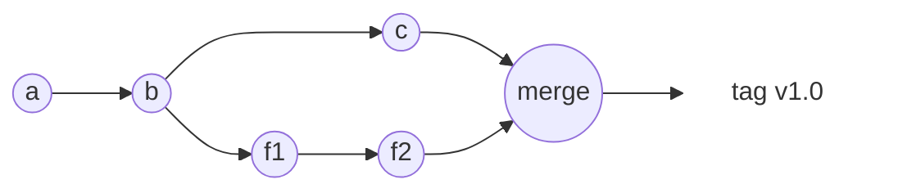
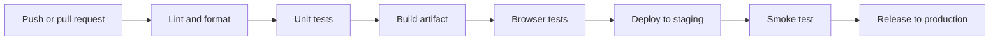

<Info>

**In short:** Git records every change to the code. A CI system (continuous
integration) builds and tests each change automatically. A CD system
(continuous delivery or deployment) moves the tested result to servers or to
users. Browser tests are one of the checks in that chain, and they behave best
when the chain is predictable.

</Info>

## Git in five ideas

**Git** is a version control system: it keeps the history of a project and lets
many people change it at once.

- A **commit** is a snapshot of all files plus a message and the identity of the
  parent commit. Its id is a hash of its content, so history cannot be changed
  without every later id changing.
- A **branch** is a movable name for a commit. Work on a feature happens on its
  own branch, so `main` stays working.
- A **merge** joins two branches. A **fast-forward** merge just moves a name
  ahead when there is nothing to combine; a **rebase** replays your commits on
  top of a newer base.
- A **remote** is a copy of the repository on another machine, usually called
  `origin`. You **fetch** to learn what is new, and **push** to publish.
- A **tag** is a permanent name for one commit, such as `v0.6.0`. Releases are
  tags.



*Two lines of work, `main` along the top and a feature branch below, joined by a
merge and then tagged.*

| Task | Command |
|---|---|
| See what changed | `git status`, `git diff` |
| Start a branch | `git switch -c fix-login` |
| Save work | `git add FILE`, then `git commit -m "fix(login): ..."` |
| Get the news | `git fetch origin` |
| Update `main` safely | `git merge --ff-only origin/main` |
| Publish | `git push origin fix-login` |
| Read history | `git log --oneline` |

Good habits make the history useful: commits that are **small and about one
thing**, messages in a fixed style such as *Conventional Commits*
(`feat(browser): ...`, `fix(cli): ...`, `docs: ...`), a **pull request** for
review before a branch reaches `main`, and a rule never to rewrite history that
others have already pulled. Secrets such as passwords and tokens never go into a
commit: once pushed, they must be treated as leaked even after deletion.

**Versions** usually follow *semantic versioning*, `MAJOR.MINOR.PATCH`: a patch
fixes bugs, a minor adds features, and a major may break users' code. While the
major number is 0, as for this project, the minor number is allowed to break
things. A **changelog** lists what changed in each version for humans.

## Continuous integration

**Continuous integration (CI)** means that every push or pull request is built
and tested by a machine, so a mistake shows up within minutes instead of at
release time. **Continuous delivery** adds a pipeline that keeps the result ready
to release; **continuous deployment** goes further and releases every passing
change by itself.



*A typical pipeline. Each stage must pass before the next starts.*

### GitHub Actions as the example

GitHub Actions is the CI system built into GitHub. A **workflow** is a YAML file
in `.github/workflows/`. Its words:

- **Event** (`on:`): what starts it, such as `push`, `pull_request` or a
  `schedule` in cron syntax.
- **Job**: a group of steps that runs on one fresh machine. Jobs run in parallel
  unless one lists another under `needs`.
- **Runner** (`runs-on`): the machine, such as `ubuntu-latest`, `macos-latest`
  or `windows-latest`.
- **Step**: one command (`run`) or one reusable **action** (`uses`).
- **Matrix**: the same job repeated for each combination, such as three
  operating systems.
- **Cache** and **artifact**: a cache keeps downloads for the next run; an
  artifact keeps a result, such as screenshots, after the machine is gone.
- **Secret**: a stored value, such as a token, handed to the job as an
  environment variable and hidden in logs.

```yaml
name: CI
on:
  push:
    branches: [main]
  pull_request:
jobs:
  browser-tests:
    runs-on: ubuntu-latest
    steps:
      - uses: actions/checkout@v4
      - run: google-chrome --version
      - run: cargo test -- --ignored
      - uses: actions/upload-artifact@v4
        if: failure()
        with:
          name: screenshots
          path: artifacts/
```

## Environments and deployment

Code passes through **environments**, copies of the system that differ in
purpose: **development** (your machine), **staging** or *pre-production* (a copy
that looks like production, for the last checks) and **production** (the real
one). They should be as similar as possible; what differs, such as addresses
and keys, is kept in **configuration** (environment variables or secret stores)
and never written into the code. Many teams also create a short-lived **preview
environment** for each pull request.

A **deployment strategy** says how a new version replaces the old one.

| Strategy | How it works | Good | Watch out for |
|---|---|---|---|
| **Recreate** | Stop the old version, start the new | Simplest | Downtime |
| **Rolling** | Replace servers a few at a time | No downtime, little extra cost | Old and new run together for a while |
| **Blue-green** | Run the new version (green) beside the old (blue), then switch the traffic at once | Instant switch and instant rollback | Twice the servers during the switch |
| **Canary** | Send a small share of users (say 5 percent) to the new version, watch, then widen | Limits the damage of a bad release | Needs good monitoring |
| **Feature flag** | Ship the code switched off, turn it on later or for some users | Separates deploy from release | Old flags must be removed |

Whatever the strategy, plan the **rollback**: how to return to the last good
version, and whether a database change can be undone. Changes to a database
schema should be written so that both the old and the new code can use them
during the rollout.

## Where browser tests run

Browser tests are slower and less stable than unit tests, so they get their own
place in the pipeline.

1. **On every pull request**: a small set of *smoke tests* that open the key
   pages and check they work. Keep this under a few minutes.
2. **Nightly**: the full end-to-end suite, on a schedule, since it takes too long
   for every push.
3. **After a deployment**: a few read-only checks against staging or production
   to prove the release is alive.

Practical points:

- GitHub-hosted Linux runners already have Chrome and chromedriver installed;
  elsewhere, use a [container](/concepts/containers) with the browser in it.
- A CI machine has no screen, so run the browser **headless**.
- Save **screenshots, page source and console logs** as artifacts when a test
  fails, because you cannot attach a debugger to a machine that is gone (see
  [developer tools](/concepts/developer-tools)).
- Keep tests independent so they can run in parallel, and treat a retry as a
  warning about a flaky test, not as a cure.
- Make a test wait for a condition rather than for a fixed time; CI machines are
  slower than yours.

<Warning>

Tests that run against production must not change real data. Use read-only
checks or a dedicated test account, and never place real credentials in the
repository. Pass them as secrets.

</Warning>

## How seleniumbase-rs uses it

**CI.** The workflow `.github/workflows/ci.yml` runs on every push and pull
request to `main` (or `master`), and also every day at 06:00 UTC. A
`concurrency` setting cancels an older run of the same branch when a newer push
arrives. Its jobs:

| Job | What it checks |
|---|---|
| `browser-smoke` | On Ubuntu, with the Chrome and chromedriver that the runner has installed, runs the real-browser tests of the `browser_smoke` test binary (`cargo test -p seleniumbase-rs --test browser_smoke -- --ignored`) |
| `check` | A matrix of Ubuntu, macOS and Windows with several feature sets: build, test, `clippy -D warnings` and `cargo fmt --check` |
| `library` | The library alone with its default features, and the command line without its default features. It also fails if a command-line crate sneaks into the library's dependencies |
| `msrv` | Compiles with Rust 1.99, the version declared in `Cargo.toml` and used in the Dockerfile |
| `tauri-example` | Builds and tests the example that has its own manifest |
| `supply-chain` | `cargo-deny`: advisories, licenses, bans and sources |
| `docs` | Builds the documentation with `mdbook`; only a push to `main` publishes it to GitHub Pages |

The real-browser tests are marked `#[ignore]`, so a plain `cargo test` stays
fast and needs no browser; the CI job (and a developer, one test binary at a time)
asks for them with `--ignored`. There are also workflows for the Docker image
(`docker.yml`) and the shell completions (`completions.yml`).

**Releases.** The steps are in `docs/contributing/releasing.md`. They are done
**by hand** from `main` at the moment, because GitHub Actions cannot run for the
repository (a billing limit), so no workflow builds the release binaries:

<Steps>

<Step title="Start from a current main" icon="code-branch">

`git fetch`, then a fast-forward-only merge of `origin/main`.

</Step>

<Step title="Set the version and close the changelog" icon="tag">

`cargo set-version` changes both packages; the `[Unreleased]` block of the
changelog becomes the new version, and generated files (the CLI completions, the
API index and the parity tables) are written again. One commit, titled
`chore(release): X.Y.Z`.

</Step>

<Step title="Gate the exact commit" icon="shield-halved">

The same checks as CI, run locally: `cargo fmt --check`, `clippy -D warnings`,
`cargo nextest run`, the doc tests, `cargo audit` and `cargo deny check`,
`trufflehog` and `ripsecrets` for secrets, `just mdx` and `mdbook build`.

</Step>

<Step title="Publish and tag" icon="upload">

Check that `origin/main` is an ancestor of the commit, push **that commit** to
`main` with no force, and push an annotated tag `vX.Y.Z`.

</Step>

<Step title="Build, release, distribute" icon="box">

Build the macOS arm64 binary, create the GitHub release with `gh release create`
and the changelog block as notes, and update the Homebrew formula in the tap
repository with the new source archive and its SHA-256. Other platforms install
from source with `cargo install --git ... --tag vX.Y.Z`.

</Step>

</Steps>

The idea is the one from the pipeline above: one commit goes through the gate,
and **that same commit** is tagged, built and published, so what users receive is
what was tested.

<Note>

The library has no API for CI or Git; it is a thing that CI runs. What it offers
for CI is a choice of headless runs, screenshots and page sources for failure
artifacts, and a container image (see [containers](/concepts/containers)).

</Note>

## Where to go next

<Columns cols={2}>

<Card title="Containers" icon="box" href="/concepts/containers">
  A browser in a Docker image, the same on every machine.
</Card>

<Card title="Developer tools" icon="wrench" href="/concepts/developer-tools">
  Inspecting a failure once you have its logs.
</Card>

<Card title="Browser architecture" icon="sitemap" href="/concepts/browser-architecture">
  Why a browser needs memory and how headless differs.
</Card>

<Card title="The DevTools Protocol" icon="bolt" href="/concepts/cdp">
  The engine behind most of the failure artifacts.
</Card>

</Columns>
