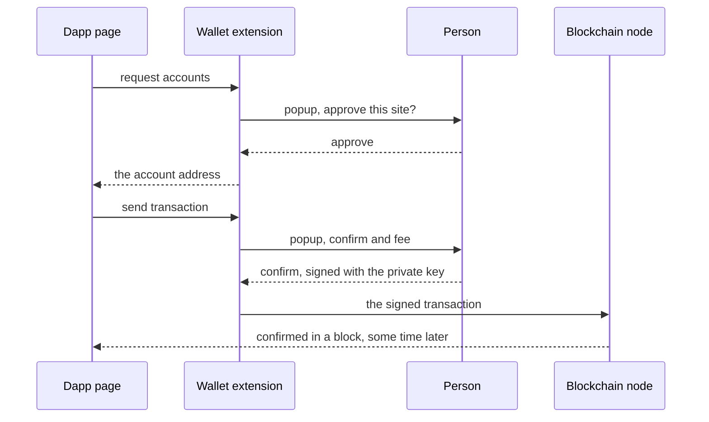
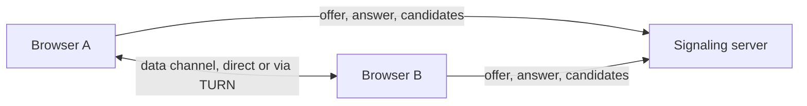
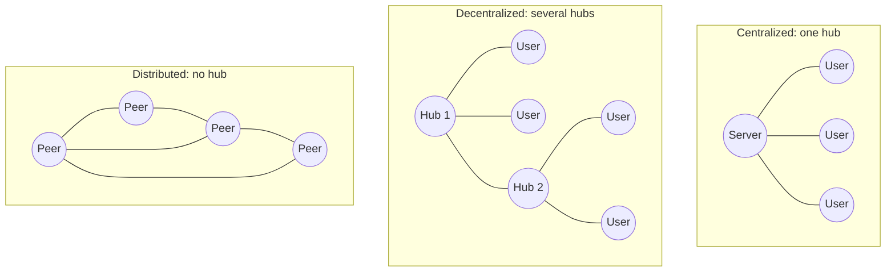

<Info>

**In short:** the web has been built in layers of ideas. Early pages were
documents, then pages became applications run by a few big platforms, and a
newer family of projects tries to move parts of that work onto the users'
computers. Each idea changes what a test has to deal with. This page describes
the technology and does not judge it.

</Info>

## Three eras

The names "Web 1.0", "Web 2.0" and "Web3" are labels people use, not versions
with release dates. They are useful for seeing **where the data and the control
sit**.

| | Web 1.0 | Web 2.0 | Web3 |
|---|---|---|---|
| Rough period | 1990s to early 2000s | Mid 2000s onwards | Late 2010s onwards |
| What a page is | A document | An application | An application that talks to a shared ledger |
| Who writes the content | The site owner | The users, on a platform | The users, with data they hold themselves |
| Where the data lives | Files on one server | The platform's database | A blockchain and other shared networks |
| How you are known | Not at all | An account with the platform | A cryptographic key held in a wallet |
| Technology | HTML, links, forms | JavaScript, AJAX, APIs, [frameworks](/concepts/frameworks-and-the-dom) | Wallet extensions, smart contracts, content addressing |
| Test difficulty | A static DOM | A DOM that changes after load | A DOM that depends on an extension and a slow network |

### Web 1.0: documents

A page was a file on a server. The browser asked for it, the server sent it, and
the browser showed it. Links connected pages; forms were the only way to send
anything back, and each submit loaded a new page. This is the model described in
[how a page loads](/concepts/how-a-page-loads), and it is the easiest thing to
automate: after the load event, the page is final.

### Web 2.0: applications on platforms

JavaScript changed the page from something you read into something you use.
`XMLHttpRequest` and later `fetch` let a page ask for data in the background, so
a feed can grow, a form can validate as you type and a map can scroll without
reloading. At the same time, large **platforms** appeared that host the content
of millions of people and know each of them by an account. The browser side is
covered in [frontends, backends and APIs](/concepts/frontends-backends-and-apis).
For tests, the page is never really "done", so tests wait for elements and
conditions instead of for the load event.

### Web3: keys and shared ledgers

"Web3" names the idea that applications can run against **public, shared
networks** that no single company operates, and that a person proves who they
are with a key instead of an account. The main parts:

- A **blockchain** is a ledger, a list of records grouped into blocks, copied
  across many computers. A new block is accepted by rules all computers apply, and
  old blocks are chained to new ones by hashes, so changing history is made
  evident.
- A **wallet** holds the keys. The **private key** (often written as a list of
  recovery words, the *seed phrase*) can sign; the **address** is derived from the
  public key and is safe to share.
- A **transaction** is a signed instruction, such as "send this amount" or "call
  this function". Sending one usually costs a fee and must be included in a block
  before it counts, which takes seconds to minutes.
- A **smart contract** is a program stored on the chain that runs when a
  transaction calls it. A **dapp** is a web page whose buttons call such
  contracts.
- A **testnet** is a separate network with worthless coins, made for trying
  things out.

### How a page talks to a wallet

Most wallets for browsers are [extensions](/concepts/browser-extensions), such as
MetaMask. An extension adds an object to every page, `window.ethereum` for
Ethereum-style wallets, and the page asks it for things:

```js
const accounts = await window.ethereum.request({ method: "eth_requestAccounts" });
console.log("connected as", accounts[0]);
```

The wallet does not answer by itself. It opens its **own popup window** and waits
for the person to approve. Only then does the promise resolve. Signing and
sending a transaction open the same kind of popup.



*A dapp never sees the private key. It receives a signature and an address.*

## Peer-to-peer

In a **client-server** system, every client talks to a server. In a
**peer-to-peer** (P2P) system, the computers talk to each other, and each one is
both client and server for the others. Three technologies show the idea.

### BitTorrent

A file is cut into pieces, and each piece has a hash so it can be checked. People
who already have pieces (**seeders**) send them to people who need them
(**leechers**), and a downloader gets different pieces from many peers at once.
A **magnet link** carries the hash of the file's description, and peers are found
through a **tracker** (a server that lists them) or a **distributed hash table**
(DHT, a lookup spread across the peers themselves). The more people share a file,
the faster it is for everyone, which is the opposite of a single overloaded
server.

### WebRTC and data channels

**WebRTC** is the browser's built-in way to connect two browsers directly. It was
built for calls, and it also offers an `RTCDataChannel` for any data, such as
chat, game state or file transfer, with options for ordered or unordered
and reliable or unreliable delivery. Two browsers behind home routers cannot
simply connect, so they go through three steps:

1. **Signaling.** They swap descriptions of themselves (the *offer* and the
   *answer*) through any channel they both reach, usually the site's own server.
   WebRTC does not define this part.
2. **ICE.** Each side collects *candidates*, the possible addresses at which it
   can be reached. A **STUN** server tells a browser its public address as seen
   from outside. If no direct path works, a **TURN** server relays the data.
3. **Connect.** The best working pair of candidates is used, over UDP, with
   encryption always on.



*The server only introduces the two browsers. The data does not pass through it.*

### IPFS: addressing by content

A normal URL says **where** something is: this server, this path. If the server
changes the file or disappears, the address is useless. **IPFS** (InterPlanetary
File System) names a file by **what it is**: its **CID** (content identifier),
which comes from a hash of the bytes. Anyone who holds the content can serve it,
and the receiver can check the bytes against the CID, so a changed file would
have a different name. Peers find each other with a DHT, and a node that wants a
file to stay available **pins** it. Because ordinary browsers cannot speak the
network directly, a **gateway** serves it over HTTPS at an address such as
`https://gateway.example/ipfs/CID`.

## Centralized, decentralized, distributed

These three words are used loosely, but their original meanings are about how
many hubs a system has.



*Three shapes. The step from one to the next removes a single point of control and a
single point of failure.*

| | Centralized | Decentralized | Distributed |
|---|---|---|---|
| Example | A social network, a bank's website | E-mail, federated chat | BitTorrent, a public blockchain |
| Control | One operator | Several operators who interoperate | The rules of the protocol |
| If one part fails | Everything stops | Part of the network stops | The rest carries on |
| Cost | Cheap to run and to change | Needs agreed standards | Slower, more complex, harder to change |

<Note>

Real products are mixtures. A "decentralized" application often has a front end
served from one ordinary web server, and reads the chain through a company that
runs nodes. Always look at which parts are shared and which are not before you
rely on a claim about it.

</Note>

## What this means for automation

- **Web 1.0 pages** need few waits. **Web 2.0 pages** need waits for elements and
  for the [JavaScript](/concepts/javascript-and-events) to finish.
- **A dapp adds an extension and a network you do not control.** The wallet
  popup is another window of the browser, so a test has to switch to it, approve
  and switch back. A transaction that waits for a block takes real time, and
  that time varies, so poll for the result with a generous timeout.
- **Use a testnet or a local development chain, and throwaway keys.** Never put a
  real seed phrase into a test, a script, a log or a repository.
- **A page can replace the wallet.** A script injected before the page's own
  scripts can define a fake `window.ethereum` that answers instantly. That tests
  the page's logic without a popup, and it leaves the real wallet flow to a few
  separate tests.
- **WebRTC reveals addresses.** The candidates in step two of the connection list
  the machine's addresses, which is why a privacy-minded setup restricts them (see
  [detection](/concepts/detection)).

<Warning>

Treat anything that holds value as production. A wallet extension that is
connected to a real network with real funds does not belong in an automated
run. Create a new browser profile for tests, with a new wallet on a testnet.

</Warning>

## How seleniumbase-rs uses it

The library has **no wallet, blockchain or IPFS API**. What it offers are the
general pieces that these tests are built from.

- **Loading an extension.** `LaunchOptionsBuilder::extension(dir)` of the pure
  CDP engine starts the browser with an unpacked extension, and
  `Browser::extension_ids()` lists the extensions the browser holds. The command
  line has `--extension-dir` for the same purpose. See
  [browser extensions](/concepts/browser-extensions) for how loading works.
- **A fake provider.** `Page::execute` sends any [CDP](/concepts/cdp) command,
  including `Page.addScriptToEvaluateOnNewDocument`, which runs a script before
  the page's own scripts and can define the stand-in `window.ethereum`.
- **WebRTC.** A page can open an `RTCPeerConnection` without asking.
  `LaunchOptionsBuilder::shield_webrtc(true)` and `Page::shield_webrtc` make
  WebRTC relay-only, so no local candidates are gathered, and
  `Page::webrtc_report()` checks the result: its `is_clean()` is true when
  nothing leaked.

```rust,ignore src/main.rs
use serde_json::json;
use seleniumbase_rs::sb_cdp::{Browser, LaunchOptions};

let browser = Browser::launch(LaunchOptions::builder().headless(true).build()?).await?;
let page = browser.default_page().await?;

// Define a stand-in wallet before any script of the page runs.
page.execute(
    "Page.addScriptToEvaluateOnNewDocument",
    json!({ "source": "window.ethereum = { request: async () => ['0xTEST'] };" }),
)
.await?;
page.goto("localhost:3000").await?;
```

## Where to go next

<Columns cols={2}>

<Card title="Browser extensions" icon="puzzle-piece" href="/concepts/browser-extensions">
  Manifest, service worker, content scripts and loading one in a test.
</Card>

<Card title="Modern web" icon="rocket" href="/concepts/modern-web">
  WebSockets, service workers and progressive web apps.
</Card>

<Card title="Detection and spoofing" icon="mask" href="/concepts/detection">
  Why a page cares what a browser reveals.
</Card>

<Card title="TCP, sockets and streams" icon="network-wired" href="/concepts/tcp-and-streams">
  The UDP and connection layers under WebRTC.
</Card>

</Columns>
