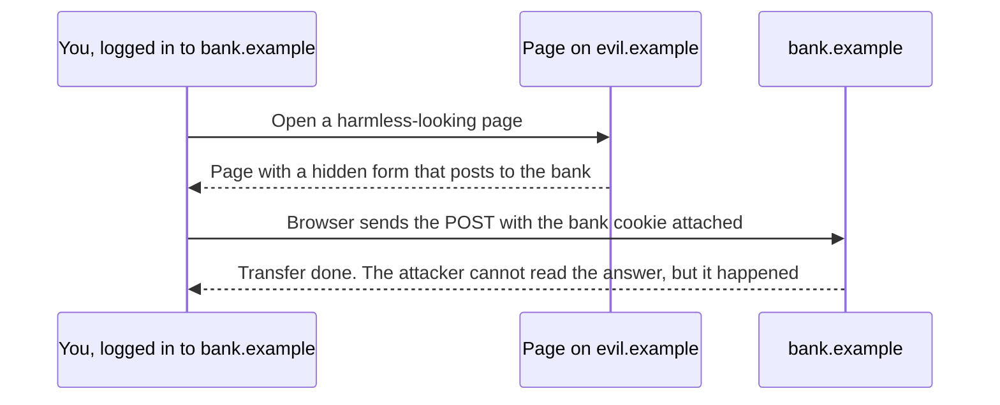

<Info>

**In short:** most web attacks are not clever. They are a site trusting
something it should have checked: text typed into a form, a number in a URL, a
request that "looks like" it came from the user, a library nobody updated. This
page names the common ones in plain words, shows where a test can catch them,
and says clearly where testing stops and permission starts.

</Info>

<Warning>

**Only test systems you are authorized to test.** Your own application, a test
environment you were given, or a target whose owner has said in writing that
you may. Sending attack-shaped input to someone else's site is a crime in many
countries, even if you "only looked". Browser automation makes it easy to send
thousands of requests; that is a reason for more care, not less.

</Warning>

## The OWASP Top 10

**OWASP** is a non-profit that publishes a ranked list of the most common web
application risks, the **Top 10**. It is the usual starting vocabulary for
security talks and audits. The 2025 edition names these:

| # | Name | In plain words |
|---|---|---|
| A01 | Broken access control | A user can do or see something they should not |
| A02 | Security misconfiguration | Default passwords, debug pages, open storage, missing headers |
| A03 | Software supply chain failures | A library, tool or build step you depend on is vulnerable or hostile |
| A04 | Cryptographic failures | Secrets sent or stored without proper encryption |
| A05 | Injection | Input is treated as a command: SQL, shell, script |
| A06 | Insecure design | The feature is built so it cannot be made safe |
| A07 | Authentication failures | Weak logins, guessable resets, sessions that never end |
| A08 | Software or data integrity failures | Updates, plugins or data accepted without checking where they came from |
| A09 | Logging and alerting failures | An attack happens and nobody notices |
| A10 | Mishandling of exceptional conditions | Errors that leak secrets or leave the system open |

The sections below go through the ones a browser test touches most.

## Injection

**Injection** happens when a program builds a command out of text it received
and the text contains command syntax. The classic case is SQL.

```sql
-- The code builds this text from what the user typed in the "name" box:
SELECT * FROM users WHERE name = '<typed text>' AND active = 1;

-- A user types:  x' OR '1'='1
SELECT * FROM users WHERE name = 'x' OR '1'='1' AND active = 1;
-- The condition is now always true, so every user is returned.
```

The fix is to keep data and command apart: a **parameterized query** sends the
command and the values separately, so a value can never become syntax. The same
rule holds for shell commands (pass an argument list, not one long string), for
templates, and for any interpreter.

## Cross-site scripting (XSS)

**XSS** is injection into the *browser*. An attacker gets their JavaScript into
a page that other people view, and it runs with that site's rights: it can read
the page, send requests as the user and steal anything not marked `HttpOnly`.

- **Stored XSS**: the script is saved by the site (a comment, a profile name) and
  shown to every visitor.
- **Reflected XSS**: the script is in a link, and the site echoes it back in the
  page.
- **DOM-based XSS**: the page's own JavaScript writes untrusted text into the
  document with `innerHTML` or similar, and no server is involved.

Defences, from the inside out: **encode output** for its context (a name shown
in HTML is escaped as text, never inserted as markup); use APIs that insert text
(`textContent`); mark session cookies `HttpOnly`; and add a
[Content Security Policy](/concepts/security-policies) as a second wall.

A safe test types a harmless marker such as `"><i id="xss-marker">` into a field
and checks that the page shows it **as text**, not as an element. If a lookup of
`#xss-marker` finds an element, the input was inserted as markup.

## Cross-site request forgery (CSRF)

Browsers attach your cookies to every request to a site, whoever started the
request. **CSRF** abuses that: a hostile page makes your browser send a request
to a site where you are logged in.



*The same-origin policy hides the answer, not the request.*

Defences: a **CSRF token** (a secret per session, put in each form and checked
by the server, which a hostile page cannot read); `SameSite` cookies, which
leave the cookie off cross-site requests; and checking the `Origin` header on
requests that change data. See [forms](/concepts/forms) for how a test carries a
token, and [security policies](/concepts/security-policies) for `SameSite`.

## Clickjacking

In **clickjacking** the attacker frames your site in an invisible iframe on top
of a decoy button ("Win a prize") so that the victim's click lands on your
"Delete account" button.

The defence is to forbid framing: the header `Content-Security-Policy:
frame-ancestors 'none'` (or `'self'`), or the older `X-Frame-Options: DENY`. A
test can request the page and assert the header is there, or try to load it in
an iframe from another origin and check that the frame stays empty.

## Server-side request forgery (SSRF)

If a feature makes the **server** fetch a URL you give it (an avatar from a
link, a webhook, a "preview this page" tool), an attacker can give it an address
only the server can reach: an internal admin panel, or the cloud provider's
metadata address (`169.254.169.254`) that hands out credentials. The server
becomes the attacker's browser inside your network.

Defences: an allow-list of hosts, refusing private and link-local address
ranges (after resolving the name, and again after each redirect), and giving
the server no more network reach than it needs. In the 2025 Top 10 SSRF is part
of broken access control.

## Broken access control

Logging in proves who you are. **Access control** decides what you may do. It
breaks when the server trusts the client for that decision.

- **IDOR** (insecure direct object reference): `GET /invoices/1001` shows your
  invoice, and changing the number to `1002` shows someone else's.
- Hidden admin pages that are not linked but not protected either.
- A button hidden in the interface while the endpoint behind it accepts anyone.

This is the risk where browser tests earn their keep. Log in as an ordinary
user, then request an admin URL, or another user's record, and assert the
answer is `403` or `404`. Do the same logged out and expect a redirect to the
login page. See [authentication](/concepts/authentication) for fast logins as
different users.

## Vulnerable dependencies and the supply chain

Modern software is mostly other people's code. Your application pulls in
libraries, which pull in more; your build uses plugins and scripts; your tests
use drivers and browsers. Each is a place an attack can enter. The risks:

- A **known vulnerability** in a library you have not updated. The fix exists,
  you did not apply it.
- A **hostile or hijacked package**: a maintainer account is taken over, or a
  look-alike name (typosquatting) is published and installed by mistake.
- **Build-time code**: install scripts and build scripts run on your machine
  or CI with your secrets in reach.
- An **unmaintained** library that will never get a fix.

What helps: commit the lockfile and install only from it; pin versions on
purpose and review upgrades; run an **advisory scanner** that compares your
lockfile with a database of known problems; limit the **licences** and
**sources** you accept; remove dependencies you no longer use; and give CI jobs
only the secrets they need.

## Security headers

Many protections are a single response header. A test can read the headers of a
page and assert the set you expect.

| Header | What it gives you |
|---|---|
| `Content-Security-Policy` | Limits where scripts and other content may come from; also `frame-ancestors` |
| `Strict-Transport-Security` | Forces https for a host |
| `X-Content-Type-Options: nosniff` | Stops the browser guessing a file's type, so an uploaded text file is not run as a script |
| `Referrer-Policy` | Limits the address sent to the next site |
| `Permissions-Policy` | Switches off browser features the page does not need |
| `Cache-Control: no-store` | Keeps private pages out of caches, including the back button |
| `Set-Cookie` with `Secure`, `HttpOnly`, `SameSite` | Protects the session cookie |

Details of the first five are in [security policies](/concepts/security-policies).

## Testing security with a browser

A browser-driven suite is not a penetration test, but it is a good place for
**regression checks** of the rules you already know about:

<Steps>

<Step title="Headers and cookies" icon="list-check">

Load the main pages and assert the headers above, and that the session cookie
is `Secure` and `HttpOnly`.

</Step>

<Step title="Access rules" icon="user-lock">

For each protected page, check the answer as logged out, as an ordinary user and
as an admin.

</Step>

<Step title="Input handling" icon="keyboard">

Put harmless marker text with markup characters through each form and check it
is shown as text.

</Step>

<Step title="Sign-out and expiry" icon="right-from-bracket">

After signing out, check that the back button and a saved URL do not show
private data.

</Step>

</Steps>

For finding unknown problems use a dedicated scanner and a person who knows
the work, against a test environment. Keep the traffic away from production
data, and agree the scope and times with the owner first.

## How seleniumbase-rs uses it

The library is a testing tool and not a scanner: it has no feature that attacks a
site. What it has is care for its **own** supply chain and for the secrets that
pass through it.

<Tabs>

<Tab title="Dependencies: deny.toml" icon="box">

The file `deny.toml` configures `cargo deny check`, which the project runs with
`cargo audit` as part of its checks. It has four parts:

- **Advisories**: known vulnerabilities fail the check. A small `ignore` list
  exists, and each entry carries a written reason (for example "reached only
  through an optional, off-by-default feature") and what upstream fix to wait
  for.
- **Licenses**: an allow-list of permissive licences (MIT, Apache-2.0, BSD and
  similar). Anything else fails.
- **Bans**: `wildcards = "deny"` refuses a dependency declared as "any version",
  and `multiple-versions = "warn"` flags two copies of one crate.
- **Sources**: `unknown-registry = "deny"` and `unknown-git = "deny"`; only one
  Git repository (the plugin API) is allowed, pinned to a revision.

</Tab>

<Tab title="Secrets in logs" icon="eye-slash">

- `sb_cdp::Session` and `SessionStore` (saved logins) print **counts**, never a
  cookie or storage value, in their `Debug` output. The module's own doctest
  asserts that a secret cookie value is not in the text.
- A proxy address is shown as `<redacted>` in the launcher's debug output.
- The MCP `dev` server's environment report passes the settings it shows
  through `redact_setting`, so proxy credentials appear as `[redacted]@host:port`.
- The page-saving tool of the MCP DevTools blanks the values of form inputs in
  the HTML it writes, and reports how many it blanked (`redacted_inputs`).
- Proxy credentials go to the **proxy** only: the pure CDP engine answers a
  password prompt with them only when its source is the proxy, and hands a
  website's own `401` prompt back to the browser.
- `sbrs encrypt` reads its passphrase from an environment variable and not from
  an argument, so it stays out of shell history. See
  [encryption](/concepts/encryption).

</Tab>

<Tab title="Files an assistant may write" icon="folder-closed">

The MCP tools write only inside the output folder, and refuse absolute paths
and `..`. See [sandboxing and isolation](/concepts/sandboxing).

</Tab>

</Tabs>

<Note>

Rust removes a whole class of bugs (use of freed memory, buffer overflows) from
the library itself, but not injection, access control or a stolen password. A
safe language is one layer of the defence, not the whole of it.

</Note>

## Where to go next

<Columns cols={2}>

<Card title="Security policies" icon="lock" color="#1a85d4" href="/concepts/security-policies">
  CORS, CSP, SameSite and the other rules the browser enforces.
</Card>

<Card title="Encryption" icon="key" color="#d52c36" href="/concepts/encryption">
  Hashing, encryption, TLS and keeping secrets out of test code.
</Card>

<Card title="Authentication" icon="user-lock" color="#199f43" href="/concepts/authentication">
  Logins, tokens, MFA and fast test logins.
</Card>

<Card title="Glossary" icon="book" color="#a631be" href="/glossary">
  Short definitions of every term used in these pages.
</Card>

</Columns>
