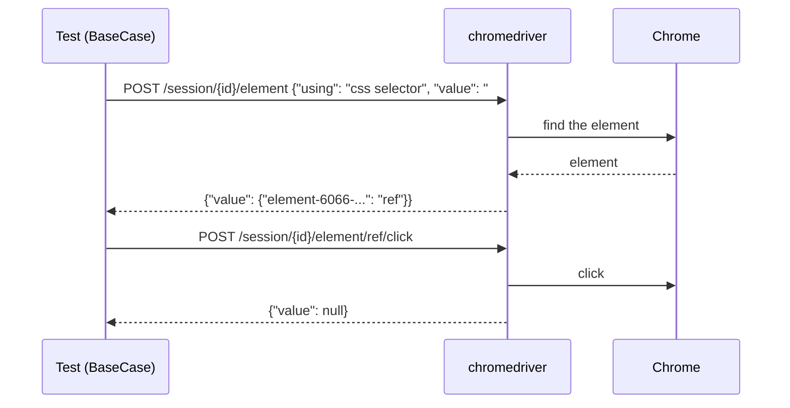
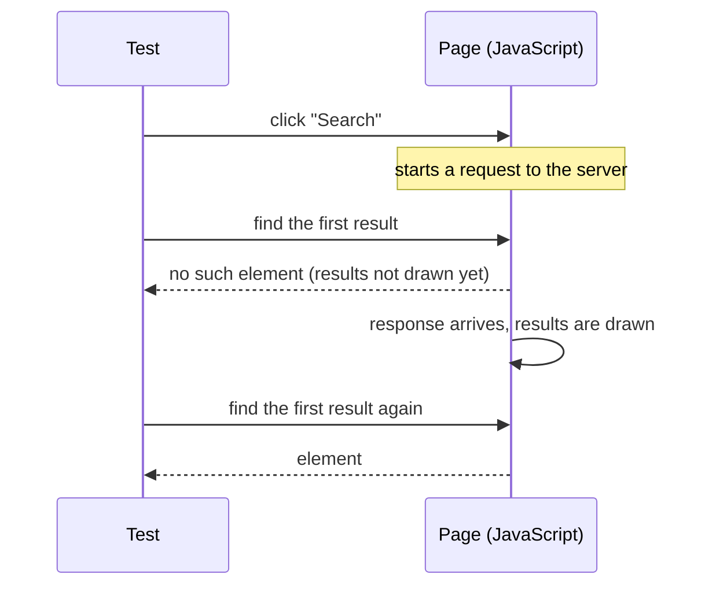

<Info>

**In short:** a WebDriver test never touches the browser itself. It sends HTTP
requests to a small program, the driver (`chromedriver` for Chrome), and the
driver controls the browser. `BaseCase` speaks this protocol; the
[pure CDP engine](/concepts/cdp) skips the driver and talks to Chrome directly.

</Info>

## Why a driver exists

A browser is built for people, not for programs. It has no public, stable way
for another program to say "open this page, click that button, tell me what the
title is". Each browser vendor therefore ships a helper, called a **driver**,
that knows how to steer that one browser from the inside:

| Browser | Driver |
|---|---|
| Chrome and Chromium | `chromedriver` |
| Edge | `msedgedriver` |
| Firefox | `geckodriver` |
| Safari | `safaridriver` |

All the drivers speak the same language to the outside world, the
<Tooltip tip="A web standard (a W3C Recommendation): JSON over HTTP, one request per command">W3C WebDriver</Tooltip>
standard. That is the whole idea: a test written against WebDriver does not care
which browser runs it. This is also the protocol that Selenium, and so
SeleniumBase, was built around.

## The three programs

| Program | Role |
|---|---|
| Your test | Calls `BaseCase` methods such as `sb.click("#go")`. It is the **client**. |
| The driver | An HTTP server on your own machine (chromedriver listens on port 9515 unless told otherwise). It turns each request into browser actions. |
| The browser | Chrome, Edge, Firefox or Safari, started and controlled by the driver. |

The client and the driver can run on different machines, which is how
[Selenium Grid](/glossary#selenium-grid) and cloud testing services work: the
"driver" is then a server somewhere else that hands your commands to a browser
it runs for you. `BaseCase` uses the `thirtyfour` crate to speak the protocol.

## The protocol: HTTP and JSON

WebDriver is deliberately plain. Every command is one HTTP request to a URL on
the driver, with a JSON body, and every reply is JSON with a `value` field. You
can talk to a driver with `curl`:

```bash
# Start chromedriver (it prints the port it listens on)
chromedriver --port=9515 &

# Command 1: New Session. The reply contains a session id.
curl -s -X POST localhost:9515/session \
  -d '{"capabilities": {"alwaysMatch": {"browserName": "chrome"}}}'

# Command 2: Navigate To. SESSION_ID comes from the reply above.
curl -s -X POST localhost:9515/session/SESSION_ID/url \
  -d '{"url": "https://example.com"}'

# Command 3: Get Title.
curl -s localhost:9515/session/SESSION_ID/title
# {"value": "Example Domain"}

# Command 4: Delete Session. The browser closes.
curl -s -X DELETE localhost:9515/session/SESSION_ID
```

These are the commands you meet most often:

| Command | Request | What it does |
|---|---|---|
| New Session | `POST /session` | Starts a browser and returns a session id. |
| Navigate To | `POST /session/{id}/url` | Opens a URL and (by default) waits for the page to load. |
| Get Title | `GET /session/{id}/title` | Returns the document title. |
| Find Element | `POST /session/{id}/element` | Looks for one element and returns a reference to it. |
| Find Elements | `POST /session/{id}/elements` | The same, for every match. |
| Element Click | `POST /session/{id}/element/{element id}/click` | Scrolls the element into view and clicks it. |
| Element Send Keys | `POST /session/{id}/element/{element id}/value` | Types text into an element. |
| Execute Script | `POST /session/{id}/execute/sync` | Runs JavaScript in the page and returns its result. |
| Perform Actions | `POST /session/{id}/actions` | Replays a sequence of pointer and keyboard actions. |
| Get All Cookies | `GET /session/{id}/cookie` | Lists the cookies visible to the current page. |
| Take Screenshot | `GET /session/{id}/screenshot` | Returns a PNG as base64. |
| Delete Session | `DELETE /session/{id}` | Ends the session and closes the browser. |

When something goes wrong, the reply carries an error object and an HTTP status
instead of a value:

```json
{"value": {"error": "no such element", "message": "no such element: Unable to locate element", "stacktrace": "..."}}
```

The standard names its errors, and you will see these constantly:

| Error | Usual meaning |
|---|---|
| `no such element` | Nothing matched the selector, at least not yet. |
| `stale element reference` | The element was found earlier, but the page has since replaced it. |
| `element not interactable` | The element exists but cannot be used: hidden, disabled, or zero-sized. |
| `element click intercepted` | Another element (an overlay, a cookie banner, a spinner) sits on top of the target. |
| `timeout` | A page load or script ran past its limit. |
| `invalid session id` | The session is gone: the browser crashed or the session was already deleted. |
| `session not created` | The driver could not start the browser, often because of a driver and browser version mismatch. |

## One command, end to end



*sb.click(&quot;#go&quot;) in a WebDriver session*

Because each step is a round trip over HTTP, with the driver relaying the
command to the browser and back, WebDriver is slower per command than the pure
CDP engine. In exchange it is the standard every browser vendor supports.

## Sessions and capabilities

A **session** is one browser started and owned by the driver. The first request
of every test run, New Session, describes the browser the client wants. That
description is called the **capabilities**:

```json
{
  "capabilities": {
    "alwaysMatch": {
      "browserName": "chrome",
      "acceptInsecureCerts": true,
      "pageLoadStrategy": "normal",
      "goog:chromeOptions": {
        "args": ["--headless=new", "--window-size=1280,800"],
        "prefs": {"intl.accept_languages": "en-US"}
      }
    }
  }
}
```

The driver starts a browser that satisfies the request and replies with a
**session id** and the capabilities the browser really has. The id goes into
every later URL. The standard capabilities are:

| Capability | Meaning |
|---|---|
| `browserName`, `browserVersion`, `platformName` | Which browser, version and operating system you want. |
| `acceptInsecureCerts` | Whether to continue past a bad or self-signed TLS certificate. |
| `pageLoadStrategy` | When "navigate" is done: `normal` (the `load` event), `eager` (the document is parsed) or `none` (return at once). |
| `proxy` | Send the browser's traffic through a proxy. See [Network](/concepts/network). |
| `timeouts` | Limits for scripts, page loads and the implicit wait. |
| `unhandledPromptBehavior` | What to do when a JavaScript `alert` is open and a command arrives. |
| `webSocketUrl` | Ask for a [BiDi](#webdriver-bidi) connection as well. |

Anything vendor-specific uses a prefix, such as `goog:chromeOptions` for
Chrome: command-line flags (`args`), browser preferences (`prefs`),
extensions, and the path of the Chrome binary. This is how headless mode, a
user agent, a window size or a profile folder reach the browser.

## Element references

When you ask for an element, the reply is not the element. A page's elements
live inside the browser; JSON can only carry text. The driver therefore keeps
the element and gives back a **reference**, an opaque id:

```json
{"value": {"element-6066-11e4-a52e-4f735466cecf": "f3a9c1e0-5b2d-4c1a-9d57"}}
```

The odd key is fixed by the standard, so every client can recognise a
reference. Later commands (`click`, `get text`) send that id back. Two things
follow:

- A reference is a handle, not a live object. If the page removes the element
  and draws a new one that looks the same (which single-page apps do all the
  time), the old handle is **stale** and the next command fails with
  `stale element reference`. The fix is to find the element again.
- Finding is a separate step from acting, so there is a gap between "it was
  there" and "I clicked it" in which the page can change.

The standard defines five ways to find an element: `css selector`,
`xpath`, `link text`, `partial link text` and `tag name`. A
[CSS selector](/glossary#css-selector) is the usual choice because it is short
and fast.

## Clicking, typing and scripts

**Element Click** is the high-level command. The driver scrolls the element into
view, checks that it is visible, enabled and not covered, then clicks its
centre through the browser's real input pipeline, so the page sees a normal
click. If the element is covered, you get `element click intercepted`.

**Perform Actions** is the low-level one: a script of pointer moves, button
presses and key presses with pauses between them. It is how drag and drop,
hover menus and key chords work.

**Execute Script** runs a piece of JavaScript inside the page and returns the
result. It is the escape hatch for anything the protocol has no command for,
such as reading `localStorage` or scrolling an element.

## Waits, and why tests flake

A page is not a still photo. After a click, the browser sends a request, the
server answers, and JavaScript draws the result, all while your test is already
asking for the next element:



The test is right and the page is right, but the order of events is a race. A
test that wins it on your laptop and loses it on a slower CI machine is
**flaky**. Nothing is wrong with either machine; the test never said what it
was waiting for. The usual causes are:

- the element has not been created yet, or exists but is still hidden by a
  spinner, an animation or an overlay;
- the element was found, then replaced by a re-render (`stale element
  reference`);
- the page is still loading scripts, so a click handler is not attached yet;
- the content sits inside an iframe or a window that the session has not
  switched to;
- a JavaScript `alert` is open and blocks every command.

WebDriver gives two tools against this:

| Wait | Where it runs | How it works |
|---|---|---|
| Implicit wait | In the driver | Every Find Element retries for up to N seconds before it reports `no such element`. It is global and easy to forget. |
| Explicit wait | In the client | The test polls a condition ("this element is visible", "the URL contains /done") until it holds or a timeout passes. |

The rule of thumb is to wait for a **condition**, never for a fixed time. A
`sleep(2)` is either too short (still flaky) or too long (slow suite). The
SeleniumBase approach is to build the wait into the action methods, so `click`
waits for its element to appear and be clickable before it acts, and tests rarely
need hand-written waits (see [Waits and Assertions](/tutorials/waits_assertions)).
[How a page loads](/concepts/how-a-page-loads) explains
why "the page loaded" does not mean "the page is ready".

## WebDriver BiDi

Classic WebDriver is **request and response only**: the client asks, the driver
answers, and the browser can never speak first. So a test cannot hear that a
console error was logged, that a request failed, or that a dialog opened,
unless it keeps asking.

**WebDriver BiDi** (bidirectional) is the newer part of the standard that fixes
this. The client opens a WebSocket to the browser (the session asks for it with
the `webSocketUrl` capability) and the two sides exchange JSON messages in both
directions, so the browser can push **events**. It is organised into modules:

| Module | What it covers |
|---|---|
| `browsingContext` | Tabs and frames: navigate, create, close; events such as `load`. |
| `script` | Run JavaScript, and add scripts that run before the page's own. |
| `network` | Watch, block and rewrite requests and responses. |
| `log` | Console messages and JavaScript errors as events. |
| `input` | Pointer and keyboard actions. |
| `storage` | Cookies. |

BiDi is the standards-based answer to what Chrome's own protocol,
[CDP](/concepts/cdp), has long offered. Firefox and Chrome both support it, and
Selenium, Puppeteer and Playwright are moving towards it. seleniumbase-rs does
not use BiDi: `BaseCase` speaks classic WebDriver, and the CDP engine and CDP
mode give Chromium the same event-style features today.

## How seleniumbase-rs uses it

`BaseCase` is the WebDriver engine of the crate. This page covers only what a
reader of the protocol needs; the steps below show how a session starts.

<Steps>

<Step title="A session starts" icon="play">

`BaseCase::new(config)` asks the driver for a new session, sending the
browser's options (headless, user agent, extensions) as capabilities. The
driver starts the browser and returns a session id.

</Step>

<Step title="Each method becomes requests" icon="arrows-left-right">

A method such as `click` first finds the element (one request), then acts on the
returned element reference (another). Every reply is JSON with a `value` field;
an error reply names a W3C error such as `no such element`.

</Step>

<Step title="The session ends" icon="stop">

`sb.quit()` deletes the session, and the driver closes the browser.

</Step>

</Steps>

### Why the driver version matters

A driver is built for one browser version: `chromedriver` 154 drives Chrome 154.
A mismatch fails when the session starts, with `session not created`.
`sbrs doctor` prints the Chrome it finds and the chromedriver it finds, with
both versions side by side.

### How a driver is found

<Steps>

<Step title="Use a running driver" icon="plug">

With the default WebDriver URL, `http://localhost:4444`, `BaseCase` first looks
for a driver already listening there. Point `--webdriver` (or the config) at
another URL to use a driver or grid you run yourself; such a driver is never
replaced.

</Step>

<Step title="Start one" icon="rocket">

If none is listening, it starts `downloaded_drivers/chromedriver` on a free port.
It does not look on your `PATH`.

</Step>

<Step title="Download it first" icon="download">

When that file is missing, it downloads the latest stable chromedriver into
`downloaded_drivers/` first. `sbrs install` does the download ahead of time.

</Step>

</Steps>

<Tip>

`chrome-headless-shell` is a separate, headless-only Chrome build that also runs
with chromedriver; choose it with `Browser::ChromeHeadlessShell` (`--browser chs`).
See [Headless and headed browsers](/tutorials/headless).

</Tip>

## Where to go next

<Columns cols={2}>

<Card title="The Chrome DevTools Protocol" icon="bolt" color="#1a85d4" href="/concepts/cdp">
  How the pure CDP engine drives Chrome without a driver.
</Card>

<Card title="How a page loads" icon="globe" color="#199f43" href="/concepts/how-a-page-loads">
  What happens between a URL and a page you can click, and why waits are needed.
</Card>

<Card title="Common problems" icon="triangle-exclamation" color="#d52c36" href="/help/common_problems">
  Driver version mismatches and other startup errors.
</Card>

<Card title="CDP mode" icon="code" color="#a631be" href="/tutorials/cdp_mode">
  DevTools commands inside a WebDriver session.
</Card>

<Card title="UC mode" icon="user-secret" color="#d47628" href="/tutorials/uc_mode">
  A WebDriver session set up to avoid common bot checks.
</Card>

</Columns>
