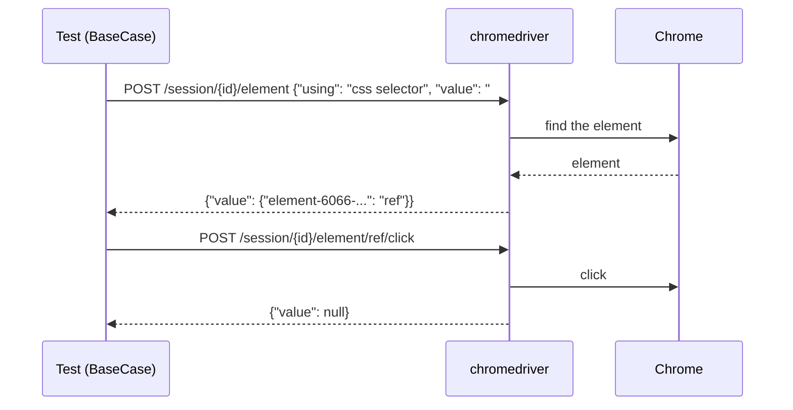

<Info>

**In short:** a WebDriver test never touches the browser itself. It sends HTTP
requests to a small program, the driver (`chromedriver` for Chrome), and the
driver controls the browser. `BaseCase` speaks this protocol; the
[pure CDP engine](/concepts/cdp) skips the driver and talks to Chrome directly.

</Info>

## The three programs

| Program | Role |
|---|---|
| Your test | Calls `BaseCase` methods such as `sb.click("#go")`. |
| The driver | `chromedriver`, `msedgedriver`, `geckodriver` or `safaridriver`: an HTTP server that turns each request into browser actions. |
| The browser | Chrome, Edge, Firefox or Safari, started and controlled by the driver. |

The protocol between the test and the driver is the W3C
<Tooltip tip="A web standard: JSON over HTTP, one request per command">WebDriver</Tooltip>
standard. `BaseCase` uses the `thirtyfour` crate to speak it.

## One command, end to end

<Frame caption="sb.click(&quot;#go&quot;) in a WebDriver session">

</Frame>

<Steps>

<Step title="A session starts" icon="play">

`BaseCase::new(config)` asks the driver for a new session, sending the
browser's options (headless, user agent, extensions) as capabilities. The
driver starts the browser and returns a session id.

</Step>

<Step title="Each method becomes requests" icon="arrows-left-right">

A method such as `click` first finds the element (one request), then acts on the
returned element reference (another). Every reply is JSON with a `value` field;
an error reply names a W3C error such as `no such element`.

</Step>

<Step title="The session ends" icon="stop">

`sb.quit()` deletes the session, and the driver closes the browser.

</Step>

</Steps>

Because each step is a round trip over HTTP, WebDriver is slower per command than
the pure CDP engine, but it is the standard every browser vendor supports.

## Why the driver version matters

A driver is built for one browser version: `chromedriver` 154 drives Chrome 154.
A mismatch fails when the session starts. `sbrs doctor` prints the Chrome it
finds and the chromedriver it finds, with both versions side by side.

## How seleniumbase-rs gets a driver

<Steps>

<Step title="Use a running driver" icon="plug">

With the default WebDriver URL, `http://localhost:4444`, `BaseCase` first looks
for a driver already listening there. Point `--webdriver` (or the config) at
another URL to use a driver or grid you run yourself; such a driver is never
replaced.

</Step>

<Step title="Start one" icon="rocket">

If none is listening, it starts `downloaded_drivers/chromedriver` on a free port.
It does not look on your `PATH`.

</Step>

<Step title="Download it first" icon="download">

When that file is missing, it downloads the latest stable chromedriver into
`downloaded_drivers/` first. `sbrs install` does the download ahead of time.

</Step>

</Steps>

<Tip>

`chrome-headless-shell` is a separate, headless-only Chrome build that also runs
with chromedriver; choose it with `Browser::ChromeHeadlessShell` (`--browser chs`).
See [Headless and headed browsers](/tutorials/headless).

</Tip>

## Where to go next

<Columns cols={2}>

<Card title="The Chrome DevTools Protocol" icon="bolt" color="#1a85d4" href="/concepts/cdp">
  How the pure CDP engine drives Chrome without a driver.
</Card>

<Card title="Common problems" icon="triangle-exclamation" color="#d52c36" href="/help/common_problems">
  Driver version mismatches and other startup errors.
</Card>

<Card title="CDP mode" icon="code" color="#199f43" href="/tutorials/cdp_mode">
  DevTools commands inside a WebDriver session.
</Card>

<Card title="UC mode" icon="user-secret" color="#a631be" href="/tutorials/uc_mode">
  A WebDriver session set up to avoid common bot checks.
</Card>

</Columns>
