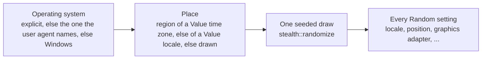

<Badge color="green" icon="circle-check">Implemented</Badge>{" "}
<Badge color="blue" icon="tag">Released in 0.5.0</Badge>{" "}
<Badge color="orange" icon="triangle-exclamation">Breaking change</Badge>

<Info>

The fingerprint API is Rust-only: it has no Python SeleniumBase counterpart, and
nothing in `parity/api.toml` changes. So this is a breaking change, listed in the
[changelog](/changelog) with a migration snippet. For how to use the API, see
[Fingerprints](/tutorials/fingerprint_stealth).

</Info>

<Visibility for="agents">

Summary for AI exports: since 0.5.0 every `Fingerprint` setting is one `Spoof<T>` (`Natural`, `Random`, `Value(T)`, `Off`); `Random` is resolved by `build()`, which returns `Result<Fingerprint, FingerprintError>`; injection behaviour lives in a separate `StealthPolicy` set through the builder. `MaskingMode`, `NoiseMode`, `PopupMode`, `ProxyMaskingMode`, `StartupBehavior`, `fills_defaults`, `geolocation_popup`, the public fields of `Fingerprint` and `FingerprintBuilder::{flags, with_flags, canvas_seed, audio_seed}` are gone.

</Visibility>

## Why

Version 1 kept every setting twice: a value (`screen_width: Option<u32>`) and a
mode that said whether to use it (`flags.screen_masking: MaskingMode`). That
allowed states that mean nothing, and it made callers say one thing in two
places:

```rust Version 1
// before: the intent is spread over a value, a flag and a mutation after build
let mut fp = Fingerprint::builder().screen(1920, 1080).build();
fp.flags.screen_masking = MaskingMode::Custom;
```

<Columns cols={3}>

<Card title="Modes that overlap" icon="clone" color="#d47628">
  `MaskingMode::Mask` and `::Custom` did the same thing in every provider, `Natural` and `Disabled` did the same thing, and `Auto` was added to paper over the rest.
</Card>

<Card title="Value and mode disagree" icon="code-compare" color="#d52c36">
  A mode could be on with no value (a generic fill nobody asked for), or a value could be given while the mode was off.
</Card>

<Card title="Identity mixed with policy" icon="layer-group" color="#a631be">
  Identity data (a time zone) and injection policy (is `toString` masked, are permissions granted) lived in the same struct.
</Card>

</Columns>

## The model

One field per setting, four states:

```rust Spoof<T>
pub enum Spoof<T> {
    Natural,    // the browser's own value (the default)
    Random,     // a random valid value, coherent with the rest, seeded by .seed(u64)
    Value(T),   // exactly this
    Off,        // the API is turned off: unavailable, or denied
}
```

| State | Means | Where |
|---|---|---|
| `Natural` | The browser's own value. The default. | Every setting |
| `Random` | A random valid value, coherent with the rest, seeded by `.seed(u64)`. Resolved by `build()`. | Every setting that has a random value |
| `Value(T)` | Exactly this value. A plain value converts to it. | Every setting |
| `Off` | The API is turned off: unavailable, or denied. | Geolocation (denied), WebRTC (unavailable), media devices (none), battery, Bluetooth, speech voices, network information and Client Hints (unavailable) |

- The value and the mode are one field, so they cannot disagree.
- `Random` is resolved by `build()`: the built `Fingerprint` holds `Natural`,
  `Value` or `Off`. A random value is drawn together with the rest of the
  identity (same operating system, same region, same locale), so it never
  contradicts a value the caller gave.
- `build()` returns an error naming any setting outside the list above that was
  given `Off`.
- Behaviour that is not a per-setting value (WebRTC IP policy, canvas and
  audio noise, native `toString`, granted permissions, blocked ports, ...) is a
  `StealthPolicy`. A policy preset never changes a setting's `Spoof`.
- The built `Fingerprint` has private fields and read accessors. To change one,
  `fp.to_builder()`, change it, `build()`.

## Before and after (public signatures)

### Setting a value

<CodeGroup>

```rust Before (v1)
FingerprintBuilder::user_agent(self, v: impl Into<String>) -> Self
FingerprintBuilder::screen(self, width: u32, height: u32) -> Self
FingerprintBuilder::geolocation(self, latitude: f64, longitude: f64) -> Self
FingerprintBuilder::webgl(self, vendor: impl Into<String>, renderer: impl Into<String>) -> Self
FingerprintBuilder::timezone(self, v: impl Into<String>) -> Self
FingerprintBuilder::build(self) -> Fingerprint
```

```rust After (v2)
FingerprintBuilder::user_agent(self, v: impl Into<Spoof<String>>) -> Self
FingerprintBuilder::screen(self, width: u32, height: u32) -> Self            // the common case
FingerprintBuilder::screen_spoof(self, v: impl Into<Spoof<ScreenSize>>) -> Self
FingerprintBuilder::geolocation(self, v: impl Into<Spoof<Geolocation>>) -> Self   // (lat, lon) works
FingerprintBuilder::webgl(self, v: impl Into<Spoof<WebGl>>) -> Self               // (vendor, renderer) works
FingerprintBuilder::timezone(self, v: impl Into<Spoof<String>>) -> Self
FingerprintBuilder::webrtc(self, v: impl Into<Spoof<WebRtcAddresses>>) -> Self
FingerprintBuilder::build(self) -> Result<Fingerprint, FingerprintError>
```

</CodeGroup>

A plain value is `Value`. `Spoof::Random`, `Spoof::Natural` and `Spoof::Off` are
accepted everywhere (`Off` is rejected by `build()` where it means nothing).
Every other setter follows the same shape: `platform`, `hardware_concurrency`,
`device_memory`, `max_touch_points`, `vendor`, `locale`, `languages`,
`accept_languages`, `pixel_ratio`, `color_depth`, `avail_screen`, `fonts`,
`media_devices`, `proxy`, `battery`, `connection`, `speech_voices`, `bluetooth`,
`client_hints`.

### Policy

<CodeGroup>

```rust Before (v1)
// a bag of flags on the fingerprint, mutated after the build
pub struct StealthFlags { pub navigator_masking: MaskingMode, /* 20 more modes */, pub native_spoofing: bool, .. }
fp.flags.native_spoofing = true;
Fingerprint::builder().flags(StealthFlags::balanced()).with_flags(|f| f.grant_permissions = true)
```

```rust After (v2)
// a separate policy type, set only through the builder
pub struct StealthPolicy { /* webrtc_policy, canvas_noise, audio_noise, native_spoofing,
                              native_tostring, chrome_runtime, headless_fixes, grant_permissions,
                              block_trackers, blocked_trackers, blocked_ports, quic, disable_csp,
                              open_shadow_roots */ }
StealthPolicy::{default(), balanced(), native_only(), max()}
StealthPolicy::grant_permissions(self, bool) -> Self      // and one setter per field
FingerprintBuilder::policy(self, p: StealthPolicy) -> Self
FingerprintBuilder::with_policy(self, f: impl Fn(StealthPolicy) -> StealthPolicy + Send + Sync + 'static) -> Self
FingerprintBuilder::{webrtc_policy, canvas_noise, audio_noise, native_spoofing, grant_permissions,
                     block_trackers, blocked_trackers, blocked_ports, disable_csp, quic} // shortcuts
Fingerprint::policy(&self) -> &StealthPolicy
```

</CodeGroup>

`StealthFlags` stays as a `#[deprecated]` alias of `StealthPolicy`.

### Reading and editing

<CodeGroup>

```rust Before (v1)
fp.user_agent: Option<String>          fp.flags.screen_masking: MaskingMode
fp.screen_width: Option<u32>           fp.is_masked(Dimension::Screen)
fp.fills_defaults(Dimension::Screen)   fp.geolocation_popup() -> PopupMode
```

```rust After (v2)
// fields are private
fp.user_agent() -> &Spoof<String>      fp.screen() -> &Spoof<ScreenSize>
fp.geolocation() -> &Spoof<Geolocation>   fp.policy() -> &StealthPolicy
fp.is_masked(Dimension::Screen)        // kept: true when the setting is not Natural
fp.to_builder() -> FingerprintBuilder
Spoof::{value(), is_natural(), is_random(), is_value(), is_off(), is_set(), as_str(), map()}
```

</CodeGroup>

### Removed

<Warning>

`MaskingMode`, `NoiseMode`, `PopupMode`, `ProxyMaskingMode`, `StartupBehavior`,
`Fingerprint::fills_defaults`, `Fingerprint::geolocation_popup`, the public
fields of `Fingerprint`, `FingerprintBuilder::{flags, with_flags, canvas_seed,
audio_seed}`. `CanvasNoiseMode` becomes `CanvasNoise`
(`Natural`, `Persistent`, `Random`, `Low`).

</Warning>

## The example that must compile

```rust Version 2
use seleniumbase_rs::stealth::fingerprint::{CanvasNoise, Fingerprint, Spoof, StealthPolicy};

let fp = Fingerprint::builder()
    .timezone("Europe/Berlin")
    .screen(1920, 1080)
    .geolocation(Spoof::Random)
    .webrtc(Spoof::Off)
    .policy(StealthPolicy::balanced())
    .canvas_noise(CanvasNoise::Random)
    .build()?;
```

<Tip>

The random position is a spot near Berlin, because the time zone is `Value`.

</Tip>

## Random: how it stays coherent



`build()` works out the operating system (the explicit one, else the one the
user agent names, else Windows), then the place: the region of a `Value` time
zone, else of a `Value` locale, else a drawn one. Every `Random` setting is taken
from one seeded draw of that machine and that place (`stealth::randomize`), so a
random locale agrees with a `Value` time zone, a random position is inside that
time zone's main city, and a random graphics adapter is one the operating system
reports. `build()` returns `FingerprintError` when no coherent value exists (a
random locale next to a time zone the place table does not know).

`.seed(u64)` seeds the draw and the canvas and audio noise, so the same calls
give the same fingerprint. Without it the draw uses fresh entropy, and the seed
it used is kept in the fingerprint.

## JSON

`Spoof<T>` serialises as `"natural"`, `"random"`, `"off"` or the value itself.
`Natural` fields are left out. `null` reads as `Natural`. A fingerprint that
holds `"random"` is resolved when it is read, the same way `build()` does it.

`ProfileParams` (external profile payloads) keeps its string flags, because the
format is another tool's, and reads the same words for every key:

| Word in the payload | Becomes |
|---|---|
| `natural`, `native`, `pass_through`, `whitelist` | `Natural` |
| `auto` | the value the payload holds, else `Natural` |
| `mask`, `spoof`, `custom`, `generic`, `random`, `noise` | the value the payload holds, else `Random` |
| `off`, `disabled`, `block`, `empty` | `Off` where an API can be off (geolocation, WebRTC, media devices); `Natural`, logged, elsewhere |
| a literal | `Value` |
| an unknown word | `Natural`, logged |

The policy keys (`canvas_noise`, `audio_masking`, `native_spoofing`,
`grant_permissions`, `disable_csp`, `quic_mode`, `ports_masking`) map to the
policy. The full table is in
[Fingerprints: words every key reads](/tutorials/fingerprint_stealth#words-every-key-reads).

## As built

<AccordionGroup>

<Accordion title="Value types" icon="cube">

The value types are `ScreenSize`, `Geolocation`, `WebGl`, `WebRtcAddresses` and
`MediaDevices` (`stealth/settings.rs`); each converts from the obvious tuple.
`languages` and `accept_languages` stay comma-separated strings, `fonts` is a
`Spoof<Vec<String>>`, and Web Bluetooth is a `Spoof<bool>` (`true`: an adapter,
`false`: none, `Off`: no API).

</Accordion>

<Accordion title="FingerprintError" icon="circle-exclamation">

`FingerprintError` has three cases: `OffNotAvailable`, `NoRandomValue` (proxy,
`oscpu`, `build_id`) and `Incoherent`.

</Accordion>

<Accordion title="Seeds" icon="seedling">

Without `.seed(..)`, a draw uses fresh entropy and a fingerprint with nothing
to draw takes a seed from its user agent, so a preset is the same every time.

</Accordion>

<Accordion title="Denied geolocation" icon="location-crosshairs">

A denied geolocation (`Off`) is scripted even under native spoofing, because
no protocol command denies the request for one tab.

</Accordion>

</AccordionGroup>

## See also

<Columns cols={2}>

<Card title="Fingerprints" icon="fingerprint" color="#1a85d4" href="/tutorials/fingerprint_stealth">
  How to build and use a fingerprint, with every setting and the policy.
</Card>

<Card title="ADR 001: Stealth architecture" icon="sitemap" color="#199f43" href="/adr/001-stealth-architecture">
  The decision record this design belongs to.
</Card>

<Card title="Changelog" icon="tag" color="#d47628" href="/changelog">
  The 0.5.0 entry, with the migration snippet.
</Card>

<Card title="Browser profiles" icon="id-card" color="#a631be" href="/tutorials/browser_profiles">
  External profile payloads and how their fields map to a fingerprint.
</Card>

</Columns>
