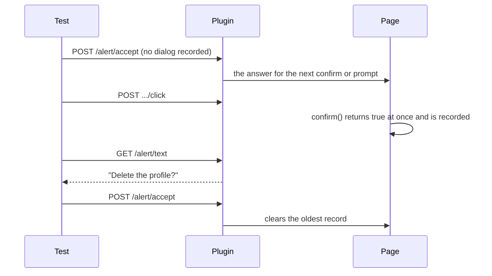

A page's `alert`, `confirm` and `prompt` stop the page until they are answered,
and a page script cannot keep them open for a client to answer later. So the
plugin replaces them in the page (and in same-origin frames) with versions that
answer at once and record the dialog. Paths follow
`http://127.0.0.1:4445/{token}`; see the
[overview](/ecosystem/tauri-api/overview) for the reply format and the errors.

<RequestExample>

```bash Set the answer
curl -s -X POST "http://127.0.0.1:4445/$TOKEN/session/$SESSION/alert/accept" -d '{}'
```

```bash Text for the next prompt
curl -s -X POST "http://127.0.0.1:4445/$TOKEN/session/$SESSION/alert/text" -d '{"text": "Bob"}'
curl -s -X POST "http://127.0.0.1:4445/$TOKEN/session/$SESSION/alert/accept" -d '{}'
```

```bash Get alert text
curl -s "http://127.0.0.1:4445/$TOKEN/session/$SESSION/alert/text"
```

```bash Clear the record
curl -s -X POST "http://127.0.0.1:4445/$TOKEN/session/$SESSION/alert/accept" -d '{}'
```

</RequestExample>

<ResponseExample>

```json 200 Get alert text
{ "value": "Delete the profile?" }
```

```json 200 Accept alert
{ "value": null }
```

```json 404 no such alert
{
  "value": {
    "error": "no such alert",
    "message": "no dialog is open: none has opened, or each was accepted or dismissed",
    "stacktrace": ""
  }
}
```

```json 500 unsupported operation
{
  "value": {
    "error": "unsupported operation",
    "message": "the confirm was dismissed when it opened, and the page cannot be answered again: accept before the confirm opens",
    "stacktrace": ""
  }
}
```

</ResponseExample>

<Badge color="green" icon="apple" stroke>Verified on macOS</Badge>

On macOS a real app answered a confirm and a prompt (with the answer set
before, and with the default dismiss), refused accepting a confirm that had
been dismissed when it opened, saw an alert leave the answer to the confirm
after it, and cleared the two in order.

## How dialogs are answered

The plugin replaces the dialogs whenever it is on (in debug builds by default),
also while no test drives the app: the app's dialogs then never show, and
answer as below. A same-origin frame gets the replacements when the next
command runs after the frame has loaded; a dialog it opens before that is the
real one.

- A confirm or prompt gets the answer the client set *before* it opened:
  `POST /alert/accept` or `POST /alert/dismiss` with no dialog recorded (the
  last one sent counts), and for a prompt `POST /alert/text` first for the
  text it returns. The first confirm or prompt uses that answer up; an alert
  needs none and leaves it for the next one. With no answer set, a confirm
  or prompt is dismissed (`false`, `null`), as W3C's default `dismiss` would.
  A prompt accepted with no text set returns its default value (the second
  argument of `prompt`), or the empty string.
- Every dialog is recorded, oldest first (the last 100 are kept), and
  `GET /alert/text` reads the oldest one's message, or `no such alert`.
- Accept or dismiss *after* a dialog opened clears the oldest record when it
  is the answer the page got (either one for an alert). The other one
  answers `unsupported operation` and keeps the record: the page already has
  its answer and cannot be given another. Sending text to a prompt that has
  opened answers `unsupported operation`, and to an alert or confirm
  `element not interactable`.
- While a dialog is recorded, accept or dismiss handles it and sets no
  answer. So clear the dialogs a test does not care about (or check
  `GET /alert/text`) before setting the answer for the next one. An answer
  that no dialog used stays set for the next confirm or prompt, however much
  later; `POST /alert/dismiss` with no dialog recorded puts the default back.
- Commands never fail with `unexpected alert open`. The dialogs and the
  answer are forgotten when the page loads another document and when a new
  session starts.



So a test that should accept a confirm accepts first, then clicks:

```rust Accept a confirm
sb.accept_alert().await?;                 // the answer for the next confirm
sb.click("#delete").await?;               // confirm(...) returns true at once
assert_eq!(sb.get_alert_text().await?, "Delete the profile?");
sb.accept_alert().await?;                 // clears the record
```

<Warning>

The usual WebDriver order, click and then accept (`wait_for_and_accept_alert`),
gets `unsupported operation` for a confirm or prompt: it was dismissed when it
opened, so the test fails there instead of going on as if it was accepted.

</Warning>

## Get alert text

<Badge color="blue">GET</Badge> `/session/{sessionId}/alert/text`

<ParamField path="sessionId" type="string" required>

The current session's id.

</ParamField>

<ResponseField name="value" type="string" required>

The message of the oldest dialog recorded (the empty string for a dialog
opened without one).

</ResponseField>

**Errors**

| Status | `error` | When |
|---|---|---|
| 404 | `no such alert` | No dialog is recorded. |

## Accept alert

<Badge color="green">POST</Badge> `/session/{sessionId}/alert/accept`

With a dialog recorded: clears the oldest one, if it was accepted when it
opened (any alert was). With none: sets *accept* as the answer for the next
confirm or prompt, with the text sent before it, if any.

<ParamField path="sessionId" type="string" required>

The current session's id.

</ParamField>

<ResponseField name="value" type="null" required>

`null`.

</ResponseField>

**Errors**

| Status | `error` | When |
|---|---|---|
| 500 | `unsupported operation` | The oldest dialog is a confirm or prompt that was dismissed when it opened. |

## Dismiss alert

<Badge color="green">POST</Badge> `/session/{sessionId}/alert/dismiss`

With a dialog recorded: clears the oldest one, if it was dismissed when it
opened (any alert can be). With none: sets *dismiss* as the answer for the
next confirm or prompt, which puts the default back.

<ParamField path="sessionId" type="string" required>

The current session's id.

</ParamField>

<ResponseField name="value" type="null" required>

`null`.

</ResponseField>

**Errors**

| Status | `error` | When |
|---|---|---|
| 500 | `unsupported operation` | The oldest dialog is a confirm or prompt that was accepted when it opened. |

## Send alert text

<Badge color="green">POST</Badge> `/session/{sessionId}/alert/text`

With no dialog recorded: keeps the text for the answer that the next
`POST /alert/accept` (or dismiss) sets, so the next prompt accepted returns
it.

<ParamField path="sessionId" type="string" required>

The current session's id.

</ParamField>

<ParamField body="text" type="string" required>

The text the next prompt returns.

</ParamField>

<ResponseField name="value" type="null" required>

`null`.

</ResponseField>

**Errors**

| Status | `error` | When |
|---|---|---|
| 400 | `invalid argument` | `text` is missing or not a string. |
| 400 | `element not interactable` | The oldest dialog recorded is an alert or a confirm (`a confirm takes no text`). |
| 500 | `unsupported operation` | The oldest dialog recorded is a prompt: it was answered when it opened. |
