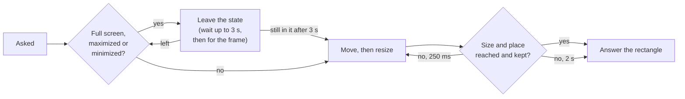

The endpoint drives one window: the one labelled `main`, or else another
window of the app. Its handle is always `main`. The rectangle comes from the
native window, not the page, which cannot tell: WKWebView reports `outerWidth`
and `outerHeight` as 0. Paths follow `http://127.0.0.1:4445/{token}`; see the
[overview](/ecosystem/tauri-api/overview) for the reply format and the errors.

<RequestExample>

```bash Get window rect
curl -s "http://127.0.0.1:4445/$TOKEN/session/$SESSION/window/rect"
```

```bash Set window rect
curl -s -X POST "http://127.0.0.1:4445/$TOKEN/session/$SESSION/window/rect" \
  -d '{"x": 0, "y": 0, "width": 900, "height": 700}'
```

```bash Maximize window
curl -s -X POST "http://127.0.0.1:4445/$TOKEN/session/$SESSION/window/maximize" -d '{}'
```

```bash Get window handles
curl -s "http://127.0.0.1:4445/$TOKEN/session/$SESSION/window/handles"
```

```bash Switch to window
curl -s -X POST "http://127.0.0.1:4445/$TOKEN/session/$SESSION/window" \
  -d '{"handle": "settings"}'
```

</RequestExample>

<ResponseExample>

```json 200 Set window rect
{
  "value": { "x": 0, "y": 30, "width": 900, "height": 700 }
}
```

```json 200 Get window handles
{ "value": ["main"] }
```

```json 400 invalid argument
{
  "value": {
    "error": "invalid argument",
    "message": "`width` must be null or a number from 0 to 2147483647",
    "stacktrace": ""
  }
}
```

```json 404 no such window
{
  "value": {
    "error": "no such window",
    "message": "the app has one window, `main`",
    "stacktrace": ""
  }
}
```

</ResponseExample>

Every command that answers a rectangle answers the window's outer rectangle in
CSS pixels, rounded to whole pixels (a scale factor such as 1.5 gives
fractions, and clients read integers):

<ResponseField name="value" type="object">

<Expandable title="properties" defaultOpen>

<ResponseField name="x" type="integer" required>

The left edge.

</ResponseField>

<ResponseField name="y" type="integer" required>

The top edge.

</ResponseField>

<ResponseField name="width" type="integer" required>

The outer width.

</ResponseField>

<ResponseField name="height" type="integer" required>

The outer height.

</ResponseField>

</Expandable>

</ResponseField>

Opening and closing windows are not served (`404 unknown command`).

## Get window handle

<Badge color="blue">GET</Badge> `/session/{sessionId}/window`

<ParamField path="sessionId" type="string" required>

The current session's id.

</ParamField>

<ResponseField name="value" type="string" required>

Always `main`.

</ResponseField>

## Get window handles

<Badge color="blue">GET</Badge> `/session/{sessionId}/window/handles`

<ParamField path="sessionId" type="string" required>

The current session's id.

</ParamField>

<ResponseField name="value" type="string[]" required>

Always `["main"]`.

</ResponseField>

## Switch to window

<Badge color="green">POST</Badge> `/session/{sessionId}/window`

Accepts the one handle and changes nothing.

<ParamField path="sessionId" type="string" required>

The current session's id.

</ParamField>

<ParamField body="handle" type="string" required>

`main`.

</ParamField>

<ResponseField name="value" type="null" required>

`null`.

</ResponseField>

**Errors**

| Status | `error` | When |
|---|---|---|
| 404 | `no such window` | Any other handle, or none (`` the app has one window, `main` ``). |

## Get window rect

<Badge color="blue">GET</Badge> `/session/{sessionId}/window/rect`

<Badge color="green" icon="apple" stroke>Verified on macOS</Badge>

The window's rectangle as it is now.

<ParamField path="sessionId" type="string" required>

The current session's id.

</ParamField>

## Set window rect

<Badge color="green">POST</Badge> `/session/{sessionId}/window/rect`

<Badge color="green" icon="apple" stroke>Verified on macOS</Badge>

Tauri only queues a change of the window for the main thread, and the system
applies it a little later (leaving full screen is an animation, over which a
new size is lost). So Set Window Rect first brings the window back to its
normal state, as WebDriver asks: out of full screen, not maximized, not
minimized (a maximized window would otherwise ignore the new size). It waits
until the window has left each state and its frame has stopped moving; then
moves and resizes it; then waits until the window has the size and the place
and keeps its rectangle, asking again every quarter of a second if a request
was lost, and giving up after two seconds.



Normally this takes well under a second. The waits are bounded, not short: a
window that does not leave a state is waited for up to three seconds (and then
used as it is), so a command can take about five seconds at worst for one
state change, more if the window goes through several states. The answer is
the rectangle the window has *then*, which can differ from the one asked for:
the system keeps a window below the menu bar (a window lower than asked counts
as placed) and may refuse a size. Sizes within one pixel count as reached.
Tauri sizes the inside of a window and WebDriver the outside, so the plugin
takes off the frame as it is at that moment.

<ParamField path="sessionId" type="string" required>

The current session's id.

</ParamField>

<ParamField body="x" type="number | null">

The left edge, from -2147483648 to 2147483647. Missing or `null` keeps it.

</ParamField>

<ParamField body="y" type="number | null">

The top edge, from -2147483648 to 2147483647. Missing or `null` keeps it.

</ParamField>

<ParamField body="width" type="number | null">

The outer width, from 0 to 2147483647. Missing or `null` keeps it.

</ParamField>

<ParamField body="height" type="number | null">

The outer height, from 0 to 2147483647. Missing or `null` keeps it.

</ParamField>

With none of the four, the command only brings the window back to its normal
state.

**Errors**

| Status | `error` | When |
|---|---|---|
| 400 | `invalid argument` | A value out of range or not a number. Nothing is changed. |
| 404 | `no such window` | The app has no window. |
| 500 | `unknown error` | The window refused a change (`the window refused: ...`). |

## Maximize window

<Badge color="green">POST</Badge> `/session/{sessionId}/window/maximize`

Takes the window out of full screen and back from the dock first, then
maximizes it, waits for the state (up to three seconds) and for the frame to
stop moving (up to two), and answers the rectangle then.

<ParamField path="sessionId" type="string" required>

The current session's id.

</ParamField>

## Minimize window

<Badge color="green">POST</Badge> `/session/{sessionId}/window/minimize`

Minimizes the window, waits for the state the same way, and answers the
rectangle then.

<ParamField path="sessionId" type="string" required>

The current session's id.

</ParamField>

## Fullscreen window

<Badge color="green">POST</Badge> `/session/{sessionId}/window/fullscreen`

Brings the window back from the dock first, makes it full screen, waits for
the state the same way, and answers the rectangle then.

<ParamField path="sessionId" type="string" required>

The current session's id.

</ParamField>

<Tip>

If a resize does not stick, start the app with
`SBRS_AUTOMATION_TRACE_WINDOW=1`. Each window command then prints the window's
state on stderr before it asks for a change, after, and when it answers: what
Tauri reports and, on macOS, what the `NSWindow` says (style mask, `isZoomed`,
frame, content view, screen).

</Tip>
