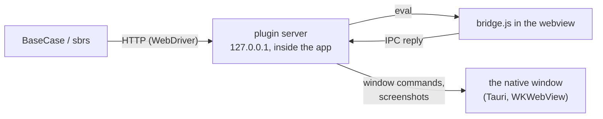

<GitHub.Repo repo="MustCodeAl/tauri-plugin-sbrs-automation" />

<Badge color="orange" shape="pill">Early: 0.1</Badge> <Badge color="purple" shape="pill">Tauri 3 alpha</Badge> <Badge color="blue" shape="pill">W3C WebDriver</Badge> <Badge color="green" icon="apple" shape="pill">macOS: verified</Badge> <Badge color="gray" icon="windows" shape="pill" stroke>Windows: not run yet</Badge> <Badge color="gray" icon="linux" shape="pill" stroke>Linux: not run yet</Badge>

At the end of this guide your Tauri app serves a WebDriver endpoint in test
builds, and a Rust test drives the app's real window through it with
`BaseCase`. Your app is the app under test: the test is the driver.

This is one of three Tauri guides. If your app should start a browser itself,
read [Automate a browser from your app](/ecosystem/tauri-client). If you want to
drive the app's own Chromium webview over CDP, or give it a fingerprint, read
[Drive your app's own webview](/ecosystem/tauri-browser).

<Visibility for="agents">

Summary for AI exports: add `tauri-plugin-sbrs-automation` to the Tauri app behind an optional Cargo feature `e2e`, register `tauri_plugin_sbrs_automation::init()` on the builder only with the feature, grant `sbrs-automation:default` in `src-tauri/capabilities/e2e/automation.json`, let `build.rs` read the capabilities folder recursively only with the feature, and on Tauri 3 name the runtime with `.runtime(tauri_runtime_wry::Wry::default())`. Start the app with `SBRS_AUTOMATION_TOKEN=secret cargo tauri dev --features e2e`. The test builds `BrowserConfig::default().with_webdriver_url("http://127.0.0.1:4445/secret/")` (the URL ends with a slash) and passes it to `BaseCase::new`.

</Visibility>

## Why a plugin

Tauri apps use the system webview. Windows (WebView2) and Linux (WebKitGTK)
have WebDriver drivers, but macOS
(<Tooltip tip="The system web view of macOS, which Tauri apps use there.">WKWebView</Tooltip>)
has none. The plugin runs a small W3C WebDriver endpoint inside your app, so
the same test drives the app on every system.

<Card color="#1a85d4" title="Key facts" icon="circle-info">

- Endpoint: `http://127.0.0.1:4445/{token}/`
- On in a debug build when `SBRS_AUTOMATION` is unset. `1`, `true` or `on` (any case) turn it on; any other value turns it off
- Token: `SBRS_AUTOMATION_TOKEN`, or a random one printed at start
- One window, `main`, and one session at a time
- Clicks and typing are simulated in the page, so the mouse and keyboard stay yours
- Screenshots on macOS only

</Card>

## Before you start

- A Tauri app that builds and runs. The plugin pins one Tauri 3 alpha exactly
  (`tauri` in its `Cargo.toml`): use that alpha in your app.
- Rust 1.99 or newer. `seleniumbase-rs` needs it, and so does the plugin on its
  `main` branch.
- Port 4445 free on `127.0.0.1`, or another port in `SBRS_AUTOMATION_PORT`.

## Set up your app

<Steps>

<Step title="Add the plugin" icon="cube">

Add the plugin, best behind a feature so release builds never have it:

```toml src-tauri/Cargo.toml
[features]
e2e = ["dep:tauri-plugin-sbrs-automation"]

[dependencies]
tauri-plugin-sbrs-automation = { git = "https://github.com/MustCodeAl/tauri-plugin-sbrs-automation", optional = true }
```

</Step>

<Step title="Register it" icon="plug">

```rust The app's builder
let mut builder = tauri::Builder::default();
#[cfg(feature = "e2e")]
{
    builder = builder.plugin(tauri_plugin_sbrs_automation::init());
}
```

</Step>

<Step title="Allow its command" icon="shield-halved">

The page script the plugin injects sends its results back through one plugin
command, so the window needs the permission `sbrs-automation:default`. With
the plugin behind a feature, put the permission in a capability of its own,
`src-tauri/capabilities/e2e/automation.json`:

```json src-tauri/capabilities/e2e/automation.json
{
  "identifier": "e2e-automation",
  "windows": ["main"],
  "permissions": ["sbrs-automation:default"]
}
```

A capability that names `sbrs-automation:default` while the plugin is not
compiled in fails the build (`Permission sbrs-automation:default not found`).
So `build.rs` reads the `e2e` folder only with the feature:

```rust src-tauri/build.rs
fn main() {
    let capabilities = if std::env::var_os("CARGO_FEATURE_E2E").is_some() {
        "./capabilities/**/*"
    } else {
        "./capabilities/*.json"
    };
    println!("cargo:rerun-if-changed=capabilities");
    let attributes = tauri_build::Attributes::new().capabilities_path_pattern(capabilities);
    if let Err(error) = tauri_build::try_build(attributes) {
        panic!("{error:#}");
    }
}
```

If the plugin is always compiled in, add `"sbrs-automation:default"` to the
permissions of `capabilities/default.json` instead.

</Step>

<Step title="Name the runtime (Tauri 3)" icon="gear">

On Tauri 3 the app must name its runtime, or it stops at start with
`RuntimeNotConfigured`. Depend on `tauri-runtime-wry` (the same alpha as
`tauri`) and call `.runtime(tauri_runtime_wry::Wry::default())` on the builder.

</Step>

</Steps>

<Prompt description="Ask a coding agent to set it up" actions={["copy", "cursor"]}>

Add tauri-plugin-sbrs-automation (git https://github.com/MustCodeAl/tauri-plugin-sbrs-automation) to this Tauri app behind a Cargo feature named e2e, as https://mustcodeal-seleniumbase-rs.docs7.io/ecosystem/tauri-driver describes: make the dependency optional, register the plugin on the builder only with the feature, grant sbrs-automation:default in src-tauri/capabilities/e2e/automation.json, let build.rs read the capabilities folder recursively only when CARGO_FEATURE_E2E is set, and on Tauri 3 depend on tauri-runtime-wry and call .runtime(tauri_runtime_wry::Wry::default()) on the builder.

</Prompt>

## Write and run a test

<Steps>

<Step title="Start the app" icon="play">

Start the app with a token of your choice. Without one, the app prints a random
token in the endpoint's URL.

```bash Terminal
SBRS_AUTOMATION_TOKEN=secret cargo tauri dev --features e2e
```

</Step>

<Step title="Wait for the endpoint" icon="clock">

The endpoint answers `GET /status` as soon as it listens, also before the
window has loaded its page:

```bash Terminal
until curl -sf "http://127.0.0.1:4445/secret/status" > /dev/null; do sleep 0.2; done
curl -s "http://127.0.0.1:4445/secret/status"
```

```json Reply
{ "value": { "ready": true, "message": "tauri-plugin-sbrs-automation is ready" } }
```

A new session waits until the window has loaded its page, so a test can start
one right after this answer.

</Step>

<Step title="Add the test" icon="vial">

Add `seleniumbase-rs` as a dev dependency and register the test, so it is
built only with the feature:

```toml src-tauri/Cargo.toml
[dev-dependencies]
seleniumbase-rs = { git = "https://github.com/MustCodeAl/seleniumbase-rs" }

[[test]]
name = "e2e_automation"
required-features = ["e2e"]
```

```rust src-tauri/tests/e2e_automation.rs
use seleniumbase_rs::{tokio, BaseCase, BrowserConfig, SeleniumBaseError};

#[tokio::test]
#[ignore = "needs the app, started with the e2e feature"]
async fn saving_a_profile() -> Result<(), SeleniumBaseError> {
    let config = BrowserConfig::default().with_webdriver_url("http://127.0.0.1:4445/secret/");
    let mut sb = BaseCase::new(config).await?;
    sb.type_text("#name", "Work").await?;
    sb.click("#save").await?;
    sb.assert_text("Saved", "#status").await?;
    sb.quit().await
}
```

The selectors are your app's own. `type_text` takes the selector first and the
text second. `assert_text` takes the expected text first and the selector
second.

<Warning>

The URL ends with `/`. WebDriver clients join each command path (`session`, ...)
to the server URL as a relative URL. Without the slash the token is replaced,
and every request is refused with `the URL does not start with the token`.

</Warning>

</Step>

<Step title="Run it" icon="gauge">

```bash Terminal
cd src-tauri
cargo test --features e2e --test e2e_automation -- --ignored
```

<Check>

The test passes, the window shows the saved profile, and the app keeps running.

</Check>

</Step>

</Steps>

Any WebDriver client works the same way with `http://127.0.0.1:4445/secret/` as
its server URL. The `sbrs` command line takes the same URL in its global
`--webdriver` option, or in `SB_WEBDRIVER_URL` (see the
[command reference](/help/cli_reference)). This guide did not run `sbrs`
against the endpoint.

A test that starts the app itself, waits for `/status`, drives the window and
stops the app, also when a step fails, is
[`e2e_automation.rs`](https://github.com/MustCodeAl/tauri-plugin-sbrs-automation/blob/main/examples/tauri-profile-manager/src-tauri/tests/e2e_automation.rs)
of the profile manager example. It gives the app a temporary `HOME`, so your
own data stays untouched.

## Answer dialogs before you click

A page's `alert`, `confirm` and `prompt` stop the page until they are answered,
and a page script cannot keep them open for a client to answer later. So while
the plugin is on, it replaces them in the page (and in same-origin frames) with
versions that answer at once and record the dialog. A test that should accept a
confirm accepts first, then clicks:

```rust A confirm
sb.accept_alert().await?;              // the answer for the next confirm
sb.click("#delete").await?;            // confirm(...) returns true at once
assert_eq!(sb.alert_text().await?, "Delete the profile?");
sb.accept_alert().await?;              // clears the record
```

- With no answer set, a confirm or prompt is dismissed (`false`, `null`).
- Accepting after the click, the usual WebDriver order, answers
  `unsupported operation`: the page already has its answer.
- Commands never fail with `unexpected alert open`.

The [User prompts page](/ecosystem/tauri-api/alerts) has every rule.

## What the endpoint serves

Sessions, timeouts, navigation, finding elements (CSS, XPath, link text, partial
link text, tag name), clicking, clearing and typing, reading text, attributes,
properties and state, running scripts (sync and async), the window's rectangle
(read, move, resize, maximize, minimize, full screen), user prompts, same-origin
frames, actions (mouse and keys) and, on macOS, screenshots. The
[API reference](/ecosystem/tauri-api/overview) gives every route with its
fields, replies and errors.

Not served:

- cookies, shadow roots, and opening or closing windows answer `unknown command`.
  [Why cookies are left out](/ecosystem/tauri-api/overview#not-served).
- screenshots on Windows and Linux, wheel input, pen and touch pointers answer
  `unsupported operation`.
- a cross-origin frame answers `no such frame`.
- CSS `:hover` and HTML drag and drop do not happen: input is DOM events, not
  OS input.

<Check>

**Verified on a real app** (macOS, Tauri `3.0.0-alpha.4` with the wry runtime,
2026-10-15 and 2026-10-16): the profile manager example was driven by
`BaseCase`. The test started a session, read the title, found elements, waited
for them, clicked, cleared and typed, asserted text, read and resized the
window, answered a confirm and a prompt, entered an `iframe` with `srcdoc`,
double-clicked, hovered, pressed keys through W3C actions, and took page and
element screenshots.

</Check>

<Warning>

**Not run on a real app yet:** Windows and Linux; the XPath, link-text and
tag-name strategies; `DELETE /actions`, entering a frame by index and
`POST /frame/parent`; right clicks, drags and Backspace (their page side runs
only in a fake page under Node.js); and element screenshots of a zoomed page.

</Warning>

## Settings

The plugin reads these environment variables once, when the app starts.

| Variable | Default | What it does |
|---|---|---|
| `SBRS_AUTOMATION` | on in debug builds, off in release | Unset: the build decides. `1`, `true` and `on` (any case) turn it on. Any other value, `0`, `false`, an empty value or a typo included, turns it off. Off, the plugin injects no page script and serves no endpoint. |
| `SBRS_AUTOMATION_PORT` | `4445` | The port on `127.0.0.1`. If it is taken (a second instance, a Selenium container), the app runs without the endpoint and says so on stderr. A value that is not a port number counts as unset. |
| `SBRS_AUTOMATION_TOKEN` | random | The first segment of every path. Unset or empty: a random token of 32 hexadecimal digits, printed when the app starts. |
| `SBRS_AUTOMATION_TRACE_WINDOW` | off | Any non-empty value makes each window command print the window's state on stderr before it asks for a change, after, and when it answers. For finding out why a resize did not stick. |

## Troubleshooting

| What you see | Why | What to do |
|---|---|---|
| Every request answers `the URL does not start with the token` | The server URL has no trailing slash, or the token is wrong | End the URL with `/`, and use the token the app printed. |
| The build fails with `Permission sbrs-automation:default not found` | A capability names the permission, but the plugin is not compiled in | Put the capability in the `e2e` folder and let `build.rs` read it only with the feature (step 3). |
| The app stops at start with `RuntimeNotConfigured` | Tauri 3 starts no runtime unless the app names one | Step 4. |
| Nothing answers on port 4445 | Release build, `SBRS_AUTOMATION` set to a value other than `1`, `true` or `on`, or the port is taken | Check stderr: a taken port is reported there. Start a debug build, or set `SBRS_AUTOMATION=1`. |
| A request answers `403 unknown error` | The request has an `Origin` header; the endpoint refuses requests from web pages | Use a WebDriver client, not a browser page. |
| `accept_alert` after the click answers `unsupported operation` | The page already has its answer | Accept before you click. |
| `no such frame` | The frame is cross-origin | Only same-origin frames can be entered. |
| A screenshot answers `unsupported operation` | Screenshots exist on macOS only | Skip them on Windows and Linux. |

## Security

<Warning>

The endpoint can run any JavaScript in your app's window. That is what
WebDriver's "execute script" is for. So it is guarded:

- on in a debug build when `SBRS_AUTOMATION` is unset; `1`, `true` or `on` (any case) turn it on, and any other value turns it off;
- listens on `127.0.0.1` only;
- every URL must start with the secret token, compared in constant time;
- requests from web pages (any request with an `Origin` header) are refused.

Keep it behind a Cargo feature that release builds do not enable.

</Warning>

## How it works



The server turns each WebDriver command into an operation of an injected script
(`src/bridge.js`), which runs it in the page and sends the result back through
Tauri's IPC. The window commands and screenshots ask the native window instead:
the page cannot tell the window's outer size (WKWebView reports it as 0), and
WebKit draws the page out of process.

## Change the page script (plugin contributors)

The page script is written in TypeScript in `src/bridge.ts` of the plugin.
`src/bridge.js` is generated from it and is what the plugin embeds, so apps that
use the plugin build without Node or Bun.

1. Change `src/bridge.ts`, then run `bun install` once.
2. Run `bun run bridge`. It builds `bridge.js` and records the SHA-256 of
   `bridge.ts` on its first line. Commit both files. `bunx tsc --noEmit`
   type-checks the source.

`cargo test` fails, naming this command, when `bridge.js` is older than
`bridge.ts`.

## Next

<Columns cols={3}>

<Card color="#199f43" title="API reference" icon="code" href="/ecosystem/tauri-api/overview">

Every route with its fields, replies and errors.

</Card>

<Card color="#d47628" title="Automate a browser from your app" icon="window-maximize" href="/ecosystem/tauri-client">

Start and drive a browser from the app's own Rust code.

</Card>

<Card color="#a631be" title="Drive your app's own webview" icon="globe" href="/ecosystem/tauri-browser">

Attach over CDP, or give the webview a fingerprint.

</Card>

</Columns>

## License

MIT.
