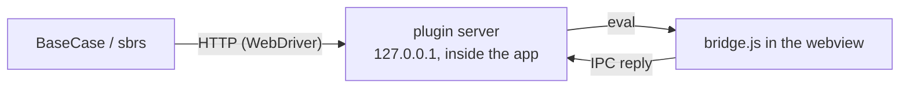

# tauri-plugin-sbrs-automation

<GitHub.Repo repo="MustCodeAl/tauri-plugin-sbrs-automation" />

Test a [Tauri](https://tauri.app) app's real window with
[seleniumbase-rs](https://github.com/MustCodeAl/seleniumbase-rs) (`BaseCase`
and the `sbrs` CLI) on **macOS, Windows and Linux**.

Tauri apps use the system webview. Windows (WebView2) and Linux (WebKitGTK)
have WebDriver drivers, but **macOS (WKWebView) has none**. This plugin runs a
small W3C WebDriver endpoint inside your app, so the same tests drive the app
everywhere.

<Note>

Early (0.1, Tauri 3 alpha). It serves the core of WebDriver: sessions,
timeouts, navigation, finding elements (CSS, XPath, link text, tag name),
clicking, typing, reading text, attributes, properties and state, running
scripts (sync and async), the window's rectangle (read, move, resize,
maximize, minimize, full screen), user prompts (alert, confirm, prompt),
same-origin frames, actions (mouse and keys) and, on macOS, screenshots.
See [Supported commands](#supported-commands). Clicks, typing, actions and
dialogs are simulated in the page with DOM events and page script, not
OS-level input, so the mouse and keyboard are never used.

</Note>

<Check>

**Verified on a real app** (2026-10-15, macOS, Tauri `3.0.0-alpha.4` with
the wry runtime): the `tauri-profile-manager` example of seleniumbase-rs is
driven by `BaseCase` (thirtyfour 0.37) in an end-to-end test that starts a
session, reads the title, finds elements by CSS selector, waits for them to
be displayed and enabled, clicks, clears and types into inputs, reads and
asserts text, reads and resizes the window, and ends the session; sync and
async scripts were run on the same app with raw WebDriver requests. Then
(2026-10-15, same setup) the same test answered a confirm and a prompt
(answer set before, and the default dismiss), entered an `<iframe srcdoc>`
(finding, a script, a click and its alert inside) and was refused a
sandboxed frame, double-clicked, hovered and pressed Space and Enter through
W3C actions, and took a page screenshot (1800 x 1400 for a 900 x 700
window on a Retina display) and an element screenshot.

</Check>

<Warning>

**Not run on a real app yet:** Windows and Linux; the XPath, link-text and
tag-name strategies, which no test covers; `DELETE /actions`, entering a
frame by index and `POST /frame/parent`, whose requests the Rust unit tests
check against a fake page script; and right clicks, drags and Backspace,
whose page side is checked only by the tests of `src/bridge.js` in a fake
page under Node.js (`tests/bridge.test.mjs`, which `cargo test` runs and
which need `node` on `PATH`), not in a webview.

Not served: cookies, shadow roots, and opening or closing windows
(`unknown command`); screenshots on Windows and Linux, wheel input, pen
and touch pointers (`unsupported operation`); cross-origin frames (`no such
frame`). The endpoint drives one window, `main` (or the only one). Cookies
are left out on purpose: on macOS the app's page is `tauri://localhost`,
where WKWebView keeps no cookies at all (`document.cookie` reads back empty
after a write).

</Warning>

## Set up your app

<Steps>

<Step title="Add the plugin">

Add the plugin, best behind a feature so release builds never have it:

```toml
[features]
e2e = ["dep:tauri-plugin-sbrs-automation"]

[dependencies]
tauri-plugin-sbrs-automation = { git = "https://github.com/MustCodeAl/tauri-plugin-sbrs-automation", optional = true }
```

</Step>

<Step title="Register it">

Register it:

```rust
let mut builder = tauri::Builder::default();
#[cfg(feature = "e2e")]
{
    builder = builder.plugin(tauri_plugin_sbrs_automation::init());
}
```

</Step>

<Step title="Allow its command">

Allow its command. With the plugin behind a feature, put the permission in
a capability of its own, `src-tauri/capabilities/e2e/automation.json`:

```json
{
  "identifier": "e2e-automation",
  "windows": ["main"],
  "permissions": ["sbrs-automation:default"]
}
```

and let `build.rs` read that folder only with the feature. A capability
that names `sbrs-automation:default` while the plugin is not compiled in
fails the build (`Permission sbrs-automation:default not found`), so it
cannot go in `default.json` next to an optional plugin:

```rust
fn main() {
    let capabilities = if std::env::var_os("CARGO_FEATURE_E2E").is_some() {
        "./capabilities/**/*"
    } else {
        "./capabilities/*.json"
    };
    println!("cargo:rerun-if-changed=capabilities");
    let attributes = tauri_build::Attributes::new().capabilities_path_pattern(capabilities);
    if let Err(error) = tauri_build::try_build(attributes) {
        panic!("{error:#}");
    }
}
```

If the plugin is always compiled in, `"sbrs-automation:default"` can simply
join the permissions of `capabilities/default.json`.

</Step>

<Step title="Name the runtime (Tauri 3)">

On Tauri 3, the app must name its runtime, or it stops at start with
`RuntimeNotConfigured`: depend on `tauri-runtime-wry` (the same alpha) and
call `.runtime(tauri_runtime_wry::Wry::default())` on the builder.

</Step>

</Steps>

## Run a test

Start the app with a token of your choice (or read the random one it prints):

```bash
SBRS_AUTOMATION_TOKEN=secret cargo tauri dev --features e2e
```

Then point `BaseCase` at it. The URL ends with `/`: WebDriver clients join
each command path (`session`, ...) to the server URL as a relative URL, so
without the slash the token is replaced and every request is refused with
`the URL does not start with the token`.

```rust
use seleniumbase_rs::{BaseCase, BrowserConfig};

#[tokio::test]
async fn saving_a_profile() -> Result<(), seleniumbase_rs::SeleniumBaseError> {
    let config = BrowserConfig::default().with_webdriver_url("http://127.0.0.1:4445/secret/");
    let mut sb = BaseCase::new(config).await?;
    sb.type_text("#name", "Work").await?;
    sb.click("#save").await?;
    sb.assert_text("Saved", "#status").await?;
    sb.quit().await
}
```

Any WebDriver client works the same way with `http://127.0.0.1:4445/secret/`
as its server URL. A new session waits until the app's window has loaded its
page, so a test can start one as soon as the endpoint answers
`GET /secret/status`. For a test that starts the app itself, see
`examples/tauri-profile-manager/src-tauri/tests/e2e_automation.rs` in
seleniumbase-rs.

| Setting | Default |
|---|---|
| `SBRS_AUTOMATION` | on in debug builds, off in release; `1` turns it on, `0` off |
| `SBRS_AUTOMATION_PORT` | `4445`; if the port is taken (a second instance, a Selenium container), the app runs without the endpoint and says so on stderr |
| `SBRS_AUTOMATION_TOKEN` | random, printed when the app starts |
| `SBRS_AUTOMATION_TRACE_WINDOW` | off; any value makes each window command print the window's state on stderr (Tauri's flags and, on macOS, the `NSWindow`'s style mask, frame and screen), for finding out why a resize did not stick |

## Supported commands

Every path starts with `/<token>`; session commands with
`/session/{id}`.

| Command | Endpoint | Notes |
|---|---|---|
| Status | `GET /status` | |
| New and delete session | `POST /session`, `DELETE /session/{id}` | One session at a time. A new session starts in the top page, with no dialog answer or input held from the last one. |
| Timeouts | `GET`, `POST /timeouts` | `script`, `pageLoad`, `implicit` (finding looks again until it is over). |
| Navigation | `POST /url`, `GET /url`, `GET /title`, `POST /back`, `/forward`, `/refresh` | Waits for the new page to load. |
| Page source | `GET /source` | Of the current frame. |
| Window | `GET /window`, `/window/handles`, `POST /window`, `GET`/`POST /window/rect`, `POST /window/maximize`, `/minimize`, `/fullscreen` | One window, `main`. A change waits until the window has it (normally well under a second; each state change is waited for up to three seconds, the final rectangle up to two more), and the answer is the window's rectangle then, which can differ from the one asked for: the system keeps a window below the menu bar and may refuse a size. |
| Frames | `POST /frame`, `POST /frame/parent` | Same-origin frames only (see below). |
| Find elements | `POST /element`, `/elements`, `/element/{id}/element`, `/element/{id}/elements`, `GET /element/active` | CSS, XPath, link text, partial link text, tag name. |
| Element state | `GET /element/{id}/text`, `/name`, `/rect`, `/enabled`, `/selected`, `/displayed`, `/attribute/{name}`, `/property/{name}`, `/css/{name}` | |
| Element interaction | `POST /element/{id}/click`, `/clear`, `/value` | DOM events. |
| Scripts | `POST /execute/sync`, `/execute/async` | Run in the current frame. |
| Actions | `POST /actions`, `DELETE /actions` | Mouse, keys and pauses (see below). |
| User prompts | `GET /alert/text`, `POST /alert/accept`, `/alert/dismiss`, `/alert/text` | Simulated (see below). |
| Screenshots | `GET /screenshot`, `GET /element/{id}/screenshot` | macOS only; PNG. |

### Details

<AccordionGroup>

<Accordion title="User prompts">

A page's `alert`, `confirm` and `prompt` stop the page
until they are answered, and a page script cannot keep them open for a
client to answer later. So the plugin replaces them in the page (and in
same-origin frames) with versions that answer at once and record the dialog.
It does so whenever it is on (in debug builds by default), also while no test
drives the app: the app's dialogs then never show, and answer as below. A
same-origin frame gets the replacements when the next command runs after the
frame has loaded; a dialog it opens before that is the real one.

- A confirm or prompt gets the answer the client set *before* it opened:
  `POST /alert/accept` or `POST /alert/dismiss` with no dialog recorded (the
  last one sent counts), and for a prompt `POST /alert/text` first for the
  text it returns. The first confirm or prompt uses that answer up; an alert
  needs none and leaves it for the next one. With no answer set, a confirm
  or prompt is dismissed (`false`, `null`), as W3C's default `dismiss` would.
- Every dialog is recorded, oldest first (the last 100 are kept), and
  `GET /alert/text` reads the oldest one's message, or `no such alert`.
- Accept or dismiss *after* a dialog opened clears the oldest record when it
  is the answer the page got (either one for an alert). The other one
  answers `unsupported operation` and keeps the record: the page already has
  its answer and cannot be given another. Sending text to a prompt that has
  opened answers `unsupported operation`, and to an alert or confirm
  `element not interactable`.
- While a dialog is recorded, accept or dismiss handles it and sets no
  answer. So clear the dialogs a test does not care about (or check
  `GET /alert/text`) before setting the answer for the next one. An answer
  that no dialog used stays set for the next confirm or prompt, however much
  later; `POST /alert/dismiss` with no dialog recorded puts the default back.
- Commands never fail with `unexpected alert open`. The dialogs and the
  answer are forgotten when the page loads another document and when a new
  session starts.

So a test that should accept a confirm accepts first, then clicks:

```rust
sb.accept_alert().await?;                 // the answer for the next confirm
sb.click("#delete").await?;               // confirm(...) returns true at once
assert_eq!(sb.get_alert_text().await?, "Delete the profile?");
sb.accept_alert().await?;                 // clears the record
```

The usual WebDriver order, click and then accept (`wait_for_and_accept_alert`),
gets `unsupported operation` for a confirm or prompt: it was dismissed when it
opened, so the test fails there instead of going on as if it was accepted.

</Accordion>

<Accordion title="Frames">

`POST /frame` takes `null` (the top page), an index into the
current page's frames, or a frame element; finding, scripts, element commands,
the page source and actions then act in that frame. Only a frame of the same
origin as the app's page can be entered (an `<iframe srcdoc>` or one of the
app's own pages): the plugin works through page script, which cannot reach
into another origin, so a cross-origin or sandboxed frame answers `no such
frame`. Navigating returns to the top page.

</Accordion>

<Accordion title="Actions">

`POST /actions` runs W3C actions tick by tick: one keyboard
(`keyDown`, `keyUp`), mouse pointers (`pointerMove` from the viewport, the
pointer or an element, `pointerDown`, `pointerUp` with buttons 0 to 4) and
pauses. They are DOM events at the pointer's place in the current frame:
pointer and mouse events (over, enter, move, down, up, out, leave), `click`
with its count and `dblclick` for two presses on the same element within
500 ms, `auxclick` and `contextmenu`, and key events into the focused element,
where printable keys type (through `execCommand`, so the page sees `input`),
Backspace and Delete delete, and Enter submits a form field's form. A move
onto an element out of view scrolls it into view first, at once even when the
page sets `scroll-behavior: smooth` (as clicks and element screenshots do). Because the events
are not the OS's, CSS `:hover` does not apply and HTML drag and drop
(`draggable`) does not start. Wheel input, pen and touch pointers and
`pointerCancel` answer `unsupported operation`; `DELETE /actions` lets go of
the keys and buttons still held.

</Accordion>

<Accordion title="Screenshots">

On macOS the window's `WKWebView` takes the snapshot itself
(`takeSnapshotWithConfiguration`), at the screen's scale (so 2x on a Retina
display), and the plugin returns it as PNG; an element's screenshot is the
part of the view the element covers, after it is scrolled into view (also
when the page is zoomed, as Tauri's `set_zoom` and the zoom hotkeys do). Windows
(WebView2) and Linux (WebKitGTK) answer `unsupported operation` for now.

</Accordion>

</AccordionGroup>

Set Window Rect first brings the window back to its normal state, as
WebDriver asks: out of full screen, not maximized, not minimized. A maximized
window would otherwise ignore the new size.

## Changing the page script

The page script is written in TypeScript in `src/bridge.ts`. `src/bridge.js` is
generated from it and is what the plugin embeds, so apps that use the plugin
build without Node or Bun.

<Steps>

<Step title="Edit the source">

Change `src/bridge.ts`, then run `bun install` once.

</Step>

<Step title="Generate the script">

Run `bun run bridge`. It builds `bridge.js` and records the SHA-256 of
`bridge.ts` on its first line. Commit both files. `bunx tsc --noEmit`
type-checks the source.

</Step>

</Steps>

<Note>

`cargo test` fails, naming this command, when `bridge.js` is older than
`bridge.ts`.

</Note>

## How it works



The server turns each WebDriver command into an operation of an injected script
(`src/bridge.js`), which runs it in the page and sends the result back through
Tauri's IPC.

## Security

<Warning>

The endpoint can run any JavaScript in your app's window; that is what
WebDriver's "execute script" is for. So it is guarded:

- on in debug builds only, unless you set `SBRS_AUTOMATION=1`;
- listens on `127.0.0.1` only;
- every URL must start with the secret token;
- requests from web pages (any request with an `Origin` header) are refused.

Keep it behind a Cargo feature that release builds do not enable.

</Warning>

## License
MIT.
