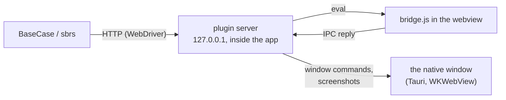

export const LayoutTree = ({ children }) => (
  <div className="not-prose layout-tree" style={{ margin: "1.25rem 0", fontFamily: "var(--font-sans)", fontSize: "14px", color: "var(--text-secondary)" }}>
    <style>{`
      .layout-tree summary { list-style: none; }
      .layout-tree summary::-webkit-details-marker { display: none; }
      .layout-tree .lt-row:hover { background-color: var(--surface-subtle); }
      .layout-tree .lt-fold { color: #d5a910; }
      .dark .layout-tree .lt-fold { color: #ffd452; }
      .layout-tree .lt-fold-closed { display: none; }
      .layout-tree details:not([open]) summary .lt-fold-open { display: none; }
      .layout-tree details:not([open]) summary .lt-fold-closed { display: flex; }
      .layout-tree .lt-hl { color: var(--primary); background-color: color-mix(in srgb, var(--primary) 8%, transparent); }
      .dark .layout-tree .lt-hl { color: var(--primary-light); }
      .layout-tree .lt-ic-gray { color: #84848a; }
      .dark .layout-tree .lt-ic-gray { color: #adadb1; }
      .layout-tree .lt-ic-blue { color: #1a85d4; }
      .dark .layout-tree .lt-ic-blue { color: #69b1ff; }
      .layout-tree .lt-ic-cyan { color: #1ca1c7; }
      .dark .layout-tree .lt-ic-cyan { color: #68cdf2; }
      .layout-tree .lt-ic-green { color: #199f43; }
      .dark .layout-tree .lt-ic-green { color: #5ecc71; }
      .layout-tree .lt-ic-indigo { color: #693acf; }
      .dark .layout-tree .lt-ic-indigo { color: #9d6afb; }
      .layout-tree .lt-ic-orange { color: #d47628; }
      .dark .layout-tree .lt-ic-orange { color: #ffa359; }
      .layout-tree .lt-ic-pink { color: #d32a61; }
      .dark .layout-tree .lt-ic-pink { color: #ff678d; }
      .layout-tree .lt-ic-purple { color: #a631be; }
      .dark .layout-tree .lt-ic-purple { color: #d568ea; }
      .layout-tree .lt-ic-red { color: #d52c36; }
      .dark .layout-tree .lt-ic-red { color: #ff6762; }
      .layout-tree .lt-ic-yellow { color: #d5a910; }
      .dark .layout-tree .lt-ic-yellow { color: #ffd452; }
    `}</style>
    {children}
  </div>
)

export const LayoutRow = ({ icon, name, note, highlight = false, button = false }) => (
  <div className={highlight ? "lt-row lt-hl" : "lt-row"} style={{ display: "flex", alignItems: "flex-start", gap: "6px", minHeight: "30px", padding: "5px 8px", margin: "0 2px", borderRadius: "6px", lineHeight: "20px", cursor: button ? "pointer" : "default" }}>
    <span style={{ width: "16px", height: "20px", flexShrink: 0, display: "flex", alignItems: "center", justifyContent: "center", color: highlight ? "inherit" : "var(--text-muted)" }}>{icon}</span>
    <span style={{ whiteSpace: "nowrap", fontFamily: "var(--font-mono, ui-monospace, SFMono-Regular, Menlo, monospace)", fontSize: "13px", fontWeight: 600, color: highlight ? "inherit" : "var(--text-primary)" }}>{name}</span>
    {note ? <span style={{ color: "var(--text-muted)", fontSize: "13px", fontStyle: "italic", marginLeft: "10px", opacity: 0.9 }}>{note}</span> : null}
  </div>
)

export const LayoutFolderIcon = ({ kind }) => (
  <svg viewBox="0 0 16 16" width="16" height="16" aria-hidden="true">
    {kind === "empty" ? (
      <path fill="none" stroke="currentColor" strokeWidth="1.2" strokeLinejoin="round" d="M2 4.2A1.2 1.2 0 0 1 3.2 3h3.1c.32 0 .62.13.85.35L8.4 4.6h4.4A1.2 1.2 0 0 1 14 5.8v6a1.2 1.2 0 0 1-1.2 1.2H3.2A1.2 1.2 0 0 1 2 11.8z" />
    ) : kind === "open" ? (
      <g fill="currentColor">
        <path opacity=".5" d="M1.5 4A1.5 1.5 0 0 1 3 2.5h3.38a1.5 1.5 0 0 1 1.06.44L8.5 4H13a1.5 1.5 0 0 1 1.5 1.5V7H4.2a1.5 1.5 0 0 0-1.4.95L1.5 11.3z" />
        <path d="M4.2 8h10.6a.7.7 0 0 1 .65.95l-1.6 4.1a1.5 1.5 0 0 1-1.4.95H2.2a.7.7 0 0 1-.65-.95l1.25-3.2A1.5 1.5 0 0 1 4.2 8z" />
      </g>
    ) : (
      <g fill="currentColor">
        <path d="M1.5 4A1.5 1.5 0 0 1 3 2.5h3.38a1.5 1.5 0 0 1 1.06.44L8.5 4H1.5z" />
        <path opacity=".6" d="M1.5 4.5V12A1.5 1.5 0 0 0 3 13.5h10a1.5 1.5 0 0 0 1.5-1.5V6A1.5 1.5 0 0 0 13 4.5z" />
      </g>
    )}
  </svg>
)

export const LayoutFileIcon = () => (
  <svg viewBox="0 0 16 16" width="16" height="16" aria-hidden="true">
    <path fill="currentColor" opacity=".5" d="M8 1v3a3 3 0 0 0 3 3h3v5.5a2.5 2.5 0 0 1-2.5 2.5h-7A2.5 2.5 0 0 1 2 12.5v-9A2.5 2.5 0 0 1 4.5 1z" />
    <path fill="currentColor" d="M9.5 1a.5.5 0 0 1 .354.146l4 4A.5.5 0 0 1 14 5.5V6h-3a2 2 0 0 1-2-2V1z" />
  </svg>
)

export const LayoutDir = ({ name, note, open = false, highlight = false, children }) =>
  children ? (
    <details open={open}>
      <summary>
        <LayoutRow icon={<span className={highlight ? "" : "lt-fold"} style={{ display: "flex" }}><span className="lt-fold-open" style={{ display: "flex" }}><LayoutFolderIcon kind="open" /></span><span className="lt-fold-closed"><LayoutFolderIcon kind="closed" /></span></span>} name={name} note={note} highlight={highlight} button />
      </summary>
      <div style={{ marginLeft: "17.5px", borderLeft: "1px solid var(--border-subtle)", paddingLeft: "6px" }}>
        {children}
      </div>
    </details>
  ) : (
    <LayoutRow icon={<span className={highlight ? "" : "lt-fold"} style={{ display: "flex" }}><LayoutFolderIcon kind="empty" /></span>} name={name} note={note} highlight={highlight} />
  )

export const layoutIconColor = (name) => {
  const n = String(name).toLowerCase()
  const ext = n.includes(".") ? n.split(".").pop() : ""
  if (n === "dockerfile" || n.startsWith("dockerfile.") || n.startsWith("docker-compose")) return "blue"
  if (["rs", "json", "jsonc", "html", "htm", "zip", "gz", "tgz", "crx", "xpi", "swift", "svg"].includes(ext)) return "orange"
  if (["ts", "tsx", "mts", "cts", "py"].includes(ext)) return "blue"
  if (["js", "mjs", "cjs", "jsx"].includes(ext)) return "yellow"
  if (["md", "mdx", "sh", "bash", "zsh", "fish", "ps1"].includes(ext)) return "green"
  if (["css", "scss"].includes(ext)) return "indigo"
  if (["png", "jpg", "jpeg", "gif", "webp", "ico"].includes(ext)) return "pink"
  if (ext === "go") return "cyan"
  return "gray"
}

export const LayoutFile = ({ name, note, highlight = false }) => (
  <LayoutRow icon={<span className={highlight ? "" : "lt-ic-" + layoutIconColor(name)} style={{ display: "flex" }}><LayoutFileIcon /></span>} name={name} note={note} highlight={highlight} />
)

<GitHub.Repo repo="MustCodeAl/tauri-plugin-sbrs-automation" />

<Badge color="orange" shape="pill">Early: 0.1</Badge> <Badge color="purple" shape="pill">Tauri 3.0.0-alpha.4</Badge> <Badge color="blue" shape="pill">W3C WebDriver</Badge> <Badge color="green" icon="apple" shape="pill">macOS: verified</Badge> <Badge color="gray" icon="windows" shape="pill" stroke>Windows: not run yet</Badge> <Badge color="gray" icon="linux" shape="pill" stroke>Linux: not run yet</Badge>

Test a [Tauri](https://tauri.app) app's real window with
[seleniumbase-rs](https://github.com/MustCodeAl/seleniumbase-rs) (`BaseCase`
and the `sbrs` CLI) on **macOS, Windows and Linux**.

Tauri apps use the system webview. Windows (WebView2) and Linux (WebKitGTK)
have WebDriver drivers, but **macOS
(<Tooltip tip="The system web view of macOS, which Tauri apps use there.">WKWebView</Tooltip>)
has none**. This plugin runs a small W3C WebDriver endpoint inside your app, so
the same tests drive the app everywhere.

<Card color="#1a85d4" title="Key facts" icon="circle-info">

- Endpoint: `http://127.0.0.1:4445/{token}/`
- On in debug builds, or with `SBRS_AUTOMATION=1`
- Token: `SBRS_AUTOMATION_TOKEN`, or a random one printed at start
- One window, `main`, and one session at a time
- Input is simulated in the page
- Screenshots on macOS only

</Card>

<Card color="#199f43" title="API reference" icon="code" href="/ecosystem/tauri-api/overview">

Every route with its fields, replies and errors.

</Card>

<Note>

Early (0.1, Tauri 3 alpha). It serves the core of WebDriver: sessions,
timeouts, navigation, finding elements (CSS, XPath, link text, tag name),
clicking, typing, reading text, attributes, properties and state, running
scripts (sync and async), the window's rectangle (read, move, resize,
maximize, minimize, full screen), user prompts (alert, confirm, prompt),
same-origin frames, actions (mouse and keys) and, on macOS, screenshots.
See [Supported commands](#supported-commands). Clicks, typing, actions and
dialogs are simulated in the page with DOM events and page script, not
OS-level input, so the mouse and keyboard are never used.

</Note>

<Check>

**Verified on a real app** (macOS, Tauri `3.0.0-alpha.4` with the wry
runtime): the `tauri-profile-manager` example of seleniumbase-rs is driven by
`BaseCase` (thirtyfour 0.37) in an end-to-end test.

- **2026-10-15**: the test starts a session, reads the title, finds elements
  by CSS selector, waits for them to be displayed and enabled, clicks, clears
  and types into inputs, reads and asserts text, reads and resizes the window,
  and ends the session; sync and async scripts were run on the same app with
  raw WebDriver requests.
- **2026-10-15**, then: the same test answered a confirm and a prompt (answer
  set before, and the default dismiss), entered an `<iframe srcdoc>` (finding,
  a script, a click and its alert inside) and was refused a sandboxed frame,
  double-clicked, hovered and pressed Space and Enter through W3C actions, and
  took a page screenshot (1800 x 1400 for a 900 x 700 window on a Retina
  display) and an element screenshot.
- **2026-10-16**: it was refused accepting a confirm that had been dismissed
  when it opened, saw an alert leave the answer to the confirm after it and
  cleared the two in order, and hovered and took the element screenshot of a
  paragraph far below the view on a page with `scroll-behavior: smooth`.

</Check>

<Warning>

**Not run on a real app yet:** Windows and Linux; the XPath, link-text and
tag-name strategies, which no test covers; `DELETE /actions`, entering a
frame by index and `POST /frame/parent`, whose requests the Rust unit tests
check against a fake page script; right clicks, drags and Backspace, whose
page side is checked only by the tests of `src/bridge.js` in a fake page under
Node.js (`tests/bridge.test.mjs`, which `cargo test` runs and which need
`node` on `PATH`), not in a webview; and element screenshots of a zoomed page,
checked only by a unit test of the conversion to the web view's points.

</Warning>

## Set up your app

<Steps>

<Step title="Add the plugin" icon="cube">

Add the plugin, best behind a feature so release builds never have it:

```toml src-tauri/Cargo.toml
[features]
e2e = ["dep:tauri-plugin-sbrs-automation"]

[dependencies]
tauri-plugin-sbrs-automation = { git = "https://github.com/MustCodeAl/tauri-plugin-sbrs-automation", optional = true }
```

</Step>

<Step title="Register it" icon="plug">

Register it:

```rust The app's builder
let mut builder = tauri::Builder::default();
#[cfg(feature = "e2e")]
{
    builder = builder.plugin(tauri_plugin_sbrs_automation::init());
}
```

</Step>

<Step title="Allow its command" icon="shield-halved">

Allow its command. With the plugin behind a feature, put the permission in
a capability of its own, `src-tauri/capabilities/e2e/automation.json`:

<LayoutTree>
<LayoutDir name="src-tauri" open note="the Rust side of the app">
<LayoutFile name="Cargo.toml" note="the e2e feature and the optional plugin" />
<LayoutFile name="build.rs" highlight note="reads capabilities/e2e only with the feature" />
<LayoutDir name="capabilities" open>
<LayoutFile name="default.json" note="cannot name sbrs-automation:default next to an optional plugin" />
<LayoutDir name="e2e" open>
<LayoutFile name="automation.json" highlight note="grants sbrs-automation:default to the main window" />
</LayoutDir>
</LayoutDir>
</LayoutDir>
</LayoutTree>

```json src-tauri/capabilities/e2e/automation.json
{
  "identifier": "e2e-automation",
  "windows": ["main"],
  "permissions": ["sbrs-automation:default"]
}
```

and let `build.rs` read that folder only with the feature. A capability
that names `sbrs-automation:default` while the plugin is not compiled in
fails the build (`Permission sbrs-automation:default not found`), so it
cannot go in `default.json` next to an optional plugin:

```rust src-tauri/build.rs
fn main() {
    let capabilities = if std::env::var_os("CARGO_FEATURE_E2E").is_some() {
        "./capabilities/**/*"
    } else {
        "./capabilities/*.json"
    };
    println!("cargo:rerun-if-changed=capabilities");
    let attributes = tauri_build::Attributes::new().capabilities_path_pattern(capabilities);
    if let Err(error) = tauri_build::try_build(attributes) {
        panic!("{error:#}");
    }
}
```

If the plugin is always compiled in, `"sbrs-automation:default"` can simply
join the permissions of `capabilities/default.json`.

</Step>

<Step title="Name the runtime (Tauri 3)" icon="gear">

On Tauri 3, the app must name its runtime, or it stops at start with
`RuntimeNotConfigured`: depend on `tauri-runtime-wry` (the same alpha) and
call `.runtime(tauri_runtime_wry::Wry::default())` on the builder.

</Step>

</Steps>

<Prompt description="Ask a coding agent to set it up" actions={["copy", "cursor"]}>

Add tauri-plugin-sbrs-automation (git https://github.com/MustCodeAl/tauri-plugin-sbrs-automation) to this Tauri app behind a Cargo feature named e2e, as https://mustcodeal-seleniumbase-rs.docs7.io/ecosystem/tauri describes: make the dependency optional, register the plugin on the builder only with the feature, grant sbrs-automation:default in src-tauri/capabilities/e2e/automation.json, let build.rs read the capabilities folder recursively only when CARGO_FEATURE_E2E is set, and on Tauri 3 depend on tauri-runtime-wry and call .runtime(tauri_runtime_wry::Wry::default()) on the builder.

</Prompt>

## Run a test

Start the app with a token of your choice (or read the random one it prints):

```bash Terminal
SBRS_AUTOMATION_TOKEN=secret cargo tauri dev --features e2e
```

Then point `BaseCase` at it. The URL ends with `/`: WebDriver clients join
each command path (`session`, ...) to the server URL as a relative URL, so
without the slash the token is replaced and every request is refused with
`the URL does not start with the token`.

```rust A test
use seleniumbase_rs::{BaseCase, BrowserConfig};

#[tokio::test]
async fn saving_a_profile() -> Result<(), seleniumbase_rs::SeleniumBaseError> {
    let config = BrowserConfig::default().with_webdriver_url("http://127.0.0.1:4445/secret/");
    let mut sb = BaseCase::new(config).await?;
    sb.type_text("#name", "Work").await?;
    sb.click("#save").await?;
    sb.assert_text("Saved", "#status").await?;
    sb.quit().await
}
```

Any WebDriver client works the same way with `http://127.0.0.1:4445/secret/`
as its server URL. A new session waits until the app's window has loaded its
page, so a test can start one as soon as the endpoint answers
`GET /secret/status`. For a test that starts the app itself, see
`examples/tauri-profile-manager/src-tauri/tests/e2e_automation.rs` in
seleniumbase-rs.

## App-owned Chromium: CEF and WebView2

An app that bundles CEF on macOS/Linux, or uses WebView2 on Windows, can expose
Chromium's loopback CDP debugger and use the pure `sb_cdp` engine. The app owns
and initializes its runtime. System WKWebView and WebKitGTK do not speak CDP;
their existing WebDriver integration above continues to work.

Enable the automation plugin's `cdp` Cargo feature (Rust 1.99). It uses a pinned
Git dependency on `seleniumbase-rs` for `engine_spoofing_args()`, so the engine
stealth switches have a single source. Before any threads or runtime initialization:

```rust
use tauri_plugin_sbrs_automation::cdp::CdpStealthConfig;

fn main() {
    let config = CdpStealthConfig::default().debugging_port(9222);
    // SAFETY: main has not started threads or initialized the runtime.
    let args = unsafe { config.apply_env() };
    // CEF: pass `args` to your app's CEF initialization before opening windows.
    // WebView2: apply_env sets WEBVIEW2_ADDITIONAL_BROWSER_ARGUMENTS before startup.
    // Continue with the app's existing runtime and automation plugin initialization.
}
```

`SBRS_CDP_PORT` selects the default port (9222 when unset/invalid). The helper
respects `SBRS_AUTOMATION=0` and the plugin's debug/release gate. It always binds
debugging to `127.0.0.1`; extra arguments cannot replace the debugging switches.
The returned arguments include the canonical engine stealth flags unless
`.stealth_args(false)` is set. Binary patches cannot be applied to an already-running app.

Connect from the test with a fingerprint, including native CDP spoofing if desired:

```rust
use seleniumbase_rs::{BaseCase, BrowserConfig, Fingerprint};

# async fn test() -> Result<(), seleniumbase_rs::SeleniumBaseError> {
let fingerprint = Fingerprint::windows_desktop()
    .to_builder().native_spoofing(true).build()?;
let config = BrowserConfig::default()
    .with_webdriver_url("http://127.0.0.1:4445/your-token/")
    .with_cdp_discovery(true)
    .with_fingerprint(fingerprint);
let mut sb = BaseCase::new(config).await?;
let title = sb.cdp_get_title().await?;
sb.cdp_click("#save").await?;
sb.quit().await?; // Detaches; the Tauri app keeps running.
# Ok(())
# }
```

Direct CDP sessions use the existing `BaseCase::cdp_*` methods rather than
WebDriver element handles. The full `Page` and `Browser` API is available through
`BrowserSession::pure_cdp_page()`, or start the pure browser directly:

```rust
use seleniumbase_rs::sb_cdp::{Browser, LaunchOptions};

# async fn test() -> Result<(), seleniumbase_rs::SeleniumBaseError> {
let options = LaunchOptions::builder()
    .cdp_url("http://127.0.0.1:9222") // Or ws://.../devtools/browser/<id>.
    .fingerprint(&seleniumbase_rs::Fingerprint::windows_desktop())
    .build()?;
let browser = Browser::launch(options).await?; // Attaches; launches no process.
let page = browser.default_page().await?;
page.locator("#save").click().await?;
// The existing CdpDriver can also drive this browser with CdpDriver::attach(browser).
browser.close().await?;
# Ok(())
# }
```

`BrowserConfig::with_cdp_url` bypasses discovery; it takes HTTP or browser
WebSocket URLs. An authenticated plugin URL is also accepted. For discovery,
`GET /<token>/cdp` returns `value.cdpEnabled`, `value.cdpPort`, and `value.cdpUrl`
(null when disabled). It reports configuration, not debugger readiness. The
route has the existing token and Origin guards; it does not authenticate the
separate loopback Chromium socket. Discovery rejects redirects and endpoints
outside loopback. `/status` keeps its existing response.

With the `plugins` feature, use the existing `BrowserConfig::with_plugins` or
`LaunchOptionsBuilder::plugins`. Attachment runs `on_browser`, packages and
`on_page_created` for each existing window, and normal page/browser hooks
afterwards. Launch-only plugins are refused by the existing attach checks;
`before_launch` is not run. Fingerprints use `session_script` and
`safe_cdp_overrides`, including `native_spoofing` overrides. The script is
registered with `Page.addScriptToEvaluateOnNewDocument` and `runImmediately`
so already-open contexts receive it too. Launch flags and profile settings
must be configured in the app before CEF/WebView2 starts.

This path is verified against mock HTTP/CDP servers. CEF and WebView2 have not
been tested on a real app in this change.

## Settings

The plugin reads these environment variables once, when the app starts.

<ParamField body="SBRS_AUTOMATION" type="string" default="on in debug builds, off in release">

`0`, `false` or `off` turn the plugin off; any other value, such as `1`, turns
it on. Unset or empty, the build decides. Off, the plugin injects no page
script and serves no endpoint.

</ParamField>

<ParamField body="SBRS_AUTOMATION_PORT" type="integer" default="4445">

The port on `127.0.0.1`. If the port is taken (a second instance, a Selenium
container), the app runs without the endpoint and says so on stderr. A value
that is not a port number counts as unset.

</ParamField>

<ParamField body="SBRS_AUTOMATION_TOKEN" type="string" default="random">

The first segment of every path. Unset or empty: a random token of 32
hexadecimal digits, printed when the app starts, in the endpoint's URL.

</ParamField>

<ParamField body="SBRS_AUTOMATION_TRACE_WINDOW" type="string" default="off">

Any non-empty value makes each window command print the window's state on
stderr before it asks for a change, after, and when it answers: what Tauri
reports and, on macOS, what the `NSWindow` says (style mask, `isZoomed`,
frame, content view, screen). For finding out why a resize did not stick.

</ParamField>

## Supported commands

Every path starts with `/<token>`; session commands with `/session/{id}`. The
[API reference](/ecosystem/tauri-api/overview) gives each command's fields,
replies and errors, with request and response examples.

| Command | Endpoint | Notes |
|---|---|---|
| [Status](/ecosystem/tauri-api/status) | `GET /status` | No session needed. |
| [New and delete session](/ecosystem/tauri-api/sessions) | `POST /session`, `DELETE /session/{id}` | One session at a time: a new one replaces the last. A new session starts in the top page, with no dialog answer or input held from the last one. |
| [Timeouts](/ecosystem/tauri-api/timeouts) | `GET`, `POST /timeouts` | `script`, `pageLoad`, `implicit` (finding looks again until it is over). |
| [Navigation](/ecosystem/tauri-api/navigation) | `POST /url`, `GET /url`, `GET /title`, `POST /back`, `/forward`, `/refresh` | Waits for the new page to load. |
| [Page source](/ecosystem/tauri-api/navigation#get-page-source) | `GET /source` | Of the current frame. |
| [Window](/ecosystem/tauri-api/window) | `GET /window`, `/window/handles`, `POST /window`, `GET`/`POST /window/rect`, `POST /window/maximize`, `/minimize`, `/fullscreen` | One window, `main`. A change waits until the window has it (normally well under a second; each state change is waited for up to three seconds, the final rectangle up to two more), and the answer is the window's rectangle then, which can differ from the one asked for: the system keeps a window below the menu bar and may refuse a size. |
| [Frames](/ecosystem/tauri-api/frames) | `POST /frame`, `POST /frame/parent` | Same-origin frames only. |
| [Find elements](/ecosystem/tauri-api/elements) | `POST /element`, `/elements`, `/element/{id}/element`, `/element/{id}/elements`, `GET /element/active` | CSS, XPath, link text, partial link text, tag name. |
| [Element state](/ecosystem/tauri-api/element-state) | `GET /element/{id}/text`, `/name`, `/rect`, `/enabled`, `/selected`, `/displayed`, `/attribute/{name}`, `/property/{name}`, `/css/{name}` | |
| [Element interaction](/ecosystem/tauri-api/element-interaction) | `POST /element/{id}/click`, `/clear`, `/value` | DOM events. |
| [Scripts](/ecosystem/tauri-api/scripts) | `POST /execute/sync`, `/execute/async` | Run in the current frame. |
| [Actions](/ecosystem/tauri-api/actions) | `POST /actions`, `DELETE /actions` | Mouse, keys and pauses. |
| [User prompts](/ecosystem/tauri-api/alerts) | `GET /alert/text`, `POST /alert/accept`, `/alert/dismiss`, `/alert/text` | Simulated: answered when they open. |
| [Screenshots](/ecosystem/tauri-api/screenshots) | `GET /screenshot`, `GET /element/{id}/screenshot` | macOS only; PNG. |

<Info>

Not served: cookies, shadow roots, and opening or closing windows (`unknown
command`); screenshots on Windows and Linux, wheel input, pen and touch
pointers (`unsupported operation`); cross-origin frames (`no such frame`). The
endpoint drives one window, `main` (or, without one, another window of the
app). Cookies are left out on purpose: on macOS the app's page is
`tauri://localhost`, where WKWebView keeps no cookies at all
(`document.cookie` reads back empty after a write).

</Info>

### Details

<Warning>

Dialogs are answered when they open. A test that should accept a confirm
accepts first, then clicks; the usual WebDriver order, click and then accept,
gets `unsupported operation`. See [User prompts](/ecosystem/tauri-api/alerts).

</Warning>

<Columns cols={2}>

<Card color="#d47628" title="User prompts" icon="message" href="/ecosystem/tauri-api/alerts">

How `alert`, `confirm` and `prompt` are replaced, recorded and answered.

</Card>

<Card color="#a631be" title="Frames" icon="table-columns" href="/ecosystem/tauri-api/frames">

Same-origin frames only, and what acts in the frame entered.

</Card>

<Card color="#1ca1c7" title="Actions" icon="keyboard" href="/ecosystem/tauri-api/actions">

Tick by tick, as DOM events: the events the page sees, and why CSS `:hover`
and HTML drag and drop do not happen.

</Card>

<Card color="#d32a61" title="Screenshots" icon="camera" href="/ecosystem/tauri-api/screenshots">

WKWebView's own snapshot at the screen's scale; an element's part of it.

</Card>

<Card color="#693acf" title="Window changes" icon="window-maximize" href="/ecosystem/tauri-api/window#set-window-rect">

Set Window Rect first brings the window back to its normal state, as
WebDriver asks: out of full screen, not maximized, not minimized.

</Card>

<Card color="#d5a910" title="Errors" icon="triangle-exclamation" href="/ecosystem/tauri-api/overview#errors">

Every error code the plugin answers, its HTTP status, and when.

</Card>

</Columns>

## Changing the page script

The page script is written in TypeScript in `src/bridge.ts`. `src/bridge.js` is
generated from it and is what the plugin embeds, so apps that use the plugin
build without Node or Bun.

<Steps>

<Step title="Edit the source" icon="pen">

Change `src/bridge.ts`, then run `bun install` once.

</Step>

<Step title="Generate the script" icon="gears">

Run `bun run bridge`. It builds `bridge.js` and records the SHA-256 of
`bridge.ts` on its first line. Commit both files. `bunx tsc --noEmit`
type-checks the source.

</Step>

</Steps>

<Note>

`cargo test` fails, naming this command, when `bridge.js` is older than
`bridge.ts`.

</Note>

## How it works



The server turns each WebDriver command into an operation of an injected script
(`src/bridge.js`), which runs it in the page and sends the result back through
Tauri's IPC. The window commands and screenshots ask the native window instead:
the page cannot tell the window's outer size (WKWebView reports it as 0), and
WebKit draws the page out of process.

<LayoutTree>
<LayoutDir name="tauri-plugin-sbrs-automation" open note="the plugin's repository">
<LayoutDir name="src" open>
<LayoutFile name="lib.rs" note="init, the settings, the bridge to the window" />
<LayoutFile name="server.rs" note="the HTTP server on 127.0.0.1, one request at a time" />
<LayoutFile name="webdriver.rs" highlight note="the routes, the replies and the error statuses" />
<LayoutDir name="webdriver" open>
<LayoutFile name="actions.rs" note="checks W3C actions and cuts them into ticks" />
</LayoutDir>
<LayoutFile name="bridge.ts" highlight note="the page script, in TypeScript: edit this one" />
<LayoutFile name="bridge.js" note="generated from bridge.ts; what the plugin embeds" />
<LayoutFile name="window.rs" note="window commands: change, then wait until the window has it" />
<LayoutFile name="native.rs" note="the app's window, through Tauri" />
<LayoutFile name="screenshot.rs" note="macOS: the WKWebView's snapshot, as PNG" />
<LayoutFile name="trace.rs" note="the SBRS_AUTOMATION_TRACE_WINDOW output" />
</LayoutDir>
<LayoutDir name="permissions" note="sbrs-automation:default lets the page script send its results back" />
<LayoutDir name="tests" note="bridge.test.mjs runs bridge.js in a fake page under Node.js" />
</LayoutDir>
</LayoutTree>

## Security

<Warning>

The endpoint can run any JavaScript in your app's window; that is what
WebDriver's "execute script" is for. So it is guarded:

- on in debug builds only, unless you set `SBRS_AUTOMATION=1`;
- listens on `127.0.0.1` only;
- every URL must start with the secret token;
- requests from web pages (any request with an `Origin` header) are refused.

Keep it behind a Cargo feature that release builds do not enable.

</Warning>

## License
MIT.
