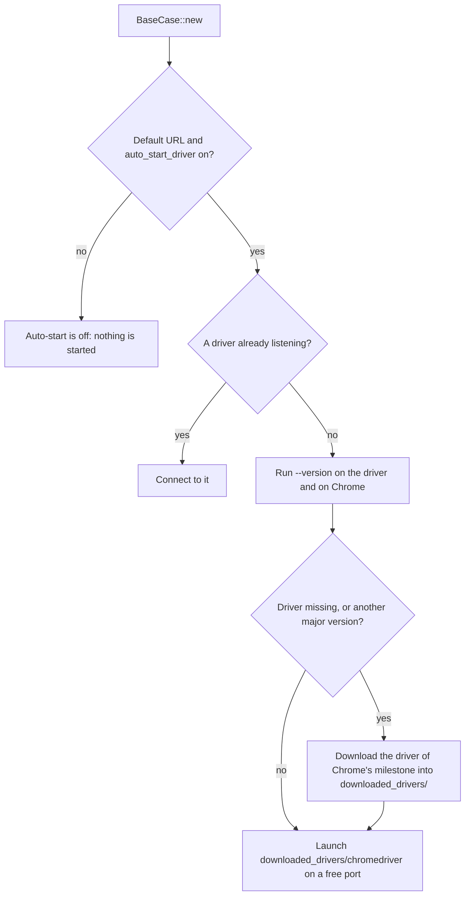

This page collects common pitfalls and their solutions. If you run into
something not listed here, turn on debug logging and check the error category
and hint:

<Tabs>

<Tab title="Your own program" icon="code">

Call `init_tracing()` and run with `RUST_LOG=seleniumbase_rs=debug`.

</Tab>

<Tab title="sbrs and sbrs-mcp" icon="terminal">

They read `SB_LOG_LEVEL`, for example `SB_LOG_LEVEL=seleniumbase_rs=debug,info`.
Without it (or with a blank or invalid one) they fall back to `RUST_LOG`, then
to `info`.

</Tab>

</Tabs>

<Visibility for="agents">

Summary for AI exports: run `sbrs doctor` first; it reports the Chrome and chromedriver it finds and whether their major versions match. `BaseCase::new` auto-starts `downloaded_drivers/chromedriver` only for the default WebDriver URL (`http://localhost:4444`) when `auto_start_driver` is on; a driver you start yourself and pass with `--webdriver` is never replaced. In a container or as root, set `SB_NO_SANDBOX=1` and run headless. Settings variables use the `SB_` prefix, not `SBASE_`. Debug logging: `RUST_LOG=seleniumbase_rs=debug` in your own program, `SB_LOG_LEVEL` for `sbrs` and `sbrs-mcp`. `sbrs` exit status: 1 a check or test failed, 2 wrong input, 3 element or wait, 4 browser or driver, 5 network or site, 6 local file or database, 7 MCP server, 130 or 143 stopped by Ctrl-C or SIGTERM.

</Visibility>

## Start here

<Tip>

Run `sbrs doctor` first. It reports which Chrome and chromedriver it finds and
whether their major versions match, and most start-up problems show up there. In
an AI-agent session the MCP tool `diagnose_environment` reports the same, plus the
platform and the redacted `SB_*` settings, without starting a browser.

</Tip>

| Symptom | Most likely cause | Go to |
|---|---|---|
| "chromedriver keeps crashing", "session not created" | chromedriver and Chrome are different major versions | [chromedriver executable not found](#chromedriver-executable-not-found) |
| The driver is "killed" or refused on a Mac | macOS quarantine or an overwritten signed binary | [chromedriver is killed or refused on macOS](#chromedriver-is-killed-or-refused-on-macos) |
| "Chrome not found" | Chrome is not in a standard location | [Chrome is not found](#chrome-is-not-found) |
| Chrome exits at once in Docker or as root | the sandbox cannot start | [Chrome will not start in a container](#chrome-will-not-start-in-a-container) |
| A wait times out, "element not found" | wrong selector, or the page is not ready | [An element is not found or a wait times out](#an-element-is-not-found-or-a-wait-times-out) |
| A test passes alone but fails in the suite | shared state or too much parallelism | [Passes alone, fails in the suite](#passes-alone-fails-in-the-suite) |
| Detected as a bot | layered detection | [Detected as a bot despite UC mode](#detected-as-a-bot-despite-uc-mode) |
| A type, function or macro is "not found" | an optional Cargo feature is off | [Item not found](#item-not-found-a-cargo-feature-is-off) |
| The MCP server lists no tools | wrong `--server` or no client config | [MCP server not listing tools](#mcp-server-not-listing-tools) |
| A setting is ignored | wrong variable name or prefix | [Environment variable not applied](#environment-variable-not-applied) |

## Detected as a bot despite UC mode

UC mode removes many fingerprints, but detection is layered. Check each defense:

<Steps>

<Step title="Patch the chromedriver binary" icon="wrench">

Use [`ChromedriverPatcher`](/tutorials/binary_patching) or
`cargo run --bin sbrs -- patch-chromedriver --path /path/to/chromedriver`.
Verify with `needs_patch()`.

</Step>

<Step title="Add engine spoofing args" icon="flag">

Pass `engine_spoofing_args()` through `BrowserConfig::with_extra_args` or
`StealthOptions::extra_args`.

</Step>

<Step title="Use a coherent fingerprint" icon="fingerprint">

A Windows user agent with a macOS WebGL vendor or a mobile screen on a desktop
platform is suspicious. Build a
[`Fingerprint`](/tutorials/fingerprint_stealth), keep the values
consistent, and check it with `Fingerprint::validate()`, whose
`CoherenceReport::is_coherent()` is `false` when the values contradict each
other.

</Step>

<Step title="Check WebGL and geolocation consistency" icon="location-dot">

Spoofed WebGL vendor/renderer and geolocation should match the IP address and
timezone.

</Step>

<Step title="Run headed" icon="window-maximize">

A headless session already starts Chrome with `--headless=new`, but some sites
still tell headless from headed. See [Headless detected](#headless-detected).

</Step>

<Step title="Drop chromedriver altogether" icon="bolt">

The [pure CDP engine](/tutorials/pure_cdp) (`seleniumbase_rs::sb_cdp`)
launches Chrome directly, so there is no driver binary to leak markers.

</Step>

</Steps>

## chromedriver executable not found

`BaseCase::new` starts a chromedriver for you when the WebDriver URL is the
default (`http://localhost:4444`) and `auto_start_driver` is on (it is by
default).



*How BaseCase::new finds or starts a chromedriver*

`BaseCase::new` first tries to connect to a driver already listening there; if
none answers, it launches `downloaded_drivers/chromedriver` (`chromedriver.exe`
on Windows) on a free port. A chromedriver only drives the Chrome of its own
major version, so before launching it the crate runs `--version` on the driver
and on your Chrome. If the driver is missing, or is for another major version,
it downloads the driver of your Chrome's <Tooltip tip="A Chrome milestone is its major version number, such as 155.">milestone</Tooltip> into `downloaded_drivers/`
first (the latest stable one when Chrome cannot be found). If both downloads
fail it keeps the old driver and logs a warning. The download needs network
access to the Chrome for Testing endpoint. To fetch the driver ahead of time:

```bash
cargo run --bin sbrs -- install chromedriver
```

`sbrs install` needs the driver's name (alone it prints the page of the command
and exits with status 2): `sbrs install chromedriver` fetches the one for your
Chrome, and `sbrs install geckodriver` and `sbrs install edgedriver` fetch the
drivers of Firefox and Edge (see the
[CLI page](/tutorials/cli_usage#install-a-driver)).

<Note>

For Chrome the auto-start does not look at your `PATH` or at `CHROMEDRIVER_PATH`;
those are consulted only by `sbrs doctor`, which prints which chromedriver it
finds (`CHROMEDRIVER_PATH`, then `downloaded_drivers/`, then `PATH`), its major
version next to Chrome's (`Version: 155 (matches Chrome 155)`, or
`Version: 151, but Chrome is 155` with a hint to run `sbrs install`), and whether
it still has automation markers.

</Note>

To use a driver you run yourself, start it and pass its URL. A URL other than
the default turns auto-start off:

```bash
chromedriver --port=9515 &
cargo run --bin sbrs -- --webdriver http://localhost:9515 open https://example.com
```

A driver you start yourself and pass with `--webdriver` is never replaced. If it
does not match your Chrome version, the session fails to start with a WebDriver
error; `sbrs doctor` shows both versions, and `sbrs install` or the
[Chrome for Testing dashboard](https://googlechromelabs.github.io/chrome-for-testing/)
has a matching one.

## chromedriver is killed or refused on macOS

macOS can refuse a driver that has the `com.apple.quarantine` flag or whose
code signature no longer matches its contents (which is what patching does).
The crate repairs this itself: after downloading, and again if the system
refuses to start the driver, it adds the execute permission, removes the
quarantine flag and, for a binary the system killed as it started, signs it
again ad hoc (`codesign --force --sign -`). `ChromedriverPatcher::patch` also
signs the patched file again on macOS. The same repair is available as
`seleniumbase_rs::browser::driver_access::make_runnable(path, resign)`. If a
driver you supply still will not start, run the two steps by hand:

```bash
xattr -d com.apple.quarantine /path/to/chromedriver
codesign --force --sign - /path/to/chromedriver
```

## Headless detected

`BrowserConfig::default()` is **headless**, while the global config file and the
`sbrs` command line default to headed. A headless session passes
`--headless=new` (and `--disable-gpu`) to Chrome. Switch to headed mode for
sites that still refuse it:

```rust
use seleniumbase_rs::{BrowserConfig, DriverMode};

let config = BrowserConfig::default()
    .with_mode(DriverMode::Uc)
    .with_headless(false);
```

Combine this with a `Fingerprint` and binary patching. On a server with no
display, run the headed browser under a virtual display such as Xvfb. The
defaults of every entry point and what gives a headless browser away are in
[Headless and headed browsers](/tutorials/headless).

## Item not found: a Cargo feature is off

Nothing is enabled by default. These pieces exist only when their feature is on:

| Feature | What it adds |
|---------|--------------|
| `tui` | `sbrs commander`, `sbrs caseplans` and `sbrs behave-gui` (without it each command prints an error and exits with status 2) |
| `gui` | `Gui`, `api::dialog`, `api::gui` and the `dialog`, `dialogs` and `gui_automation` examples (on Linux it links GTK and X11) |
| `playwright` | `PlaywrightSession`, `BaseCase::activate_playwright_mode` |
| `mcp-server` | the `seleniumbase_rs::mcp` module and the `sbrs-mcp` binary |
| `turso` | `seleniumbase_rs::storage` (`ResultStore`, `ProfileVault`) and `sbrs report` |
| `test-util` | the scripted mock browser for `sb_cdp` (`Browser::new_mocked`, `MockCtrl`) |
| `s3`, `azure`, `gcp` | the cloud logging plugins |
| `full-tracing` | a timing-histogram layer in the subscriber the `init_tracing*` functions install |
| `error-backtrace` | nothing yet: the feature is declared, but no code reads it |

Enable one with `--features`, for example
`cargo build --features tui,turso`.

## Playwright / rustwright feature not compiling

The `playwright` feature pulls in the `rustwright` and `rustwright-core`
crates from crates.io, which bring a large Chromium automation core. It is off
by default, so a plain `cargo build` does not need them:

```bash
cargo build --features playwright
```

The project's own quality gate (see `ROADMAP.md`) notes that building with
`--all-features` needs a `libpython` available because of this feature. If you
build with it on macOS and a test binary fails to start with a missing
`libpython...dylib`, point the loader at your Python install's `lib` folder:

```bash
DYLD_LIBRARY_PATH=/path/to/python/lib cargo test --features playwright
```

## MCP server not listing tools

The `sbrs-mcp` binary only exists when the `mcp-server` feature is
enabled:

```bash
cargo build --bin sbrs-mcp --features mcp-server
```

The server communicates over stdio. Configure your MCP client with the absolute
path to the built binary. It serves the `sb` toolset unless you pass
`--server cdp` or `--server driver`. Listing tools does not require a running
browser, but no browser exists until the client calls the `start_browser` tool;
any other browser tool called first returns "no browser session is running; call
start_browser first". See the [MCP servers guide](/tutorials/mcp_server).

## Macro not found

Macros are `#[macro_export]` and live at the crate root, not under
`seleniumbase_rs::macros`:

```rust
use seleniumbase_rs::{sb_open, sb_click, sb_test, selector};
```

Action macros expand `.await` internally, so they must be called inside an
`async` block or function. `sb_test!` generates a `#[tokio::test]` wrapper for
you. See the [macros guide](/tutorials/macros).

## Chrome is not found

The library looks in the usual install locations for your system (see
[Operating systems](/building#operating-systems)). If yours is elsewhere, or you want a
specific build, name it:

```bash
export SB_CHROME_BIN="/path/to/chrome"      # CHROME_BIN also works
```

Run `sbrs doctor` to confirm which one was picked. The pure CDP engine also takes
the path in `LaunchOptions`.

## Chrome will not start in a container

Chrome often cannot start its sandbox as root or inside Docker. Set
`SB_NO_SANDBOX=1` (or `LaunchOptionsBuilder::no_sandbox(true)` in the pure CDP
engine) and run headless (`SB_HEADLESS=true`).

<Warning>

`--no-sandbox` weakens the browser's isolation, so use it only in a container you
control.

</Warning>

If it crashes under load rather than at start, give the container more shared
memory (`--shm-size=1g`). See [Deployment](/deployment).

## An element is not found or a wait times out

Read the error before changing anything: it names the selector and carries a
hint, and element errors point out a likely mistake in the selector.

<Steps>

<Step title="Check the selector" icon="crosshairs">

Check the selector in the browser's developer tools; a class that is generated
on each build, or an element inside an iframe or a shadow root, will not match
a plain selector.

</Step>

<Step title="Wait for the right condition" icon="clock">

Wait for the right condition (`wait_for_element_visible`, `wait_for_text`)
instead of sleeping.

</Step>

<Step title="Remember the built-in wait" icon="hourglass-half">

`BaseCase` actions already wait for their element for the default timeout
(10 seconds; `set_timeout` changes it). A timeout that long usually means the
selector is wrong, not that the page is slow.

</Step>

<Step title="Ask the agent tools" icon="robot">

With an AI agent attached, `diagnose_selector` explains why a selector matches
nothing and `suggest_selectors` proposes ones that work; `inspect_page` shows
what is on the page.

</Step>

</Steps>

## Passes alone, fails in the suite

The usual causes are shared state and too much parallelism. Give each test its
own browser context (the pool's `Lease` isolates cookies and storage), do not
reuse a logged-in profile between tests, and lower `SB_THREADS` to see whether the
failure goes away. Do not add retries to hide it; see
[Reliability](/reliability).

## Reading an error

Every `SeleniumBaseError` has a hint: the likely cause and the fix
(`error.hint()`). Element errors name the selector, the strategy it was read as
(the same rules the lookup uses), and a likely mistake in it: a mistyped prefix
(`lnk=Home` for `link=Home`), a prefix from another tool (`css=`, `xpath=`,
`id=`, `name=`), XPath without its leading `//`, or unbalanced brackets.

`sbrs` prints a failure for people, on standard error, with colour only on a
terminal (and never with `NO_COLOR` set):

```text
error: invalid configuration: failed to read settings: No such file or directory (os error 2)
hint: Review the configuration values passed to the builder, the command line or the environment; `sbrs doctor` checks the browser setup.
```

A cause the first line does not already say gets its own `caused by:` line. The
exit status says which kind of failure it was:

| Status | Meaning |
| --- | --- |
| 1 | a check or a test failed, or another error |
| 2 | the input was wrong (configuration, selector syntax, a value that does not parse); also what a mistyped option gives |
| 3 | an element could not be found or used, or a wait timed out |
| 4 | the browser or its driver failed |
| 5 | the network or a site failed |
| 6 | a local file or database failed |
| 7 | the MCP server failed |
| 130, 143 | stopped by Ctrl-C or SIGTERM |

<Note>

`sbrs test` is the exception: it exits with the status of the `cargo test` it
ran.

</Note>

In the HTML report of `ReportPlugin`, a failed test shows its error, the hint,
the page's URL and title when it failed, and, with
`ReportPlugin::html(path).with_evidence()`, links to the screenshot and page
source saved next to the report. The MCP servers answer a failed call with a
report that includes the page's state and the next tools to try; see the
[MCP tutorial](/tutorials/mcp_server#when-a-call-fails).

## Errors are not descriptive enough

`SeleniumBaseError::log()` emits a `tracing` error event with the error
category, whether it is transient, and a remediation hint; `ResultExt::log_err`
logs only the message. Make sure a subscriber is installed:

```rust,no_run
# use seleniumbase_rs::{init_tracing, BaseCase, ResultExt};
# async fn demo(case: &mut BaseCase) {
init_tracing();

// `log_err` logs the message and returns the Result unchanged.
let _ = case.click("#missing").await.log_err();

// `log` adds `error.category`, `error.transient` and `error.hint` fields.
if let Err(err) = case.click("#missing").await {
    err.log();
}
# }
```

Or configure the log level before running `sbrs` / `sbrs-mcp`:

```bash
SB_LOG_LEVEL=seleniumbase_rs=info,error cargo run --bin sbrs -- open https://example.com
```

`SeleniumBaseError` provides helpers for programmatic handling:

```rust
# use seleniumbase_rs::SeleniumBaseError;
# fn handle(err: SeleniumBaseError) -> Result<(), SeleniumBaseError> {
match err {
    e if e.is_transient() => println!("worth another attempt: {e}"),
    e if e.is_skipped() => return Ok(()),
    e if e.category() == "element_not_found" => {
        println!("Hint: {}", e.hint().unwrap_or_default());
    }
    e => return Err(e),
}
# Ok(())
# }
```

To retry transient failures with backoff, see `RetryPolicy` in the
[reliability guide](/reliability).

## Environment variable not applied

Configuration uses the `SB_` prefix, not `SBASE_`. For example:

```bash
export SB_HEADLESS=true
export SB_WEBDRIVER_URL=http://localhost:9515
```

Where a variable is read depends on how you build the configuration:

- `BrowserConfig::default()` reads **no** variables. `BrowserConfig::from_env()`
  reads the runtime ones (`SB_WEBDRIVER_URL`, `SB_CHROME_BIN`,
  `SB_REMOTE_WEBDRIVER_TIMEOUT`, and so on).
- `Settings::load()`, `Settings::load_from(path)` and `Settings::from_env()`
  read the settings ones, `SB_WEBDRIVER_URL` and `SB_CHROME_BIN` among them
  (`SB_BROWSER`, `SB_HEADLESS`, `SB_TIMEOUT`, and the rest of the list in
  [Customizing Test Runs](/help/customizing_test_runs)). `sbrs test` passes the
  flags you give it to the tests as such variables.
- The `sbrs` binary reads the settings ones. Its browser commands (`open`,
  `smoke`, and the rest) start from the config file (`--config FILE`, else the
  global one), apply the settings variables on top, and then its own flags,
  which win. The WebDriver URL is `--webdriver`, else `SB_WEBDRIVER_URL`, else
  `http://localhost:4444`; the browser binary is `SB_CHROME_BIN`.

See [Customizing Test Runs](/help/customizing_test_runs) for the full list.

## Frequently asked questions

Short answers, with a pointer to the page that has the detail.

### Choosing and getting started

<AccordionGroup>

<Accordion title="Is this the same as Python SeleniumBase?" icon="code-compare">

It is a Rust port of it (tracking 4.55.2) and of its MCP server. Every upstream
API has a recorded status in [the parity table](/parity). It also adds things
Python does not have; see [Why Rust?](/why-rust).

</Accordion>

<Accordion title="Do I need Rust to use it?" icon="code">

To write tests in Rust, yes. The `sbrs` CLI and the MCP server are single
binaries you can use without writing Rust; `sbrs` can also convert Python
SeleniumBase scripts.

</Accordion>

<Accordion title="Which engine should I use?" icon="route">

Start with the pure CDP engine (`sb_cdp`): it drives Chrome directly, so there is
no chromedriver to match. Use the WebDriver engine (`BaseCase`) for Selenium Grid,
Firefox, or an existing SeleniumBase-style suite. See
[Performance](/performance#choosing-the-engine).

</Accordion>

<Accordion title="Is it on crates.io?" icon="cube">

No. Build it from the repository ([Building](/building)) or add it as a git
dependency.

</Accordion>

<Accordion title="Does it run on Windows and Linux?" icon="desktop">

CI builds and tests on Linux, macOS and Windows. Development happens on macOS.
See [Operating systems](/building#operating-systems).

</Accordion>

<Accordion title="How does it compare with Playwright, Selenium or Puppeteer?" icon="scale-balanced">

See [How it compares](/comparison).

</Accordion>

</AccordionGroup>

### Using it

<AccordionGroup>

<Accordion title="Is it faster than Python SeleniumBase?" icon="gauge-high">

Not for end-to-end tests: Chrome, the network and the page dominate. It has low
overhead of its own ([Benchmarks](/benchmarks)), but there is no measured
comparison with Python. See [Performance](/performance).

</Accordion>

<Accordion title="A test fails with a wait timeout. What now?" icon="clock">

Read the hint in the error: it names the selector and a likely mistake. Use
`wait_for_element_visible`/`wait_for_text` instead of sleeps. In an AI-agent
session, `diagnose_selector` and `inspect_page` show what the page really has.
See [Reliability](/reliability).

</Accordion>

<Accordion title="Why does sbrs exit with different statuses?" icon="terminal">

The exit status follows the error's category (a bad selector differs from a
missing browser), so a CI script can tell them apart.

</Accordion>

<Accordion title="Can an AI agent write my tests?" icon="robot">

Yes, with the MCP servers and `export_session_as_test`; the result is a draft you
review. See [Vibe coding](/tutorials/vibe_coding).

</Accordion>

</AccordionGroup>

### Browsers and drivers

<AccordionGroup>

<Accordion title='"chromedriver keeps crashing" or "session not created".' icon="triangle-exclamation">

The chromedriver and Chrome major versions differ. Run `sbrs doctor`, then
`sbrs install chromedriver`. The pure CDP engine avoids the problem. See
[Common problems](/help/common_problems).

</Accordion>

<Accordion title="Can it drive Firefox or Safari?" icon="globe">

Firefox through the WebDriver engine (there are typed Firefox preferences); Safari
launch options exist for the WebDriver engine. The pure CDP engine is Chrome and
Chromium only. A `playwright` feature gives a Playwright-compatible mode.

</Accordion>

<Accordion title="Does it work headless?" icon="eye-slash">

Yes, and use it in containers and CI. How you turn it on depends on the entry
point: `BrowserConfig::default()` is already headless, `sbrs` and code that loads
`Settings` read `SB_HEADLESS=true`, and the pure CDP engine is headless on Linux
by default (`LaunchOptionsBuilder::headless(true)` anywhere). See
[Headless and headed browsers](/tutorials/headless).

</Accordion>

</AccordionGroup>

### Stealth and scraping

<AccordionGroup>

<Accordion title="Does it get past bot detection?" icon="user-secret">

It reduces the obvious signs (no webdriver markers in the pure CDP engine,
coherent fingerprints, human-paced input), but there is no guarantee against any
particular service, and the randomised identities have not been tested against
live detection.

TLS (JA3/JA4) and HTTP/2 impersonation for one measured browser
and system (Chrome 155 on macOS), with an HTTP session, a proxy that applies it to
a real Chrome, and a session that moves between the two, is the separate,
experimental [seleniumbase-rs-stealth](https://github.com/MustCodeAl/seleniumbase-rs-stealth)
project (it left this crate in 0.3.0). It was tested against local servers and a
local Chrome, not live services.

See [the stealth tutorial](/tutorials/fingerprint_stealth) and
[Stealth scraping](/stealth/overview).

</Accordion>

<Accordion title="Is scraping with it allowed?" icon="gavel">

That depends on the site's terms and the law where you are. The library does not
make that decision for you.

</Accordion>

</AccordionGroup>

### Contributing and project status

<AccordionGroup>

<Accordion title="How complete is the port?" icon="list-check">

Every upstream API has a status (888 implemented, 383 composed, 94
not-applicable, none planned), and most behaviour is tested against a mock or
unit tests rather than a real browser.

An audit of the entries marked
implemented found 26 that did less than the Python method, and a second audit of
the composed and not-applicable entries found 34 more that said more than the
Rust does; they were fixed or re-marked, and the `planned` ones are listed in
[the parity table](/parity).

The project README has a "Project status" section.

</Accordion>

<Accordion title="How do I contribute?" icon="code-pull-request">

Read `CONTRIBUTING.md` and `CLAUDE.md`. Run the checks listed in
[Building](/building) before opening a pull request.

</Accordion>

</AccordionGroup>
