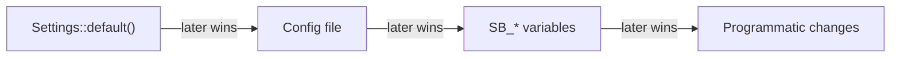

SeleniumBase for Rust can be configured through the `BrowserConfig` builder, a
global config file, environment variables, or CLI flags. This guide explains the
full hierarchy and shows how to make each source of configuration work for your
workflow.

<Info>

**What you will learn**

- How to configure a run with the `BrowserConfig` builder.
- How to create a global TOML config file.
- How to override settings with `SB_*` environment variables.
- How CLI flags interact with programmatic and file configuration, and how
  `sbrs test` hands them to your tests.

</Info>

<Visibility for="agents">

Summary for AI exports: a run is configured by the `BrowserConfig` builder, a global `sbase_config.toml` (or `.sbase_config.toml`, `.sbase_config`) in the working directory, `SB_*` environment variables and `sbrs` flags. Later sources win: defaults, config file, `SB_*` variables, then programmatic changes. `sbrs` options go before the subcommand. `sbrs test` passes the global options to tests as `SB_*` variables.

</Visibility>

## BrowserConfig builder

The most direct way to configure a run is the `BrowserConfig` builder. Every
method returns `Self`, so calls can be chained fluently. `BrowserConfig::default()`
is headless, reads no environment variables, and starts a chromedriver for you
when none is running at the default WebDriver URL.

```rust,no_run
use seleniumbase_rs::{BaseCase, BrowserConfig, DriverMode};

#[tokio::main]
async fn main() -> Result<(), Box<dyn std::error::Error>> {
    let config = BrowserConfig::default()
        .with_mode(DriverMode::Uc)
        .with_headless(true)
        .with_mobile(true)
        .with_locale("en-US")
        .with_proxy("http://proxy.example.com:8080");

    let mut sb = BaseCase::new(config).await?;
    sb.set_timeout(15).await?;
    sb.open("https://seleniumbase.io").await?;
    sb.quit().await?;
    Ok(())
}
```

Key builder methods:

| Method | Effect |
|---|---|
| `with_mode(mode)` | Set `DriverMode::WebDriver`, `Cdp`, or `Uc`. |
| `with_browser(browser)` | Set `Browser::Chrome`, `Chromium`, `Edge`, or `Firefox`. |
| `with_headless(bool)` | Run without a visible window. |
| `with_webdriver_url(url)` | Connect to this WebDriver server instead of auto-starting a local chromedriver. |
| `with_user_agent(s)` | Override the user agent string. |
| `with_mobile(bool)` | Emulate a mobile device: a 390x844 window and an Android Chrome user agent, unless you set your own user agent. |
| `with_locale(s)` | Set `navigator.languages` / `Accept-Language`. |
| `with_proxy(url)` | Route traffic through an HTTP/HTTPS/SOCKS proxy. |
| `with_proxy_pac_url(url)` | Load proxy configuration from a <Tooltip tip="Proxy auto-config: a script that tells the browser which proxy to use for a URL.">PAC</Tooltip> file. |
| `with_user_data_dir(path)` | Launch with an existing Chromium profile. |
| `with_extension_dir(path)` | Load an unpacked extension. |
| `with_start_page(url)` | The page `BaseCase::open_start_page` / `goto_start_page` returns to (default `about:blank`). |
| `with_reuse_session(bool)` | Share browsers among the tests of the run (`--reuse-session`, `--rs`); see [Sharing a browser between tests](#sharing-a-browser-between-tests). |
| `with_reuse_module_session(bool)` / `with_reuse_class_session(name)` | Share a browser only among the tests of one module, or of one name (`--rcs`). Both turn `reuse_session` on. |
| `with_threads(n)` | Sets `threads`. `BaseCase` ignores it; only `sbrs test` acts on a thread count (`-n`, as `--test-threads`). |
| `with_ad_block(bool)` | Sets `ad_block`: a Chromium WebDriver session refuses the requests of advertising and tracking hosts (see below). |
| `with_ad_block_list(list)` | Block the hosts of this `AdBlockList` instead of the built-in list, and turn `ad_block` on. |
| `with_fingerprint(fp)` | Apply a [`Fingerprint`](/tutorials/fingerprint_stealth). |
| `with_browser_binary_path(path)` | Use this Chrome/Chromium/Edge executable. |
| `with_extra_args(vec)` / `push_extra_arg(s)` | Pass extra Chromium launch flags. |

`with_remote_webdriver_timeout(Duration)` sets the client-side timeout of each
request to a Remote WebDriver server (a part of a second rounds up to a whole
second), the field `remote_webdriver_timeout_seconds`.

| Builder | Effect |
|---|---|
| `with_run_settings(settings)` | The demo, slow, message and default-timeout settings a test starts with; see [Run settings](/tutorials/run_settings). |

### Blocking ads

<Badge color="blue">Chromium WebDriver sessions</Badge>

`ad_block` makes a Chromium WebDriver session (Chrome, Chromium, Edge, Brave,
Comet, Opera, Chrome for Testing, `chrome-headless-shell`) refuse every request
to a listed advertising or tracking host and its subdomains. Once the session is
connected it sends the hosts to the browser with `Network.setBlockedURLs`
through chromedriver's DevTools channel. The list is the built-in
`AdBlockList::builtin()`, or your own:

```rust
use seleniumbase_rs::config::ad_block_list::AdBlockList;
use seleniumbase_rs::BrowserConfig;

let list = AdBlockList::from_hosts(["ads.example.com", "tracker.example.net"])?;
let config = BrowserConfig::default().with_ad_block_list(list);
# Ok::<(), seleniumbase_rs::SeleniumBaseError>(())
```

A list of your own replaces the built-in one. A list that needs more than 2,000
URL patterns is refused when the session starts. Limits:

<Warning>

- The block belongs to a window. The session repeats it for the window it opens
  with and for each window it switches to (`switch_to_window`,
  `switch_to_new_window`); a window reached any other way needs
  `BrowserSession::apply_ad_block()`.
- A URL that names a port (`https://ads.example.com:8443/`) is not matched.
- A frame of another site is not stopped from loading, and what it requests is
  not blocked (checked in Chrome 155). A frame of the page's own site is blocked
  like the page. Ad frames are usually of another site, so this blocks the
  scripts, pixels and images a page asks for, and not the frames that carry the
  ads.
- Firefox, Safari and Internet Explorer have no DevTools channel through
  WebDriver, so the setting blocks nothing there and a warning says so.
- Python hides the ad elements of a page once it has loaded; `BaseCase::ad_block`
  does that, when called. The pure CDP engine blocks hosts with
  `LaunchOptionsBuilder::ad_block`.

</Warning>

### Launch settings

The Python SeleniumBase options that shape how a browser or its driver starts
live in `BrowserConfig::launch` (a `LaunchSettings`) and have builder methods of
their own. Each value type reads the text the Python command line takes, so
`"1280,720".parse::<WindowSize>()` and `"eager".parse::<PageLoadStrategy>()`
work.

| Method | Python option | Effect |
|---|---|---|
| `with_block_images(bool)`, `with_disable_js(bool)`, `with_disable_cookies(bool)`, `with_do_not_track(bool)`, `with_external_pdf(bool)` | `--block-images`, `--disable-js`, `--disable-cookies`, `--do-not-track`, `--external-pdf` | Browser preferences (Chrome `prefs`, Firefox preferences). |
| `with_enable_sync(bool)` | `--enable-sync` | Leave Chrome Sync on; sessions switch it off otherwise. |
| `with_disable_csp(bool)` | `--disable-csp`, `--dcsp`, `--no-csp` | Remove the Content-Security-Policy headers (bundled extension, Chromium only). |
| `with_page_load_strategy(s)` | `--page-load-strategy`, `--pls` | `normal`, `eager` or `none`. |
| `with_window_size(s)`, `with_window_position(p)` | `--window-size`, `--window-position` | Size and place the window. |
| `with_device_metrics(m)` | `--metrics`, `d_width`, `d_height`, `d_p_r` | Emulate a phone screen (turns `mobile` on). |
| `with_proxy_bypass_list(l)` | `--proxy-bypass-list` | Hosts that skip the proxy. |
| `with_proxy_for_driver_download(bool)` | `--proxy-driver` | Download drivers and Chrome for Testing through the proxy. |
| `with_extension_archive(a)` | `--extension-zip`, `--crx` | Load a `.zip` or `.crx` extension (Chromium). |
| `with_automation_extension(bool)`, `with_recorder_extension(bool)` | `--use-auto-ext`, `recorder_ext` | Keep Chrome's automation extension; load the Recorder. |
| `with_esc_end(bool)` | `--esc-end`, `--esc_end`, `--ee` | End the test when ESC is pressed in the browser (see below). |
| `with_rec_sb_cdp(bool)` | `--rec-sb-cdp`, `rec_sb_cdp` | Write recordings as pure CDP code: `export_recording_as_rust` and `save_recording_to_logs` return `ActionRecorder::to_cdp_script` ([Recorder Mode](/tutorials/recorder_mode#pure-cdp-code---rec-sb-cdp)). |
| `with_firefox_options(o)` | `--firefox-arg`, `--firefox-pref` | Firefox arguments and preferences. |
| `with_capabilities(c)` | `--cap-string`, `--cap-file` | Merge extra capabilities into the session's. |
| `with_driver_version(v)` | `--driver-version` | Run this chromedriver (downloaded when missing). |
| `with_remote_debug(bool)`, `with_remote_debug_port(p)` | `--remote-debug` | Open Chrome's debugger (9222 or a port you name). |
| `with_cdp_events(c)` | `--log-cdp-events`, `--uc-cdp-events` | Keep the DevTools events; read them with `BrowserSession::cdp_events`. |
| `with_virtual_display(d)` | `--xvfb`, `--xvfb-metrics` | Run a headed browser on <Tooltip tip="A virtual display server: it lets a headed browser run on a machine with no screen.">Xvfb</Tooltip> (Linux). |

`with_browser` also takes `Brave`, `Comet`, `Opera`, `Safari`,
`InternetExplorer`, `ChromeForTesting` and `ChromeHeadlessShell` (the Python
`--brave`, `--comet`, `--opera`, `--safari`, `--ie`, `--cft` and `--chs`). Chrome
for Testing and `chrome-headless-shell` are downloaded into `downloaded_drivers/`
when missing; Opera, Safari and Internet Explorer need their own driver
(`operadriver`, `safaridriver`, `IEDriverServer`) on the `PATH`.

### Ending a test with ESC

<Badge color="blue">WebDriver engine (`BaseCase`) only</Badge>

`with_esc_end(true)` lets the person watching a headed run stop the test: `BaseCase`
puts a key listener in the page, and the first `open`, `click`, `click_link_text`,
`highlight`, `wait_for_element_visible`, `wait_for_ready_state_complete`, `type_text`,
`update_text` or `press_keys` after ESC was pressed returns
`SeleniumBaseError::Skipped` instead of doing its work. `run_browser_test`
counts that as a skipped test, not a failure. A new page loses the listener, so
`open`, `refresh`, `go_back`, `go_forward`, `click`, `click_link_text` and
`wait_for_ready_state_complete` put it back. The listener is added with
`addEventListener`, so the page keeps its own key handlers. Only the WebDriver
engine (`BaseCase`) has the option.

### Sharing a browser between tests

`with_reuse_session(true)` (`--reuse-session`, `--reuse_session`, `--rs`,
`SB_REUSE_SESSION`) keeps a browser open from one test to the next, as Python's
option does. `BaseCase::new` attaches to a browser that an earlier test of the
same process started with the same configuration (everything but the start
page) and has given back, and `BaseCase::quit`, `run_browser_test` or dropping
the case gives it back open instead of closing it:

```rust,no_run
use seleniumbase_rs::{run_browser_test, BrowserConfig};

#[tokio::test]
async fn login_page_loads() -> seleniumbase_rs::Result<()> {
    let config = BrowserConfig::default().with_reuse_session(true);
    run_browser_test(config, async |sb| sb.open("https://example.com/login").await)
    .await
}
```

Each `#[tokio::test]` has its own Tokio runtime, so what is shared is the
browser's WebDriver session, not a client: a process-wide registry keeps the
address of its WebDriver server, its session id and the chromedriver this crate
started, and each test attaches with a client of its own.

- Before a test gets a browser back it is cleaned: an open dialog is dismissed,
  every window but the first is closed, every cookie is deleted (through
  DevTools on a Chromium browser), the open page's local and session storage is
  cleared, and it goes to `about:blank` (then to the start page, if there is
  one). Python keeps the cookies and the page unless `--crumbs` is given; here a
  browser is always cleaned, because Rust tests run in any order and side by
  side.
- One test holds a browser at a time. A test that starts while every matching
  browser is held gets a browser of its own, kept for reuse too, so a run with
  four test threads ends up with up to four browsers. A browser that no longer
  answers is closed and replaced.
- `get_new_driver` browsers are never shared.
- `BaseCase::session_id()` tells which browser a test has.

`with_reuse_module_session(true)` (`--rcs`, `--reuse-class-session`,
`SB_REUSE_CLASS_SESSION`) shares a browser only among the tests of one Rust
module, which plays the part of Python's test class. The module is read from
the name libtest gives the thread a test runs on: `login::tests::valid_password`
is in `login::tests`, and every test at the root of an integration test file is
in the root module. `with_reuse_class_session("Login")` shares one among the
tests that pass the same name instead.

Idle browsers are closed, with their chromedriver, by a background thread once
no test has held them for five seconds (`seleniumbase_rs::browser::reuse::set_idle_timeout`,
or `SB_REUSE_IDLE_SECS` in whole seconds), by
`seleniumbase_rs::shutdown_reused_sessions()`, and by
`common::shutdown::drain_cleanups`, which `sbrs` calls before it exits. A Rust
test binary has no hook that runs after its last test, and it usually exits
sooner than the idle timeout. On macOS and Linux the browser of the last tests
still ends with the binary: every chromedriver and browser this crate starts
belongs to a process group that a small watcher ends when the program that
started it exits, also when that program is killed.

<Warning>

On Windows nothing watches
them, so call `shutdown_reused_sessions()` where your run ends (the `main` of a
`harness = false` test target, or the end of a program).

</Warning>

Under cargo-nextest
each test is a process of its own, so nothing is shared.

## Global config file

Create `sbase_config.toml` in the directory you run from, for shared defaults:

<CodeGroup>

```toml sbase_config.toml
browser = "chrome"
headless = false
mobile = false
locale = "en-US"
timeout_seconds = 10
screenshot_dir = "screenshots"
proxy = "http://proxy.example.com:8080"
```

```json .sbase_config
{ "browser": "chrome", "headless": false, "timeout_seconds": 10 }
```

</CodeGroup>

Every key is optional and any key you leave out keeps its default. The keys are
the fields of `Settings`: `browser`, `headless`, `timeout_seconds`,
`screenshot_dir`, `proxy`, `proxy_pac_url`, `window_width`, `window_height`,
`user_data_dir`, `extension_dir`, `locale`, `user_agent`, `mode` (`webdriver`,
`cdp` or `uc`), `ad_block`, `reuse_session`, `reuse_class_session`, `mobile`, `threads`, `esc_end`,
`rec_sb_cdp`, `remote_webdriver_timeout_seconds`, `webdriver_url` and `chrome_bin`.
Note that `timeout_seconds` is a whole number of seconds. A `browser` or `mode`
that is not a known name, or a `window_width` without a `window_height`, is an
error when the file is read.

`Settings::load_global()` looks for these names, in this order, in the
**current working directory only** (it does not search parent directories):
`sbase_config.toml`, `.sbase_config.toml`, `.sbase_config`. A file whose name
ends in `.toml` is read as TOML; any other name, including `.sbase_config`, is
read as JSON (the second tab above).

<Warning>

A flat `key=value` file is not supported. `sbrs --config FILE` (or `-c FILE`)
reads one specific file by the same rule.

</Warning>

<Note>

`timeout_seconds` becomes the default wait of every `BaseCase` made from
`settings.to_browser_config()` (`BaseCase::new`, so `run_browser_test` and the
plugin runner too); `sb.set_timeout(..)` changes it later. `window_width` and
`window_height` set the browser window when both are present. `screenshot_dir`
is stored for your code to read; nothing in the crate applies it.

</Note>

To build a `BrowserConfig` from the file in your own test:

```rust,no_run
use seleniumbase_rs::config::settings::Settings;
use seleniumbase_rs::BaseCase;

# async fn demo() -> Result<(), Box<dyn std::error::Error>> {
// The global config file (if any), with the SB_* variables applied on top.
// `Settings::load_from(path)` reads a file you name instead.
let settings = Settings::load()?;
let config = settings.to_browser_config();

// `timeout_seconds` from the file or `SB_TIMEOUT` is already its default wait.
let mut sb = BaseCase::new(config).await?;
# sb.quit().await?;
# Ok(())
# }
```

`to_browser_config()` takes the WebDriver URL and the browser binary from
`webdriver_url` and `chrome_bin` (`SB_WEBDRIVER_URL` and `SB_CHROME_BIN`), and
does not set a fingerprint or extra arguments; add those with the builder
methods afterwards.

## Environment variables

Environment variables override file values. The prefix is `SB_` (not `SBASE_`):

```bash Terminal
export SB_HEADLESS=true
export SB_LOCALE=fr-FR
export SB_BROWSER=chrome
export SB_TIMEOUT=20
```

`Settings::load` and `Settings::from_env` read exactly these, each mapped to the
field of the same name: `SB_BROWSER`, `SB_HEADLESS`, `SB_TIMEOUT`,
`SB_REMOTE_WEBDRIVER_TIMEOUT`, `SB_SCREENSHOT_DIR`, `SB_PROXY`,
`SB_PROXY_PAC_URL`, `SB_WINDOW_WIDTH`, `SB_WINDOW_HEIGHT`, `SB_USER_DATA_DIR`,
`SB_EXTENSION_DIR`, `SB_LOCALE`, `SB_USER_AGENT`, `SB_MODE`, `SB_AD_BLOCK`,
`SB_REUSE_SESSION`, `SB_REUSE_CLASS_SESSION`, `SB_MOBILE`, `SB_THREADS`,
`SB_ESC_END`, `SB_REC_SB_CDP`, `SB_WEBDRIVER_URL` and `SB_CHROME_BIN`. Booleans accept `true`/`false`, `1`/`0`, `yes`/`no` and
`on`/`off`. There is no automatic name mapping: a
variable that is not in this list, such as `SB_LOGGING__LOG_LEVEL`, does
nothing. See [Settings and Global Configuration](/tutorials/settings_and_config)
for the table, including the separate runtime variables (`SB_LOG_LEVEL`,
`SB_LOG_FORMAT`, ...), which `RuntimeConfig::from_env()` reads, and
`BrowserConfig::from_env()`, which reads only `SB_WEBDRIVER_URL` and
`SB_CHROME_BIN`:

```bash Terminal
export SB_WEBDRIVER_URL=http://localhost:4444/wd/hub
```

The `sbrs` binary reads the settings variables above when it drives a browser
(`sbrs open`, `smoke` and the other browser commands). A bad value, such
as `SB_HEADLESS=maybe`, stops the command with an error before any browser
starts.

## CLI flags

<Warning>

When using the `sbrs` binary, put its options **before** the subcommand. They
belong to `sbrs` itself, not to the subcommand, so `sbrs open URL --headless`
is rejected.

</Warning>

```bash Terminal
cargo run --bin sbrs -- --headless --proxy http://proxy.example.com:8080 open https://seleniumbase.io
```

Common flags:

| Flag | Description |
|------|-------------|
| `--headless` / `--headed` | Run the browser without or with a visible window. |
| `--mobile` | Emulate a mobile device (see `with_mobile`). |
| `--esc-end` / `--esc_end` / `--ee` | End the test when ESC is pressed in the browser (see `with_esc_end`). |
| `--rec-sb-cdp` / `--rec_sb_cdp` | Write recordings as pure CDP code (see `with_rec_sb_cdp`); `sbrs run-scenario` then saves a pure CDP program. |
| `--proxy HOST:PORT` | Route traffic through a proxy (`scheme://host:port` also works). |
| `--proxy-list FILE` | Choose from a file of proxies: a random one, or the entry named by `--proxy`. |
| `--proxy-pac-url URL` | Use a PAC file for proxy configuration. |
| `--user-data-dir DIR` | Load a Chromium user data directory. |
| `--extension-dir DIR` | Load a Chromium extension. |
| `--user-agent STRING` / `-a STRING` | Override the user agent. |
| `--locale LOCALE` | Set the browser locale. |
| `--ad-block` | Sets `ad_block`: a Chromium WebDriver session refuses the built-in list of ad and tracker hosts (`Network.setBlockedURLs`). Firefox and Safari block nothing. Images stay on; `--block-images` turns them off. |
| `--reuse-session` / `--reuse_session` / `--rs` | Share browsers among the tests of the run (see [Sharing a browser between tests](#sharing-a-browser-between-tests)); `sbrs test` passes it on as `SB_REUSE_SESSION`. |
| `--rcs` / `--reuse-class-session` / `--reuse_class_session` | Share a browser among the tests of one Rust module; `sbrs test` passes it on as `SB_REUSE_CLASS_SESSION`. |
| `-n NUM` / `--threads NUM` | With `sbrs test`, run that many tests at once (`--test-threads`), so that many browsers. |
| `--browser NAME` | Select `chrome`, `chromium`, `edge`, or `firefox`. |
| `--cdp` / `--uc` | Select CDP or UC mode (they cannot be combined). |
| `--webdriver URL` | WebDriver server URL (default `SB_WEBDRIVER_URL`, else `http://localhost:4444`). |
| `-c FILE` / `--config FILE` | Read settings from this TOML or JSON file instead of the global config file. |

Run `sbrs --help` and `sbrs <subcommand> --help` for the full list of flags.

### Running tests with `sbrs test`

`sbrs test` runs `cargo test` (or one example) and carries the global options
into the tests as `SB_*` environment variables, so a test that loads `Settings`
sees them:

```bash Terminal
# Sets SB_HEADLESS=true and SB_BROWSER=firefox, and runs 2 tests at a time.
cargo run --bin sbrs -- --headless --browser firefox -n 2 test
cargo run --bin sbrs -- test login --test checkout --release --features turso
```

It accepts a name filter, `--test NAME` (one file from `tests/`),
`--example NAME`, `--release`, `--features a,b`, and harness arguments after
`--`. Only the options you actually pass become variables, so everything else
still comes from your config file and environment. A non-default
`--webdriver` URL reaches the tests as `SB_WEBDRIVER_URL`.

## Combining config sources

For a test that builds its configuration with `Settings::load` and then adjusts
it, later sources win:

1. Built-in defaults (`Settings::default()`).
2. Global config file (`sbase_config.toml`, `.sbase_config.toml` or `.sbase_config`).
3. Environment variables (`SB_*`).
4. Programmatic changes, such as `BrowserConfig` builder calls.



`sbrs test` adds the command-line flags as step 3 for its tests. The `sbrs`
binary follows the same order when it drives a browser directly (`sbrs open`
and the like): it starts from the config file (the global one, or the one named
by `--config`), applies the `SB_*` variables on top, and then the CLI flags
override both. So `SB_HEADLESS=true sbrs open URL` runs headless, and
`SB_HEADLESS=true sbrs --headed open URL` shows the window.

<Tip>

Use the config file for stable defaults, environment variables for CI-specific
overrides, and the builder or CLI flags for one-off experiments.

</Tip>

## Troubleshooting

<AccordionGroup>

<Accordion title="Environment variable ignored" icon="key">

**Likely cause:** Used `SBASE_` instead of `SB_`, or the variable is not one `Settings` reads.

**Fix:** Use the `SB_` prefix and a name from the list above.

</Accordion>

<Accordion title="sbrs open still shows a window with SB_HEADLESS=true" icon="window-maximize">

**Likely cause:** A `--headed` flag beats the variable, or the variable is not exported to `sbrs`.

**Fix:** Drop `--headed`, and `export` the variable (or put it before the command on the same line).

</Accordion>

<Accordion title="Config file not loaded" icon="folder-open">

**Likely cause:** File is in a parent directory, or has another name.

**Fix:** Put it in the directory you run from, named `sbase_config.toml`.

</Accordion>

<Accordion title="Config file fails to parse" icon="file-circle-exclamation">

**Likely cause:** A flat `key=value` file, or a float for `timeout_seconds`.

**Fix:** Use TOML (`.toml` name) or JSON, and whole numbers of seconds.

</Accordion>

<Accordion title="CLI flag rejected as unexpected" icon="flag">

**Likely cause:** The flag was placed after the subcommand.

**Fix:** Put it before: `sbrs --headless open URL`.

</Accordion>

<Accordion title="Proxy not used" icon="network-wired">

**Likely cause:** Format is invalid.

**Fix:** Pass a full URL such as `http://host:8080`.

</Accordion>

</AccordionGroup>

## Next steps

<Columns cols={3}>

<Card color="#1a85d4" title="Run settings" icon="sliders" href="/tutorials/run_settings">

Demo and slow mode, and the other run-wide settings.

</Card>

<Card color="#199f43" title="Settings and Global Configuration" icon="gear" href="/tutorials/settings_and_config">

The table of settings and the separate runtime variables.

</Card>

<Card color="#d47628" title="Fingerprint & Stealth Profiles" icon="fingerprint" href="/tutorials/fingerprint_stealth">

What `with_fingerprint` applies.

</Card>

</Columns>
