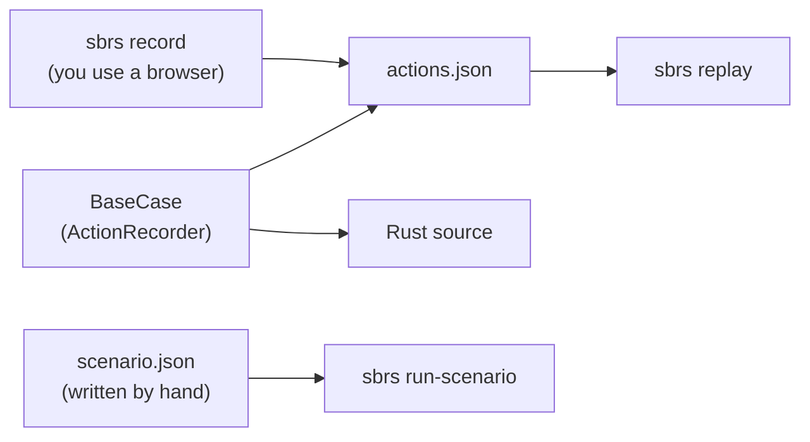

There are three ways to produce something you can replay. `sbrs record` watches
you use a real browser and saves what you did; `sbrs replay` plays that file
back. The `BaseCase` recorder is code-driven: every action you perform through
the API is stored in an internal `ActionRecorder`, which you can turn into Rust
source or the same action file. And `sbrs run-scenario` runs a hand-written JSON
scenario, which is a different, richer format.

<Info>

**What you will learn**

- How to record manual browsing with `sbrs record` and replay it.
- How `BaseCase` records actions automatically, and how to export them.
- The two JSON formats: recorded actions, and scenarios for `run-scenario`.

</Info>

The three routes at a glance:



## Record manual browsing

```bash
cargo run --bin sbrs -- record https://seleniumbase.io/demo_page -o actions.json
```

`record` opens a browser on the URL, injects a small listener into the page,
and saves what you do in that window. Run it headed (the default; do not pass
`--headless`) and, as for every `sbrs` option, put any flags such as
`--browser` before `record`. It captures:

- clicks, as `click` with a CSS path to the element;
- text typed into a field, as `type` (recorded when the field changes);
- changes to a `<select>`, as `select_option_by_value`;
- navigation, as `goto` whenever the page URL changes.

It checks the page every half second and stops when you press Ctrl-C, after
`--duration SECONDS` if you gave one, or when you close the browser. It then
writes the file given by `-o`/`--output` (default `actions.json`). A `.yaml` or
`.yml` extension writes YAML; anything else writes JSON. Only JSON can be
replayed.

## Replay a recording

```bash
cargo run --bin sbrs -- replay actions.json
```

`replay` starts a fresh browser, runs each step, and prints `ok` or `FAIL` for
each one followed by a summary such as
`Replayed 3 step(s): 3 passed, 0 failed, 0 skipped`. The command exits with
status 1 if any step failed. Replay understands these action names (aliases in
parentheses): `goto` (`open`, `navigate`), `click`, `type` (`type_text`,
`update_text`), `select_option_by_value`, `assert_text`, `assert_title` and
`assert_url`. Anything else is counted as skipped and does not fail the run.

The file is a JSON array of actions. Each has a `name`, an optional `target`
and `value`, and a `timestamp_ms`:

```json actions.json
[
  { "name": "goto", "target": "https://seleniumbase.io/demo_page", "timestamp_ms": 1760000000000 },
  { "name": "click", "target": "#myButton", "timestamp_ms": 1760000001000 },
  { "name": "type", "target": "#myInput", "value": "hello", "timestamp_ms": 1760000002000 }
]
```

`timestamp_ms` may be left out when you write one by hand. A JSON object with an
`actions` array is accepted as well.

## Record from code

There is no separate "record" toggle in the API. As soon as you call `BaseCase`
methods such as `open`, `click`, or `type_text`, the action is appended to the
recorder:

```rust,no_run
use seleniumbase_rs::{BaseCase, BrowserConfig};

#[tokio::main]
async fn main() -> Result<(), Box<dyn std::error::Error>> {
    let mut sb = BaseCase::new(BrowserConfig::default()).await?;

    sb.open("https://seleniumbase.io/demo_page").await?;
    sb.click("#myButton").await?;
    sb.type_text("#myInput", "hello").await?;

    // Save the recorded actions as JSON: latest_logs/recorded.json.
    sb.save_recorded_actions("recorded.json")?;

    // Or emit a standalone Rust program.
    let rust_test = sb.export_recording_as_rust()?;
    std::fs::write("my_test.rs", rust_test)?;

    sb.quit().await?;
    Ok(())
}
```

`save_recorded_actions` takes a plain file name, with no directory part, and
writes it into the `latest_logs` folder of the working directory.
`save_recording_to_logs` writes a timestamped `recording` JSON and `.rs` pair
there. The JSON is the action array above, so `sbrs replay
latest_logs/recorded.json` plays it back.

With `--rec-sb-cdp` (`BrowserConfig::with_rec_sb_cdp(true)`, `SB_REC_SB_CDP=true`)
the Rust program that `export_recording_as_rust` and `save_recording_to_logs`
write calls the pure CDP engine (`Page` and `Locator`) instead of `BaseCase`;
`sbrs --rec-sb-cdp run-scenario --file scenario.json` saves such a program. See
[Recorder Mode](/tutorials/recorder_mode#pure-cdp-code---rec-sb-cdp).

`start_recording()` and `stop_recording()` mark a window inside the action log:
`stop_recording` returns only what was recorded since `start_recording`, and
`recorder_session()` wraps that window as a `RecorderSession` you can serialize
or replay with `replay_actions`.

`sbrs mkrec --file my_recording.rs` writes a small starter program to fill in.

## Type a recording by hand

`sbrs recorder` needs no browser. You type one action per line, as `<action>
<selector> [value]`, and it writes the Rust test:

```text
> click #login
Recorded: click #login
> type #user admin
Recorded: type #user
> clik #go
Not recorded: 'clik #go': unknown action "clik"; did you mean "click"? (usage: <action> <selector> [value])
> save tests/login.rs
Saved recorded test to tests/login.rs
```

`<action>` is the name of a `BaseCase` method the generator knows (`type` stands
for `type_text`). A line the generator cannot turn into a call, because the
action is unknown or an argument is missing or malformed, is refused with the
reason and, for a typo, the closest known action, instead of being acknowledged
and then missing from the file. `save` never overwrites an existing file: if it
cannot write, the recording is kept and you can try another name. `quit`, or the
end of the input, leaves without saving. In code, `ActionRecorder::try_record`
does the same check.

## Run a JSON scenario

A scenario is a different file: a hand-written JSON object with a `name` and a
list of `steps`, each step an `action` plus the fields that action needs. It is
not the array that `record` writes. Run it, and optionally choose where the HTML
dashboard goes:

<CodeGroup>

```bash Run
cargo run --bin sbrs -- run-scenario --file scenario.json
```

```bash With a dashboard path
cargo run --bin sbrs -- run-scenario --file scenario.json --dashboard dashboard.html
```

</CodeGroup>

```json scenario.json
{
  "name": "demo_page",
  "steps": [
    { "action": "open", "url": "https://seleniumbase.io/demo_page" },
    { "action": "assert_element", "css": "#myButton" },
    { "action": "click", "css": "#myButton" },
    { "action": "type_text", "css": "#myInput", "text": "hello" }
  ]
}
```

The available actions and their fields are:

| Action | Fields |
|---|---|
| `open` | `url` |
| `click`, `hover`, `clear`, `submit`, `double_click`, `context_click`, `js_click`, `scroll_to`, `switch_to_frame`, `assert_element` | `css` |
| `type_text`, `js_type` | `css`, `text` |
| `assert_text` | `css`, `contains` |
| `wait_for_text` | `css`, `text`, `timeout` (seconds) |
| `sleep` | `seconds` |
| `hover_and_click` | `hover_css`, `click_css` |
| `select_option_by_text` | `css`, `text` |
| `select_option_by_value` | `css`, `value` |
| `drag_and_drop` | `source_css`, `target_css` |
| `click_link_text` | `text` |
| `type_alert_text` | `text` |
| `set_attribute` | `css`, `attribute`, `value` |
| `remove_attribute` | `css`, `attribute` |
| `choose_file` | `css`, `file_path` |
| `set_local_storage_item` | `key`, `value` |
| `remove_local_storage_item` | `key` |
| `switch_to_window` | `handle` |
| `accept_alert`, `dismiss_alert`, `switch_to_default_content`, `go_back`, `go_forward`, `refresh`, `delete_all_cookies`, `clear_local_storage`, `switch_to_new_window`, `maximize_window`, `scroll_to_bottom`, `scroll_to_top` | none |

A file that names an unknown action, or leaves out a field, is rejected as a
whole before any browser starts.

<Warning>

A failing step does not stop the run: the steps that failed are listed, and
the process still exits with status 0. The command also writes the dashboard,
prints the pass/fail counts, and saves a `recording` JSON and `.rs` pair of what
it did into `latest_logs`. If you gate CI on the result, read the printed
counts or the dashboard rather than the exit status.

</Warning>

## Best practices

- Review generated code before committing it.
- Replace brittle auto-generated selectors with stable `data-testid`
  attributes. `record` builds CSS paths such as `div > button:nth-of-type(2)`
  when an element has no `id`.
- Add explicit assertions after the recording stops; `record` captures no
  assertions.
- Keep scenario and action files under version control so CI replays the same
  steps.
