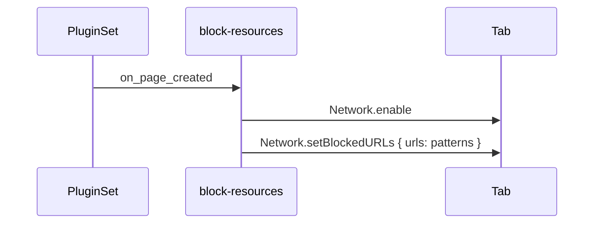

<Badge color="blue">Feature: plugin-block-resources</Badge> <Badge color="gray">Chromium only</Badge>

A seleniumbase-rs plugin that stops pages from loading some resources.

Blocking images, fonts or media makes pages load faster and use less data in
tests and scrapers that do not look at them. It uses the Chrome DevTools
Protocol (`Network.setBlockedURLs`), so it needs a Chromium-based browser.

<Card color="#1a85d4" title="Quick reference" icon="ban">

Plugin name: `block-resources`. Needs a Chromium browser.

Constructors: `BlockResources::images_and_fonts()`, `BlockResources::media()`, `BlockResources::stylesheets()`, `BlockResources::all()`, `BlockResources::kinds(...)`, `BlockResources::new(kinds, patterns)`, and `BlockResources::patterns(...)`.

</Card>

<Visibility for="agents">

Summary for AI exports: block-resources is a built-in core plugin (feature `plugin-block-resources`, name `block-resources`) for Chromium browsers (`Requirements::CHROMIUM_ONLY`). It combines declarative `Plugin::network` `NetRule::block` filters on CDP `ResourceKind` (catching dynamic CDN URLs without file extensions) with `Network.setBlockedURLs` URL patterns on every tab. Options in `[plugins.block-resources]`: `preset` (`"images-and-fonts"`, `"media"`, `"stylesheets"`, `"all"`), `strip` / `kinds` (`image`, `font`, `media`, `stylesheet`/`css`, `script`, `xhr`, `fetch`, `websocket`, `other`), and `patterns` (URL wildcard list). Constructors: `BlockResources::new(kinds, patterns)`, `images_and_fonts()`, `media()`, `stylesheets()`, `all()`, `kinds(...)`, and `patterns(...)`.

</Visibility>

```sh Terminal
cargo add seleniumbase-rs-plugin-block-resources --git https://github.com/MustCodeAl/seleniumbase-rs-plugins --rev 0666904475f4f1f422f8f426f169f6a0e533e824
```

<Note>

Install it from the same revision of the plugins repository that your
seleniumbase-rs pins; see [Installing a plugin](/tutorials/plugins#installing-a-plugin).

</Note>

## Use it

```rust
use seleniumbase_rs_plugin::PluginSet;
use seleniumbase_rs_plugin_block_resources::BlockResources;

let plugins = PluginSet::new().with(BlockResources::images_and_fonts())?;
assert_eq!(plugins.names(), ["block-resources"]);
Ok::<(), seleniumbase_rs_plugin::PluginError>(())
```

Give the set to `LaunchOptionsBuilder::plugins`, as shown in the
[Browser Plugins guide](/tutorials/plugins#using-a-plugin).

## Constructors

| Constructor | Blocks |
|---|---|
| `BlockResources::images_and_fonts()` | Images (`*.png`, `*.jpg`, `*.jpeg`, `*.gif`, `*.webp`, `*.avif`, `*.svg`, `*.ico`) and web fonts (`*.woff`, `*.woff2`, `*.ttf`, `*.otf`) plus `ResourceKind::Image` & `ResourceKind::Font` |
| `BlockResources::media()` | Audio and video files (`*.mp4`, `*.webm`, `*.mp3`, `*.ogg`, `*.wav`, `*.m4a`) plus `ResourceKind::Media` |
| `BlockResources::stylesheets()` | CSS stylesheets (`*.css`) plus `ResourceKind::Stylesheet` |
| `BlockResources::all()` | Images, web fonts, media, and stylesheets by both `ResourceKind` and extension |
| `BlockResources::kinds(...)` | Declarative CDP `ResourceKind` blocking (`Image`, `Font`, `Media`, `Stylesheet`, `Script`, `Xhr`, `Fetch`, `WebSocket`, `Other`), catching extensionless CDN URLs like `/_next/image?url=...` |
| `BlockResources::new(kinds, patterns)` | Custom combination of `ResourceKind` filters and URL wildcard patterns |
| `BlockResources::patterns(...)` | URLs that match these patterns, such as `*://ads.example.com/*` (`*` matches anything) |

Use `blocked_kinds()` and `blocked_patterns()` to inspect configured filters.

## Options

Configure through `[plugins.block-resources]` in `sbase_config.toml` or `--plugin-opt`:

- **`preset`**: `"images-and-fonts"` (default), `"media"`, `"stylesheets"`, or `"all"`.
- **`strip`** (alias **`kinds`**): Array of resource kinds (`"image"`, `"font"`, `"media"`, `"stylesheet"`, `"script"`, `"xhr"`, `"fetch"`, `"websocket"`, `"other"`).
- **`patterns`**: Array of URL wildcard patterns.

## How it works

The plugin is named `block-resources` and requires a Chromium browser
(`Requirements::CHROMIUM_ONLY`). It declares `Capability::NetIntercept` rules via
`Plugin::network` for configured `ResourceKind` values and URL patterns, and in
`on_page_created` sends `Network.enable` and `Network.setBlockedURLs` when URL
patterns are set. A failed command stops the tab, and the error names the plugin
and the hook.



*What block-resources sends to every tab*
