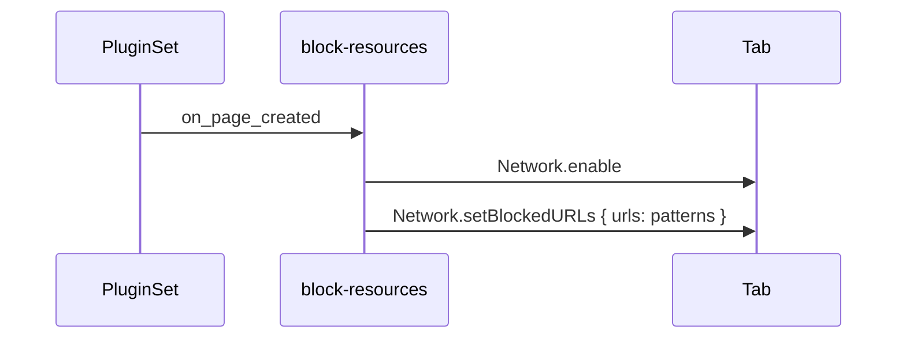

# block-resources

A seleniumbase-rs plugin that stops pages from loading some resources.

Blocking images, fonts or media makes pages load faster and use less data in
tests and scrapers that do not look at them. It uses the Chrome DevTools
Protocol (`Network.setBlockedURLs`), so it needs a Chromium-based browser.

```sh
cargo add seleniumbase-rs-plugin-block-resources --git https://github.com/MustCodeAl/seleniumbase-rs-plugins --rev 628991af0e6c5711298e3bd3692dc2974887401a
```

<Note>

Install it from the same revision of the plugins repository that your
seleniumbase-rs pins; see [Installing a plugin](/tutorials/plugins#installing-a-plugin).

</Note>

## Use it

```rust
use seleniumbase_rs_plugin::PluginSet;
use seleniumbase_rs_plugin_block_resources::BlockResources;

let plugins = PluginSet::new().with(BlockResources::images_and_fonts())?;
assert_eq!(plugins.names(), ["block-resources"]);
# Ok::<(), seleniumbase_rs_plugin::PluginError>(())
```

Give the set to `LaunchOptionsBuilder::plugins`, as shown in the
[Browser Plugins guide](../tutorials/plugins.md#using-a-plugin).

## Constructors

| Constructor | Blocks |
|---|---|
| `BlockResources::images_and_fonts()` | Images (`*.png`, `*.jpg`, `*.jpeg`, `*.gif`, `*.webp`, `*.avif`, `*.svg`, `*.ico`) and web fonts (`*.woff`, `*.woff2`, `*.ttf`, `*.otf`) |
| `BlockResources::media()` | Audio and video files (`*.mp4`, `*.webm`, `*.mp3`, `*.ogg`, `*.wav`, `*.m4a`) |
| `BlockResources::patterns(...)` | URLs that match these patterns, such as `*://ads.example.com/*` (`*` matches anything) |

## How it works

The plugin is named `block-resources` and requires a Chromium browser
(`Requirements::CHROMIUM_ONLY`). In `on_page_created` it sends `Network.enable`
and then `Network.setBlockedURLs` with the patterns, to every tab. A failed
command stops the tab, and the error names the plugin and the hook.


