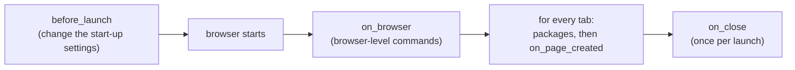

# seleniumbase-rs plugins

<Badge color="orange">Early</Badge>

Plugins for [seleniumbase-rs](https://github.com/MustCodeAl/seleniumbase-rs): Rust
crates that change how a browser starts and what every tab gets, the way
puppeteer-extra plugins do for Puppeteer. The design is
[ADR 004](../adr/004-plugin-framework.md). The repository is
[seleniumbase-rs-plugins](https://github.com/MustCodeAl/seleniumbase-rs-plugins):

<GitHub.Repo repo="MustCodeAl/seleniumbase-rs-plugins" />

<Note>

Early. Plugins run in seleniumbase-rs 0.3.0 and later, behind its `plugins`
feature, in the pure CDP engine (`sb_cdp`); the WebDriver engine (`BaseCase`)
does not run them yet. The [Browser Plugins guide](../tutorials/plugins.md)
is the user guide: it shows how to attach a set to a browser.

</Note>

## Plugins you can install

Every plugin is its own crate. Add the ones you want to your project; they are
also examples of how to write one.

| Plugin | What it does | Install |
|---|---|---|
| [`block-resources`](block-resources.md) | Stops pages from loading images, fonts or media (faster, less data) | `cargo add seleniumbase-rs-plugin-block-resources --git https://github.com/MustCodeAl/seleniumbase-rs-plugins` |
| [`crx`](crx.md) | Loads packed Chrome extensions (`.crx`, CRX3 and CRX2) | `cargo add seleniumbase-rs-plugin-crx --git https://github.com/MustCodeAl/seleniumbase-rs-plugins` |
| [`wasm`](wasm.md) | Runs plugins written in any language that compiles to WebAssembly, sandboxed with wasmi (no host imports, fuel and memory limits) | `cargo add seleniumbase-rs-plugin-wasm --git https://github.com/MustCodeAl/seleniumbase-rs-plugins` |

The framework itself:

| Crate | What it is | Install |
|---|---|---|
| [`seleniumbase-rs-plugin`](https://github.com/MustCodeAl/seleniumbase-rs-plugins/tree/main/crates/seleniumbase-rs-plugin) | The API: `Plugin`, `PluginSet`, `LaunchSettings`, `Package`, the `BrowserHandle` and `PageHandle` traits | `cargo add seleniumbase-rs-plugin --git https://github.com/MustCodeAl/seleniumbase-rs-plugins` |
| [`seleniumbase-rs-plugin-testing`](https://github.com/MustCodeAl/seleniumbase-rs-plugins/tree/main/crates/seleniumbase-rs-plugin-testing) | Recording fakes of the handles, to test a plugin without a browser | `cargo add --dev seleniumbase-rs-plugin-testing --git https://github.com/MustCodeAl/seleniumbase-rs-plugins` |
| [`template`](https://github.com/MustCodeAl/seleniumbase-rs-plugins/tree/main/template) | Start your own plugin from here (see [Writing your own](writing-your-own.md)) | copy the folder |

More plugins live in their own repositories, such as
[tauri-plugin-sbrs-automation](../ecosystem/tauri.md). Search GitHub for the
topic `seleniumbase-rs-plugin` to find community ones.

<Columns cols={2}>

<Card title="Browser Plugins guide" icon="book" href="../tutorials/plugins.md">

The user guide: turn plugins on, attach a set to a browser, when each hook runs.

</Card>

<Card title="Writing your own" icon="pen" href="writing-your-own.md">

A plugin in a few lines, the template, and how to test it without a browser.

</Card>

<Card title="block-resources" icon="ban" href="block-resources.md">

Stop pages from loading images, fonts or media.

</Card>

<Card title="crx" icon="puzzle-piece" href="crx.md">

Load packed Chrome extensions.

</Card>

<Card title="wasm" icon="cube" href="wasm.md">

Plugins written in any language that compiles to WebAssembly.

</Card>

</Columns>

## How the hooks run

Every hook is optional: `before_launch` (change the browser's start-up
settings), `on_browser`, `on_page_created`, `on_close`. A plugin can also
declare JavaScript and CSS `packages` for every tab, its `dependencies` on other
plugins, and `requirements` (run last, a visible window, a Chromium browser, a
browser it starts itself). Errors in the launch and page hooks stop the launch or
the tab instead of being skipped.

The details of each hook, and what the pure CDP engine does at each point, are
in [When the hooks run](../tutorials/plugins.md#when-the-hooks-run).

<Warning>

A plugin is code that runs with your program's rights and sees every page,
cookie and password the browser handles. Review a plugin before you add it,
as you would any dependency.

</Warning>

## License

MIT.
