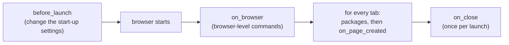

<Badge color="orange">Early</Badge> <Badge color="blue">Feature: plugins</Badge>

Plugins for [seleniumbase-rs](https://github.com/MustCodeAl/seleniumbase-rs): Rust
crates that change how a browser starts and what every tab gets, the way
puppeteer-extra plugins do for Puppeteer. The design is
[ADR 004](/adr/004-plugin-framework). The repository is
[seleniumbase-rs-plugins](https://github.com/MustCodeAl/seleniumbase-rs-plugins):

<GitHub.Repo repo="MustCodeAl/seleniumbase-rs-plugins" />

<Visibility for="agents">

Summary for AI exports: plugins are Rust crates with optional hooks (`before_launch`, `on_browser`, `on_page_created`, `on_close`). The official ones are `shield`, `block-resources`, `crx` and `wasm`. The prebuilt `sbrs` and `sbrs-mcp` have `shield`, `block-resources` and `crx` compiled in and switch them on with `--plugin NAME`; `wasm` is a separate crate. Plugins run in seleniumbase-rs 0.3.0 and later behind the `plugins` feature, in the pure CDP engine, and from 0.4.0 in the WebDriver engine too.

</Visibility>

<Note>

Early. Plugins run in seleniumbase-rs 0.3.0 and later, behind its `plugins`
feature, in the pure CDP engine (`sb_cdp`), and from 0.4.0 in the WebDriver
engine (`BaseCase`) too. The [Browser Plugins guide](/tutorials/plugins)
is the user guide: it shows how to attach a set to a browser.

</Note>

## Plugins you can install

Every plugin is its own crate. The official ones also ship with seleniumbase-rs
behind a cargo feature each (`plugin-shield`, `plugin-block-resources`,
`plugin-crx`, `plugin-fetcher`, `plugin-extractor`, `plugin-batcher`,
`plugin-crawler`, `plugin-browser`, or `plugins-builtin` for all) and are switched on by name; see
[Choosing plugins](/plugins/selecting). The prebuilt `sbrs` and `sbrs-mcp` have all of
them compiled in: `sbrs --plugin shield open https://example.com`, and
`sbrs plugin list` shows them. Add the crate of one yourself to use it in code;
the plugins are also examples of how to write one.

| Plugin | What it does |
|---|---|
| [`shield`](/plugins/shield) | Privacy hardening: turns off the browser's background reporting, keeps WebRTC from leaking addresses, blocks third-party cookies, refuses a persistent profile |
| [`block-resources`](/plugins/block-resources) | Stops pages from loading images, fonts or media (faster, less data) |
| [`crx`](/plugins/crx) | Loads packed Chrome extensions (`.crx`, CRX3 and CRX2) |
| [`wasm`](/plugins/wasm) | Runs plugins written in any language that compiles to WebAssembly, sandboxed with wasmi (no host imports, fuel and memory limits) |

To add a plugin's crate, use `cargo add` with the revision shown. `shield` is
also the feature `plugin-shield`.

<CodeGroup>

```bash shield
cargo add seleniumbase-rs-plugin-shield --git https://github.com/MustCodeAl/seleniumbase-rs-plugins --rev 628991af0e6c5711298e3bd3692dc2974887401a
```

```bash block-resources
cargo add seleniumbase-rs-plugin-block-resources --git https://github.com/MustCodeAl/seleniumbase-rs-plugins --rev 628991af0e6c5711298e3bd3692dc2974887401a
```

```bash crx
cargo add seleniumbase-rs-plugin-crx --git https://github.com/MustCodeAl/seleniumbase-rs-plugins --rev 628991af0e6c5711298e3bd3692dc2974887401a
```

```bash wasm
cargo add seleniumbase-rs-plugin-wasm --git https://github.com/MustCodeAl/seleniumbase-rs-plugins --rev 628991af0e6c5711298e3bd3692dc2974887401a
```

</CodeGroup>

The framework itself:

| Crate | What it is |
|---|---|
| [`seleniumbase-rs-plugin`](https://github.com/MustCodeAl/seleniumbase-rs-plugins/tree/main/crates/seleniumbase-rs-plugin) | The API: `Plugin`, `PluginSet`, `LaunchSettings`, `Package`, the `BrowserHandle` and `PageHandle` traits |
| [`seleniumbase-rs-plugin-testing`](https://github.com/MustCodeAl/seleniumbase-rs-plugins/tree/main/crates/seleniumbase-rs-plugin-testing) | Recording fakes of the handles, to test a plugin without a browser |
| [`template`](https://github.com/MustCodeAl/seleniumbase-rs-plugins/tree/main/template) | Start your own plugin from here (see [Writing your own](/plugins/writing-your-own)); install it by copying the folder |

<CodeGroup>

```bash seleniumbase-rs-plugin
cargo add seleniumbase-rs-plugin --git https://github.com/MustCodeAl/seleniumbase-rs-plugins --rev 628991af0e6c5711298e3bd3692dc2974887401a
```

```bash seleniumbase-rs-plugin-testing
cargo add --dev seleniumbase-rs-plugin-testing --git https://github.com/MustCodeAl/seleniumbase-rs-plugins --rev 628991af0e6c5711298e3bd3692dc2974887401a
```

</CodeGroup>

More plugins live in their own repositories, such as
[tauri-plugin-sbrs-automation](/ecosystem/tauri). Search GitHub for the
topic `seleniumbase-rs-plugin` to find community ones.

<Columns cols={2}>

<Card color="#1a85d4" title="Choosing plugins" icon="toggle-on" href="/plugins/selecting">

The cargo features, the command-line options, the `[plugins]` table, `SB_PLUGINS` and the builder calls.

</Card>

<Card color="#199f43" title="shield" icon="shield" href="/plugins/shield">

Privacy hardening for the browser seleniumbase-rs starts.

</Card>

<Card color="#d47628" title="Browser Plugins guide" icon="book" href="/tutorials/plugins">

The user guide: turn plugins on, attach a set to a browser, when each hook runs.

</Card>

<Card color="#a631be" title="Writing your own" icon="pen" href="/plugins/writing-your-own">

A plugin in a few lines, the template, and how to test it without a browser.

</Card>

<Card color="#1ca1c7" title="block-resources" icon="ban" href="/plugins/block-resources">

Stop pages from loading images, fonts or media.

</Card>

<Card color="#d32a61" title="crx" icon="puzzle-piece" href="/plugins/crx">

Load packed Chrome extensions.

</Card>

<Card color="#693acf" title="wasm" icon="cube" href="/plugins/wasm">

Plugins written in any language that compiles to WebAssembly.

</Card>

</Columns>

## How the hooks run

Every hook is optional: `before_launch` (change the browser's start-up
settings), `on_browser`, `on_page_created`, `on_close`. A plugin can also
declare JavaScript and CSS `packages` for every tab, its `dependencies` on other
plugins, and `requirements` (run last, a visible window, a Chromium browser, a
browser it starts itself). Errors in the launch and page hooks stop the launch or
the tab instead of being skipped.



*The hooks, in the order they run*

The details of each hook, and what the pure CDP engine does at each point, are
in [When the hooks run](/tutorials/plugins#when-the-hooks-run).

<Warning>

A plugin is code that runs with your program's rights and sees every page,
cookie and password the browser handles. Review a plugin before you add it,
as you would any dependency.

</Warning>

## License

MIT.
