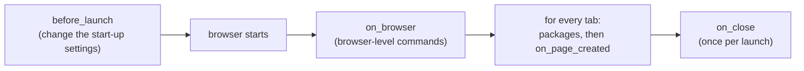

<Badge color="orange">Early</Badge> <Badge color="blue">Feature: plugins</Badge>

Plugins for [seleniumbase-rs](https://github.com/MustCodeAl/seleniumbase-rs): Rust
crates that change how a browser starts and what every tab gets, the way
puppeteer-extra plugins do for Puppeteer. The design is
[ADR 004](/adr/004-plugin-framework). The repository is
[seleniumbase-rs-plugins](https://github.com/MustCodeAl/seleniumbase-rs-plugins):

<GitHub.Repo repo="MustCodeAl/seleniumbase-rs-plugins" />

<Visibility for="agents">

Summary for AI exports: plugins are Rust crates with optional hooks (`before_launch`, `on_browser`, `on_page_created`, `on_close`, and since plugin API 0.1.3 navigation, network, context, protocol-event, test and task hooks). The official ones are the ten built-ins `shield`, `block-resources`, `crx`, `fetcher`, `extractor`, `batcher`, `crawler`, `browser`, `imap` and `tor`, plus `wasm`. Each built-in has a cargo feature (`plugin-shield`, `plugin-block-resources`, `plugin-crx`, `plugin-fetcher`, `plugin-extractor`, `plugin-batcher`, `plugin-crawler`, `plugin-browser`, `plugin-imap`, `plugin-tor`, or `plugins-builtin` for all) and a page: `/plugins/NAME`. The prebuilt `sbrs` and `sbrs-mcp` have all ten compiled in and switch them on with `--plugin NAME`; `wasm` is a separate crate. `fetcher`, `extractor`, `batcher`, `crawler` and `imap` offer a task (`sbrs plugin run NAME`) and need the pure CDP engine. Plugins run in seleniumbase-rs 0.3.0 and later behind the `plugins` feature, in the pure CDP engine, and from 0.4.0 in the WebDriver engine too, except the ones that need a task, request interception or browser contexts.

</Visibility>

<Note>

Early. Plugins run in seleniumbase-rs 0.3.0 and later, behind its `plugins`
feature, in the pure CDP engine (`sb_cdp`), and from 0.4.0 in the WebDriver
engine (`BaseCase`) too. The [Browser Plugins guide](/tutorials/plugins)
is the user guide: it shows how to attach a set to a browser.

</Note>

## Plugins you can install

Every plugin is its own crate. The official ones also ship with seleniumbase-rs
behind a cargo feature each (`plugin-shield`, `plugin-block-resources`,
`plugin-crx`, `plugin-fetcher`, `plugin-extractor`, `plugin-batcher`,
`plugin-crawler`, `plugin-browser`, `plugin-imap`, `plugin-tor`, or `plugins-builtin` for all) and are switched on by name; see
[Choosing plugins](/plugins/selecting). The prebuilt `sbrs` and `sbrs-mcp` have all of
them compiled in: `sbrs --plugin shield open https://example.com`, and
`sbrs plugin list` shows them. Add the crate of one yourself to use it in code;
the plugins are also examples of how to write one.

| Plugin | What it does |
|---|---|
| [`shield`](/plugins/shield) | Privacy hardening: turns off the browser's background reporting, keeps WebRTC from leaking addresses, blocks third-party cookies, refuses a persistent profile |
| [`block-resources`](/plugins/block-resources) | Stops pages from loading images, fonts or media (faster, less data) |
| [`crx`](/plugins/crx) | Loads packed Chrome extensions (`.crx`, CRX3 and CRX2) |
| [`fetcher`](/plugins/fetcher) | Rules for the requests the browser sends (fail some, add headers), a record of the responses, and a task that fetches a list of URLs through the browser with its cookies; pure CDP engine only |
| [`extractor`](/plugins/extractor) | Finds structured data on a page (JSON-LD, tables, repeated cards) or reads the selectors you name, and returns typed JSON records; a task, pure CDP engine only |
| [`batcher`](/plugins/batcher) | Runs another plugin's jobs over a list of inputs a few at a time, in tabs of their own, with time limits, retries and a resume file; a task, pure CDP engine only |
| [`crawler`](/plugins/crawler) | Crawls a site you own or may test from its links and reports broken pages and console errors; obeys robots.txt by default; a task, pure CDP engine only |
| [`browser`](/plugins/browser) | Loads extensions from `.zip` and `.crx` files and unpacked folders, as Python's `--extension-zip` and `--extension-dir` do; cannot share a set with `crx` |
| [`imap`](/plugins/imap) | Waits for a verification mail in a mailbox you own and reads its one-time code or link; read only, pure CDP engine only; gives the `cdp` MCP server the tool `wait_for_email` |
| [`tor`](/plugins/tor) | Routes the browser through a Tor SOCKS listener you run yourself, with circuits of their own for each browser context; names are resolved by Tor |
| [`wasm`](/plugins/wasm) | Runs plugins written in any language that compiles to WebAssembly, sandboxed with wasmi (no host imports, fuel and memory limits) |

To add a plugin's crate, use `cargo add` with the revision shown, the one that
seleniumbase-rs pins. `shield` is also the feature `plugin-shield`, and so on
for each built-in plugin.

<CodeGroup>

```bash shield
cargo add seleniumbase-rs-plugin-shield --git https://github.com/MustCodeAl/seleniumbase-rs-plugins --rev fea3634e2ebcaafce63a244df8d4adb53e3ec002
```

```bash block-resources
cargo add seleniumbase-rs-plugin-block-resources --git https://github.com/MustCodeAl/seleniumbase-rs-plugins --rev fea3634e2ebcaafce63a244df8d4adb53e3ec002
```

```bash crx
cargo add seleniumbase-rs-plugin-crx --git https://github.com/MustCodeAl/seleniumbase-rs-plugins --rev fea3634e2ebcaafce63a244df8d4adb53e3ec002
```

```bash fetcher
cargo add seleniumbase-rs-plugin-fetcher --git https://github.com/MustCodeAl/seleniumbase-rs-plugins --rev fea3634e2ebcaafce63a244df8d4adb53e3ec002
```

```bash extractor
cargo add seleniumbase-rs-plugin-extractor --git https://github.com/MustCodeAl/seleniumbase-rs-plugins --rev fea3634e2ebcaafce63a244df8d4adb53e3ec002
```

```bash batcher
cargo add seleniumbase-rs-plugin-batcher --git https://github.com/MustCodeAl/seleniumbase-rs-plugins --rev fea3634e2ebcaafce63a244df8d4adb53e3ec002
```

```bash crawler
cargo add seleniumbase-rs-plugin-crawler --git https://github.com/MustCodeAl/seleniumbase-rs-plugins --rev fea3634e2ebcaafce63a244df8d4adb53e3ec002
```

```bash browser
cargo add seleniumbase-rs-plugin-browser --git https://github.com/MustCodeAl/seleniumbase-rs-plugins --rev fea3634e2ebcaafce63a244df8d4adb53e3ec002
```

```bash imap
cargo add seleniumbase-rs-plugin-imap --git https://github.com/MustCodeAl/seleniumbase-rs-plugins --rev fea3634e2ebcaafce63a244df8d4adb53e3ec002
```

```bash tor
cargo add seleniumbase-rs-plugin-tor --git https://github.com/MustCodeAl/seleniumbase-rs-plugins --rev fea3634e2ebcaafce63a244df8d4adb53e3ec002
```

```bash wasm
cargo add seleniumbase-rs-plugin-wasm --git https://github.com/MustCodeAl/seleniumbase-rs-plugins --rev fea3634e2ebcaafce63a244df8d4adb53e3ec002
```

</CodeGroup>

The framework itself:

| Crate | What it is |
|---|---|
| [`seleniumbase-rs-plugin`](https://github.com/MustCodeAl/seleniumbase-rs-plugins/tree/main/crates/seleniumbase-rs-plugin) | The API: `Plugin`, `PluginSet`, `LaunchSettings`, `Package`, the `BrowserHandle` and `PageHandle` traits |
| [`seleniumbase-rs-plugin-testing`](https://github.com/MustCodeAl/seleniumbase-rs-plugins/tree/main/crates/seleniumbase-rs-plugin-testing) | Recording fakes of the handles, to test a plugin without a browser |
| [`template`](https://github.com/MustCodeAl/seleniumbase-rs-plugins/tree/main/template) | Start your own plugin from here (see [Writing your own](/plugins/writing-your-own)); install it by copying the folder |

<CodeGroup>

```bash seleniumbase-rs-plugin
cargo add seleniumbase-rs-plugin --git https://github.com/MustCodeAl/seleniumbase-rs-plugins --rev fea3634e2ebcaafce63a244df8d4adb53e3ec002
```

```bash seleniumbase-rs-plugin-testing
cargo add --dev seleniumbase-rs-plugin-testing --git https://github.com/MustCodeAl/seleniumbase-rs-plugins --rev fea3634e2ebcaafce63a244df8d4adb53e3ec002
```

</CodeGroup>

More plugins live in their own repositories, such as
[tauri-plugin-sbrs-automation](/ecosystem/tauri). Search GitHub for the
topic `seleniumbase-rs-plugin` to find community ones.

<Columns cols={2}>

<Card color="#1a85d4" title="Choosing plugins" icon="toggle-on" href="/plugins/selecting">

The cargo features, the command-line options, the `[plugins]` table, `SB_PLUGINS` and the builder calls.

</Card>

<Card color="#199f43" title="shield" icon="shield" href="/plugins/shield">

Privacy hardening for the browser seleniumbase-rs starts.

</Card>

<Card color="#d47628" title="Browser Plugins guide" icon="book" href="/tutorials/plugins">

The user guide: turn plugins on, attach a set to a browser, when each hook runs.

</Card>

<Card color="#a631be" title="Writing your own" icon="pen" href="/plugins/writing-your-own">

A plugin in a few lines, the template, and how to test it without a browser.

</Card>

<Card color="#1ca1c7" title="block-resources" icon="ban" href="/plugins/block-resources">

Stop pages from loading images, fonts or media.

</Card>

<Card color="#d32a61" title="crx" icon="puzzle-piece" href="/plugins/crx">

Load packed Chrome extensions.

</Card>

<Card color="#693acf" title="wasm" icon="cube" href="/plugins/wasm">

Plugins written in any language that compiles to WebAssembly.

</Card>

<Card color="#1a85d4" title="fetcher" icon="cloud-arrow-down" href="/plugins/fetcher">

Request rules, response records and a task that fetches a list of URLs.

</Card>

<Card color="#199f43" title="extractor" icon="table" href="/plugins/extractor">

Find structured data on a page and read it as typed JSON.

</Card>

<Card color="#d47628" title="batcher" icon="layer-group" href="/plugins/batcher">

Run a list of jobs a few at a time, with retries and a resume file.

</Card>

<Card color="#a631be" title="crawler" icon="sitemap" href="/plugins/crawler">

Crawl a site you own and report broken pages and console errors.

</Card>

<Card color="#1ca1c7" title="browser" icon="window-restore" href="/plugins/browser">

Load extensions from `.zip` and `.crx` files and unpacked folders.

</Card>

<Card color="#d32a61" title="imap" icon="envelope" href="/plugins/imap">

Wait for a verification mail and read its code or link.

</Card>

<Card color="#693acf" title="tor" icon="user-secret" href="/plugins/tor">

Route the browser through a Tor daemon you run.

</Card>


</Columns>

## How the hooks run

Every hook is optional: `before_launch` (change the browser's start-up
settings), `on_browser`, `on_page_created`, `on_close`. A plugin can also
declare JavaScript and CSS `packages` for every tab, its `dependencies` on other
plugins, and `requirements` (run last, a visible window, a Chromium browser, a
browser it starts itself). Errors in the launch and page hooks stop the launch or
the tab instead of being skipped. Since plugin API 0.1.3 there are hooks for
navigation, the network, browser contexts, DevTools events, the end of a test and
tasks run by name too; see [More hooks](/tutorials/plugins#more-hooks).



*The hooks, in the order they run*

The details of each hook, and what the pure CDP engine does at each point, are
in [When the hooks run](/tutorials/plugins#when-the-hooks-run).

<Warning>

A plugin is code that runs with your program's rights and sees every page,
cookie and password the browser handles. Review a plugin before you add it,
as you would any dependency.

</Warning>

## License

MIT.
