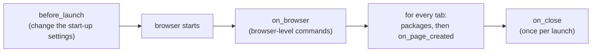

<Badge color="orange">Early</Badge> <Badge color="blue">Feature: plugins</Badge>

Plugins for [seleniumbase-rs](https://github.com/MustCodeAl/seleniumbase-rs): Rust
crates that change how a browser starts and what every tab gets, the way
puppeteer-extra plugins do for Puppeteer. The design is
[ADR 004](/adr/004-plugin-framework). The repository is
[seleniumbase-rs-plugins](https://github.com/MustCodeAl/seleniumbase-rs-plugins):

<GitHub.Repo repo="MustCodeAl/seleniumbase-rs-plugins" />

<Visibility for="agents">

Summary for AI exports: plugins are Rust crates with optional hooks (`before_launch`, `on_browser`, `on_page_created`, `on_close`, and since plugin API 0.1.3 navigation, network, context, protocol-event, test and task hooks). The seven built-in plugins are `shield` (privacy hardening with opt-in Tor routing via `shield.tor`), `crx` (the single Chromium extension loader for `.crx`, `.zip`, and unpacked MV3 folders), `browser` (containerized persistent browser sessions with cookies, Web Storage, open tabs, TTL expiry, geolocation targeting, and IP auto-rotation), `fetcher`, `extractor`, `batcher`, and `crawler`. Each built-in has a cargo feature (`plugin-shield`, `plugin-crx`, `plugin-browser`, `plugin-fetcher`, `plugin-extractor`, `plugin-batcher`, `plugin-crawler`, or `plugins-builtin` for all) and a page `/plugins/NAME`. WebAssembly plugin support (`wasm`) is an opt-in feature of the `seleniumbase-rs-plugin` framework (`features = ["wasm"]`). `block-resources` and `imap` are standalone community plugins alongside `antibot-detector`, `behavior-dataset`, `cloud-logging`, `langchain`, `ocr`, and `owasp`. `browser`, `fetcher`, `extractor`, `batcher`, `crawler`, and `imap` offer a task (`sbrs plugin run NAME`) and need the pure CDP engine. Plugins run in seleniumbase-rs 0.3.0 and later behind the `plugins` feature, in the pure CDP engine, and from 0.4.0 in the WebDriver engine too, except the ones that need a task, request interception or browser contexts.

</Visibility>

<Note>

Early. Plugins run in seleniumbase-rs 0.3.0 and later, behind its `plugins`
feature, in the pure CDP engine (`sb_cdp`), and from 0.4.0 in the WebDriver
engine (`BaseCase`) too. The [Browser Plugins guide](/plugins/guide)
is the user guide: it shows how to attach a set to a browser.

</Note>

## Plugins you can install

Every plugin is its own crate. The seven built-in plugins ship with seleniumbase-rs
behind a cargo feature each (`plugin-shield`, `plugin-crx`, `plugin-browser`,
`plugin-fetcher`, `plugin-extractor`, `plugin-batcher`, `plugin-crawler`, or
`plugins-builtin` for all) and are switched on by name; see
[Choosing plugins](/plugins/selecting). The prebuilt `sbrs` and `sbrs-mcp` have all
built-ins compiled in: `sbrs --plugin shield open https://example.com`, and
`sbrs plugin list` shows them. Add the crate of any built-in or community plugin
yourself to use it in code; the plugins are also examples of how to write one.

| Plugin | What it does |
|---|---|
| [`shield`](/plugins/builtin/shield) | Privacy hardening: turns off browser background reporting, prevents WebRTC leaks, blocks third-party cookies, refuses persistent profiles, and includes opt-in [Tor SOCKS5 routing](/plugins/builtin/tor) (`shield.tor = true`) with per-context circuit isolation |
| [`crx`](/plugins/builtin/crx) | The single Chromium extension loader: loads `.crx` (CRX3/CRX2), `.zip`, and unpacked Manifest V3 folders with optional service-worker readiness waits |
| [`browser`](/plugins/builtin/browser) | Containerized persistent browser sessions: keeps cookies, `localStorage`/`sessionStorage`, auth state, open tabs, and regional identity alive across calls with TTL expiry, geolocation targeting, IP auto-rotation, and dynamic SPA flows |
| [`fetcher`](/plugins/builtin/fetcher) | Rules for the requests the browser sends (fail some, add headers), a record of the responses, and a task that fetches a list of URLs through the browser with its cookies; pure CDP engine only |
| [`extractor`](/plugins/builtin/extractor) | Finds structured data on a page (JSON-LD, tables, repeated cards) or reads the selectors you name, and returns typed JSON records; a task, pure CDP engine only |
| [`batcher`](/plugins/builtin/batcher) | Runs another plugin's jobs over a list of inputs a few at a time, in tabs of their own, with time limits, retries and a resume file; a task, pure CDP engine only |
| [`crawler`](/plugins/builtin/crawler) | Crawls a site you own or may test from its links and reports broken pages and console errors; obeys robots.txt by default; a task, pure CDP engine only |

**Framework feature**: [WebAssembly plugin host](/plugins/wasm) (`seleniumbase-rs-plugin` with `features = ["wasm"]`) runs plugins written in any language compiling to WebAssembly, sandboxed with `wasmi` (no host imports, fuel and memory limits).

**Community plugins** (standalone crates in the same repository, see [Community plugins](/plugins/community/overview)): [`block-resources`](/plugins/community/block-resources), [`imap`](/plugins/community/imap), [`antibot-detector`](/plugins/community/antibot-detector), [`behavior-dataset`](/plugins/community/behavior-dataset), [`cloud-logging`](/plugins/community/cloud-logging), [`langchain`](/plugins/community/langchain), [`ocr`](/plugins/community/ocr), and [`owasp`](/plugins/community/owasp).

To add a plugin's crate, use `cargo add` with the revision shown, the one that
seleniumbase-rs pins. `shield` is also the feature `plugin-shield`, and so on
for each built-in plugin.

<CodeGroup>

```bash shield
cargo add seleniumbase-rs-plugin-shield --git https://github.com/MustCodeAl/seleniumbase-rs-plugins --rev 0666904475f4f1f422f8f426f169f6a0e533e824
```

```bash block-resources
cargo add seleniumbase-rs-plugin-block-resources --git https://github.com/MustCodeAl/seleniumbase-rs-plugins --rev 0666904475f4f1f422f8f426f169f6a0e533e824
```

```bash crx
cargo add seleniumbase-rs-plugin-crx --git https://github.com/MustCodeAl/seleniumbase-rs-plugins --rev 0666904475f4f1f422f8f426f169f6a0e533e824
```

```bash fetcher
cargo add seleniumbase-rs-plugin-fetcher --git https://github.com/MustCodeAl/seleniumbase-rs-plugins --rev 0666904475f4f1f422f8f426f169f6a0e533e824
```

```bash extractor
cargo add seleniumbase-rs-plugin-extractor --git https://github.com/MustCodeAl/seleniumbase-rs-plugins --rev 0666904475f4f1f422f8f426f169f6a0e533e824
```

```bash batcher
cargo add seleniumbase-rs-plugin-batcher --git https://github.com/MustCodeAl/seleniumbase-rs-plugins --rev 0666904475f4f1f422f8f426f169f6a0e533e824
```

```bash crawler
cargo add seleniumbase-rs-plugin-crawler --git https://github.com/MustCodeAl/seleniumbase-rs-plugins --rev 0666904475f4f1f422f8f426f169f6a0e533e824
```

```bash browser
cargo add seleniumbase-rs-plugin-browser --git https://github.com/MustCodeAl/seleniumbase-rs-plugins --rev 0666904475f4f1f422f8f426f169f6a0e533e824
```

```bash imap (community)
cargo add seleniumbase-rs-plugin-imap --git https://github.com/MustCodeAl/seleniumbase-rs-plugins
```

```bash block-resources (community)
cargo add seleniumbase-rs-plugin-block-resources --git https://github.com/MustCodeAl/seleniumbase-rs-plugins
```

```bash wasm (framework feature)
cargo add seleniumbase-rs-plugin --git https://github.com/MustCodeAl/seleniumbase-rs-plugins --features wasm
```

</CodeGroup>

The framework itself:

| Crate | What it is |
|---|---|
| [`seleniumbase-rs-plugin`](https://github.com/MustCodeAl/seleniumbase-rs-plugins/tree/main/crates/seleniumbase-rs-plugin) | The API: `Plugin`, `PluginSet`, `LaunchSettings`, `Package`, the `BrowserHandle` and `PageHandle` traits, and optional `wasm` feature (`seleniumbase_rs_plugin::wasm`) |
| [`seleniumbase-rs-plugin-testing`](https://github.com/MustCodeAl/seleniumbase-rs-plugins/tree/main/crates/seleniumbase-rs-plugin-testing) | Recording fakes of the handles, to test a plugin without a browser |
| [`template`](https://github.com/MustCodeAl/seleniumbase-rs-plugins/tree/main/template) | Start your own plugin from here (see [Writing your own](/plugins/writing-your-own)); install it by copying the folder |

<CodeGroup>

```bash seleniumbase-rs-plugin
cargo add seleniumbase-rs-plugin --git https://github.com/MustCodeAl/seleniumbase-rs-plugins
```

```bash seleniumbase-rs-plugin-testing
cargo add --dev seleniumbase-rs-plugin-testing --git https://github.com/MustCodeAl/seleniumbase-rs-plugins
```

</CodeGroup>

More plugins live in their own repositories or as standalone workspace crates. See
[Community plugins](/plugins/community/overview) (covering
[`block-resources`](/plugins/community/block-resources),
[`imap`](/plugins/community/imap),
[`antibot-detector`](/plugins/community/antibot-detector),
[`behavior-dataset`](/plugins/community/behavior-dataset),
[`cloud-logging`](/plugins/community/cloud-logging),
[`langchain`](/plugins/community/langchain),
[`ocr`](/plugins/community/ocr), and
[`owasp`](/plugins/community/owasp)),
[tauri-plugin-sbrs-automation](/ecosystem/integrations/tauri/overview), or search GitHub for the
topic `seleniumbase-rs-plugin`. Scaffold your own crate in one command with
`sbrs plugin new` (or the `dev` MCP server's `scaffold_plugin` tool).

<Columns cols={2}>

<Card color="#693acf" title="Community plugins" icon="users" href="/plugins/community/overview">

Standalone ecosystem plugins (`block-resources`, `imap`, `antibot-detector`, `behavior-dataset`, `cloud-logging`, `langchain`, `ocr`, `owasp`) and `sbrs plugin new`.

</Card>

<Card color="#1a85d4" title="Choosing plugins" icon="toggle-on" href="/plugins/selecting">

The cargo features, the command-line options, the `[plugins]` table, `SB_PLUGINS` and the builder calls.

</Card>

<Card color="#199f43" title="shield" icon="shield" href="/plugins/builtin/shield">

Privacy hardening for Chromium, including opt-in Tor SOCKS5 routing and per-context circuit isolation.

</Card>

<Card color="#d47628" title="Browser Plugins guide" icon="book" href="/plugins/guide">

The user guide: turn plugins on, attach a set to a browser, when each hook runs.

</Card>

<Card color="#a631be" title="Writing your own" icon="pen" href="/plugins/writing-your-own">

A plugin in a few lines, the template, and how to test it without a browser.

</Card>

<Card color="#1ca1c7" title="block-resources (community)" icon="ban" href="/plugins/community/block-resources">

Community plugin: stop pages from loading images, fonts, or media.

</Card>

<Card color="#d32a61" title="crx" icon="puzzle-piece" href="/plugins/builtin/crx">

Unified Chromium extension loader for `.crx`, `.zip`, and unpacked MV3 folders with optional service-worker waits.

</Card>

<Card color="#693acf" title="wasm (framework feature)" icon="cube" href="/plugins/wasm">

Opt-in `seleniumbase-rs-plugin` framework feature for plugins compiled to WebAssembly.

</Card>

<Card color="#1a85d4" title="fetcher" icon="cloud-arrow-down" href="/plugins/builtin/fetcher">

Request rules, response records and a task that fetches a list of URLs.

</Card>

<Card color="#199f43" title="extractor" icon="table" href="/plugins/builtin/extractor">

Find structured data on a page and read it as typed JSON.

</Card>

<Card color="#d47628" title="batcher" icon="layer-group" href="/plugins/builtin/batcher">

Run a list of jobs a few at a time, with retries and a resume file.

</Card>

<Card color="#a631be" title="crawler" icon="sitemap" href="/plugins/builtin/crawler">

Crawl a site you own and report broken pages and console errors.

</Card>

<Card color="#1ca1c7" title="browser" icon="window-restore" href="/plugins/builtin/browser">

Containerized persistent browser sessions: cookies, Web Storage, open tabs, TTL expiry, geolocation targeting, and IP auto-rotation.

</Card>

<Card color="#d32a61" title="imap (community)" icon="envelope" href="/plugins/community/imap">

Community plugin: wait for a verification email and read its code or link.

</Card>

<Card color="#693acf" title="Tor in shield" icon="user-secret" href="/plugins/builtin/tor">

Opt-in Tor SOCKS5 routing and per-context circuit isolation configured inside `shield`.

</Card>


</Columns>

## Scraping

Scraping is reading data out of pages: loading them, finding the parts you
want and keeping them, often for many pages at once. The built-in plugins do
the common jobs on the pure CDP engine; when a site resists automated clients,
the stealth repository's tools take over (Stealth › Advanced stealth).

<Note>

Scrape what you may: read a site's terms and its `robots.txt`, keep the rate
low, and do not collect personal data you have no right to. The `crawler`
plugin follows `robots.txt` by default.

</Note>

| You want to | Use | Read |
|---|---|---|
| Read a few pages with your own code | the pure CDP engine: `Page` and `Locator` | [Reading a page in your own code](/plugins/builtin/extractor#reading-a-page-in-your-own-code) |
| Fetch a list of URLs as the signed-in browser would | `fetcher` | [Fetch a list of URLs](/plugins/builtin/fetcher#fetch-a-list-of-urls) |
| Read structured data without writing selectors | `extractor` | [Read structured data](/plugins/builtin/extractor#read-structured-data) |
| Walk a whole site | `crawler` | [Scraping with crawler](/plugins/builtin/crawler#scraping-with-crawler) |
| Run thousands of jobs with retries and a resume file | `batcher` | [Scraping with batcher](/plugins/builtin/batcher#scraping-with-batcher) |
| Run many isolated workers at once, and keep a signed-in session between them | `BrowserPool` and its `SessionStore` | [The browser pool](/guides/browser-engines/pure-cdp#many-workers-the-browser-pool) |
| Scrape a site that blocks automated browsers | `CdpSession` (`seleniumbase-rs-stealth`) | [Stealthy scraping](/stealth/session/overview) |
| Plain HTTP that looks like Chrome on the wire | `HttpSession` (`seleniumbase-rs-stealth`) | [HttpSession](/stealth/advanced/session/http-session) |
| One identity moving between a browser and HTTP | `HybridSession` (`seleniumbase-rs-stealth`) | [Advanced stealthy scraping](/stealth/advanced/session/overview) |

The four plugins are built into this crate, each behind its own cargo feature
(`plugin-fetcher`, `plugin-extractor`, `plugin-crawler`, `plugin-batcher`).
`CdpSession`, `HttpSession`, `HybridSession` and `MitmProxy` live in
[seleniumbase-rs-stealth](https://github.com/MustCodeAl/seleniumbase-rs-stealth),
which builds on this crate's public API; depend on it only when a site needs
it ([Which crate to depend on](/stealth/session/overview#which-crate-to-depend-on)).


## How the hooks run

Every hook is optional: `before_launch` (change the browser's start-up
settings), `on_browser`, `on_page_created`, `on_close`. A plugin can also
declare JavaScript and CSS `packages` for every tab, its `dependencies` on other
plugins, and `requirements` (run last, a visible window, a Chromium browser, a
browser it starts itself). Errors in the launch and page hooks stop the launch or
the tab instead of being skipped. Since plugin API 0.1.3 there are hooks for
navigation, the network, browser contexts, DevTools events, the end of a test and
tasks run by name too; see [More hooks](/plugins/guide#more-hooks).



*The hooks, in the order they run*

The details of each hook, and what the pure CDP engine does at each point, are
in [When the hooks run](/plugins/guide#when-the-hooks-run).

<Warning>

A plugin is code that runs with your program's rights and sees every page,
cookie and password the browser handles. Review a plugin before you add it,
as you would any dependency.

</Warning>

## License

MIT.
