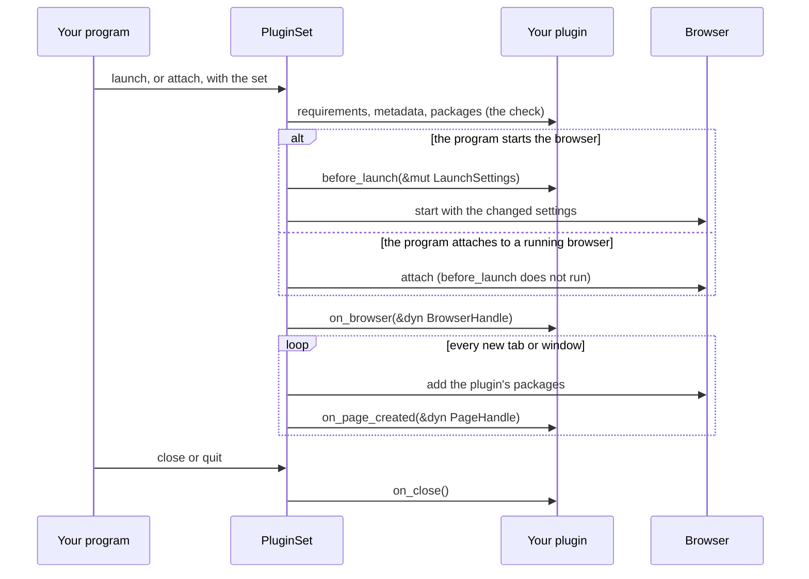

export const LayoutTree = ({ children }) => (
  <div className="not-prose layout-tree" style={{ margin: "1.25rem 0", fontFamily: "var(--font-sans)", fontSize: "14px", color: "var(--text-secondary)" }}>
    <style>{`
      .layout-tree summary { list-style: none; }
      .layout-tree summary::-webkit-details-marker { display: none; }
      .layout-tree .lt-row:hover { background-color: var(--surface-subtle); }
      .layout-tree .lt-fold { color: #d5a910; }
      .dark .layout-tree .lt-fold { color: #ffd452; }
      .layout-tree .lt-fold-closed { display: none; }
      .layout-tree details:not([open]) summary .lt-fold-open { display: none; }
      .layout-tree details:not([open]) summary .lt-fold-closed { display: flex; }
      .layout-tree .lt-hl { color: var(--primary); background-color: color-mix(in srgb, var(--primary) 8%, transparent); }
      .dark .layout-tree .lt-hl { color: var(--primary-light); }
      .layout-tree .lt-ic-gray { color: #84848a; }
      .dark .layout-tree .lt-ic-gray { color: #adadb1; }
      .layout-tree .lt-ic-blue { color: #1a85d4; }
      .dark .layout-tree .lt-ic-blue { color: #69b1ff; }
      .layout-tree .lt-ic-cyan { color: #1ca1c7; }
      .dark .layout-tree .lt-ic-cyan { color: #68cdf2; }
      .layout-tree .lt-ic-green { color: #199f43; }
      .dark .layout-tree .lt-ic-green { color: #5ecc71; }
      .layout-tree .lt-ic-indigo { color: #693acf; }
      .dark .layout-tree .lt-ic-indigo { color: #9d6afb; }
      .layout-tree .lt-ic-orange { color: #d47628; }
      .dark .layout-tree .lt-ic-orange { color: #ffa359; }
      .layout-tree .lt-ic-pink { color: #d32a61; }
      .dark .layout-tree .lt-ic-pink { color: #ff678d; }
      .layout-tree .lt-ic-purple { color: #a631be; }
      .dark .layout-tree .lt-ic-purple { color: #d568ea; }
      .layout-tree .lt-ic-red { color: #d52c36; }
      .dark .layout-tree .lt-ic-red { color: #ff6762; }
      .layout-tree .lt-ic-yellow { color: #d5a910; }
      .dark .layout-tree .lt-ic-yellow { color: #ffd452; }
    `}</style>
    {children}
  </div>
)

export const LayoutRow = ({ icon, name, note, highlight = false, button = false }) => (
  <div className={highlight ? "lt-row lt-hl" : "lt-row"} style={{ display: "flex", alignItems: "flex-start", gap: "6px", minHeight: "30px", padding: "5px 8px", margin: "0 2px", borderRadius: "6px", lineHeight: "20px", cursor: button ? "pointer" : "default" }}>
    <span style={{ width: "16px", height: "20px", flexShrink: 0, display: "flex", alignItems: "center", justifyContent: "center", color: highlight ? "inherit" : "var(--text-muted)" }}>{icon}</span>
    <span style={{ whiteSpace: "nowrap" }}>{name}</span>
    {note ? <span style={{ color: "var(--text-muted)", marginLeft: "6px" }}>{note}</span> : null}
  </div>
)

export const LayoutFolderIcon = ({ kind }) => (
  <svg viewBox="0 0 16 16" width="16" height="16" aria-hidden="true">
    {kind === "empty" ? (
      <path fill="none" stroke="currentColor" strokeWidth="1.2" strokeLinejoin="round" d="M2 4.2A1.2 1.2 0 0 1 3.2 3h3.1c.32 0 .62.13.85.35L8.4 4.6h4.4A1.2 1.2 0 0 1 14 5.8v6a1.2 1.2 0 0 1-1.2 1.2H3.2A1.2 1.2 0 0 1 2 11.8z" />
    ) : kind === "open" ? (
      <g fill="currentColor">
        <path opacity=".5" d="M1.5 4A1.5 1.5 0 0 1 3 2.5h3.38a1.5 1.5 0 0 1 1.06.44L8.5 4H13a1.5 1.5 0 0 1 1.5 1.5V7H4.2a1.5 1.5 0 0 0-1.4.95L1.5 11.3z" />
        <path d="M4.2 8h10.6a.7.7 0 0 1 .65.95l-1.6 4.1a1.5 1.5 0 0 1-1.4.95H2.2a.7.7 0 0 1-.65-.95l1.25-3.2A1.5 1.5 0 0 1 4.2 8z" />
      </g>
    ) : (
      <g fill="currentColor">
        <path d="M1.5 4A1.5 1.5 0 0 1 3 2.5h3.38a1.5 1.5 0 0 1 1.06.44L8.5 4H1.5z" />
        <path opacity=".6" d="M1.5 4.5V12A1.5 1.5 0 0 0 3 13.5h10a1.5 1.5 0 0 0 1.5-1.5V6A1.5 1.5 0 0 0 13 4.5z" />
      </g>
    )}
  </svg>
)

export const LayoutFileIcon = () => (
  <svg viewBox="0 0 16 16" width="16" height="16" aria-hidden="true">
    <path fill="currentColor" opacity=".5" d="M8 1v3a3 3 0 0 0 3 3h3v5.5a2.5 2.5 0 0 1-2.5 2.5h-7A2.5 2.5 0 0 1 2 12.5v-9A2.5 2.5 0 0 1 4.5 1z" />
    <path fill="currentColor" d="M9.5 1a.5.5 0 0 1 .354.146l4 4A.5.5 0 0 1 14 5.5V6h-3a2 2 0 0 1-2-2V1z" />
  </svg>
)

export const LayoutDir = ({ name, note, open = false, highlight = false, children }) =>
  children ? (
    <details open={open}>
      <summary>
        <LayoutRow icon={<span className={highlight ? "" : "lt-fold"} style={{ display: "flex" }}><span className="lt-fold-open" style={{ display: "flex" }}><LayoutFolderIcon kind="open" /></span><span className="lt-fold-closed"><LayoutFolderIcon kind="closed" /></span></span>} name={name} note={note} highlight={highlight} button />
      </summary>
      <div style={{ marginLeft: "17.5px", borderLeft: "1px solid var(--border-subtle)", paddingLeft: "6px" }}>
        {children}
      </div>
    </details>
  ) : (
    <LayoutRow icon={<span className={highlight ? "" : "lt-fold"} style={{ display: "flex" }}><LayoutFolderIcon kind="empty" /></span>} name={name} note={note} highlight={highlight} />
  )

export const layoutIconColor = (name) => {
  const n = String(name).toLowerCase()
  const ext = n.includes(".") ? n.split(".").pop() : ""
  if (n === "dockerfile" || n.startsWith("dockerfile.") || n.startsWith("docker-compose")) return "blue"
  if (["rs", "json", "jsonc", "html", "htm", "zip", "gz", "tgz", "crx", "xpi", "swift", "svg"].includes(ext)) return "orange"
  if (["ts", "tsx", "mts", "cts", "py"].includes(ext)) return "blue"
  if (["js", "mjs", "cjs", "jsx"].includes(ext)) return "yellow"
  if (["md", "mdx", "sh", "bash", "zsh", "fish", "ps1"].includes(ext)) return "green"
  if (["css", "scss"].includes(ext)) return "indigo"
  if (["png", "jpg", "jpeg", "gif", "webp", "ico"].includes(ext)) return "pink"
  if (ext === "go") return "cyan"
  return "gray"
}

export const LayoutFile = ({ name, note, highlight = false }) => (
  <LayoutRow icon={<span className={highlight ? "" : "lt-ic-" + layoutIconColor(name)} style={{ display: "flex" }}><LayoutFileIcon /></span>} name={name} note={note} highlight={highlight} />
)

<Badge color="orange">Early</Badge> <Badge color="blue">Feature: plugins</Badge>

A plugin is a Rust type that changes how a browser starts and what every tab
gets. This page builds one, from an empty folder to a tested crate that a
program turns on by name. For turning plugins on and attaching a set to a
browser, read the [Browser Plugins guide](/tutorials/plugins). This page is
about the plugin itself.

<Info>

**What you will learn**

- What a plugin can do, and when each of its hooks runs
- How to build a plugin crate step by step, with an option
- How to test it without a browser, and against the mock browser
- How to turn it on from Rust, from the settings file and from the command line
- How to declare what it needs, so a strict set accepts it
- How to package and share it, or write it in WebAssembly instead

</Info>

<Visibility for="agents">

Summary for AI exports: a plugin implements the `Plugin` trait of the crate `seleniumbase-rs-plugin` (re-exported as `seleniumbase_rs::plugin_api`, feature `plugins`). Only `name` is required. The optional hooks are `before_launch(&mut LaunchSettings)`, `on_browser(&dyn BrowserHandle)`, `on_page_created(&dyn PageHandle)` and `on_close()`; the optional declarations are `metadata`, `requirements`, `dependencies`, `packages` and `per_launch`. To enable a plugin by name with options, implement `Configurable` (`NAME`, `describe`, `configure(&Value)`), add `Descriptor::of::<P>()` to a `Registry`, and build the set with `seleniumbase_rs::plugin_host::build_with`. Test with `seleniumbase-rs-plugin-testing` (`RecordingPage`, `RecordingBrowser`, `block_on`). A plugin crate must take the plugins repository at the same git `rev` as seleniumbase-rs.

</Visibility>

<Card color="#1a85d4" title="Quick reference" icon="plug">

- API crate: `seleniumbase-rs-plugin`
- From seleniumbase-rs: `seleniumbase_rs::plugin_api`, feature `plugins`
- Required: `fn name(&self) -> &str`
- Hooks: `before_launch`, `on_browser`, `on_page_created`, `on_close`
- By name: `Configurable`, `Descriptor`, `Registry`
- Tests: `seleniumbase-rs-plugin-testing`
- Pin: the `rev` that seleniumbase-rs pins

</Card>

## A plugin

A plugin is a type that implements the `Plugin` trait. `name` is the only
method you must write; every hook has a default that does nothing. This one logs
a line in the console of every page:

```rust src/lib.rs
use seleniumbase_rs_plugin::{async_trait, PageHandle, Plugin, Result};

pub struct Hello;

#[async_trait]
impl Plugin for Hello {
    fn name(&self) -> &str {
        "hello"
    }

    async fn on_page_created(&self, page: &dyn PageHandle) -> Result<()> {
        page.add_init_script("console.log('hello from a plugin')").await
    }
}
```

A plugin crate imports the API from `seleniumbase_rs_plugin`. In a program that
already depends on seleniumbase-rs, the same items are
`seleniumbase_rs::plugin_api` (feature `plugins`). A plugin never sees
`sb_cdp::Browser`, `Page` or `BaseCase`. The browser and the tab reach it as two
small traits, `BrowserHandle` and `PageHandle`, which both engines implement, so
one plugin works with the pure CDP engine and with the WebDriver engine.

What a plugin can do, and where:

| You want to | Use |
|---|---|
| Add browser switches, preferences, extensions or a proxy, or change headless mode | `before_launch` |
| Send a browser-level DevTools command | `on_browser` |
| Add a script or a stylesheet to every page | `packages`, or `add_init_script` in `on_page_created` |
| Send a DevTools command to every tab, such as blocking URLs or setting the time zone | `on_page_created` |
| Clean up, such as deleting temporary folders | `on_close` |
| Refuse a browser it cannot work with | `requirements` |
| Say what it is and what it needs | `metadata` |
| Run before or after other plugins | `dependencies`, or the ordering edges of `metadata` |

A <Tooltip tip="Chrome DevTools Protocol: a method name, such as Network.setBlockedURLs, and JSON parameters, sent to the browser or to one tab.">DevTools command</Tooltip>
reaches only Chromium browsers. On Firefox and Safari, `send` returns an error.

## How a plugin runs

The set of plugins checks every plugin before anything starts. Then it calls the
hooks in order, and each hook gets a handle to what exists at that point:

<Frame caption="The hooks of one browser, from start to close">



</Frame>

| Hook | Receives | Runs | When it fails |
|---|---|---|---|
| `before_launch` | `&mut LaunchSettings` | Before the browser starts. Not when the program attaches to a running browser | The launch stops |
| `on_browser` | `&dyn BrowserHandle` | Once the browser runs, started or attached | The launch stops |
| packages, then `on_page_created` | `&dyn PageHandle` | For every tab or window the library attaches to, before your program uses it | The tab stops |
| `on_close` | nothing | Once per launch, when the browser closes or is dropped | The error is logged, and the other plugins still run |

Errors fail closed: a plugin that did not run must not leave a browser without
what it adds. They come back as `SeleniumBaseError::Plugin`, which names the
plugin and the hook. At each point, plugins run in the order of their phase,
then of their `requires`, `after` and `before` edges, then in the order they
were added. The exact points for each engine are in
[When the hooks run](/tutorials/plugins#when-the-hooks-run),
[The WebDriver engine](/tutorials/plugins#the-webdriver-engine) and
[When a plugin fails](/tutorials/plugins#when-a-plugin-fails).

## Write your own

You will build `hello`, a plugin that logs a message of your choice in every
page. It reads one option, `message`, has tests that need no browser, and can be
turned on by name.

<Steps>

<Step title="Create the crate" icon="folder-plus" titleSize="h3">

Copy the [`template/`](https://github.com/MustCodeAl/seleniumbase-rs-plugins/tree/main/template)
folder of the plugins repository (see [The template](#the-template)), or run
`cargo new --lib`. Name the crate `seleniumbase-rs-plugin-<name>`.

<LayoutTree>
  <LayoutDir name="seleniumbase-rs-plugin-hello" open note="the plugin crate">
    <LayoutFile name="Cargo.toml" note="the plugin API, serde_json and the test fakes" />
    <LayoutDir name="src" open note="the plugin">
      <LayoutFile name="lib.rs" highlight note="Hello, its options and its unit tests" />
    </LayoutDir>
    <LayoutDir name="tests" open note="optional">
      <LayoutFile name="mock_browser.rs" note="the real launch steps against the mock browser" />
    </LayoutDir>
  </LayoutDir>
</LayoutTree>

```toml Cargo.toml
[package]
name = "seleniumbase-rs-plugin-hello"
description = "A seleniumbase-rs plugin that logs a line in every page"
version = "0.1.0"
edition = "2024"
license = "MIT"

[dependencies]
seleniumbase-rs-plugin = { git = "https://github.com/MustCodeAl/seleniumbase-rs-plugins", rev = "628991af0e6c5711298e3bd3692dc2974887401a" }
serde_json = "1"

[dev-dependencies]
seleniumbase-rs-plugin-testing = { git = "https://github.com/MustCodeAl/seleniumbase-rs-plugins", rev = "628991af0e6c5711298e3bd3692dc2974887401a" }
```

The crate depends on the plugin API, and on `serde_json` because options and
DevTools parameters are JSON values. It never depends on seleniumbase-rs.

<Warning>

Name the `rev` that your seleniumbase-rs pins: the `rev` of
`seleniumbase-rs-plugin` in its `Cargo.toml`, currently
`628991af0e6c5711298e3bd3692dc2974887401a`. Cargo counts a git repository under
two references as two crates, and then your `Plugin` is not the trait
seleniumbase-rs calls. See [Cargo features](/plugins/selecting#cargo-features).

</Warning>

</Step>

<Step title="Implement the Plugin trait" icon="code" titleSize="h3">

```rust src/lib.rs
//! A seleniumbase-rs plugin that logs a line in the console of every page.

use seleniumbase_rs_plugin::{
    async_trait, Capability, Category, HostScope, Metadata, PageHandle, Plugin, Result,
};
use serde_json::Value;

/// Logs a line in the console of every page.
pub struct Hello {
    message: String,
}

impl Hello {
    /// A plugin that logs this message.
    pub fn new(message: impl Into<String>) -> Self {
        Self { message: message.into() }
    }

    /// The script for every page. The message goes in as a JSON string,
    /// so a quote in it cannot break the script.
    fn script(&self) -> String {
        format!("console.log({});", Value::from(self.message.as_str()))
    }
}

impl Default for Hello {
    fn default() -> Self {
        Self::new("hello from a plugin")
    }
}

#[async_trait]
impl Plugin for Hello {
    fn name(&self) -> &str {
        "hello"
    }

    fn metadata(&self) -> Metadata {
        Metadata::new(Category::Testing)
            .version(env!("CARGO_PKG_VERSION"))
            .summary("Logs a line in the console of every page")
            .capability(Capability::PageScript(HostScope::Everywhere))
    }

    async fn on_page_created(&self, page: &dyn PageHandle) -> Result<()> {
        page.add_init_script(&self.script()).await
    }
}
```

- `#[async_trait]` comes from the API crate, so the crate needs no dependency
  of its own for it.
- `add_init_script` runs the script in every document the tab loads from now on,
  before the page's own scripts on Chromium browsers. It returns a `Result`: an
  error goes up to the set, which stops the tab and names the plugin.
- `metadata` says what the plugin is (a `Testing` plugin) and what it needs (a
  script on every page). Without it the plugin is a "legacy" plugin, which a <Tooltip tip="A PluginSet that refuses plugins that declare no metadata. The command line, the MCP server and every set built from names are strict.">strict set</Tooltip> refuses.
  More in [Declaring metadata and capabilities](#declaring-metadata-and-capabilities).

</Step>

<Step title="Read its options" icon="sliders" titleSize="h3">

To be turned on by name, with options from a settings file or the command line,
a plugin implements `Configurable`. It names the plugin, describes it without
building one, and builds it from its options:

```rust src/lib.rs
use seleniumbase_rs_plugin::{Configurable, PluginError};

impl Configurable for Hello {
    const NAME: &'static str = "hello";

    fn describe() -> Metadata {
        Metadata::new(Category::Testing)
            .version(env!("CARGO_PKG_VERSION"))
            .summary("Logs a line in the console of every page")
            .capability(Capability::PageScript(HostScope::Everywhere))
    }

    /// Options: message, the text to log. No options: the default text.
    fn configure(options: &Value) -> Result<Self> {
        let refuse = |why: String| PluginError::Config(format!("hello: {why}"));
        match options {
            Value::Null => Ok(Self::default()),
            Value::Object(table) => {
                if let Some(key) = table.keys().find(|key| key.as_str() != "message") {
                    return Err(refuse(format!("unknown option '{key}'")));
                }
                match table.get("message") {
                    None => Ok(Self::default()),
                    Some(Value::String(text)) => Ok(Self::new(text.as_str())),
                    Some(other) => Err(refuse(format!("'message' must be a string, not {other}"))),
                }
            }
            other => Err(refuse(format!("the options must be a table, not {other}"))),
        }
    }
}
```

Then let `name` and `metadata` read from it, so each is written once:

```rust src/lib.rs
    fn name(&self) -> &str {
        Self::NAME
    }

    fn metadata(&self) -> Metadata {
        Self::describe()
    }
```

`options` is `Value::Null` when no option was given, and otherwise the plugin's
table as JSON. Refuse a key you do not know: a typo must not turn a setting off
without a word. The [Options reference](#options-reference) has the rules.

</Step>

<Step title="Test it without a browser" icon="flask" titleSize="h3">

<Tabs>

<Tab title="Recording fakes" icon="vial">

`seleniumbase-rs-plugin-testing` has fakes of the two handles. `RecordingPage`
and `RecordingBrowser` write down every command, script and expression a hook
sends. `block_on` runs a hook without an async runtime, because the fakes never
wait.

```rust src/lib.rs
#[cfg(test)]
mod tests {
    use super::*;
    use seleniumbase_rs_plugin::{BrowserFamily, Engine, LaunchContext, PluginSet};
    use seleniumbase_rs_plugin_testing::{block_on, Call, RecordingPage};
    use serde_json::json;

    #[test]
    fn every_page_gets_the_script() {
        let page = RecordingPage::new();
        let set = PluginSet::new().with(Hello::new("hi")).unwrap();
        block_on(set.on_page_created(&page)).unwrap();
        assert_eq!(page.calls(), [Call::InitScript(r#"console.log("hi");"#.into())]);
    }

    #[test]
    fn a_failure_names_the_plugin_and_the_hook() {
        let page = RecordingPage::new().failing("add_init_script");
        let set = PluginSet::new().with(Hello::default()).unwrap();
        let error = block_on(set.on_page_created(&page)).unwrap_err().to_string();
        assert!(error.contains("hello") && error.contains("on_page_created"), "{error}");
    }

    #[test]
    fn a_strict_set_accepts_it() {
        let set = PluginSet::strict().with(Hello::default()).unwrap();
        let context = LaunchContext {
            engine: Engine::Cdp,
            family: BrowserFamily::Chromium,
            headless: true,
            connecting: false,
        };
        set.check(&context).unwrap();
    }

    #[test]
    fn options_are_read_and_mistakes_refused() {
        let hello = Hello::configure(&json!({ "message": "hi" })).unwrap();
        assert_eq!(hello.message, "hi");
        assert_eq!(Hello::configure(&Value::Null).unwrap().message, "hello from a plugin");
        assert!(Hello::configure(&json!({ "mesage": "hi" })).is_err());
        assert!(Hello::configure(&json!({ "message": 3 })).is_err());
    }
}
```

```bash Terminal
cargo test
```

`RecordingPage::new().replying(method, value)` answers a command with a value,
and `.failing(method)` makes it fail. `RecordingPage::on(Engine::WebDriver)` and
`RecordingBrowser::of(engine, family)` stand in for the other engine and for
other browsers.

</Tab>

<Tab title="Mock browser" icon="window-maximize">

To run the real launch steps of seleniumbase-rs with no Chrome, add it as a
dev-dependency with the features `plugins` and `test-util`.
`Browser::launch_mocked` checks the set, runs the hooks and prepares the first
tab against a scripted browser, and `MockCtrl` reads back what that browser was
sent.

```toml Cargo.toml
[dev-dependencies]
seleniumbase-rs = { git = "https://github.com/MustCodeAl/seleniumbase-rs", tag = "v0.5.1", features = ["plugins", "test-util"] }
tokio = { version = "1", features = ["macros", "rt"] }
```

```rust tests/mock_browser.rs
use seleniumbase_rs::plugin_api::PluginSet;
use seleniumbase_rs::sb_cdp::{Browser, LaunchOptions, MockCtrl};
use seleniumbase_rs_plugin_hello::Hello;

#[tokio::test]
async fn the_first_tab_gets_the_script() {
    let mock = MockCtrl::new();
    let plugins = PluginSet::new().with(Hello::new("hi")).unwrap();
    let options = LaunchOptions::builder().headless(true).plugins(plugins).build().unwrap();

    let browser = Browser::launch_mocked(options, &mock).await.unwrap();

    let scripts = mock.calls_to("Page.addScriptToEvaluateOnNewDocument");
    assert!(scripts.iter().any(|call| call.params["source"] == r#"console.log("hi");"#));
    browser.close().await.unwrap();
}
```

This works only when this seleniumbase-rs and your crate take
`seleniumbase-rs-plugin` from the same `rev`. If Cargo builds two versions, see
[Troubleshooting](#troubleshooting).

</Tab>

</Tabs>

<Check>

`cargo test` passes: the plugin adds its script, names itself when it fails,
satisfies a strict set and reads its options.

</Check>

The whole file, tests included:

<CodeBlock language="rust" filename="src/lib.rs" icon="file-code" lines expandable>
{`//! A seleniumbase-rs plugin that logs a line in the console of every page.

use seleniumbase_rs_plugin::{
    async_trait, Capability, Category, Configurable, HostScope, Metadata, PageHandle, Plugin,
    PluginError, Result,
};
use serde_json::Value;

/// Logs a line in the console of every page.
pub struct Hello {
    message: String,
}

impl Hello {
    /// A plugin that logs this message.
    pub fn new(message: impl Into<String>) -> Self {
        Self { message: message.into() }
    }

    /// The script for every page. The message goes in as a JSON string,
    /// so a quote in it cannot break the script.
    fn script(&self) -> String {
        format!("console.log({});", Value::from(self.message.as_str()))
    }
}

impl Default for Hello {
    fn default() -> Self {
        Self::new("hello from a plugin")
    }
}

#[async_trait]
impl Plugin for Hello {
    fn name(&self) -> &str {
        Self::NAME
    }

    fn metadata(&self) -> Metadata {
        Self::describe()
    }

    async fn on_page_created(&self, page: &dyn PageHandle) -> Result<()> {
        page.add_init_script(&self.script()).await
    }
}

impl Configurable for Hello {
    const NAME: &'static str = "hello";

    fn describe() -> Metadata {
        Metadata::new(Category::Testing)
            .version(env!("CARGO_PKG_VERSION"))
            .summary("Logs a line in the console of every page")
            .capability(Capability::PageScript(HostScope::Everywhere))
    }

    /// Options: message, the text to log. No options: the default text.
    fn configure(options: &Value) -> Result<Self> {
        let refuse = |why: String| PluginError::Config(format!("hello: {why}"));
        match options {
            Value::Null => Ok(Self::default()),
            Value::Object(table) => {
                if let Some(key) = table.keys().find(|key| key.as_str() != "message") {
                    return Err(refuse(format!("unknown option '{key}'")));
                }
                match table.get("message") {
                    None => Ok(Self::default()),
                    Some(Value::String(text)) => Ok(Self::new(text.as_str())),
                    Some(other) => Err(refuse(format!("'message' must be a string, not {other}"))),
                }
            }
            other => Err(refuse(format!("the options must be a table, not {other}"))),
        }
    }
}

#[cfg(test)]
mod tests {
    use super::*;
    use seleniumbase_rs_plugin::{BrowserFamily, Engine, LaunchContext, PluginSet};
    use seleniumbase_rs_plugin_testing::{block_on, Call, RecordingPage};
    use serde_json::json;

    #[test]
    fn every_page_gets_the_script() {
        let page = RecordingPage::new();
        let set = PluginSet::new().with(Hello::new("hi")).unwrap();
        block_on(set.on_page_created(&page)).unwrap();
        assert_eq!(page.calls(), [Call::InitScript(r#"console.log("hi");"#.into())]);
    }

    #[test]
    fn a_failure_names_the_plugin_and_the_hook() {
        let page = RecordingPage::new().failing("add_init_script");
        let set = PluginSet::new().with(Hello::default()).unwrap();
        let error = block_on(set.on_page_created(&page)).unwrap_err().to_string();
        assert!(error.contains("hello") && error.contains("on_page_created"), "{error}");
    }

    #[test]
    fn a_strict_set_accepts_it() {
        let set = PluginSet::strict().with(Hello::default()).unwrap();
        let context = LaunchContext {
            engine: Engine::Cdp,
            family: BrowserFamily::Chromium,
            headless: true,
            connecting: false,
        };
        set.check(&context).unwrap();
    }

    #[test]
    fn options_are_read_and_mistakes_refused() {
        let hello = Hello::configure(&json!({ "message": "hi" })).unwrap();
        assert_eq!(hello.message, "hi");
        assert_eq!(Hello::configure(&Value::Null).unwrap().message, "hello from a plugin");
        assert!(Hello::configure(&json!({ "mesage": "hi" })).is_err());
        assert!(Hello::configure(&json!({ "message": 3 })).is_err());
    }
}`}
</CodeBlock>

</Step>

<Step title="Register it and turn it on" icon="toggle-on" titleSize="h3">

A program adds the plugin crate next to seleniumbase-rs:

```toml Cargo.toml
[dependencies]
seleniumbase-rs = { git = "https://github.com/MustCodeAl/seleniumbase-rs", tag = "v0.5.1", features = ["plugins"] }
seleniumbase-rs-plugin-hello = { path = "../seleniumbase-rs-plugin-hello" }
serde_json = "1"
```

The names that the settings file, `SB_PLUGINS`, `plugins_named` and
`plugin_selection` accept come from the built-in registry only. A plugin of your
own joins by name through a registry of your own:
`plugin_host::builtin_registry().with(Descriptor::of::<Hello>())`, and then
`plugin_host::build_with`.

<Tabs>

<Tab title="Rust" icon="code">

Build a set and give it to a launch. `PluginSet::with` grants what the plugin
declares, except Critical capabilities.

<CodeGroup>

```rust Pure CDP
use seleniumbase_rs::plugin_api::PluginSet;
use seleniumbase_rs::sb_cdp::{Browser, LaunchOptions};
use seleniumbase_rs_plugin_hello::Hello;

let plugins = PluginSet::new().with(Hello::new("hi"))?;
let browser = Browser::launch(LaunchOptions::builder().plugins(plugins).build()?).await?;
```

```rust WebDriver
use seleniumbase_rs::plugin_api::PluginSet;
use seleniumbase_rs::{BaseCase, BrowserConfig};
use seleniumbase_rs_plugin_hello::Hello;

let plugins = PluginSet::new().with(Hello::new("hi"))?;
let mut sb = BaseCase::new(BrowserConfig::default().with_plugins(plugins)).await?;
```

</CodeGroup>

</Tab>

<Tab title="Settings file" icon="file-code">

```toml sbase_config.toml
[plugins]
enable = ["hello"]

[plugins.hello]
message = "hi from the settings file"
```

```rust src/main.rs
use std::path::Path;

use seleniumbase_rs::config::settings::Settings;
use seleniumbase_rs::plugin_api::Descriptor;
use seleniumbase_rs::plugin_host;
use seleniumbase_rs::sb_cdp::{Browser, LaunchOptions};
use seleniumbase_rs_plugin_hello::Hello;

// The [plugins] table of sbase_config.toml, with SB_PLUGINS on top.
let selection = Settings::load_plugin_selection(None::<&Path>)?;
let registry = plugin_host::builtin_registry().with(Descriptor::of::<Hello>());
let plugins = plugin_host::build_with(&registry, &selection)?;
let browser = Browser::launch(LaunchOptions::builder().plugins(plugins).build()?).await?;
```

`SB_PLUGINS=hello` turns it on for one run with the same code; it replaces the
`enable` list of the file. `build_with` returns a strict set and grants each
plugin what it declares, except Critical capabilities. An unknown name, an
option the plugin refuses, or a name given twice is an error before any browser
starts.

</Tab>

<Tab title="Command line" icon="terminal">

`sbrs` and `sbrs-mcp` know only the plugins compiled into them, the built-in
ones, so `sbrs --plugin hello` reports an unknown name. In a command-line
program of your own, `PluginChoice` applies the same `--plugin` and
`--plugin-opt` rules as `sbrs`:

```rust src/main.rs
use std::path::Path;

use seleniumbase_rs::cli::plugin_cmd::{self, PluginChoice};
use seleniumbase_rs::plugin_api::Descriptor;
use seleniumbase_rs::plugin_host;
use seleniumbase_rs_plugin_hello::Hello;

// What your argument parser collected from --plugin NAME and
// --plugin-opt NAME.KEY=VALUE, as two lists of strings.
let choice = PluginChoice::load(None::<&Path>, &plugin_flags, &option_flags)?;
let registry = plugin_host::builtin_registry().with(Descriptor::of::<Hello>());
// A plugin that declares launch.proxy, artifacts.write or host.* must be named by
// the operator, not only by the settings file of the current folder.
plugin_cmd::check_origins_with(&registry, choice.origins())?;
let plugins = plugin_host::build_with(&registry, choice.selection())?;
```

```bash Terminal
my-tool --plugin hello --plugin-opt 'hello.message="hi"'
```

The precedence is the command line, then `SB_PLUGINS`, then the settings file.
`VALUE` is a TOML value, so quote a string. Details are in
[On the command line](/plugins/selecting#on-the-command-line).

</Tab>

</Tabs>

</Step>

<Step title="Check what it declares" icon="magnifying-glass" titleSize="h3">

`sbrs plugin info NAME` prints what a plugin declares, for the plugins of the
`sbrs` build. For your own registry the same text comes from
`plugin_cmd::info_with`, and the table of `sbrs plugin list` from `list_with`:

<CodeGroup>

```rust Rust
use seleniumbase_rs::cli::plugin_cmd;
use seleniumbase_rs::config::plugins::PluginSelection;
use seleniumbase_rs::plugin_api::Descriptor;
use seleniumbase_rs::plugin_host;
use seleniumbase_rs_plugin_hello::Hello;
use serde_json::json;

let registry = plugin_host::builtin_registry().with(Descriptor::of::<Hello>());
let selection = PluginSelection::new()
    .enable("hello")
    .with_options("hello", json!({ "message": "hi" }));
print!("{}", plugin_cmd::info_with(&registry, "hello", &selection)?);
```

```text Output
hello 0.1.0
Logs a line in the console of every page

category      testing
enabled       yes
phase         observe
needs         -
capabilities  page.script:*  high    enforced
optional      -
requires      -
conflicts     -
runs after    -
runs before   -
seals         -
options       message = "hi"
```

</CodeGroup>

Read it as a reviewer would: the category and phase, each capability with its
risk, what the plugin needs from the browser, and the options in effect.
`PluginSet::audit()` returns the same capabilities as rows (granted or not,
risk, enforcement) for a test to check.

</Step>

</Steps>

<Prompt description="Ask an AI coding agent to start a plugin from this page" actions={["copy"]}>

Create a seleniumbase-rs plugin crate named seleniumbase-rs-plugin-NAME from the template folder of github.com/MustCodeAl/seleniumbase-rs-plugins. Depend on seleniumbase-rs-plugin at the same git rev that my seleniumbase-rs pins. Implement the Plugin trait with only the hooks the plugin needs, declare its metadata (category, version, summary, capabilities), implement Configurable so that it refuses unknown options, and test it with RecordingPage from seleniumbase-rs-plugin-testing. The plugin should: DESCRIBE WHAT IT DOES.

</Prompt>

## Hook reference

Every method of `Plugin` but `name` has a default. The hooks are `async`
(through `#[async_trait]`) and return `Result<()>`. An error from any hook but
`on_close` stops the launch or the tab.

<ResponseField name="name" type="fn(&self) -> &str" required>

The plugin's unique, lower-case name, such as `block-resources`. A set refuses a
second plugin with the same name. With `Configurable`, return `Self::NAME`.

</ResponseField>

<ResponseField name="metadata" type="fn(&self) -> Metadata" default="Metadata::legacy()">

What the plugin is and what it needs. See
[Declaring metadata and capabilities](#declaring-metadata-and-capabilities).

</ResponseField>

<ResponseField name="requirements" type="fn(&self) -> Requirements" default="Requirements::empty()">

Conditions the set checks before anything starts. Combine flags with `|`. A
refusal is an error, not a warning.

<Expandable title="flags">

<ResponseField name="Requirements::CHROMIUM_ONLY" type="flag">

Refuses browsers that are not Chromium-based (Firefox and Safari). Say it when
the plugin needs `send`, or a script that runs before the page's own.

</ResponseField>

<ResponseField name="Requirements::LAUNCH_ONLY" type="flag">

Refuses a browser the program attaches to instead of starting, such as one
attached with `Browser::connect_with_plugins`.

</ResponseField>

<ResponseField name="Requirements::HEADFUL" type="flag">

Refuses a headless browser.

</ResponseField>

<ResponseField name="Requirements::RUN_LAST" type="flag">

Refuses nothing. The plugin runs in the last phase, after the others.

</ResponseField>

</Expandable>

</ResponseField>

<ResponseField name="dependencies" type="fn(&self) -> &[&str]" default="&[]">

The names of plugins that must be in the same set. They run before this one, and
a missing one stops the launch.

</ResponseField>

<ResponseField name="packages" type="fn(&self) -> Vec<Package>" default="none">

JavaScript and CSS for every new tab, added before `on_page_created` runs. Each
package must say where it loads, or the set refuses the plugin.

<Expandable title="Package">

<ResponseField name="Package::script(code)" type="Package">

JavaScript run in every matching document before the page's own scripts.

</ResponseField>

<ResponseField name="Package::style(css)" type="Package">

CSS added to every matching document.

</ResponseField>

<ResponseField name="Package::script_url(url)" type="Package">

A script loaded from a URL. Pin the version in the URL.

</ResponseField>

<ResponseField name="Package::style_url(url)" type="Package">

A stylesheet loaded from a URL.

</ResponseField>

<ResponseField name=".only_on(hosts)" type="Package">

Loads only on these hosts and their subdomains.

</ResponseField>

<ResponseField name=".everywhere()" type="Package">

Loads on every site.

</ResponseField>

<ResponseField name=".integrity(hash)" type="Package">

The Subresource Integrity hash of the file at the URL, such as `sha384-...`. The
browser refuses a file that does not match.

</ResponseField>

</Expandable>

</ResponseField>

<ResponseField name="per_launch" type="fn(&self) -> Option<Arc<dyn Plugin>>" default="None">

A fresh instance for each browser, so pooled browsers launched from one set do
not share state. It must have the same name. `crx` uses it so that closing one
browser does not delete the folders of another.

</ResponseField>

<ResponseField name="before_launch" type="async fn(&self, launch: &mut LaunchSettings) -> Result<()>">

Changes the start-up settings before the browser starts. It does not run when
the program attaches to a running browser. After each plugin, the set checks the
change: it needs the matching capability, lists only grow, and a field another
plugin sealed keeps its value.

<Expandable title="LaunchSettings">

<ResponseField name="args" type="Vec<String>">

Browser switches, such as `--lang=de`. Needs `launch.args`. The switches of
`switch_policy::REFUSED_SWITCHES` (`--no-sandbox`, `--remote-debugging-port`,
`--user-data-dir` and others) are refused unless the plugin holds `raw:switches`.

</ResponseField>

<ResponseField name="prefs" type="serde_json::Map<String, Value>">

Browser preferences, as in Chrome's `Preferences` file, with dotted names such
as `intl.accept_languages`. Needs `launch.prefs`. A plugin may set a value, but
not remove a key that is there.

</ResponseField>

<ResponseField name="extensions" type="Vec<PathBuf>">

Unpacked extension folders to load. Needs `launch.extensions`.

</ResponseField>

<ResponseField name="proxy" type="Option<String>">

The proxy server, such as `http://127.0.0.1:8080`. Needs `launch.proxy`. A
plugin sees the server only, never a password from the launch options.

</ResponseField>

<ResponseField name="headless" type="bool">

Whether the browser runs without a window. Needs `launch.headless`.

</ResponseField>

<ResponseField name="host_resolver_rules" type="Vec<String>">

Host-resolver rules; the host joins them into one switch. Needs `launch.network`.

</ResponseField>

<ResponseField name="webrtc_policy" type="Option<WebRtcPolicy>">

Chrome's WebRTC IP-handling policy. Needs `launch.network`.

</ResponseField>

<ResponseField name="disable_features" type="Vec<String>">

Features to disable; the host merges them into one switch. Needs `launch.args`.
`IsolateOrigins` and `site-per-process` are refused.

</ResponseField>

<ResponseField name="enable_features" type="Vec<String>">

Features to enable; the host merges them into one switch. Needs `launch.args`.
The same two features are refused.

</ResponseField>

<ResponseField name="disable_quic" type="bool">

Whether to turn QUIC off. Needs `launch.network`.

</ResponseField>

<ResponseField name="profile()" type="&ProfileView">

The browser profile, read-only: `ProfileView::Ephemeral` (thrown away at close)
or `ProfileView::Persistent(path)`.

</ResponseField>

</Expandable>

On Firefox and Safari a plugin that sets one of the Chromium-only fields is
refused; what each browser accepts is in
[The WebDriver engine](/tutorials/plugins#the-webdriver-engine).

</ResponseField>

<ResponseField name="on_browser" type="async fn(&self, browser: &dyn BrowserHandle) -> Result<()>">

The browser runs, started or attached to. Use it for browser-level commands.

<Expandable title="BrowserHandle">

<ResponseField name="engine()" type="Engine">

`Engine::Cdp` (the pure CDP engine) or `Engine::WebDriver`.

</ResponseField>

<ResponseField name="family()" type="BrowserFamily">

`Chromium`, `Firefox`, `Safari`, or `Embedded` (a webview in an app, such as
Tauri's).

</ResponseField>

<ResponseField name="send(method, params)" type="async -> Result<Value>">

Sends a browser-level DevTools command and returns its result. Browsers without
the protocol return an error.

</ResponseField>

</Expandable>

</ResponseField>

<ResponseField name="on_page_created" type="async fn(&self, page: &dyn PageHandle) -> Result<()>">

A tab or window was attached, before any command of your program runs in it.
The plugin's packages are already added.

<Expandable title="PageHandle">

<ResponseField name="engine()" type="Engine">

The engine that runs the tab.

</ResponseField>

<ResponseField name="send(method, params)" type="async -> Result<Value>">

Sends a DevTools command to this tab and returns its result. The host refuses
`Fetch.*` and `Network.setRequestInterception`, because it owns request
interception. It merges `Network.setBlockedURLs` with the tab's other
blocklists (the other plugins' and the `ad_block` list) instead of replacing
them.

</ResponseField>

<ResponseField name="add_init_script(source)" type="async -> Result<()>">

Runs `source` in every document the tab loads from now on, before the page's own
scripts. On Firefox and Safari it runs after them; see
[The WebDriver engine](/tutorials/plugins#the-webdriver-engine).

</ResponseField>

<ResponseField name="evaluate(expression)" type="async -> Result<Value>">

Evaluates `expression` in the current document and returns its value.

</ResponseField>

</Expandable>

</ResponseField>

<ResponseField name="on_close" type="async fn(&self) -> Result<()>">

The browser is about to close. Every plugin runs even when one fails; the errors
are logged and do not stop the close.

</ResponseField>

## Declaring metadata and capabilities

A plugin can say what it is and what it needs by overriding `metadata()`. The
default is `Metadata::legacy()`, which keeps older plugins working: no category,
and the legacy capabilities, `raw:cdp` among them. A strict set refuses such a
plugin.

```rust src/lib.rs
use seleniumbase_rs_plugin::{
    async_trait, Capability, Category, HostScope, Metadata, PageHandle, Plugin, Result,
};

pub struct Hello;

#[async_trait]
impl Plugin for Hello {
    fn name(&self) -> &str {
        "hello"
    }

    fn metadata(&self) -> Metadata {
        Metadata::new(Category::Environment)
            .summary("Says hello in every page")
            .capability(Capability::PageScript(HostScope::Everywhere))
    }

    async fn on_page_created(&self, page: &dyn PageHandle) -> Result<()> {
        page.add_init_script("console.log('hello from a plugin')").await
    }
}
```

`Metadata` is a builder:

| Method | What it says |
|---|---|
| `Metadata::new(category)` | A declared plugin of this category; the category sets the default phase |
| `.version(v)`, `.summary(s)` | Shown by `sbrs plugin list` and `sbrs plugin info` |
| `.capability(c)`, `.capabilities([...])` | What it needs. The check fails when the engine cannot give it or the set did not grant it |
| `.optional(c)` | What it uses when granted. It never fails the check |
| `.requires(name)` | A plugin that must be in the set and run before it |
| `.conflicts_with(name)` | A plugin that may not be in the same set |
| `.after(name)`, `.before(name)` | Its order against a plugin, when that plugin is present |
| `.phase(p)` | A phase other than the category's |
| `.seal(seals)` | Scalar launch fields (`Seals::PROXY`, `Seals::WEBRTC`, `Seals::HEADLESS`, ...) that later plugins may not change to another value |
| `.budget(budgets)` | Time limits for `before_launch` and `on_page_created`; stored, not enforced yet |

Without `phase`, the category sets it (`Category::default_phase`):

| Category | For | Default phase |
|---|---|---|
| `Environment` | Presets, switches, proxies, headless | `Prepare`, first |
| `Extension` | Extensions and their workers | `Normal` |
| `Core` | Interception, network logging, resource blocking | `Normal` |
| `Privacy` | Hardening, telemetry, WebRTC, cookie isolation | `Enforce`, after the others |
| `Testing` | Assertions, lifecycle, reporters, recording fakes | `Observe` |

`Requirements::RUN_LAST` puts a plugin in the phase `Last`.

Declare the capability that matches what the plugin does:

| Your plugin | Declares |
|---|---|
| Adds to `args`, `disable_features` or `enable_features` | `Capability::LaunchArgs` (`launch.args`) |
| Sets `prefs` | `Capability::LaunchPrefs` (`launch.prefs`) |
| Sets `host_resolver_rules`, `webrtc_policy` or `disable_quic` | `Capability::LaunchNetwork` (`launch.network`) |
| Sets `proxy` | `Capability::LaunchProxy` (`launch.proxy`) |
| Adds `extensions` | `Capability::LaunchExtensions` (`launch.extensions`) |
| Changes `headless` | `Capability::LaunchHeadless` (`launch.headless`) |
| Adds scripts or packages to pages | `Capability::PageScript(HostScope::Hosts(...))`, or `HostScope::Everywhere` (`page.script:*`) |
| Calls `evaluate` | `Capability::PageEvaluate` (`page.evaluate`) |
| Sends the commands of one DevTools domain | `Capability::Cdp("Network".into())` (`cdp:Network`) |
| Reads or writes files | `Capability::HostFsRead(...)`, `Capability::HostFsWrite(PathScope::Temp)` |

The full list, with the risk of each, is on the
[architecture page](/plugins/architecture#capabilities).

A set grants capabilities when you add a plugin:

- `PluginSet::new().with(p)` grants what `p` declares, except Critical
  capabilities.
- `with_trusted(p, &[Capability])` also grants the Critical ones you name.
- `with_grants(p, set)` grants exactly `set`.
- `PluginSet::strict()` refuses plugins that declare no metadata. The command
  line and the MCP server use strict sets.

The Critical capabilities are `raw:*`, `host.process`, `cdp:Target` and
`cdp:Browser`. A set built from names never grants them, so a plugin that
requires one is added in code, with `with_trusted`.

The set checks the required capabilities before the launch, against its grants
and against what the engine can give: WebDriver has no network observation, and
Firefox and Safari have no DevTools channel. It checks each change of
`before_launch` right after the plugin runs. For DevTools commands, the host
today refuses `Fetch.*` and merges `Network.setBlockedURLs`; other commands go
to the browser as sent (see [Limits](/plugins/architecture#limits)).

<Warning>

For a native Rust plugin, capabilities are a declared contract, not a sandbox.
Only [WebAssembly](/plugins/wasm) plugins are sandboxed.

</Warning>

## Options reference

Options let one plugin serve many runs. The host reads them from the settings
file, from `--plugin-opt` or from code, and hands them to
`Configurable::configure` as one JSON value. `SB_PLUGINS` carries names only.

<ResponseField name="Configurable::NAME" type="const &'static str" required>

The name the plugin is enabled by. Return the same string from `Plugin::name`.

</ResponseField>

<ResponseField name="Configurable::describe()" type="fn() -> Metadata" required>

What the plugin declares, without building one. `sbrs plugin list` and
`sbrs plugin info` read it, and so does the check that a project's settings file
cannot turn on a plugin with `launch.proxy`, `artifacts.write` or `host.*` alone.

</ResponseField>

<ResponseField name="Configurable::configure(options)" type="fn(&Value) -> Result<Self>" required>

Builds the plugin. Return `PluginError::Config` for an option that is wrong; the
host adds the plugin's name and stops before any browser starts.

<Expandable title="what options holds">

<ResponseField name="no options" type="Value::Null">

Nothing gave an option. Build the defaults, or refuse when the plugin cannot
start without options (`crx` needs its `files`).

</ResponseField>

<ResponseField name="[plugins.NAME] in the settings file" type="Value::Object">

The plugin's table, as JSON: TOML strings, numbers, booleans, arrays and tables
arrive as their JSON forms.

</ResponseField>

<ResponseField name="--plugin-opt NAME.KEY=VALUE" type="one key">

Sets one key of that object. It replaces the file's value for that key and
keeps the others. `VALUE` is TOML, so a string is quoted: `'hello.message="hi"'`.

</ResponseField>

<ResponseField name="PluginSelection::with_options(name, value)" type="Value">

In code: the value you pass, usually `json!(...)`.

</ResponseField>

</Expandable>

</ResponseField>

Document the options on the plugin's page, as the built-in plugins do
([shield](/plugins/shield#options)): `sbrs plugin info` cannot list them,
because the plugin API does not describe options yet. For `hello`:

<ParamField body="message" type="string" default="hello from a plugin">

The text every page logs in its console.

</ParamField>

A plugin with several options can read them with serde, as shield does:
`#[serde(default, deny_unknown_fields)]` turns an unknown key into an error. It
needs `serde` with the `derive` feature:

```rust src/lib.rs
use serde::Deserialize;

/// The options of hello. An unknown key is an error.
#[derive(Default, Deserialize)]
#[serde(default, deny_unknown_fields)]
struct Options {
    message: Option<String>,
}

impl Configurable for Hello {
    // NAME and describe() as before.

    fn configure(options: &Value) -> Result<Self> {
        let options: Options = if options.is_null() {
            Options::default()
        } else {
            serde_json::from_value(options.clone())
                .map_err(|error| PluginError::Config(format!("hello: {error}")))?
        };
        Ok(options.message.map_or_else(Self::default, Self::new))
    }
}
```

To make a plugin known by name, put `Descriptor::of::<P>()` into a `Registry`.
`Registry::build(&PluginSpec)` builds one plugin from a name and options, and
`Registry::plugin_set(&[PluginSpec])` builds a strict set. `plugin_host::build_with`
does the same from a `PluginSelection` and reports a mistake as
`SeleniumBaseError::Plugin`.

## Worked example: block-resources

The built-in [block-resources](/plugins/block-resources) plugin is a whole
plugin in about a hundred lines. The tabs show its parts and those of
[crx](/plugins/crx), which works before the browser starts.

<Tabs>

<Tab title="block-resources: a tab hook" icon="ban">

```rust plugins/block-resources/src/lib.rs (abridged)
use seleniumbase_rs_plugin::{
    Capability, Category, Configurable, Metadata, PageHandle, Plugin, PluginError, Requirements,
    Result, async_trait,
};
use serde_json::json;

/// Blocks requests whose URL matches any of its patterns (`*` matches anything).
#[derive(Clone, Debug, PartialEq, Eq)]
pub struct BlockResources {
    patterns: Vec<String>,
}

#[async_trait]
impl Plugin for BlockResources {
    fn name(&self) -> &str {
        "block-resources"
    }

    fn requirements(&self) -> Requirements {
        Requirements::CHROMIUM_ONLY
    }

    fn metadata(&self) -> Metadata {
        Self::describe()
    }

    async fn on_page_created(&self, page: &dyn PageHandle) -> Result<()> {
        page.send("Network.enable", json!({})).await?;
        page.send("Network.setBlockedURLs", json!({ "urls": self.patterns }))
            .await?;
        Ok(())
    }
}

impl Configurable for BlockResources {
    const NAME: &'static str = "block-resources";

    fn describe() -> Metadata {
        Metadata::new(Category::Core)
            .version(env!("CARGO_PKG_VERSION"))
            .summary("Stops pages from loading images, fonts, media or URLs you name")
            .capability(Capability::Cdp("Network".into()))
    }

    /// Options: `preset` (`"images-and-fonts"`, the default, or `"media"`) or
    /// `patterns`, an array of URL patterns.
    fn configure(options: &serde_json::Value) -> Result<Self> {
        if let Some(patterns) = options.get("patterns") {
            let list = patterns
                .as_array()
                .and_then(|items| items.iter().map(|v| v.as_str()).collect::<Option<Vec<_>>>())
                .ok_or_else(|| {
                    PluginError::Config("`patterns` must be an array of strings".into())
                })?;
            return Ok(Self::patterns(list));
        }
        match options.get("preset").and_then(serde_json::Value::as_str) {
            None | Some("images-and-fonts") => Ok(Self::images_and_fonts()),
            Some("media") => Ok(Self::media()),
            Some(other) => Err(PluginError::Config(format!("unknown preset `{other}`"))),
        }
    }
}
```

What to copy from it:

- It sends raw commands with `page.send`, so it says `Requirements::CHROMIUM_ONLY`,
  and it declares the one domain it uses, `cdp:Network`, not `raw:cdp`.
- It sends `Network.enable` first, then `Network.setBlockedURLs`. The host merges
  the list with those of the other plugins and the `ad_block` list.
- `configure` builds the default preset from no options, and refuses a preset it
  does not know and a `patterns` value that is not an array of strings.

Its test checks the exact commands with `RecordingPage`:

```rust plugins/block-resources/src/lib.rs (test)
#[test]
fn a_new_tab_gets_the_network_domain_and_the_patterns() {
    let page = RecordingPage::new();
    let set = PluginSet::new()
        .with(BlockResources::patterns(["*.png"]))
        .unwrap();
    block_on(set.on_page_created(&page)).unwrap();
    assert_eq!(
        page.calls(),
        [
            Call::Send("Network.enable".into(), json!({})),
            Call::Send(
                "Network.setBlockedURLs".into(),
                json!({ "urls": ["*.png"] })
            ),
        ]
    );
}
```

The constructors and the other tests are in
[its source](https://github.com/MustCodeAl/seleniumbase-rs-plugins/blob/main/plugins/block-resources/src/lib.rs).

</Tab>

<Tab title="crx: a launch hook with clean-up" icon="puzzle-piece">

```rust plugins/crx/src/lib.rs (abridged)
impl Configurable for CrxExtensions {
    const NAME: &'static str = "crx";

    fn describe() -> Metadata {
        Metadata::new(Category::Extension)
            .version(env!("CARGO_PKG_VERSION"))
            .summary("Loads .crx extension files into the browser it starts")
            .capability(Capability::LaunchExtensions)
            .capability(Capability::HostFsWrite(PathScope::Temp))
    }

    // configure reads `files`, an array of paths, and refuses options without it.
}

#[async_trait]
impl Plugin for CrxExtensions {
    fn requirements(&self) -> Requirements {
        Requirements::CHROMIUM_ONLY | Requirements::LAUNCH_ONLY
    }

    fn metadata(&self) -> Metadata {
        Self::describe().capability(Capability::HostFsRead(PathScope::Declared(
            self.files.clone(),
        )))
    }

    /// A fresh instance for each browser, so closing one pooled browser does
    /// not delete the unpacked folders of the others.
    fn per_launch(&self) -> Option<Arc<dyn Plugin>> {
        Some(Arc::new(Self::new(self.files.clone())))
    }

    async fn before_launch(&self, launch: &mut LaunchSettings) -> Result<()> {
        for file in &self.files {
            // Read the file and unpack it into a temporary folder, `dir`. Then:
            launch.extensions.push(dir.path().to_path_buf());
            self.unpacked
                .lock()
                .unwrap_or_else(PoisonError::into_inner)
                .push(dir);
        }
        Ok(())
    }

    async fn on_close(&self) -> Result<()> {
        // Dropping the folders deletes them.
        self.unpacked
            .lock()
            .unwrap_or_else(PoisonError::into_inner)
            .clear();
        Ok(())
    }
}
```

What to copy from it:

- `describe()` holds what every crx plugin declares, and `metadata()` adds what
  this one reads: its own files.
- `LAUNCH_ONLY`, because extensions load only into a browser it starts.
- `per_launch` and `on_close` keep state per browser and clean it up.
- Its file access is `host.fs.*`, which a native plugin only declares:
  `sbrs plugin info crx` marks it `declared only`.

</Tab>

</Tabs>

[shield](/plugins/shield) shows the rest: `packages`, a `before_launch` that
sets preferences and network settings, and options read with serde.

## Packaging and sharing

| Way | For | How people get it | How it is turned on |
|---|---|---|---|
| A crate of your own | Most plugins | `cargo add --git` with your repository, at the same pinned `rev` of the API | `PluginSet::with`, or by name through your `Registry` and `plugin_host::build_with` |
| A built-in plugin | The official plugins | A cargo feature of seleniumbase-rs (`plugin-shield`, ...), compiled into the prebuilt `sbrs` and `sbrs-mcp` | `--plugin`, the `[plugins]` table, `SB_PLUGINS`, `plugins_named` |
| A WebAssembly module | Any language, in a sandbox | A `.wasm` file, loaded with the crate `seleniumbase-rs-plugin-wasm` | `PluginSet::with(WasmPlugin::from_file(...)?)` |

### A crate of your own

- Name it `seleniumbase-rs-plugin-<name>`, and publish it on GitHub with the
  topic `seleniumbase-rs-plugin` so people find it.
- Say in its README which `rev` of the plugins repository it uses, the options it
  takes and the capabilities it declares.
- Native code is never loaded at run time: a program compiles your crate in.

<Info>

A plugin depends only on `seleniumbase-rs-plugin`, never on seleniumbase-rs, so
it keeps working as seleniumbase-rs changes. A dev-dependency for the mock
browser test is fine.

</Info>

### Built-in plugins

A built-in plugin is a crate in the plugins repository, behind a feature of
`seleniumbase-rs-plugins-builtin` and in its `registry()`, and behind a
`plugin-<name>` feature of seleniumbase-rs. Adding one changes both
repositories. That is how the official plugins ship; see
[Choosing plugins](/plugins/selecting).

### WebAssembly plugins

<Badge color="green" icon="shield">Sandboxed</Badge>

Not a Rust programmer? Write the plugin in any language that compiles to
WebAssembly and load it with the [`wasm`](/plugins/wasm) host: the module only
describes the plugin in JSON (a name, browser switches, page scripts, URLs to
block) and runs in a sandbox. The ABI is on the [wasm page](/plugins/wasm).

```rust src/main.rs
use seleniumbase_rs_plugin::PluginSet;
use seleniumbase_rs_plugin_wasm::WasmPlugin;

let plugins = PluginSet::new().with(WasmPlugin::from_file("hello.wasm")?)?;
```

The loaded `WasmPlugin` is an ordinary `Plugin` with fixed hooks: its switches
in `before_launch`, its scripts as `packages`, its blocked URLs in
`on_page_created`. It declares only what it uses (`launch.args`, `cdp:Network`,
`page.script:*`). It is not in the built-in registry, because it needs the path
of a module, so it is added with `PluginSet::with`, not by name.

<Danger>

A plugin is code that runs with your program's rights and sees every page,
cookie and password the browser handles. Review a plugin before you add it,
as you would any dependency.

</Danger>

## The template

The template is a whole plugin crate with tests, in the plugins repository:

<GitHub.Repo repo="MustCodeAl/seleniumbase-rs-plugins" />

<LayoutTree>
  <LayoutDir name="template" open note="copy this folder and rename the crate">
    <LayoutFile name="Cargo.toml" note="seleniumbase-rs-plugin-hello; the API and the test fakes from git, with no rev" />
    <LayoutDir name="src" open>
      <LayoutFile name="lib.rs" highlight note="Hello with its metadata, and two tests" />
    </LayoutDir>
  </LayoutDir>
</LayoutTree>

- `Cargo.toml` names the package `seleniumbase-rs-plugin-hello`. It takes
  `seleniumbase-rs-plugin`, and `seleniumbase-rs-plugin-testing` for the tests,
  from the git URL of the plugins repository with no `rev`: add the `rev` that
  your seleniumbase-rs pins (see [Create the crate](#create-the-crate)).
- `src/lib.rs` has a `Hello` plugin that declares its metadata (category
  `Testing`, the crate's version, a summary and `page.evaluate`) and adds a
  script to every page with `add_init_script`. A plugin that adds scripts to
  pages declares `page.script`, as the steps above do. Its two tests check that a
  strict set accepts it and that every page gets the script.

Rename the crate, the type and the name, then follow
[Write your own](#write-your-own).

## Troubleshooting

<AccordionGroup>

<Accordion title="The trait Plugin is not implemented (two versions of the API crate)" icon="code-branch" description="The compiler mentions two versions of seleniumbase_rs_plugin">

Your crate and seleniumbase-rs take `seleniumbase-rs-plugin` from different git
references, so Cargo built two copies. Use the `rev` that seleniumbase-rs pins
in every dependency on the plugins repository.
[Cargo features](/plugins/selecting#cargo-features) shows the `cargo add` line.

</Accordion>

<Accordion title="Declares no metadata, which a strict set requires" icon="id-card">

The plugin keeps the default `metadata()`. Return `Metadata::new(category)` with
the capabilities it needs. The command line, the MCP server and every set built
from names are strict.

</Accordion>

<Accordion title="No plugin named hello is available" icon="magnifying-glass">

`plugins_named`, `plugin_selection`, `with_plugin_selection`, `sbrs --plugin`
and `sbrs plugin info` look names up in the built-in registry. Add your plugin
to a registry of your own and build the set with `plugin_host::build_with`, as
in [Register it and turn it on](#register-it-and-turn-it-on). The prebuilt
`sbrs` cannot load a plugin that is not compiled into it.

</Accordion>

<Accordion title="Not allowed to use launch.args: it changed a setting without the capability" icon="lock">

`before_launch` changed a field the plugin did not declare. Declare the
capability for that field (see the table under
[Declaring metadata and capabilities](#declaring-metadata-and-capabilities)).
The same check says "list settings only grow" when a plugin removed an entry,
and refuses any change of the profile.

</Accordion>

<Accordion title="The switch is refused for every plugin" icon="ban">

The switch is in `switch_policy::REFUSED_SWITCHES`, such as `--no-sandbox` or
`--proxy-server`. Use the matching field instead (`proxy`,
`host_resolver_rules`) where there is one. A plugin that truly needs the switch
declares `raw:switches`, a Critical capability, and is added with
`with_trusted`.

</Accordion>

<Accordion title="One of its packages says neither only_on nor everywhere" icon="file-code">

Every `Package` must say where it loads. Add `.only_on(["example.com"])` or
`.everywhere()`.

</Accordion>

<Accordion title="Fetch.enable is not available to plugins" icon="filter">

The host owns request interception: one `Fetch.enable` per tab, shared with the
library's proxy login. To stop requests, send `Network.setBlockedURLs`; the host
merges it with the other blocklists of the tab.

</Accordion>

<Accordion title="Needs cdp:Network, which WebDriver with Firefox or Safari does not support" icon="globe">

The engine cannot give a capability the plugin requires. Run it on a Chromium
browser, and say `Requirements::CHROMIUM_ONLY` so the refusal names the reason.
If the plugin can work without the capability, declare it with `optional` and
handle the error that `send` returns there.

</Accordion>

<Accordion title="It is required but not granted" icon="key">

The plugin requires a Critical capability, which `with` and every set built from
names leave out. Add it in code with
`PluginSet::new().with_trusted(plugin, &[capability])`.

</Accordion>

<Accordion title="block_on or tokio::test?" icon="hourglass">

`block_on` of `seleniumbase-rs-plugin-testing` is for the recording fakes, which
never wait. A test against the mock browser runs a real launch, so it needs an
async runtime: use `#[tokio::test]`, as in
[Test it without a browser](#test-it-without-a-browser).

</Accordion>

</AccordionGroup>

## Next steps

<Columns cols={2}>

<Card color="#199f43" title="Choosing plugins" icon="toggle-on" href="/plugins/selecting">

The cargo features, the `[plugins]` table, `SB_PLUGINS`, `--plugin` and the builder calls.

</Card>

<Card color="#d47628" title="Browser Plugins guide" icon="book" href="/tutorials/plugins">

Attach a set to a browser, and see when each hook runs on each engine.

</Card>

<Card color="#a631be" title="Plugin architecture" icon="sitemap" href="/plugins/architecture">

Categories, capabilities, ordering and what the host enforces.

</Card>

<Card color="#1ca1c7" title="wasm plugin host" icon="cube" href="/plugins/wasm">

Plugins written in any language that compiles to WebAssembly.

</Card>

<Card color="#d32a61" title="block-resources" icon="ban" href="/plugins/block-resources">

The worked example above, as a plugin you can turn on.

</Card>

<Card color="#693acf" title="shield" icon="shield" href="/plugins/shield">

A privacy plugin with `packages`, launch settings and serde options.

</Card>

</Columns>
