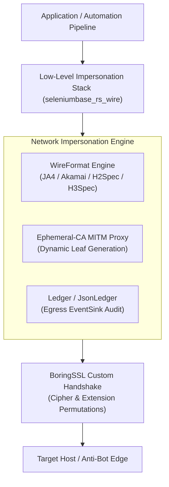
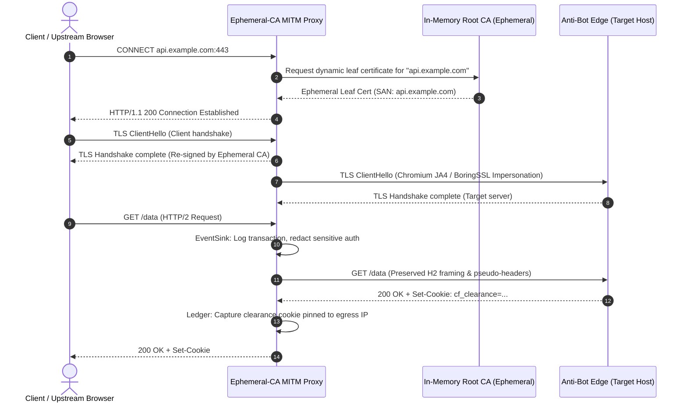
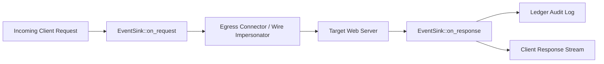

Network Patching is SeleniumBase-RS's low-level browser impersonation engine. Rather than merely setting high-level HTTP headers or driving a heavy browser process, it controls and patches the raw network bytes transmitted across the wire: TLS ClientHello fingerprints, HTTP/2 frame and HPACK sequences, HTTP/3 QUIC specifications, Ephemeral-CA MITM interception, and egress ledger auditing.

<Badge color="orange">Advanced Architecture</Badge>

<Visibility for="agents">

Summary for AI coding agents: Network patching operates below WebDriver and CDP. It provides byte-accurate browser impersonation using measured TLS handshakes (JA3, JA4, BoringSSL cipher order, extension permutations), HTTP/2 frame hierarchies (SETTINGS, WINDOW_UPDATE, pseudo-header order), and HTTP/3 QUIC profiles. It includes an Ephemeral-CA MITM engine (`seleniumbase_rs_stealth::wire::mitm`) that dynamically signs leaf certificates, an egress `Ledger` / `JsonLedger` event sink for transaction auditing, and native-level binary and protocol engine patching.

</Visibility>

---

## 1. What is Low-Level Browser Impersonation?

Modern anti-bot defenses—such as Cloudflare Turnstile, DataDome, Akamai Bot Manager, Kasada, and PerimeterX (HUMAN)—do not evaluate browsers solely through JavaScript surface APIs. Long before a webpage's DOM or JavaScript executes, server-side network sensors evaluate the TCP, TLS, and HTTP framing signatures of incoming requests.

A traditional HTTP client (such as Python `requests`, Node `axios`, Go `net/http`, or standard Rust `reqwest`) gives itself away on the very first packet:
- **TLS Handshake Fingerprints (JA3 / JA4)**: Standard OpenSSL or rustls handshakes advertise cipher suites, elliptic curves, signature algorithms, and extension permutations that are completely different from Google Chrome or Apple Safari.
- **HTTP/2 Frame Mismatches (Akamai Fingerprint)**: Standard HTTP/2 implementations send stream settings, window updates, and pseudo-header orders (`:scheme`, `:method`, `:path`, `:authority`) that diverge from Chromium's strict `:method`, `:authority`, `:scheme`, `:path` convention.
- **HTTP/3 & QUIC Deviations**: Default QUIC implementations fail to match Chromium's transport parameter layouts, GREASE values, and QPACK dynamic table behaviors.

**Low-Level Browser Impersonation** solves this at the wire layer. Rather than launching an entire browser binary (which consumes 150–350 MB RAM per instance), it uses byte-exact records captured from real browsers (`crates/codec/src/measured`) and feeds them into a dedicated network stack (`seleniumbase_rs_wire` / `seleniumbase-rs-stealth`) powered by BoringSSL, dynamic frame synthesizers, and an Ephemeral-CA MITM proxy.



---

## 2. Low-Level Impersonation vs. Playwright

A common architectural question is how low-level wire impersonation compares to **Playwright** or **Puppeteer**:

### What is Playwright?
Playwright is an automation framework from Microsoft that spawns and controls real browser binaries (Chromium, Firefox, WebKit) via the Chrome DevTools Protocol (CDP) or browser-specific debugging sockets. While it generates genuine TLS handshakes by virtue of running a real browser, it comes with heavy operational overhead and distinct automation detection vectors.

### Direct Architectural Comparison

| Dimension | Playwright / Puppeteer | Low-Level Browser Impersonation (`seleniumbase-rs-stealth::wire`) |
|---|---|---|
| **Execution Model** | Spawns a full Chromium browser process (150–350 MB RAM per instance). | Headless asynchronous HTTP client with patched network wire framing (5–12 MB RAM per session). |
| **Throughput** | 5–20 pages/min per CPU core. | 500–2,500 requests/sec per CPU core. |
| **TLS & Wire Fingerprint** | Native Chrome TLS handshake. | Native Chrome TLS handshake synthesized via BoringSSL (`JA4`, `JA3`, `peetprint`). |
| **CDP Leak Vulnerability** | **High**: Exposes `Runtime.enable`, `window.cdc_`, execution context anomalies, and CDP caller stack traces. | **Zero CDP footprint**: No DevTools protocol is connected; undetectable by CDP probes. |
| **Proxy & Egress Steering** | Configured per browser context (requires browser restart for certain proxy switches). | Dynamic per-request egress routing, proxy rotation, and ledger auditing. |
| **Hardware Overhead** | Requires GPU/software rasterizer, audio stack, and sandbox IPC. | Pure asynchronous I/O over Tokio without display or GUI requirements. |
| **Use Case** | Complex SPAs requiring deep DOM interaction and visual verification. | High-throughput data extraction, API scraping, and authenticated endpoint transactions. |

---

## 3. Ephemeral-CA TLS & MITM Proxy Architecture

When driving an upstream browser or intercepting traffic to harvest session cookies and clearance tokens, the **Ephemeral-CA MITM Proxy** (`seleniumbase_rs_wire::mitm`) intercepts and inspects egress traffic in real-time.



### How Ephemeral-CA TLS Operates:
1. **Self-Signed Ephemeral Root CA**: Upon engine startup, an in-memory root Certificate Authority (`CaOptions`) is generated using an ECDSA (P-256) or RSA-2048 keypair. The private key resides strictly in memory and is never written to disk, preventing persistent root certificate trust leaks on host machines.
2. **On-the-Fly Leaf Certificate Issuance**: When a client issues an `HTTP CONNECT` or TLS handshake for a target domain (e.g., `api.example.com`):
   - The MITM proxy extracts the Server Name Indication (SNI).
   - The engine synthesizes an ephemeral **Leaf Certificate** on the fly with Subject Alternative Names (SANs) matching the requested hostname.
   - The leaf certificate is signed by the ephemeral Root CA and cached in an in-memory LRU cache with configurable validity and renewal margins.
3. **Upstream Wire Impersonation**: The MITM proxy connects upstream to the target server using the exact `WireFormat` of the target browser persona, replaying Chrome's JA4 and HTTP/2 settings.
4. **Traffic Rewriting & Injection**: Requests and responses pass through an `EventSink`. Clearance tokens, cookies, and authentication headers can be injected, updated, or audited transparently.

```rust
use seleniumbase_rs_stealth::wire::mitm::{CaOptions, MitmProxy, ProxyConfig};

#[tokio::main]
async fn main() -> Result<(), Box<dyn std::error::Error>> {
    // 1. Initialize Ephemeral CA in-memory
    let ca = CaOptions::builder()
        .common_name("SeleniumBase-RS Ephemeral Root CA")
        .ca_validity_days(1)
        .leaf_validity_hours(2)
        .leaf_capacity(1000)
        .build()?;

    // 2. Configure MITM Proxy
    let proxy = MitmProxy::builder()
        .ca(ca)
        .listen_addr("127.0.0.1:8080")
        .upstream_wire_impersonation(true)
        .build()?;

    // Starts listening and synthesizing leaf certificates dynamically
    proxy.start().await?;
    Ok(())
}
```

---

## 4. CaOptions, Leaf Certificates, and Egress / Proxy Routing

### `CaOptions` Configuration Parameters
The `CaOptions` builder configures certificate lifecycle, security parameters, and cache bounds:
- **`ca_validity_days`**: Duration the ephemeral root CA remains valid (typically 1 to 7 days).
- **`leaf_validity_hours`**: Lifetime of synthesized leaf certificates (default: 2 hours).
- **`leaf_renew_margin_mins`**: Window before expiration when a cached leaf certificate is renewed (default: 15 minutes).
- **`leaf_capacity`**: Maximum number of cached leaf certificates kept in the in-memory LRU cache (e.g. 1,000 entries).

### Egress & Proxy Routing
The stack abstracts egress routing via `EgressConnector`, preventing DNS and identity leaks:
- **Direct Socket Binding**: Outbound IPv4 or IPv6 socket binding.
- **SOCKS5 / SOCKS5h**: Remote DNS resolution (`SOCKS5h`) ensures domain names are resolved at the proxy exit node, completely eliminating local DNS query leaks.
- **HTTP / HTTPS CONNECT**: Upstream proxy chains with basic or digest authentication.
- **Dynamic IP Pinning**: Egress sessions track the public outbound IP to ensure clearance cookies (`cf_clearance`, `datadome`) remain strictly bound to the IP that solved the challenge.

---

## 5. Ledger & JsonLedger: Transaction Auditing

In automated scraping and network patching, every outbound packet must be auditable, repeatable, and isolated. The `Ledger` subsystem provides structured event recording for all egress transactions.

### Architecture of the Audit Ledger
- **`Ledger` Trait**: The core interface for recording egress events.
- **`JsonLedger`**: Writes structured JSON Lines (`.jsonl`) to disk or an asynchronous stream.
- **`InMemoryLedger`**: Retains recent transactions in memory for programmatic inspection and assertion in tests.

### Recorded Event Attributes:
- **Timestamp**: Microsecond-precision UTC timestamp.
- **Request Metadata**: HTTP method, URL, normalized header names.
- **Traffic Metrics**: Bytes sent, bytes received, round-trip latency.
- **TLS Information**: Negotiated TLS version, cipher suite, ALPN (`h2`, `http/1.1`, `h3`), and JA4 fingerprint.
- **Clearance Status**: Tracks whether anti-bot cookies (`cf_clearance`, `datadome`, `_abck`) were received, updated, or refreshed.
- **Redaction Rules**: Sensitive values (passwords, `Authorization` headers, session cookies) are automatically redacted from logs and debug traces.

```rust
use seleniumbase_rs_stealth::scrape::ledger::{JsonLedger, LedgerOptions};

let ledger = JsonLedger::open("target/egress_audit.jsonl", LedgerOptions::default())?;
// Every egress request through the session automatically writes an immutable log line
```

---

## 6. EventSink & MITM Proxy Architecture

The MITM proxy relies on an event-driven interception pipeline decoupled via the `EventSink` trait.



### EventSink Trait Methods:
- **`on_request(&self, req: &mut RequestContext)`**: Invoked before sending a request upstream. Allows header rewriting, user-agent injection, or credentials injection.
- **`on_response(&self, resp: &mut ResponseContext)`**: Invoked upon receiving the target server's response. Parses clearance cookies, evaluates challenge status codes (e.g. 403 / 503), and updates session state.
- **`on_tls_handshake(&self, handshake: &TlsHandshakeEvent)`**: Logs negotiated cipher suites and peer certificate chains.

Built-in implementations include `NoopEventSink` (zero overhead) and `CollectingEventSink` (in-memory buffer for testing and debugging).

---

## 7. Wire Formats in Detail: JA4, Akamai H2, and H3Spec

A `WireFormat` represents the complete network fingerprint DNA of a specific browser persona.

### A. TLS ClientHello Fingerprinting (JA3 / JA4 / Peetprint)
Anti-bot systems analyze the unencrypted TLS `ClientHello` packet:
- **JA3**: An MD5 hash of TLS version, cipher suites, extensions, elliptic curves, and curve point formats.
- **JA4**: A modern, readable fingerprint format:
  ```
  t13d1516h2_8daaf6152771_027eb95dd9e3
  ```
  - `t13`: TLS 1.3 over TCP.
  - `d`: SNI present (domain).
  - `15`: 15 cipher suites advertised.
  - `16`: 16 TLS extensions present.
  - `h2`: ALPN indicates HTTP/2.
  - `8daaf6152771`: Sorted cipher suite hash.
  - `027eb95dd9e3`: Sorted extension hash.
- **BoringSSL Cipher Suite Order**: Google Chrome relies on BoringSSL, which permutes extension orders and injects GREASE (Generate Random Extensions And Sustain Extensibility) values (e.g. `0x1a1a`, `0x2a2a`).

### B. HTTP/2 Framing (`H2Spec` & Akamai Fingerprint)
Chromium's HTTP/2 implementation exhibits a deterministic framing hierarchy:
- **Initial SETTINGS Frame**:
  - `HEADER_TABLE_SIZE`: 65536
  - `ENABLE_PUSH`: 0
  - `MAX_CONCURRENT_STREAMS`: 1000 (or omitted)
  - `INITIAL_WINDOW_SIZE`: 6291456
  - `MAX_HEADER_LIST_SIZE`: 262144
- **WINDOW_UPDATE Frame**: Immediately follows `SETTINGS` with a stream-0 window increment of `15663105`.
- **Pseudo-Header Ordering**: Chromium strictly serializes pseudo-headers in this exact order:
  1. `:method`
  2. `:authority`
  3. `:scheme`
  4. `:path`
  Any deviation (e.g. standard Go or Python placing `:scheme` before `:method`) triggers immediate detection by Akamai and Cloudflare.

### C. HTTP/3 & QUIC (`H3Spec`)
HTTP/3 operates over UDP using the QUIC protocol (RFC 9000, RFC 9001, RFC 9114):
- **QUIC Transport Parameters**: Emulates Chrome's `initial_max_data`, `initial_max_stream_data_bidi_local`, and `initial_max_streams_bidi`.
- **GREASE Injection**: Injects reserved QUIC transport parameter IDs and cipher suites.
- **QPACK Compression**: Adheres to Chromium's QPACK dynamic table size limits and encoder/decoder stream layouts.

---

## 8. Common Authorization Models & Header Hygiene

Network Patching natively manages all standard Web and API authorization paradigms while maintaining strict header hygiene:

1. **Bearer Token Authentication**:
   - `Authorization: Bearer <token>`
   - Header case must conform to target browser standards (lowercase `authorization` in HTTP/2 and HTTP/3).
2. **Basic Authentication (RFC 7617)**:
   - `Authorization: Basic <base64(user:password)>`
   - Preemptive or challenge-response handling upon receiving `401 Unauthorized` with `WWW-Authenticate`.
3. **Digest Authentication (RFC 7616 / RFC 2617)**:
   - MD5 and SHA-256 algorithm support.
   - Computes `HA1`, `HA2`, and `response` incorporating `nonce`, `nc` (nonce counter), `cnonce`, and `qop="auth"`.
4. **Mutual TLS (mTLS)**:
   - Client identity certificates and private keys presented during the initial TLS handshake to satisfy enterprise zero-trust gateways.
5. **Session Cookies & Clearance Jars**:
   - Strict RFC 6265 path and domain isolation.
   - Cleared anti-bot cookies (`cf_clearance`, `__cf_bm`, `datadome`, `_abck`) are pinned to the egress proxy IP that solved them.
6. **OAuth2 with PKCE (RFC 7636)**:
   - Generates high-entropy `code_verifier` (43–128 characters) and SHA-256 `code_challenge` for secure single-page app and mobile client token exchanges without client secrets.

---

## 9. Native-Level Spoofing & Engine Patching

When driving real browser binaries (Chromium or Firefox) rather than the raw wire HTTP client, naive JavaScript property overrides alone are fragile against modern detectors that inspect V8 internal structures, error stack traces, and WebIDL prototype chains.

SeleniumBase-RS implements native-layer and binary-level patching across these core surfaces:

- **Native WebIDL & Function Integrity**: Wrappers live on prototypes with faithful `Function.prototype.toString` (`function () { [native code] }`), length/name descriptors, and own-property hygiene so instance inspection sees empty property lists.
- **Deterministic Hardware & Readback Noise**: Deterministic per-seed micro-noise covers 2D/Offscreen Canvas pixels and text metrics, `DOMRect` geometry, WebGL `readPixels`, and `AudioBuffer`/`AnalyserNode` frequency and time-domain outputs.
- **CDP Stack & Automation Scrubbing**: Filters DevTools evaluation frames (`UtilityScript.`, `__webdriver_evaluate`, `ExecutionContext.evaluate`) from `Error.prototype.stack` without touching `Error.prepareStackTrace`, while scrubbing driver globals (`$cdc_`, `__webdriver_*`).
- **Binary Driver & Browser Patching**: Operates directly on chromedriver and Chromium binaries to neutralize `$cdc_` variables, `kAutomationControlled`, and `--enable-automation` checks before launch.
- **ANGLE/OpenGL Parameter Coherence**: Aligns shader precision, WebGL2 limits, hardware-tier uniform/texture unit caps, and mobile vs. desktop compressed texture extensions with the spoofed GPU renderer.

### Binary Engine Patcher (`ChromedriverPatcher` & `ChromeBinaryPatcher`)

In `seleniumbase-rs::evasion::patcher`, the binary patcher operates directly on executable bytes:

```rust
use seleniumbase_rs::evasion::patcher::{ChromeBinaryPatcher, EnginePatch};

let patcher = ChromeBinaryPatcher::new("/Applications/Google Chrome.app/Contents/MacOS/Google Chrome");
let patched_binary = patcher.patch(EnginePatch {
    scrub_webdriver_markers: true,
    patch_navigator_webdriver: true,
    patch_headless_user_agent: true,
    scrub_k_automation_controlled: true,
    scrub_enable_automation: true,
    patch_cdp_runtime_isolate: true,
    ..EnginePatch::balanced()
})?;

println!("Patched binary ready for zero-detection execution: {}", patched_binary.display());
```

---

## 10. Core Rules and Operational Best Practices

1. **Never guess unmeasured systems**:
   If target traffic must appear as Chrome on Windows, use a measured profile for Chrome on Windows. Never combine a macOS TLS profile with a Windows User-Agent—detectors immediately flag this contradiction (`JA4` platform mismatch).
2. **Pin clearance cookies to the solving egress IP**:
   Cloudflare and DataDome validate that the client IP establishing the TLS connection matches the IP embedded in the HMAC of `cf_clearance` or `datadome`. If you rotate proxies, clearance cookies must rotate with them.
3. **Keep `Error.prototype.stack` clean during CDP evaluations**:
   When using CDP Mode or `Page::evaluate`, ensure stack frame filters are active to prevent detectors from inspecting caller stack traces.
4. **Use Ephemeral Roots for MITM, never static development CAs**:
   Static debugging certificates (like Charles or mitmproxy default certs) have publicly known fingerprints and subject keys that are immediately detected. Generate ephemeral keys per run.
5. **Prevent DNS leaks with remote resolution**:
   Always configure proxy connections with remote resolution (`socks5h://` or `http://` / `https://` CONNECT) to prevent DNS leaks from exposing the worker's true physical IP.
