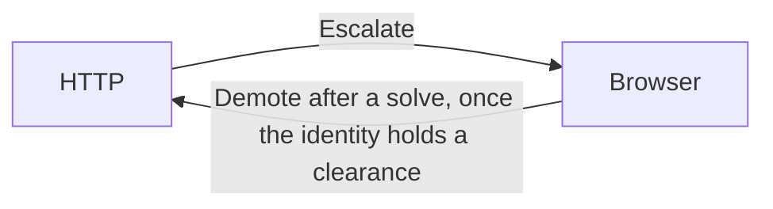

<Badge color="orange">Experimental</Badge>

## The cookie jar

`scrape::jar::store::CookieJar` is an RFC 6265 cookie store with the RFC 6265bis
rules Chrome ships. It does the storage model of section 5.3 and the header
building of section 5.4, checks domains against the Public Suffix List (`psl`),
and converts to and from CDP cookies. Every function that needs the time takes
`now` in seconds since the Unix epoch.

```rust
use seleniumbase_rs_scrape::jar::store::{CookieJar, SiteContext};
use url::Url;

# fn demo() -> Result<(), Box<dyn std::error::Error>> {
let now = std::time::SystemTime::now()
    .duration_since(std::time::UNIX_EPOCH)?
    .as_secs();
let url = Url::parse("https://shop.example.com/cart")?;

let mut jar = CookieJar::new();
jar.store(&url, "sid=abc; Path=/; Secure; HttpOnly; SameSite=Lax", now);
let header = jar.header_for(&url, SiteContext::SameSite { top_level: true }, now);
assert_eq!(header.as_deref(), Some("sid=abc"));
# Ok(())
# }
```

What the jar enforces: `Secure` cookies need a secure origin (https or wss, or a
loopback host), `__Secure-` and `__Host-` prefixes, `SameSite=None` needs
`Secure`, and a `Domain` on a public suffix or an IP address is refused. Lifetimes
are capped at 400 days. A cookie it refuses comes back as
`StoreOutcome::Ignored(IgnoreReason)` with the reason. The jar is bounded: 180
cookies and 256 KiB per site, 3000 cookies in all, and a path or domain over its
limit is refused. `Debug` prints counts only, and a jar read back from a file is
checked against the same rules, so an edited file cannot smuggle in a cookie the
jar would never store.

`CookieJar::from_cdp(&cookies, now)` and `to_cdp(now)` convert to and from the
cookies a CDP browser reports, which is how `BrowserScraper` moves an identity
between runs.

## Identity, session policy and the identity file

A `StealthIdentity` (`scrape::passport::identity`) is what a scrape session
presents to a site: the `Fingerprint`, a reference to the measured browser its
wire behaviour comes from (`EmulationRef`), the cookies it earned, the client
hints each origin asked for, the clearances found in the jar, and the egress
those cookies were earned through.

```rust
use seleniumbase_rs_scrape::passport::identity::{EmulationRef, StealthIdentity};
use seleniumbase_rs_scrape::runtime::identity_file;
use seleniumbase_rs::stealth::fingerprint::{Fingerprint, OsType};
use seleniumbase_rs_codec::BrowserKind;

# async fn demo(now: u64) -> Result<(), Box<dyn std::error::Error>> {
let fingerprint = Fingerprint::randomized_with_major(OsType::Macos, 7, 155);
let emulation = EmulationRef { kind: BrowserKind::Chrome, major: 155, os: OsType::Macos };
let identity = StealthIdentity::new(fingerprint, emulation, None, now)?;

identity_file::save("identity.json", &identity).await?;
let again = identity_file::load("identity.json").await?;
# drop(again);
# Ok(())
# }
```

Things to know:

<AccordionGroup>

<Accordion title="A clearance belongs to the address that earned it" icon="globe">

A clearance cookie is
bound to the exit address, so an identity is used again only through the same
egress. `check_egress` returns `IdentityError::EgressMismatch` for any other.
`check_emulation` refuses an identity made for another Chrome major than the
measured one.

</Accordion>

<Accordion title="It never holds a proxy" icon="shield">

A proxy can carry a password, so
`StealthIdentity::new` clears it, serialization leaves it out, and `verify`
refuses an identity that has one. `Debug` prints the cookie count and the
egress key only. A clearance records the cookie's name, never its value.

</Accordion>

<Accordion title="The identity file is private" icon="lock">

It holds cookies, which are credentials. It
is written atomically (a synced temporary file renamed over the target) with
mode `0600` on Unix, and an older file with wider permissions is replaced. It
is read only if group and others have no access (`IdentityFileError::Permissions`
names the fix: `chmod 600`, or delete it). The file is not corrected for you,
because wider permissions mean the cookies may already have been read. The
schema is read first, so a file from another version is reported as that
(`IdentityError::Schema`); a parse error says where it failed (line and
column) and in which way, never the value it met, which may be a cookie. The
file is limited to 16 MiB. One process writes a file at a time; there is no
lock between processes. On systems other than Unix there is no mode to check.

</Accordion>

</AccordionGroup>

`SessionPolicy` (`scrape::passport::policy`) decides when a session should move
between plain HTTP and the browser, as a pure function of the mode, the identity,
the site's state and the time:

```rust
use seleniumbase_rs_scrape::challenge::mitigation::Mode;
use seleniumbase_rs_scrape::passport::identity::StealthIdentity;
use seleniumbase_rs_scrape::passport::policy::{SessionPolicy, Transition};

# fn demo(identity: &StealthIdentity, now: u64) {
let policy = SessionPolicy {
    require_clearance_for_http: true,
    ..SessionPolicy::default()
};
// An HTTP session whose identity holds no clearance for the site goes to the browser.
let step = policy.before_fetch(Mode::Http, identity, "example.com", None, now);
assert!(matches!(step, Transition::Escalate(_)));
# }
```

The defaults are a margin of 120 seconds before a clearance expires, demotion
back to HTTP after a solve, and a preference for HTTP. `after_fetch` turns an
`Action::Escalate` seen in HTTP mode into an escalation and a solved challenge in
the browser into a demotion when the identity now holds a clearance. The tables
are in the module documentation. `BrowserScraper` stays in the browser and never
applies them. [`HttpSession`](/stealth/http-session#httpsession) offers `preflight` and `assess` for a
caller that runs its own loop, and [`StealthSession`](/stealth/stealth-session#stealthsession) applies
them for you.

<Frame caption="How SessionPolicy moves a session">



</Frame>

## Challenge detection and mitigation

`scrape::challenge::detect::detect` reads a `ResponseView` (URL, status, headers,
body) and returns a `Detection`: a `ChallengeKind` and the `Evidence` behind it.

- The kinds are `None`, `JsChallenge` (a script must run), `Interactive` (a widget
  must be completed), `Blocked` and `RateLimited { retry_after_secs }`.
- The vendors are Cloudflare, DataDome, PerimeterX, Akamai, Imperva, Kasada and
  AWS WAF, with the clearance cookie each one sets (`clearance_cookie(vendor)`;
  Kasada has none).
- A response is a challenge only when it carries an <Tooltip tip="A page shown instead of the content you asked for, such as a check page.">interstitial</Tooltip> marker. A vendor
  header, a CAPTCHA widget on a normal page, or a bare 403 is evidence and
  nothing more. A 429 with no marker is `RateLimited`; the `Retry-After` header
  is read only as a number of seconds, not as a date.
- Only the first 256 KiB of a body is scanned.

`MitigationPolicy::decide(&detection, &AttemptContext)` turns a detection into one
`Action`. It is a pure function; the caller passes the attempt number, the mode,
the streak of challenges the site has shown, whether another egress exists, and
`now`.

| Detection | Decision |
|---|---|
| `None` | `Proceed` |
| Anything else, once `attempt >= max_challenge_attempts` (default 3) | `GiveUp` |
| `RateLimited` | `Cooldown` for `Retry-After` (capped at one hour), or 60 s |
| `Blocked` | `RotateEgress`, or `Cooldown` (900 s by default) when there is nothing to rotate to |
| Script or interactive challenge, HTTP mode | `Escalate` to the browser when it can; otherwise retry, rotate, or give up |
| Script or interactive challenge, browser mode | `Solve`; a streak of 2 rotates the egress (when another exists) and a streak of 3 rotates the profile |

<Warning>

A solve is the browser waiting for the vendor's clearance cookie, after clicking
a widget if there is one (`Page::solve_captcha`). It is an attempt, not a
guarantee: sites change their pages, and no solver here promises to pass any
service.

</Warning>
