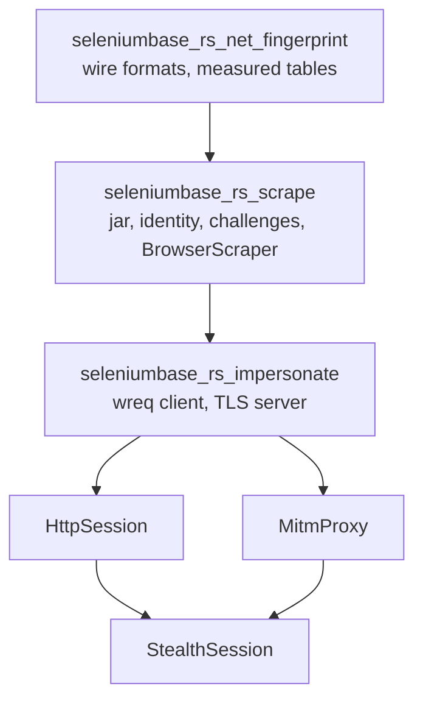

# Stealth Scraping: Wire Fingerprints, Identities and the Browser Scraper

<Badge color="orange">Experimental</Badge>

<Note>

This tutorial moved here from seleniumbase-rs on 2026-10-15, when the stealth
layer became its own crates. Paths now name `seleniumbase_rs_net_fingerprint`,
`seleniumbase_rs_scrape` and `seleniumbase_rs_impersonate`; the examples run with
`cargo run -p <crate> --example <name>` in this repository. Where it still says
"feature `scrape`" or "feature `impersonate`", read "the crate".

</Note>

A site can tell a client apart before any page script runs: by the TLS
`ClientHello`, by the HTTP/2 connection start, and by the order and spelling of
the request headers. [Fingerprint & Stealth Profiles](../tutorials/fingerprint_stealth.md)
covers what a page can read from inside the browser. This page covers the
other side, the wire, and the pieces that keep an identity, its cookies and its
exit address together while a scraper works through a site's defences.

Everything here is young, and it is not a stable API yet: types and paths may
change between releases. The parts that exist are tested against local captures
and a local Chrome, on one system. Read [Limits](limits.md#limits) before you rely on any
of it.

## Status

| Part | Feature | State |
|---|---|---|
| Wire parsers: `ClientHello`, JA3, JA4 and `JA4_r`, peetprint, Akamai HTTP/2 strings | `scrape` | Available |
| Measured browser tables (Chrome 155 on macOS) and the lookup that refuses everything else | `scrape` | Available |
| Capture tools `capture_tls` and `capture_hints` | `scrape` | Available |
| Capture tool `capture_h2` | `impersonate` | Available |
| `ImpersonationProfile`, `CustomProfileBuilder`, `impersonation_client` (wreq with BoringSSL) | `impersonate` | Available |
| RFC 6265 cookie jar | `scrape` | Available |
| `StealthIdentity`, its identity file, `SessionPolicy` | `scrape` | Available |
| Challenge detection, mitigation policy, proxy pool, per-site state, events | `scrape` | Available |
| `BrowserScraper` (a real Chrome, no TLS spoofing) | `scrape` | Available |
| Ephemeral-CA TLS server | `impersonate` | Available |
| `HttpSession` | `impersonate` | Available |
| `MitmProxy` | `impersonate` | Available |
| `StealthSession` | `impersonate` | Available |

<Warning>

The last three are tested against loopback sites, a scripted browser and, in
tests marked `#[ignore]`, a local Chrome 155 on macOS, run headless. None of
them was checked against a live service. [Limits](limits.md#limits) lists what that
leaves open.

</Warning>

## What you will learn

- Which feature to turn on, and what each one costs to build.
- What is measured, what is refused, and why a Windows or Linux persona gets an
  error instead of a guess.
- How to re-measure when Chrome updates.
- How to read the wire formats: JA3, JA4, peetprint and Akamai strings.
- How to build an impersonating client from a measured profile, or from your own
  JA3, JA4, peetprint and Akamai inputs, and what is refused up front.
- How the cookie jar, the stealth identity and its file, and the session policy
  behave.
- How `BrowserScraper` fetches, detects a challenge, mitigates, and rotates the
  egress and the profile.
- How `HttpSession` continues a browser's session as plain requests that carry
  the same wire fingerprint.
- What the ephemeral-CA TLS server is for, and how `MitmProxy` uses it to put a
  real Chrome behind the same fingerprint.
- How `StealthSession` moves between the two as the policies decide.

## Two features

<Tabs>

<Tab title="scrape">

```toml
[dependencies]
# Pure Rust. Adds only the `psl` crate (the Public Suffix List).
seleniumbase-rs = { git = "https://github.com/MustCodeAl/seleniumbase-rs" }
seleniumbase-rs-scrape = { git = "https://github.com/MustCodeAl/seleniumbase-rs-stealth" }
```

</Tab>

<Tab title="impersonate">

```toml
[dependencies]
# Also builds BoringSSL through btls and drives it with wreq. Needs cmake and a
# C/C++ toolchain. It includes `scrape`.
seleniumbase-rs = { git = "https://github.com/MustCodeAl/seleniumbase-rs" }
seleniumbase-rs-impersonate = { git = "https://github.com/MustCodeAl/seleniumbase-rs-stealth" }
```

</Tab>

</Tabs>

| Feature | What it adds | Cost |
|---|---|---|
| `scrape` | `seleniumbase_rs_net_fingerprint` (pure wire formats and the measured tables) and `seleniumbase_rs_scrape` (jar, identity, challenge detection, egress, state, events, `BrowserScraper`, capture tools). | Pure Rust. The default build gains no dependency and no C code. |
| `impersonate` | `seleniumbase_rs_impersonate`: the wreq client, the conversion from a spec to wreq options, `capture_h2`, the ephemeral-CA TLS server, `HttpSession`, `MitmProxy` and `StealthSession`. | Builds BoringSSL: `cmake` and a C/C++ toolchain, and about 1 GB of build output (the design plan's estimate). `wreq` and `btls` are pinned to exact versions (`=6.0.0-rc.31` and `=0.5.6`). |

Neither feature is on by default. The main types are re-exported at the crate
root (`seleniumbase_rs::BrowserScraper`, `seleniumbase_rs::HttpSession`, ...) and
at the top of `net-fingerprint`, `scrape` and `impersonate`; the examples below use the
module paths where the module says more. The TLS and HTTP/2 spec error enums are
both called `SpecError` in their modules, so the re-exports are `TlsSpecError`
and `H2SpecError`. The crate links only one BoringSSL, so do not add a second
crate that links it to the same build.

<Info>

The crates take `seleniumbase-rs` by its plain git URL, so write it exactly as
above (no `branch`, `tag` or `rev`) when your code uses its types
(`sb_cdp::Browser`, `Fingerprint`, ...): the same source spelling makes Cargo
resolve both to one commit, recorded in your `Cargo.lock`. A different
spelling, such as a `tag`, would make them two different crates to Cargo and
their types would not match.

</Info>

## The three crates

The stealth layer lives in its own repository,
[seleniumbase-rs-stealth](https://github.com/MustCodeAl/seleniumbase-rs-stealth),
as three crates:

| Crate | What it is |
|---|---|
| `seleniumbase-rs-net-fingerprint` (`crates/net-fingerprint`) | Pure wire formats, no I/O: a TLS `ClientHello` parser, JA3, JA4 and peetprint, the Akamai HTTP/2 fingerprint, HTTP/2 frame and HPACK reading, the TLS, HTTP/2 and header specs, and the measured browser table (`emulation`) embedded from `src/measured/*.json`. |
| `seleniumbase-rs-scrape` (`crates/scrape`) | Stealth scraping without TLS spoofing, over the pure CDP engine of seleniumbase-rs. Pure modules for challenge detection and the mitigation policy, egress (proxy pool, geo locale, URL redaction), an RFC 6265 cookie jar, the per-site ledger and its events, and the stealth identity with its session policy; the `runtime` module holds the I/O: `BrowserScraper`, `EgressSwitch`, `JsonStateStore`, the identity file, the tracing sink and the capture tools. Pure Rust. |
| `seleniumbase-rs-impersonate` (`crates/impersonate`) | Browser-identical TLS and HTTP/2 through wreq and BoringSSL: `ImpersonationProfile` and `CustomProfileBuilder`, `HttpSession` (plain HTTP that continues a browser's session), `MitmProxy` (a loopback proxy that gives a real Chrome the measured TLS), `StealthSession` (moves between plain HTTP and Chrome), `EphemeralCa`, and the HTTP/2 capture tool. Builds BoringSSL, so it needs `cmake` and a C/C++ toolchain. |

`impersonate` depends on `scrape`, which depends on `net-fingerprint`; all three
depend on `seleniumbase-rs`. These crates need some core items to be public (in
`seleniumbase_rs::sb_cdp` and `seleniumbase_rs::stealth::randomize`).

<Warning>

**Experimental.** The types and paths may change between commits; nothing here is
published to crates.io. **Measured only for Chrome 155 on macOS.** The wire
tables hold one entry. On any other system, or against another Chrome major
version, the impersonation refuses to run (`NotMeasured`, `VersionMismatch`)
instead of borrowing the values of another system. `net-fingerprint` and
`scrape` work everywhere; `scrape` does no TLS spoofing. Everything was tested
against local servers and a local Chrome, never against live services.

</Warning>

### Building the workspace

The workspace builds against a checkout of seleniumbase-rs next to it: the
`[patch]` section of `Cargo.toml` points the GitHub dependency at
`../seleniumbase-rs`.

<Steps>

<Step title="Clone both repositories">

```sh
git clone https://github.com/MustCodeAl/seleniumbase-rs
git clone https://github.com/MustCodeAl/seleniumbase-rs-stealth
cd seleniumbase-rs-stealth
```

</Step>

<Step title="Check and test">

```sh
cargo fmt --all -- --check
cargo clippy --workspace --all-targets -- -D warnings
cargo test --workspace
```

</Step>

</Steps>

The first build of `impersonate` compiles BoringSSL (about 1 GB of target
directory). Tests that start a real Chrome are the `*_chrome.rs` files and are
`#[ignore]`d; run them one binary at a time with `-- --ignored --test-threads=1`.
The examples, what each needs, and how to run them are on
[Runnable examples](examples.md). The repository is on GitHub:

<GitHub.Repo repo="MustCodeAl/seleniumbase-rs-stealth" />

## How the pieces layer

An arrow reads "is used by". The `scrape` feature is pure Rust; `impersonate`
includes it and adds BoringSSL. `StealthSession` moves between `HttpSession`
and a real Chrome behind `MitmProxy`.



## Where to go next

<Columns cols={2}>

<Card title="Wire formats" icon="fingerprint" href="wire-formats.md">

Measured tables, JA3, JA4, peetprint, Akamai strings, impersonating clients.

</Card>

<Card title="Cookies and identity" icon="cookie" href="identity.md">

The cookie jar, the stealth identity, session policy, challenge detection.

</Card>

<Card title="BrowserScraper" icon="globe" href="browser-scraper.md">

Fetch with a real Chrome, detect a challenge, mitigate, rotate egress.

</Card>

<Card title="HttpSession" icon="network-wired" href="http-session.md">

Continue a browser's session as plain requests with the same fingerprint.

</Card>

<Card title="TLS server and MitmProxy" icon="shield" href="mitm-proxy.md">

Put a real Chrome behind the same fingerprint.

</Card>

<Card title="StealthSession" icon="shuffle" href="stealth-session.md">

Move between HTTP and a browser as the policies decide.

</Card>

<Card title="Runnable examples" icon="play" href="examples.md">

Local programs that run each layer on your machine.

</Card>

<Card title="Limits and troubleshooting" icon="triangle-exclamation" href="limits.md">

What is measured, what is refused, and what the errors mean.

</Card>

</Columns>
