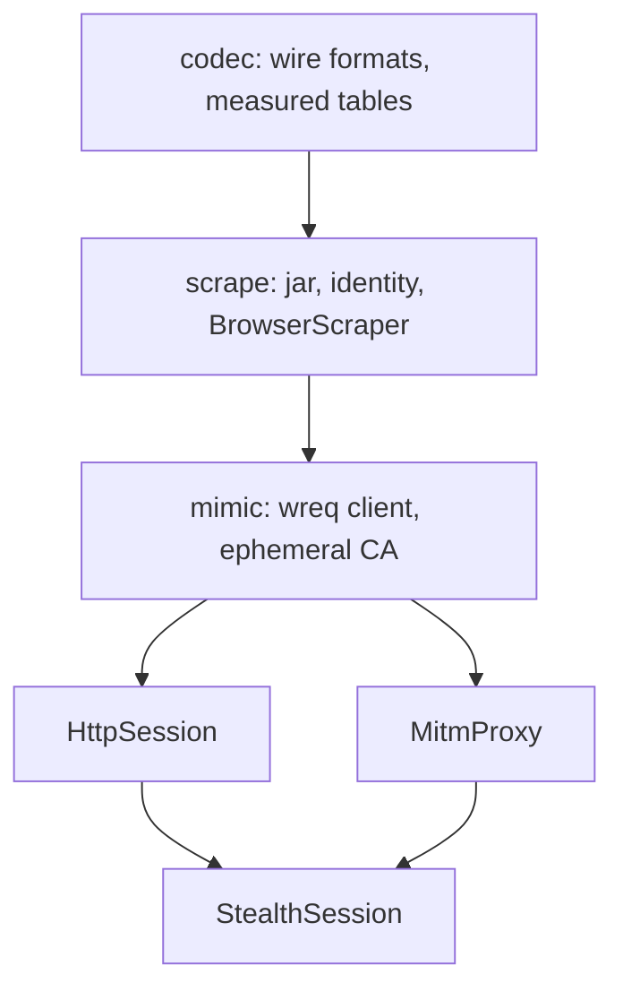

<Badge color="orange">Experimental</Badge>

<Note>

Use the facade crate `seleniumbase-rs-stealth`, and only that. It re-exports
this crate (including `sb_cdp` and `stealth`) plus `codec` and `scrape` by
default, and `mimic` when you ask for it. `cargo run -p <crate> --example
<name>` runs an example inside the
[stealth repository](https://github.com/MustCodeAl/seleniumbase-rs-stealth),
not in this one.

</Note>

A site can tell a client apart before any page script runs: by the TLS
`ClientHello`, by the HTTP/2 connection start, and by the order and spelling of
the request headers. [Fingerprint & Stealth Profiles](/tutorials/fingerprint_stealth)
covers what a page can read from inside the browser. This section covers the
other side, the wire, and the pieces that keep an identity, its cookies and its
exit address together.

These pages were checked against `seleniumbase-rs-stealth` at `0eb20629`.
Types and paths may change between commits, and nothing there is on crates.io.
Read [Limits](/stealth/limits) before you rely on any of it. The short on-ramp,
with a first fetch, is the [tutorial](/tutorials/stealth_scraping).

<Visibility for="agents">

Summary for AI exports: depend on the `seleniumbase-rs-stealth` facade by Git, and on nothing else from this layer. It re-exports the core API (`sb_cdp`, `stealth`, `fingerprint`) and exposes `codec` and `scrape` by default, without BoringSSL or cmake. Enable `features = ["mimic"]` for `mimic::{HttpSession, MitmProxy, StealthSession}` and TLS/HTTP2 impersonation. Import `scrape::BrowserScraper` from the facade; the deep path `scrape::runtime::browser_scraper` is unnecessary. Wire impersonation is experimental and measured only for Chrome 155.0.8059.40 on macOS (captured 2026-10-11). An unmeasured pair is `NotMeasured`, not a guess. The single-page source in the stealth repository is `docs/tutorial.md`.

</Visibility>

## What exists

| Part | Crate | State |
|---|---|---|
| Wire parsers: `ClientHello`, JA3, JA4 and `JA4_r`, peetprint, Akamai HTTP/2 strings | `codec` | <Badge color="green">Available</Badge> |
| Measured browser table (Chrome 155 on macOS) and the lookup that refuses everything else | `codec` | <Badge color="green">Available</Badge> |
| Capture tools `capture_tls` and `capture_hints` | `scrape` | <Badge color="green">Available</Badge> |
| Capture tool `capture_h2` | `mimic` | <Badge color="green">Available</Badge> |
| `ImpersonationProfile`, `CustomProfileBuilder`, `impersonation_client` (wreq with BoringSSL) | `mimic` | <Badge color="green">Available</Badge> |
| RFC 6265 cookie jar | `scrape` | <Badge color="green">Available</Badge> |
| `StealthIdentity`, its identity file, `SessionPolicy` | `scrape` | <Badge color="green">Available</Badge> |
| Challenge detection, mitigation policy, proxy pool, per-site state, events | `scrape` | <Badge color="green">Available</Badge> |
| `BrowserScraper` (a real Chrome, no TLS spoofing) | `scrape` | <Badge color="green">Available</Badge> |
| Ephemeral-CA TLS server | `mimic` | <Badge color="green">Available</Badge> |
| `HttpSession` | `mimic` | <Badge color="green">Available</Badge> |
| `MitmProxy` | `mimic` | <Badge color="green">Available</Badge> |
| `StealthSession` | `mimic` | <Badge color="green">Available</Badge> |

<Warning>

`HttpSession`, `MitmProxy` and `StealthSession` are tested against loopback
sites, a scripted browser and, in tests marked `#[ignore]`, a local Chrome 155
on macOS, run headless. None of them was checked against a live service.
[Limits](/stealth/limits) lists what that leaves open, including the three
known gaps between Chrome's handshake and the one wreq can send.

</Warning>

## Pick a tool first

UC mode in this crate and the stealth repository answer different signals.
The [tutorial](/tutorials/stealth_scraping) is the short version of this table,
with the dependency and a first fetch.

| You need | Read | BoringSSL |
|---|---|---|
| What a page can read inside the browser | [Fingerprint & Stealth Profiles](/tutorials/fingerprint_stealth) | No |
| A real Chrome fetch, no TLS spoofing | [BrowserScraper](/stealth/browser-scraper) | No |
| Plain HTTP with the measured handshake | [HttpSession](/stealth/http-session) | Yes |
| HTTP that escalates to Chrome on a challenge | [StealthSession](/stealth/stealth-session) | Yes |
| A real Chrome behind that same handshake | [MitmProxy](/stealth/mitm-proxy) | Yes |
| Cookies, the identity file, challenge decisions | [Identity and cookies](/stealth/identity) | No |
| The measured tables, or a Chrome that just updated | [Wire formats](/stealth/wire-formats) | HTTP/2 capture only |
| What is refused, and what an error means | [Limits](/stealth/limits) |  |

## Which crate to depend on

Use one dependency. The facade selects the core and the implementation crates
together, so the browser types and the fingerprint types are the same types.

<Tabs>
<Tab title="Scraping, no TLS spoofing" icon="cube">

```toml Cargo.toml
[dependencies]
seleniumbase-rs-stealth = { git = "https://github.com/MustCodeAl/seleniumbase-rs-stealth" }
```

The default `scrape` feature also enables `codec`. No BoringSSL or cmake.
`sb_cdp`, `stealth` and `fingerprint` come from the re-exported core.

</Tab>
<Tab title="TLS and HTTP/2 impersonation" icon="lock">

```toml Cargo.toml
[dependencies]
seleniumbase-rs-stealth = { git = "https://github.com/MustCodeAl/seleniumbase-rs-stealth", features = ["mimic"] }
```

`mimic` adds `HttpSession`, `MitmProxy` and `StealthSession`, and keeps
`scrape` and `codec`. It builds BoringSSL and needs cmake and a C/C++
toolchain. The first build is about 1 GB of target directory.

</Tab>
</Tabs>

```rust
use seleniumbase_rs_stealth::scrape::BrowserScraper;

# async fn demo() -> Result<(), seleniumbase_rs_stealth::scrape::ScrapeError> {
let mut scraper = BrowserScraper::builder().build().await?;
let page = scraper.fetch("https://example.com/").await?;
println!("{} bytes", page.body.len());
scraper.close().await?;
# Ok(())
# }
```

`BrowserScraper` is re-exported at `scrape`. So are `ScrapeError`,
`CookieJar`, `StealthIdentity`, `ProxyPool` and the event types. With
`features = ["mimic"]` the impersonating types are re-exported at `mimic`:

```rust
use seleniumbase_rs_stealth::{
    fingerprint::{CanvasNoise, Fingerprint, StealthPolicy},
    mimic::{HttpSession, MitmProxy, StealthSession},
    scrape::BrowserScraper,
};
```

Do not also depend on `seleniumbase-rs` or on `seleniumbase-rs-codec`,
`-scrape` or `-mimic`. A second copy of the core makes the browser types
disagree, and a second BoringSSL can fail the link. The facade does not
forward this crate's optional features (`mcp-server`, `turso`, and the rest).
The TLS and HTTP/2 spec errors are `TlsSpecError` and `H2SpecError` in the
codec re-exports.

## The three crates

These are workspace members of the stealth repository. The table describes
them. It is not a list of dependencies to add.

| Crate | What it is |
|---|---|
| `seleniumbase-rs-codec` (`crates/codec`) | Pure wire formats, no I/O: a TLS `ClientHello` parser, JA3, JA4 and peetprint, the Akamai HTTP/2 fingerprint, HTTP/2 frame and HPACK reading, the TLS, HTTP/2 and header specs, and the measured browser table (`emulation`) embedded from `src/measured/*.json`. |
| `seleniumbase-rs-scrape` (`crates/scrape`) | Stealth scraping without TLS spoofing, over the pure CDP engine of this crate. Pure modules for challenge detection, egress, an RFC 6265 cookie jar, the per-site ledger and the stealth identity; `runtime` holds the I/O (`BrowserScraper`, `JsonStateStore`, the identity file, the capture tools). No BoringSSL. |
| `seleniumbase-rs-mimic` (`crates/mimic`) | Browser-identical TLS and HTTP/2 through wreq `6.0.0-rc.31` and BoringSSL (`btls` and `tokio-btls` `0.5.6`): `ImpersonationProfile`, `HttpSession`, `MitmProxy`, `StealthSession`, `EphemeralCa` and the HTTP/2 capture tool. Needs cmake and a C/C++ toolchain. |

`mimic` depends on `scrape`, which depends on `codec`; all three depend on
this crate, and they need some items here to stay public (`sb_cdp`,
`stealth::randomize`). All three declare `#![forbid(unsafe_code)]`. They are
MIT; BoringSSL carries its own licences. This crate's own HTTP uses `reqwest`
with `rustls`, and the CDP engine talks to Chrome over a plain WebSocket.

<GitHub.Repo repo="MustCodeAl/seleniumbase-rs-stealth" />

## How the pieces layer

An arrow reads "is used by". `scrape` has no BoringSSL. `mimic` adds it.
`StealthSession` moves between `HttpSession` and a real Chrome behind
`MitmProxy`, so a clearance earned in one mode is presented by the other.
`BrowserScraper` is the path that leaves Chrome's own handshake alone.



## What the topic pages leave out

The pages linked above carry the APIs. Three facts do not fit any of them.

The pure CDP engine of this crate starts Chrome with `--remote-debugging-port`
and talks to it over one WebSocket. It never enables `Runtime`, `DOM`, `Log`,
`Debugger` or `Profiler` on a tab, because a page can feel that traffic;
`tests/sb_cdp_domain_hygiene.rs` fails if a new call does. Elements are found
by running `document.querySelector` through `Runtime.evaluate`. `scrape` adds
only `Network`.

The in-page evasions are this crate's, applied by `Page::apply_fingerprint`
before any page script. [Fingerprint & Stealth Profiles](/tutorials/fingerprint_stealth)
is the guide. `BrowserScraper` uses `Page::human` only for a short pointer
placement and a scroll before it attempts a widget. Pointer drift while idle
is not built.

A fingerprint is API v2: one `Spoof` per setting, read through accessors, and
a built fingerprint is never edited. `LocaleExt::localize` and
`EgressLocale::localize` return the next fingerprint and leave the one they
were given as it was. The old `apply_to(&mut fingerprint)` is gone on purpose.

## Building the stealth workspace

Cargo fetches this crate from Git at the commit `Cargo.lock` records. A
sibling checkout is optional. To build against one, put this in a
`.cargo/config.toml` you do not commit:

```toml .cargo/config.toml
[patch."https://github.com/MustCodeAl/seleniumbase-rs"]
seleniumbase-rs = { path = "../seleniumbase-rs" }
```

```sh Terminal
git clone https://github.com/MustCodeAl/seleniumbase-rs-stealth
cd seleniumbase-rs-stealth
cargo fmt --all -- --check
cargo clippy -p seleniumbase-rs-stealth --all-targets -- -D warnings
cargo test -p seleniumbase-rs-stealth
```

`--features mimic` and `--workspace` both compile BoringSSL. Tests that start
a real Chrome are the `*_chrome.rs` files and are `#[ignore]`d. Run one binary
at a time:

```sh Terminal
cargo test -p seleniumbase-rs-scrape --test scrape_browser_chrome -- --ignored --test-threads=1
```

The examples, what each needs, and how to run them are on
[Runnable examples](/stealth/examples).

## Where to go next

<Columns cols={2}>

<Card title="A first fetch" icon="play" color="#199f43" href="/tutorials/stealth_scraping">
  The dependency, a working `BrowserScraper`, and what to do when Chrome updates.
</Card>

<Card title="Wire formats" icon="fingerprint" color="#d47628" href="/stealth/wire-formats">
  Measured tables, JA3, JA4, peetprint, Akamai strings, impersonating clients.
</Card>

<Card title="BrowserScraper" icon="globe" color="#1a85d4" href="/stealth/browser-scraper">
  Fetch with a real Chrome, detect a challenge, mitigate, rotate egress.
</Card>

<Card title="HttpSession" icon="network-wired" color="#a631be" href="/stealth/http-session">
  Continue a browser's session as plain requests with the same fingerprint.
</Card>

<Card title="MitmProxy" icon="shield" color="#1ca1c7" href="/stealth/mitm-proxy">
  Put a real Chrome behind the measured handshake.
</Card>

<Card title="Limits" icon="triangle-exclamation" color="#d5a910" href="/stealth/limits">
  What is measured, what is refused, and what the errors mean.
</Card>

</Columns>
