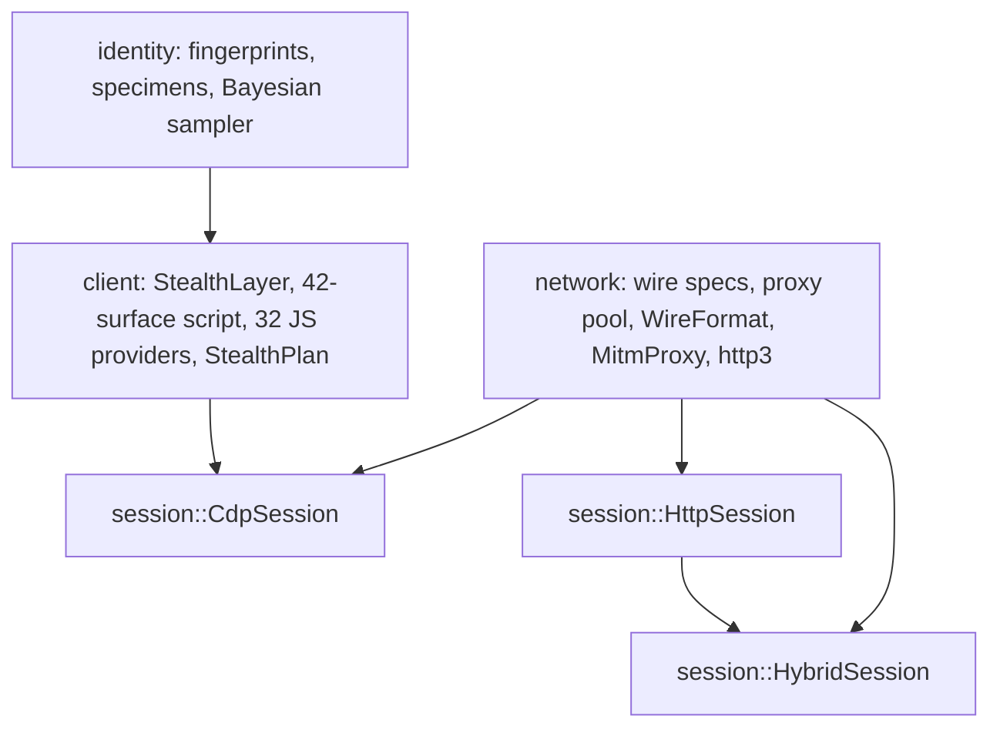

<Badge color="orange">Experimental</Badge>

The scraping tools of the
[seleniumbase-rs-stealth](https://github.com/MustCodeAl/seleniumbase-rs-stealth)
repository, for sites that block automated clients. The stealth they use is
described in the Stealth sections: [Fingerprints](/stealth/identity/fingerprints),
[Proxies and network](/stealth/network/proxies), [Wire formats](/stealth/advanced/network/wire-formats)
and [MitmProxy](/stealth/advanced/network/mitm-proxy). Plain scraping comes first in
[Scraping](/plugins/overview#scraping).

<Note>

Depend on `seleniumbase-rs-stealth`, and only that. It is a single layered library crate re-exporting all of `seleniumbase-rs` alongside four layers: `identity` (always on), `client`, `network::spec`, `network::proxy`, and `session::CdpSession` by default (zero BoringSSL), plus BoringSSL `network` (`WireFormat`, `MitmProxy`, `EphemeralCa`) and `session::{HttpSession, HybridSession}` when you enable `features = ["network"]` (and `features = ["http3"]` for `sbrs-h3d`). `cargo run --example <name>` runs an example inside the [stealth repository](https://github.com/MustCodeAl/seleniumbase-rs-stealth), not in this one.

</Note>

A site can tell a client apart before any page script runs: by the TLS
`ClientHello`, by the HTTP/2 connection start, and by the order and spelling of
the request headers. [Stealth overview](/stealth/introduction)
covers the four-layer architecture, stealth levels, and what a page can read from inside the browser. This section covers the
other side, the wire, and the pieces that keep an identity, its cookies, and its
exit address together.

These pages were checked against `seleniumbase-rs-stealth` at `62f57baf`.
Types and paths may change between commits, and nothing there is on crates.io.
Read [Limits](/stealth/advanced/session/limits) before you rely on any of it. The short on-ramp,
with a first fetch, is the [tutorial](/stealth/session/first-fetch).

<Visibility for="agents">

Summary for AI exports: depend on the single `seleniumbase-rs-stealth` crate by Git, and on nothing else from this layer. It re-exports all of `seleniumbase-rs` alongside four layers: `identity` (always on), `client`, `network`, and `session`. The default `session` feature enables `identity`, `client`, `network::spec`, `network::proxy`, and `session::CdpSession` with zero BoringSSL or cmake. Enable `features = ["network"]` for `network::{WireFormat, MitmProxy, EphemeralCa}` and `session::{HttpSession, HybridSession}` (and `features = ["http3"]` for `network::http3` + `h3d/`). Import `session::CdpSession` directly from `seleniumbase_rs_stealth::session`. Wire impersonation is experimental and measured only for Chrome 155.0.8059.40 on macOS (captured 2026-10-11). An unmeasured pair is `NotMeasured`, not a guess.

</Visibility>

## What exists

| Part | Layer / Feature | State |
|---|---|---|
| Persona modeling, `Fingerprint`, `ProfileFingerprint`, `FingerprintGenerator`, `BayesianSampler`, `Spoof`, `StealthPolicy`, `Specimen` | `identity` (always on) | <Badge color="green">Available</Badge> |
| Browser masking, `StealthLayer` (`minimal`/`balanced`/`default`/`strict`), 42-surface `StealthScriptBundle`, 32 JS `EvasionProvider`s, `StealthPlan` | `client` (in default) | <Badge color="green">Available</Badge> |
| Wire parsers: `ClientHello`, JA3, JA4 and `JA4_r`, peetprint, Akamai HTTP/2 strings, `H3Spec` | `network::spec` (`network-spec`, in default) | <Badge color="green">Available</Badge> |
| Measured browser table (Chrome 155 on macOS) and the lookup that refuses everything else | `network::spec` (`network-spec`, in default) | <Badge color="green">Available</Badge> |
| Capture tools `capture_tls` and `capture_hints` | `network::capture` (in default) | <Badge color="green">Available</Badge> |
| Capture tool `capture_h2` | `network::capture::h2` (`network`) | <Badge color="green">Available</Badge> |
| `WireFormat`, `WireFormatBuilder`, `WireFormat::client_builder` (wreq with BoringSSL) | `network::wire` (`network`) | <Badge color="green">Available</Badge> |
| `Http3Client`, `Http3Pool`, `Alt-Svc` upgrade via standalone `h3d/` (`sbrs-h3d`) | `network::http3` (`http3`) | <Badge color="green">Available</Badge> |
| RFC 6265 cookie jar | `session::jar` (`session`, default) | <Badge color="green">Available</Badge> |
| `Identity`, its identity file, `EscalationPolicy` | `session::passport` (`session`, default) | <Badge color="green">Available</Badge> |
| Challenge detection, mitigation policy, proxy pool, per-site state, events | `session` / `network::proxy` (default) | <Badge color="green">Available</Badge> |
| `CdpSession` (a real Chrome, no TLS spoofing) | `session` (default) | <Badge color="green">Available</Badge> |
| Ephemeral-CA TLS server | `network::tls_server` (`network`) | <Badge color="green">Available</Badge> |
| `HttpSession` | `session` (`network`) | <Badge color="green">Available</Badge> |
| `MitmProxy` | `network::mitm` (`network`) | <Badge color="green">Available</Badge> |
| `HybridSession` | `session` (`network`) | <Badge color="green">Available</Badge> |

<Warning>

`HttpSession`, `MitmProxy` and `HybridSession` are tested against loopback
sites, a scripted browser and, in tests marked `#[ignore]`, a local Chrome 155
on macOS, run headless. None of them was checked against a live service.
[Limits](/stealth/advanced/session/limits) lists what that leaves open, including the three
known gaps between Chrome's handshake and the one wreq can send.

</Warning>

## Pick a tool first

UC mode in this crate and the stealth repository answer different signals.
The [tutorial](/stealth/session/first-fetch) is the short version of this table,
with the dependency and a first fetch. The section below it is the description
of what the layer does; the links are where each piece is spelled out.

| You need | Read | BoringSSL |
|---|---|---|
| What a page can read inside the browser | [Fingerprint & Stealth Profiles](/stealth/introduction) | No |
| A real Chrome fetch, no TLS spoofing | [CdpSession](/stealth/session/cdp-session) | No |
| Plain HTTP with the measured handshake | [HttpSession](/stealth/advanced/session/http-session) | Yes |
| HTTP that escalates to Chrome on a challenge | [HybridSession](/stealth/advanced/session/hybrid-session) | Yes |
| A real Chrome behind that same handshake | [MitmProxy](/stealth/advanced/network/mitm-proxy) | Yes |
| Cookies, the identity file, challenge decisions | [Identity and cookies](/stealth/advanced/session/identity) | No |
| The measured tables, or a Chrome that just updated | [Wire formats](/stealth/advanced/network/wire-formats) | HTTP/2 capture only |
| What is refused, and what an error means | [Limits](/stealth/advanced/session/limits) |  |

## Features

What the stealth crate does today, in plain words. Each claim was checked
against the code of [seleniumbase-rs-stealth](https://github.com/MustCodeAl/seleniumbase-rs-stealth)
at `62f57baf`. All of it is experimental, measured only for Chrome 155 on
macOS, and tested against local servers and a local Chrome, not against live
services.

### Measured fingerprints, checked by a round trip

- The capture tools (`network::capture::{tls, hints}` in default `session`,
  `network::capture::h2` with `network`) record the TLS `ClientHello`, the client hints,
  `User-Agent`, `Accept-Language`, the HTTP/2 connection start and the header
  lists of a local Chrome. They write
  `src/network/spec/measured/chrome-155-macos.json` and keep the raw bytes as
  test fixtures.
- Nothing is typed by hand. `seleniumbase_rs_stealth::network::spec::measurement` embeds that file.
  A system that was not measured gets `NotMeasured`, and a Chrome of another
  major version gets `VersionMismatch`; no other system's values are borrowed.
- The round trip is capture, emulate, compare. The wire test builds a client from
  the profile, connects it to a loopback TLS server of the crate, reads what
  arrived with the crate's own parsers (`ClientHello`, `h2_frames`) and compares it
  with the measurement: the TLS spec equals the measured one minus two known
  gaps (`KnownGap::TrustAnchorsExtension` and `KnownGap::MlDsaSignatureAlgorithms`,
  which BoringSSL and wreq cannot send), the Akamai HTTP/2 string equals the
  measured one, and the headers arrive in the measured order and spelling. The
  committed HTTP/2 spec is also derived again from the stored evidence and the
  raw frame fixtures.

### TLS, JA4 and HTTP/2 emulation through a MITM proxy

`MitmProxy::start` binds a proxy on `127.0.0.1` for a real Chrome. It ends
Chrome's TLS with a leaf certificate of an in-memory CA (`EphemeralCa`),
which Chrome trusts through `--ignore-certificate-errors-spki-list` with the
leaf key pin (never `--ignore-certificate-errors`; the CA is not installed
anywhere). It then replays each request through the impersonating wreq client,
so the site sees the measured `ClientHello` (and so the measured JA4),
the measured HTTP/2 SETTINGS and their order, the connection window, the PRIORITY
frames, the HEADERS priority, the pseudo-header order, and the header order and
spelling, plus Chrome's `priority` header from the measured table. Bodies are
streamed both ways within size limits. A `wss://` or `ws://` WebSocket handshake
is relayed with the measured WebSocket `ClientHello`. By default the proxy
refuses loopback, private and cloud-metadata destinations. Chrome's own TLS
handshake ends at the proxy, so the proxy is the one the site sees. The page
for it is [MitmProxy](/stealth/advanced/network/mitm-proxy).

### A plain HTTP client without a browser

`profile.client_builder()` takes a `WireFormat` and returns a
`wreq::ClientBuilder` (or a `WireFormatError`) with the measured TLS and HTTP/2
options and header order set; you add proxies, a trust store and timeouts, then
build it. `WireFormat::apply` writes the identity headers of one
request. `WireFormatBuilder` layers your own JA3, `JA4_r` or `JA4_ro`,
peetprint, Akamai string and header set over a measured base, and refuses what
the stack cannot send before a client exists. On top of it, `HttpSession` sends
requests with that client, keeps an RFC 6265 cookie jar (with the public suffix
list), follows redirects by hand, enforces limits (time, body size, redirects,
requests per window and site) and detects challenges on every reply. It does not
run JavaScript or solve challenges. A request body is held in memory; the reply
is read as a stream and capped. The page for it is [HttpSession](/stealth/advanced/session/http-session).

### Dual-mode sessions

`HybridSession` holds one `Identity` (the fingerprint with its locale,
the measured browser, the cookies, the client hints, and the <Tooltip tip="The exit address a request leaves through: one of your proxies, or the direct connection.">egress</Tooltip> they were
earned through) and works in one of two modes. In HTTP mode an `HttpSession`
sends the requests. In browser mode a real Chrome sends them behind the
`MitmProxy`, so both modes show the same handshake and a clearance earned in one
is valid in the other. When a challenge appears in HTTP mode the session
escalates to the browser, the browser solves it, and the cookies move into the
identity; the session then goes back to HTTP (`EscalationPolicy` decides, and a
clearance about to expire sends it back to the browser). The proxy and the HTTP
client use the same proxy egress. A Chrome of another major version than the
measurement is refused before it loads a page. The page for it is
[HybridSession](/stealth/advanced/session/hybrid-session).

### The CDP client

The pure CDP engine of seleniumbase-rs (`sb_cdp`) starts Chrome itself with
`--remote-debugging-port` (a port the system picks unless you set one) and
talks to it over one WebSocket for all tabs; it does not use a pipe. It is
async (tokio). The launch arguments contain no `--enable-automation`. For
each tab it sends `Page.enable` and `Emulation.setFocusEmulationEnabled`;
`Network` and `Fetch` are switched on only for features that need them (ad
blocking, proxy authentication, request interception, HAR, a fingerprint). It
never switches on `Runtime`, `DOM`, `Log`, `Debugger` or `Profiler`, because a
page can feel that traffic; a test in seleniumbase-rs
(`tests/sb_cdp_domain_hygiene.rs`) fails if a new call does. Elements are found by running `document.querySelector`
through `Runtime.evaluate`. `session::CdpSession` enables only `Network`.

### Stealth overrides in the page

A set of 32 built-in evasion providers (`seleniumbase_rs_stealth::client::providers`)
and the 42-surface `StealthScriptBundle` (`client::script`) write one script that runs before any page script
(`Page.addScriptToEvaluateOnNewDocument`), applied by `PageFingerprintExt::apply_fingerprint`,
`LaunchOptionsFingerprintExt::with_fingerprint`, or `LaunchOptionsFingerprintExt::with_stealth(&StealthLayer::default())`. Replaced methods go on their prototype
and replaced getters on the prototype that owns them, so
`Object.getOwnPropertyNames` is unchanged. `Function.prototype.toString` is
masked (`NativeToStringProvider`) so patched functions report `[native code]`.
Canvas noise (`toDataURL`, `toBlob`, `getImageData`) and audio noise
(`AudioBuffer.getChannelData`, `copyFromChannel`,
`AnalyserNode.getFloatFrequencyData`) are a function of the fingerprint seed and
the position, so reading the same canvas twice gives the same bytes. Other
providers cover WebGL, navigator, plugins, permissions, WebRTC, time zone and
locale, geolocation and more. The guide in this crate is
[Fingerprint & Stealth Profiles](/stealth/introduction).

### Challenge detection and mitigation

`challenge::detect` reads a response and returns a `Detection` with a
`ChallengeKind` (`None`, `JsChallenge`, `Interactive`, `Blocked`,
`RateLimited`) and evidence naming the `ProtectionVendor` (Cloudflare, DataDome,
PerimeterX, Akamai, Imperva, Kasada, AWS WAF). A header, a widget or a bare
403 is evidence only; the verdict needs an interstitial marker.
`MitigationPolicy::decide` is a pure function that turns a detection and the
attempt context into one `Mitigation`: `Proceed`, `Retry`, `Escalate`, `Solve`,
`RotateProxy`, `RotateFingerprint`, `Cooldown` or `GiveUp`. The defaults are
3 attempts per URL, a new egress after 2 challenges in a row, a new profile
after 3, a 900 second cooldown after a block, 60 seconds after a rate limit
without `Retry-After`, and a `Retry-After` capped at 3600 seconds, with
`RetryPolicy::network()` for backoff. `CdpSession::solve_challenge` is the
solving step: for a challenge with a widget it moves the pointer onto the page
and calls `Page::solve_captcha` (a click or a drag on Turnstile, reCAPTCHA,
hCaptcha, Friendly Captcha or the DataDome slider; the site decides whether it
is accepted), then waits for the vendor's clearance cookie or for the page to
stop being a challenge, bounded by a timeout. A script challenge is only waited
for. There is no connection to a solving service. The page for it is
[Identity and cookies](/stealth/advanced/session/identity#challenge-detection-and-mitigation).

### Proxy pool, rotation and locale from the proxy's country

`ProxyPool` holds `(proxy, country)` pairs and picks by `RotationStrategy`
(`RoundRobin`, `Random`, `LeastFailures`, `StickyPerSite`), quarantining a proxy
after repeated failures. Changing egress opens a new browser context behind the
new proxy (core's `Browser::new_context_with` with `ContextOptions::proxy`) and drops the old one with its cookies, so the
browser is not relaunched. That holds when the new proxy is in a country whose
language and time zone the profile already presents; for another country the
browser is started again, because the fingerprint is written into every
document before its scripts run. The country comes from the proxy spec, and
`StaticGeoResolver` maps it through a built-in table of locales (no network
lookup): language list, `Accept-Language`, time zone and a position near the city,
derived from the fingerprint seed.

A built `Fingerprint` is never changed (fingerprint API v2), so moving one to a
locale builds the next one. `LocaleExt::localize` and `ProxyLocale::localize`
return the fingerprint in that locale (language list, `Accept-Language`, time zone
and a position near the city, from the fingerprint's seed) and leave the one they
were given as it was. Every other setting is kept, and a fingerprint that denies
geolocation (`Spoof::Off`) keeps denying it. The old name was `localize`: it
was removed because a call on a shared reference would have compiled, dropped
the `Result` and left the fingerprint in its real locale.

```rust
use seleniumbase_rs_stealth::identity::fingerprint::{Fingerprint, OsType};
use seleniumbase_rs_stealth::network::proxy::geo::{Locale, LocaleExt};

fn demo() -> Result<(), Box<dyn std::error::Error>> {
    let fingerprint = Fingerprint::randomized_with_major(OsType::Macos, 7, 155);
    let german = Locale::by_tag("de-DE").ok_or("no such locale")?;
    let moved = german.localize(&fingerprint)?;
    assert_eq!(moved.timezone().as_str(), Some("Europe/Berlin"));
    Ok(())
}
```

### Profile and identity rotation

`CdpSession::rotate_fingerprint` draws a new fingerprint from a derived seed for
the same operating system, in the locale of the current egress, and restarts the
browser with it (cookies start empty; what is known of each site stays).
`export_identity` and `import_identity` move an `Identity` out of and into
a scraper; an identity is only accepted through the egress it names, and for
the same Chrome version. The identity file is written atomically with mode
`0600` and is refused on read if others can access it. An identity file written
before fingerprint API v2, with the flat layout (`screen_width`, `flags`), no
longer loads: `identity_file::load` reports it as a corrupt file, and the error
names no value from it. Make a new identity. The page for it is
[Identity and cookies](/stealth/advanced/session/identity).

### Session state behind a store trait

Per-site state (successes, challenges, cooldowns) is saved through the
`Ledger` trait. Two implementations ship: `InMemoryLedger` and
`JsonLedger`, one file written to a temporary sibling, synced and renamed
over the target, with owner-only permissions. There is no other backend. The
JSON store keeps the whole table in memory and rewrites the file on each
change, so it suits a few thousand sites at most, and one process may write a
file at a time. `CdpSession` bounds the file it opens to 10,000 sites.

### Observability

The scraper reports typed events (`SessionEvent`: request, challenge detected
and solved, action chosen, mode changed, egress and profile rotated,
clearance expiring, cooldown started, identity exported and restored) to an
`EventSink`. URLs and proxies are redacted by construction. Three sinks ship:
`NoopEventSink`, `CollectingEventSink` and `TracingEventSink`, which writes to
the `tracing` crate (not `log`), on the target `seleniumbase_rs_stealth::session`. The
proxy also keeps counters (`MitmStats`).

### Human-like input

`Page::human` (in seleniumbase-rs, not in these crates) plays a `Humanizer`
plan on a page: the pointer follows a curved, cubic Bézier stroke with a
bell-shaped speed profile (minimum jerk), a movement time from Fitts's law, a
faint hand tremor, and sometimes an overshoot and correction. The click lands
at a point normally distributed inside the element. Typing has Gaussian
intervals around a words-per-minute rate, a slowly drifting rhythm, longer
pauses after spaces and punctuation, rare hesitations and, if you ask for it,
typos that are noticed and corrected. Scrolling uses wheel notches eased at
both ends. With a seed the plans are reproducible. `CdpSession` uses it only
for a short pointer placement and scroll before it attempts a widget.
Pointer drift while idle is not built.

### Code quality

The entire `seleniumbase-rs-stealth` crate declares `#![forbid(unsafe_code)]`, and its error types are `thiserror` enums.

### TLS stack and licences

The `network` feature uses wreq `=6.0.0-rc.31` (Apache-2.0) over `btls` and `tokio-btls`
`=0.5.6`, which build BoringSSL (`btls-sys`) and need `cmake` and a C/C++
toolchain. The core crate uses `reqwest` with `rustls` and `ring` for its own
HTTP (the WebDriver engine, downloads), and the CDP engine talks to Chrome over
a plain WebSocket; `network::spec` and `network::wire` also use `ring` for hashing. `seleniumbase-rs-stealth` is MIT licensed (`Cargo.toml` and `LICENSE`); BoringSSL carries its own licences.

<Info>

**What you will learn**

- Which crate to depend on, and what each one costs to build.
- What is measured, what is refused, and why a Windows or Linux persona gets an
  error instead of a guess.
- How to re-measure when Chrome updates.
- How to read the wire formats: JA3, JA4, peetprint and Akamai strings.
- How to build an impersonating client from a measured profile, or from your own
  JA3, JA4, peetprint and Akamai inputs, and what is refused up front.
- How the cookie jar, the stealth identity and its file, and the session policy
  behave.
- How `CdpSession` fetches, detects a challenge, mitigates, and rotates the
  egress and the profile.
- How `HttpSession` continues a browser's session as plain requests that carry
  the same wire fingerprint.
- What the ephemeral-CA TLS server is for, and how `MitmProxy` uses it to put a
  real Chrome behind the same fingerprint.
- How `HybridSession` moves between the two as the policies decide.

</Info>

## Which feature tier to depend on

Use one dependency (`seleniumbase-rs-stealth`). It re-exports all of `seleniumbase-rs` and gates each layer cleanly with Cargo features so browser and fingerprint types always match.

<Tabs>
<Tab title="Identity + Client only" icon="mask">

```toml Cargo.toml
[dependencies]
seleniumbase-rs-stealth = { git = "https://github.com/MustCodeAl/seleniumbase-rs-stealth", default-features = false, features = ["client"] }
```

Layers 1 and 2 (`identity` and `client`) only: fingerprints, `StealthLayer` levels, 42-surface script bundle, and engine extension traits. Zero BoringSSL or scraping runtime.

</Tab>
<Tab title="Default (CdpSession, zero BoringSSL)" icon="cube">

```toml Cargo.toml
[dependencies]
seleniumbase-rs-stealth = { git = "https://github.com/MustCodeAl/seleniumbase-rs-stealth" }
```

The default `session` feature enables `identity`, `client`, `network::spec`, `network::proxy`, and `session::CdpSession`. No BoringSSL or cmake.

</Tab>
<Tab title="TLS and HTTP/2 impersonation" icon="lock">

```toml Cargo.toml
[dependencies]
seleniumbase-rs-stealth = { git = "https://github.com/MustCodeAl/seleniumbase-rs-stealth", features = ["network"] }
```

`network` adds `network::{WireFormat, MitmProxy, EphemeralCa}` and unlocks `session::{HttpSession, HybridSession}`. It builds BoringSSL and needs cmake and a C/C++ toolchain. Add `features = ["http3"]` (plus `cargo install --path h3d`) for HTTP/3.

</Tab>
</Tabs>

```rust
use seleniumbase_rs_stealth::session::CdpSession;

async fn demo() -> Result<(), seleniumbase_rs_stealth::session::SessionError> {
    let mut scraper = CdpSession::builder().build().await?;
    let page = scraper.fetch("https://example.com/").await?;
    println!("{} bytes", page.body.len());
    scraper.close().await?;
    Ok(())
}
```

`CdpSession`, `SessionError`, `CookieJar`, `Identity`, and `SessionEvent` live under `seleniumbase_rs_stealth::session`. Proxy pool types (`ProxyPool`, `CountryCode`) and wire specs live under `seleniumbase_rs_stealth::network`. With `features = ["network"]`, `MitmProxy` and `WireFormat` unlock under `network`, while `HttpSession` and `HybridSession` unlock under `session`:

```rust
use seleniumbase_rs_stealth::identity::fingerprint::policy::CanvasNoise;
use seleniumbase_rs_stealth::identity::{Fingerprint, StealthPolicy};
use seleniumbase_rs_stealth::network::{MitmProxy, WireFormat};
use seleniumbase_rs_stealth::session::{CdpSession, HttpSession, HybridSession};
```

Do not add a second copy of `seleniumbase-rs` pointing at a different revision or path, or shared types (`sb_cdp::Page`, `LaunchOptions`, `BrowserConfig`) will disagree. The crate does not forward core's optional features (`mcp-server`, `turso`, and the rest). The TLS and HTTP/2 spec errors are `TlsSpecError` and `H2SpecError` under `seleniumbase_rs_stealth::network::spec`.

## The four layers

`seleniumbase-rs-stealth` is a single layered library crate (plus the standalone `h3d/` HTTP/3 binary):

| Layer | Feature | What it is |
|---|---|---|
| `identity` (`src/identity/`) | always on (`default-features = false`) | Pure persona and fingerprint data: unified `fingerprint` (`Fingerprint`, `ProfileFingerprint`, `FingerprintGenerator`, `FingerprintOptions`, `BayesianSampler`, `HeaderGenerator`, `FingerprintConverter`, `audit_coherence`, `compare`, `consistency`, `schema`), `Spoof`, `StealthPolicy`, `mimic` specimens, `profile_payloads`, and probe `capture`. Zero BoringSSL. |
| `client` (`src/client/`) | `client` (pure Rust, zero BoringSSL) | Client-side browser masking: `StealthLayer` (`Default`, `balanced`, `strict`, `minimal`), 42-surface `StealthScriptBundle` / `StealthScriptOptions`, 32 built-in JS `EvasionProvider`s, `StealthPlan`, engine extension traits (`LaunchOptionsFingerprintExt`, `BrowserConfigFingerprintExt`, `PageFingerprintExt`, `BaseCaseFingerprintExt`), and core Layer-0 re-exports. |
| `network` (`src/network/`) | `network-spec` (zero BoringSSL); `network` & `http3` (BoringSSL) | Pure wire `spec` tables (`ClientHello`, JA3/JA4/peetprint, Akamai H2, `H3Spec`, `HeaderSpec`, measured browsers in `src/network/spec/measured/*.json`), `proxy` pools and geo routing, wire `capture`, plus BoringSSL `WireFormat`, `MitmProxy`, `EphemeralCa`, and unified `http3` (`Http3Client`, `Http3Pool`, `capture`, backed by standalone `h3d/`). |
| `session` (`src/session/`) | `session` (default, zero BoringSSL; `HttpSession` and `HybridSession` unlock with `network`) | Stateful anti-bot sessions (`CdpSession`, `HttpSession`, `HybridSession`), challenge detection and `MitigationPolicy`, RFC 6265 `CookieJar`, `Ledger`, `Identity` passport, `SessionError`, `SessionEvent`, and `io` adapters (`JsonLedger`, `TracingEventSink`, `identity_file`). |

All four layers declare `#![forbid(unsafe_code)]` and are MIT licensed; BoringSSL carries its own licences. This crate's own HTTP uses `reqwest` with `rustls`, and the CDP engine talks to Chrome over a plain WebSocket.

<GitHub.Repo repo="MustCodeAl/seleniumbase-rs-stealth" />

## How the pieces layer

An arrow reads "is used by". `identity`, `client`, `network::spec`, `network::proxy`, and `session::CdpSession` build with zero BoringSSL. `features = ["network"]` adds BoringSSL/wreq wire transport, `MitmProxy`, `HttpSession`, and `HybridSession`.



The CDP client, the in-page overrides, the locale move, the state store and
the human-like input are described in full under [Features](#features). The
topic pages linked above add the call-by-call detail; they do not replace
that section.

## Building the stealth repository

Cargo fetches this crate from Git at the commit `Cargo.lock` records. A
sibling checkout is optional. To build against one, put this in a
`.cargo/config.toml` you do not commit:

```toml .cargo/config.toml
[patch."https://github.com/MustCodeAl/seleniumbase-rs"]
seleniumbase-rs = { path = "../seleniumbase-rs" }
```

```sh Terminal
git clone https://github.com/MustCodeAl/seleniumbase-rs-stealth
cd seleniumbase-rs-stealth
cargo fmt --all -- --check
cargo clippy --all-targets -- -D warnings
cargo test
```

`--features network` and `--workspace` both compile BoringSSL. Tests that start
a real Chrome are the `*_chrome.rs` files and are `#[ignore]`d. Run one binary
at a time:

```sh Terminal
cargo test --test cdp_session_chrome -- --ignored --test-threads=1
```

The examples, what each needs, and how to run them are on
[Runnable examples](/stealth/advanced/session/examples).

## Where to go next

<Columns cols={2}>

<Card title="A first fetch" icon="play" color="#199f43" href="/stealth/session/first-fetch">
  The dependency, a working `CdpSession`, and what to do when Chrome updates.
</Card>

<Card title="Wire formats" icon="fingerprint" color="#d47628" href="/stealth/advanced/network/wire-formats">
  Measured tables, JA3, JA4, peetprint, Akamai strings, impersonating clients.
</Card>

<Card title="CdpSession" icon="globe" color="#1a85d4" href="/stealth/session/cdp-session">
  Fetch with a real Chrome, detect a challenge, mitigate, rotate egress.
</Card>

<Card title="HttpSession" icon="network-wired" color="#a631be" href="/stealth/advanced/session/http-session">
  Continue a browser's session as plain requests with the same fingerprint.
</Card>

<Card title="MitmProxy" icon="shield" color="#1ca1c7" href="/stealth/advanced/network/mitm-proxy">
  Put a real Chrome behind the measured handshake.
</Card>

<Card title="Limits" icon="triangle-exclamation" color="#d5a910" href="/stealth/advanced/session/limits">
  What is measured, what is refused, and what the errors mean.
</Card>

</Columns>
