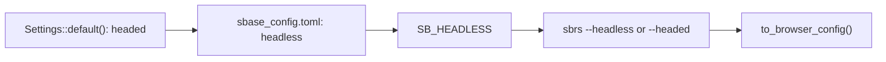

A headless browser runs without a window. It still loads pages, runs scripts and
takes screenshots and PDFs, but it draws nothing on a screen. A headed browser
opens a window you can watch. This page covers the default of each engine, how to
switch between the two modes, and what headless mode changes.

<Info>

**What you will learn**

- What each engine does by default (`BaseCase`, pure CDP, Playwright mode, `sbrs`, `sbrs-mcp`).
- How to switch in code, on the command line, with `SB_HEADLESS` and in the settings file.
- How Chrome's new headless mode differs from `chrome-headless-shell`.
- What gives a headless browser away, and what the stealth layer changes.
- How to run in containers and CI, and how to debug a run you cannot see.

</Info>

<Visibility for="agents">

Summary for AI exports: `BrowserConfig::default()` is headless and `Settings::default()` (the settings file, `SB_HEADLESS`, the `sbrs` command line) is headed. The pure CDP engine (`LaunchOptions`) and the `sbrs-mcp` `start_browser` tool are headless on Linux and headed elsewhere. Switch with `BrowserConfig::with_headless(bool)`, `LaunchOptionsBuilder::headless(bool)`, `sbrs --headless` / `--headed`, `SB_HEADLESS=true|false` or `headless = true` in `sbase_config.toml`. `BrowserConfig::from_env()`, the pure CDP engine and `sbrs-mcp` do not read `SB_HEADLESS`. Chromium sessions use `--headless=new`; Chrome's old headless mode is `Browser::ChromeHeadlessShell` (`--browser chs`), which cannot run UC mode. On Linux, `BrowserConfig::with_virtual_display` runs a headed browser on Xvfb.

</Visibility>

<Card color="#1a85d4" title="Quick reference" icon="eye-slash">

- In code: `BrowserConfig::with_headless(bool)`
- Pure CDP: `LaunchOptionsBuilder::headless(bool)`
- Command line: `sbrs --headless` or `sbrs --headed`
- Variable: `SB_HEADLESS=true`
- Settings file: `headless = true`
- Old headless mode: `--browser chs`
- Headed on a Linux server: `with_virtual_display`

</Card>

## What headless mode does

Each engine turns headless mode into a browser flag:

| Browser and engine | Headless flags | Window size |
|---|---|---|
| Chrome, Edge and the other Chromium browsers, WebDriver engine | `--headless=new` and `--disable-gpu` | `--window-size=1280,720` (`390,844` with `mobile`) unless you set one, headless or headed |
| Chrome, pure CDP engine | `--headless=new` | none unless you set `window_size(width, height)` or a fingerprint gives a screen size |
| Firefox, WebDriver engine | `-headless` | the browser's own |
| Chromium, Playwright mode | rustwright's `headless` launch option | 1920 by 1080, maximised, unless you set one |
| Safari | none: Safari always opens a window | the browser's own |

<Columns cols={2}>

<Card color="#199f43" title="Use headless mode" icon="eye-slash">

Use it when nobody watches the run:

- **CI and containers.** A server or container usually has no display, and a headed
  browser needs one.
- **Screenshots and PDFs.** These work without a window. The real-Chrome test suite
  takes a PNG, a PDF and an element screenshot from a headless Chrome.
- **Many browsers at once.** No windows open on your desktop.

</Card>

<Card color="#d47628" title="Run headed" icon="window-maximize">

Run headed when someone has to see or use the window:

- **Watching a test.** Demo mode (`RunSettings::with_demo_mode`) outlines each
  element and pauses after each action so you can follow along (see
  [Run settings](/tutorials/run_settings)). `with_esc_end(true)` lets the person
  watching press ESC in the browser to end the test.
- **Recording.** `sbrs mkrec` saves the clicks and typing you do in the browser.
  Like the other `sbrs` browser commands, it is headed by default.
- **Clicking with the system pointer.** `Page::gui_click_captcha` and
  `Page::gui_captcha_plan` (feature `gui`) refuse a headless browser, because it
  has no window on the screen to click.
- **Plugins that need a window.** A browser plugin that declares
  `Requirements::HEADFUL` refuses a headless launch. `sbrs plugin info NAME` shows
  that as "a window, not headless".
- **Sites that block headless browsers.** See [Headless and stealth](#headless-and-stealth).

</Card>

</Columns>

In a headless browser, `post_message` and the other message helpers keep a message
on the page for at most 0.75 s, as Python SeleniumBase does, because nobody is
watching.

## Defaults

Each engine has its own default:

| Entry point | Default | How to change it |
|---|---|---|
| `BrowserConfig::default()` and `BrowserConfig::from_env()`, which `BaseCase::new` and `run_browser_test` take | <Badge color="green">Headless</Badge> | `with_headless(bool)`. Neither constructor reads `SB_HEADLESS`. |
| `Settings`: `sbase_config.toml`, `Settings::load()` and `to_browser_config()`, also used by the helpers `sbrs mkdir` writes | <Badge color="blue">Headed</Badge> (`headless = false`) | The file's `headless` key, then `SB_HEADLESS` |
| `sbrs` browser commands (`open`, `smoke`, `record`, ...) | <Badge color="blue">Headed</Badge> | `--headless` or `--headed`, `SB_HEADLESS`, the settings file |
| `sbrs devtools` | <Badge color="purple">By system</Badge> Headless on Linux, headed elsewhere | `--headless`, or the global `--headed` |
| Pure CDP engine (`LaunchOptions`) | <Badge color="purple">By system</Badge> Headless on Linux, headed on every other system | `LaunchOptionsBuilder::headless(bool)` |
| `PlaywrightSession::launch()` | <Badge color="blue">Headed</Badge> | `PlaywrightSession::launch_with_config(&config)` uses `config.headless`; `BaseCase::activate_playwright_mode` uses the case's configuration |
| `sbrs-mcp` `start_browser` (all three toolsets: `sb`, `driver` and `cdp`) | <Badge color="purple">By system</Badge> Headless on Linux, headed elsewhere | The tool's `headless` argument |
| Safari | <Badge color="blue">Headed</Badge> Always a window | Safari ignores the setting |

<Warning>

`BrowserConfig::default()` is headless, but `Settings::default()` is headed. A
test that builds `BrowserConfig::default()` runs without a window. The same test
built from `Settings::load()?.to_browser_config()` opens one when there is no
settings file and no `SB_HEADLESS`.

</Warning>

For `Settings` and the `sbrs` commands, each step in this chain overrides the one
before it, and `to_browser_config()` turns the result into a `BrowserConfig`. A
`BrowserConfig` you build in code with `with_headless` is final.



## Switch between headless and headed

<Tabs>

<Tab title="BrowserConfig" icon="code">

`with_headless(true)` runs without a window (the default), and `with_headless(false)`
opens one. A value you set in code is final: no variable or file changes it later.

```rust,no_run tests/headed.rs
use seleniumbase_rs::{run_browser_test, BrowserConfig, Result};

#[tokio::test]
async fn shows_the_title() -> Result<()> {
    // `false` opens a window; `true` (the default) runs without one.
    let config = BrowserConfig::default().with_headless(false);

    run_browser_test(config, async |sb| {
        sb.open("https://example.com").await?;
        sb.assert_title("Example Domain").await
    })
    .await
}
```

</Tab>

<Tab title="Pure CDP" icon="bolt">

`LaunchOptionsBuilder::headless(bool)` sets the mode. Leave it unset to get the
default for the system: headless on Linux, where there is usually no display, and
headed elsewhere. `LaunchOptions::is_headless()` shows which mode the options will
launch.

```rust,no_run src/main.rs
use seleniumbase_rs::sb_cdp::{Browser, LaunchOptions};

#[tokio::main]
async fn main() -> Result<(), Box<dyn std::error::Error>> {
    let options = LaunchOptions::builder().headless(true).build()?;
    assert!(options.is_headless());

    let browser = Browser::launch(options).await?;
    let page = browser.default_page().await?;
    page.goto("https://example.com").await?;
    std::fs::write("example.png", page.screenshot().await?)?;
    browser.close().await?;
    Ok(())
}
```

</Tab>

<Tab title="Command line" icon="terminal">

`--headless` and `--headed` are global options, so they go before the subcommand:

```bash Terminal
sbrs --headless open https://example.com
sbrs --headed open https://example.com
sbrs --headless --browser firefox test   # the tests see SB_HEADLESS=true
```

- A flag beats `SB_HEADLESS`, and `SB_HEADLESS` beats the settings file.
- If you pass both flags, `--headless` wins.
- These flags take no value: `--headless=false` is refused. Use `--headed`.
- A global option written after the subcommand is refused too.
- `sbrs test` passes the flag to the tests as `SB_HEADLESS`, so a test that loads
  `Settings` sees it.
- `sbrs devtools` also has its own `--headless` option, written after
  `devtools`.

</Tab>

<Tab title="Environment variable" icon="dollar-sign">

<ParamField body="SB_HEADLESS" type="boolean" default="unset">

`SB_HEADLESS` accepts `true`/`false`, `1`/`0`, `yes`/`no` and `on`/`off`. A blank
value counts as unset. Any other value is an `InvalidConfig` error
(`cannot parse bool: maybe`), and `sbrs` stops before it starts a browser.

</ParamField>

```bash Terminal
SB_HEADLESS=true cargo test --test ui
```

`SB_HEADLESS` is read by `Settings::load()`, `Settings::load_from(path)`,
`Settings::from_env()` and the `sbrs` browser commands. **It is not read by
`BrowserConfig::from_env()`, the pure CDP engine or `sbrs-mcp`.** To make a
`BaseCase` follow it, build the configuration from `Settings`:

```rust,no_run tests/helpers.rs
use seleniumbase_rs::{BrowserConfig, Result, Settings};

fn config() -> Result<BrowserConfig> {
    // sbase_config.toml if there is one, then the SB_* variables on top.
    Ok(Settings::load()?.to_browser_config())
}
```

For the pure CDP engine, read it yourself. The programs that
`sbrs import-playwright` and `sbrs import-puppeteer` write do this:

```rust,no_run src/main.rs
use seleniumbase_rs::config::settings::Settings;
use seleniumbase_rs::sb_cdp::LaunchOptions;

fn launch_options() -> Result<LaunchOptions, seleniumbase_rs::SeleniumBaseError> {
    let mut builder = LaunchOptions::builder();
    // Without SB_HEADLESS, the engine's default for the system stays.
    if std::env::var_os("SB_HEADLESS").is_some() {
        builder = builder.headless(Settings::from_env()?.headless);
    }
    builder.build()
}
```

</Tab>

<Tab title="Settings file" icon="gear">

<ParamField body="headless" type="boolean" default="false">

Run without a window. `SB_HEADLESS` and the `sbrs` flags override it.

</ParamField>

`Settings::load()` and `sbrs` look for `sbase_config.toml`, then
`.sbase_config.toml`, then `.sbase_config` (JSON) in the current directory:

<CodeGroup>

```toml sbase_config.toml
headless = true
```

```json .sbase_config
{ "headless": true }
```

</CodeGroup>

`SB_HEADLESS` overrides the file, and an `sbrs` flag overrides both. `sbrs --config
FILE` reads another file instead. See [Settings](/tutorials/settings_and_config).

</Tab>

<Tab title="MCP server" icon="robot">

The `start_browser` tool of every `sbrs-mcp` toolset takes a `headless` argument:
`true` forces headless and `false` forces headed. Without it, the browser is
headless on Linux and headed elsewhere. The server does not read `SB_HEADLESS`.

```json start_browser arguments
{ "headless": true }
```

See [MCP servers](/tutorials/mcp_server).

</Tab>

</Tabs>

## New headless mode and chrome-headless-shell

Setting `headless` on Chrome launches Chrome's new headless mode (`--headless=new`):
your installed Chrome with no window. This is what Python SeleniumBase's
`headless2` asks for. Chrome's old headless mode now exists only as a separate
build, `chrome-headless-shell`, which the WebDriver engine runs as
`Browser::ChromeHeadlessShell`:

<CodeGroup>

```rust Rust
use seleniumbase_rs::{Browser, BrowserConfig};

let config = BrowserConfig::default()
    .with_browser(Browser::ChromeHeadlessShell)
    .with_headless(true);
```

```bash Terminal
sbrs --browser chs --headless open https://example.com
```

</CodeGroup>

In the settings file and in `SB_BROWSER`, the name `chrome-headless-shell` works
as well as `chs`.

| | Chrome with `headless` | `chrome-headless-shell` |
|---|---|---|
| What runs | The Chrome installed on the machine | A separate build in `downloaded_drivers/chs/`, downloaded (stable channel) when missing |
| Driver | chromedriver for your Chrome | chromedriver for the shell's own version |
| UC mode | Yes | No: `InvalidConfig` "chrome-headless-shell cannot run the undetected (UC) mode" |
| Pure CDP engine | `headless(true)` | Name the program with `executable_path`, or `use_chromium(true)` finds `chrome-headless-shell` on the `PATH` after `chromium` and `chromium-browser` |
| Python option | `headless`, `headless2` | `headless1` |

## Headless and stealth

Pages can tell a headless Chrome from a headed one. The code and tests of this
crate deal with these signs:

- **The user agent.** A headless Chrome reports `HeadlessChrome` instead of
  `Chrome`. The pure CDP engine itself uses that to tell whether a browser it
  attaches to is headless.
- **No GPU.** The WebDriver engine passes `--disable-gpu` only to a headless
  browser. A browser without a GPU reports a software renderer that pages can tell
  apart from a real one.
- **Permissions.** `navigator.permissions.query` and `Notification.permission`
  give different answers for notifications.
- **Media queries and visibility.** The answers of `matchMedia`, and
  `document.hidden` and `visibilityState`.
- **The hairline check** that Modernizr runs.

The stealth layer changes these:

| Layer | What it does about headless |
|---|---|
| UC mode (`DriverMode::Uc`) | If you set no user agent and Chrome reports `HeadlessChrome`, it overrides the user agent to say `Chrome` over CDP. |
| A `Fingerprint` whose policy has `headless_fixes` on (`StealthPolicy::balanced()`, which every preset uses) | Runs the `headless`, `permissions` and `hairline` evasions and turns on `Emulation.setFocusEmulationEnabled`. `matchMedia` then reports no reduced motion, no dark color scheme and a fine pointer, `document.hidden` is `false`, `visibilityState` is `visible`, and the two permission answers agree. The outer window size is left to the `window_geometry` evasion. |
| A user agent from `with_user_agent`, `LaunchOptionsBuilder::user_agent` or a fingerprint | Replaces the `HeadlessChrome` user agent at launch. |
| `native_spoofing` on a WebDriver session (Chrome, Chromium, Edge) | Runs a patched copy of Chrome (`EnginePatch::chrome_binary()`), which also overwrites the `HeadlessChrome` marker in the binary. |
| Pure CDP engine without a user agent or fingerprint | Changes nothing: the user agent still says `HeadlessChrome`. |

<Note>

None of this makes a headless browser identical to a headed one. The network audit
test (`tests/stealth_audit_network.rs`) only requires that, on <Tooltip tip="A public bot-detection test page that grades how headless and how patched a browser looks.">CreepJS</Tooltip>, a browser
with a fingerprint looks no more headless than the same Chrome without one. On its
first run (headless Chrome 155 on macOS), CreepJS still found two signs.

</Note>

<Tip>

**Recommendation.** If a site still blocks a headless browser after these
measures, run headed with `with_headless(false)` (or `sbrs --headed`). On a server
with no display, give the headed browser a virtual display; see the last step below.
[UC mode](/tutorials/uc_mode#still-detected) lists the other measures.

</Tip>

## Containers and CI

<Steps>

<Step title="Turn headless mode on" icon="eye-slash">

Set `SB_HEADLESS=true` for `sbrs` and for tests that load `Settings`. Keep
`BrowserConfig::default()` (already headless) or call `with_headless(true)` in
code. The pure CDP engine is headless on Linux unless you set `headless(false)`.
The repository's verification image sets `SB_HEADLESS=true` because the container
has no display.

</Step>

<Step title="Let Chrome start without its sandbox" icon="shield">

On Linux, the WebDriver engine passes `--no-sandbox` to Chromium browsers itself.
The pure CDP engine passes it only with `LaunchOptionsBuilder::no_sandbox(true)` or
when `SB_NO_SANDBOX` is set, which Chrome needs when it runs as root in a
container. The runtime image built from the `Dockerfile` runs as the non-root user
`sbrs`.

<Warning>

`--no-sandbox` weakens Chrome's isolation, so use it only in a container you
control.

</Warning>

</Step>

<Step title="Give the browser shared memory" icon="memory">

WebDriver sessions pass `--disable-dev-shm-usage`. The repository's own container
commands also start Docker with `--shm-size=1g`:

```bash Terminal
docker run --rm --shm-size=1g seleniumbase-rs --headless smoke 'data:text/html,<title>Smoke</title><h1>hi</h1>' --title-contains Smoke
```

The image's entry point is `sbrs`, so the arguments after the image name are
`sbrs` arguments.

</Step>

<Step title="Give a test that needs a window a virtual display" icon="desktop">

<Badge color="orange">Linux only</Badge> <Badge color="gray">WebDriver engine</Badge>

On Linux, `BrowserConfig::with_virtual_display` starts <Tooltip tip="A virtual X display that a headed browser opens its window on when the machine has no screen.">Xvfb</Tooltip> and opens the headed
browser on it. This is Python SeleniumBase's `--xvfb`. The screen is 1366 by 768
unless you pass another `VirtualDisplay`:

```rust,no_run tests/headed_on_a_server.rs
use seleniumbase_rs::browser::options::VirtualDisplay;
use seleniumbase_rs::{run_browser_test, BrowserConfig, Result};

#[tokio::test]
async fn runs_headed_on_a_server() -> Result<()> {
    let config = BrowserConfig::default()
        .with_headless(false)
        .with_virtual_display(VirtualDisplay::new(1920, 1080));

    run_browser_test(config, async |sb| {
        sb.open("https://example.com").await?;
        sb.assert_title("Example Domain").await
    })
    .await
}
```

- Xvfb must be installed (`apt install xvfb` on Debian or Ubuntu). It takes the
  first free display from `:99` to `:199` and stops when the session ends.
- A session ignores the virtual display, and logs that, if it is headless, if it is
  not on Linux, or if it connects to a driver this crate did not start.
- The pure CDP engine has no such option. Start `Xvfb` in the background and
  export `DISPLAY` before you launch the browser, as `docker/verify-linux.sh` does
  with `SBRS_XVFB=1`. That script does not use `xvfb-run`, which can wait forever
  for a signal that a background process ignores.

</Step>

</Steps>

## Doing things headless

A headless browser does what a headed one does, except draw on a screen, so the
recipes below run the same in both modes unless they say otherwise. Each recipe
has a tab for every entry point that can do the task. In the **BaseCase
(WebDriver)** tabs, `sb` is the `&mut BaseCase` that `run_browser_test` passes to
the test, as in [Switch between headless and headed](#switch-between-headless-and-headed).
In the **Pure CDP** tabs, `page` comes from `browser.default_page().await?`. The
command lines put the global `--headless` before the subcommand.

<Note>

Some `BaseCase` helpers speak the DevTools Protocol: `print_to_pdf`,
`save_as_pdf_to_logs`, `set_timezone`, `set_geolocation`, `cdp_click`,
`cdp_type` and `solve_captcha`. They need a Chromium session started with
`with_mode(DriverMode::Cdp)` (or `DriverMode::Uc`). In plain WebDriver mode they
fail with "CDP is unavailable for this session".

</Note>

### Set the window and viewport size

A headless browser has no screen to fill, so the page is laid out, and
screenshots are taken, at the size the browser starts with or is given.

<Tabs>

<Tab title="BaseCase (WebDriver)" icon="code">

A Chromium session starts at 1280 by 720 pixels (390 by 844 with
`with_mobile(true)`) unless `with_window_size` sets another size.
`set_window_size` resizes a running browser, and `reset_window_size` goes back to
1280 by 720.

```rust Window size
use seleniumbase_rs::browser::options::WindowSize;
use seleniumbase_rs::BrowserConfig;

let config = BrowserConfig::default().with_window_size(WindowSize::new(1920, 1080));

// Inside the test:
sb.set_window_size(1366, 768).await?;
let (width, height) = sb.get_window_size().await?;
```

</Tab>

<Tab title="Pure CDP" icon="bolt">

Without `window_size`, the pure CDP engine passes no size and Chrome keeps its
own, unless a fingerprint gives a screen size. `page.window()` resizes and reads
a running window.

```rust Window size
use seleniumbase_rs::sb_cdp::LaunchOptions;

let options = LaunchOptions::builder()
    .headless(true)
    .window_size(1920, 1080)
    .build()?;

// On a page of the running browser:
page.window().set_bounds(0, 0, 1366, 768).await?;
let bounds = page.window().bounds().await?;
println!("{} by {}", bounds.width, bounds.height);
```

</Tab>

<Tab title="Command line" icon="terminal">

`sbrs` takes the size from `SB_WINDOW_WIDTH` and `SB_WINDOW_HEIGHT`, or from
`window_width` and `window_height` in the settings file. Set both, or neither.
`--mobile` gives a 390 by 844 window and an Android user agent.

```bash Terminal
SB_WINDOW_WIDTH=1920 SB_WINDOW_HEIGHT=1080 sbrs --headless open https://example.com
sbrs --headless --mobile open https://example.com
```

</Tab>

</Tabs>

### Take a screenshot

Neither engine has a full-page capture: a page screenshot holds what fits in the
window, so make the window taller first when you need more of the page.

<Tabs>

<Tab title="BaseCase (WebDriver)" icon="code">

`save_screenshot` and `save_element_as_image_file` write into the logs folder
(`latest_logs/`) and take a plain file name. `save_screenshot_to_path` writes
to the path you give, and `screenshot_as_png` returns the bytes.

```rust Screenshots
let shot = sb.save_screenshot("home.png").await?;
let heading = sb.save_element_as_image_file("h1", "heading.png").await?;
sb.save_screenshot_to_path(std::env::temp_dir().join("home.png")).await?;
let png = sb.screenshot_as_png().await?;
```

</Tab>

<Tab title="Pure CDP" icon="bolt">

`page.screenshot()` captures the viewport as PNG bytes. A locator's `screenshot()`
scrolls the element into view and captures its box at scale 1, also the part
that reaches past the window.

```rust Screenshots
std::fs::write("home.png", page.screenshot().await?)?;
std::fs::write("heading.png", page.locator("h1").screenshot().await?)?;
```

</Tab>

</Tabs>

`sbrs screenshot` and `sbrs save-source` start a new browser and capture it
before any page is open, so they do not help with a page. Use one of the code
tabs.

### Print a page to PDF

Printing needs no window. Both engines ask for the page's backgrounds, and
`BaseCase` also uses the page's own CSS page size. To read the text back, see
[PDF parsing](/tutorials/pdf_parsing).

<Tabs>

<Tab title="BaseCase (WebDriver)" icon="code">

Printing goes over the DevTools Protocol, so start the session in
`DriverMode::Cdp`. `print_to_pdf` writes to a path, and `save_as_pdf_to_logs`
writes into `latest_logs/` and returns the path.

```rust PDF
use seleniumbase_rs::{BrowserConfig, DriverMode};

let config = BrowserConfig::default().with_mode(DriverMode::Cdp);

// Inside the test:
sb.print_to_pdf("example.pdf").await?;
let pdf = sb.save_as_pdf_to_logs("example.pdf").await?;
```

</Tab>

<Tab title="Pure CDP" icon="bolt">

`page.pdf()` returns the PDF bytes.

```rust PDF
std::fs::write("example.pdf", page.pdf().await?)?;
```

</Tab>

<Tab title="Command line" icon="terminal">

`sbrs print-pdf` opens a URL or a local file and prints it (to `page.pdf`
without `-o`). On a Chromium browser it turns CDP mode on by itself.

```bash Terminal
sbrs --headless print-pdf https://example.com -o example.pdf
```

</Tab>

</Tabs>

### Download a file and wait for it

<Tabs>

<Tab title="BaseCase (WebDriver)" icon="code">

`download_file_in_browser` opens the address in a new tab, waits up to the given
number of seconds for the file, and goes back to the first tab. The assertions
wait up to the default timeout for a file that is still being written. All of
them look in `get_downloads_folder()`: the system's Downloads folder, or the
working directory when the system names none.

`download_file` is the plain HTTP form, as in Python: it fetches the address
with the browser's user agent, sends none of the page's cookies, and saves the
body in `get_downloads_folder()` under the last part of the address, or in the
folder that `.destination_folder(..)` names. `save_file_as(url, new_file_name)`
does the same under a name of your choosing. Both return the file's `PathBuf`.

```rust Downloads
let fetched = sb.download_file("https://example.com/report.csv").await?;
let copy = sb
    .download_file("https://example.com/report.csv")
    .destination_folder("reports")
    .await?;
let path = sb
    .download_file_in_browser("https://example.com/report.csv", "report.csv", 30)
    .await?;

sb.click("a#export").await?;
sb.assert_downloaded_file("export.csv").await?;
sb.assert_data_in_downloaded_file("id,name", "export.csv").await?;
println!("downloads go to {}", sb.get_downloads_folder().display());
```

<Warning>

The WebDriver engine does not tell the browser where to save. If the browser
saves somewhere other than `get_downloads_folder()`, the wait of
`download_file_in_browser` or of an assertion ends in a timeout. The pure CDP
engine sets the folder itself.

</Warning>

</Tab>

<Tab title="Pure CDP" icon="bolt">

`download_file` has the page fetch the address, with its cookies, and
`download_by_click` clicks a link the server answers with a download. Both tell
Chrome to save into the folder you give, create it, and wait, up to the page's
timeout, for the browser to report the file finished. Until a folder is given,
`assert_downloaded_file` looks in `downloaded_files/`.

```rust Downloads
use std::time::Duration;

page.goto("https://example.com/reports").await?;
let report = page
    .download_file("https://example.com/reports/report.csv", "downloads")
    .await?;
let export = page.download_by_click("a#export", "downloads").await?;
page.assert_downloaded_file("export.csv", Duration::from_secs(10)).await?;

// A slow download needs a longer wait than the default 7 seconds:
let big = page
    .with_timeout(Duration::from_secs(120))
    .download_file("https://example.com/big.zip", "downloads")
    .await?;
```

A file of the same name in the folder is replaced, and an address on another
site needs CORS headers, because the page itself fetches it.

</Tab>

<Tab title="Command line" icon="terminal">

`sbrs download-file` downloads with the browser and, when that fails or takes
longer than `--timeout` seconds (30 by default), over plain HTTP.

```bash Terminal
sbrs --headless download-file https://example.com/report.csv -o reports/report.csv
```

</Tab>

</Tabs>

### Upload a file

Neither engine opens a file chooser, so uploads work headless: both put the path
straight into the `<input type=file>` element.

<Tabs>

<Tab title="BaseCase (WebDriver)" icon="code">

`choose_file` waits up to 10 seconds for the input, and the file must exist on the
machine that runs the test. A relative path is read from the working directory.

```rust Upload
sb.choose_file("input[type=file]", "fixtures/report.csv").await?;
sb.click("button[type=submit]").await?;
```

</Tab>

<Tab title="Pure CDP" icon="bolt">

The pure CDP engine has no upload method. The programs that
`sbrs import-playwright` and `sbrs import-puppeteer` write add a helper that
focuses the input and hands it to `DOM.setFileInputFiles` with `page.execute`.
The same steps, with `serde_json` in your `Cargo.toml`:

```rust Upload
use serde_json::json;

page.locator("input[type=file]").focus().await?;
let input = page
    .execute("Runtime.evaluate", json!({ "expression": "document.activeElement" }))
    .await?;
let path = std::fs::canonicalize("fixtures/report.csv")?;
page.execute(
    "DOM.setFileInputFiles",
    json!({ "files": [path.to_string_lossy()], "objectId": input["result"]["objectId"] }),
)
.await?;
```

</Tab>

<Tab title="Command line" icon="terminal">

`sbrs choose-file` opens `--url` (or a blank page with a file input) and puts
the file into the input the selector names.

```bash Terminal
sbrs --headless choose-file --url https://example.com/upload 'input[type=file]' fixtures/report.csv
```

</Tab>

</Tabs>

### Handle alerts, confirms and prompts

<Tabs>

<Tab title="BaseCase (WebDriver)" icon="code">

The alert methods work the same headless. Read the text before you answer;
`dismiss_alert` is the Cancel button.

```rust Dialogs
sb.click("#delete").await?; // the page calls confirm("Delete?")
let question = sb.get_alert_text().await?;
sb.accept_alert().await?;

sb.click("#rename").await?; // the page calls prompt("New name")
sb.type_alert_text("Ada").await?;
sb.accept_alert().await?;

sb.click("#later").await?; // the alert opens after a delay
sb.wait_for_and_accept_alert(5).await?;
```

</Tab>

<Tab title="Pure CDP" icon="bolt">

The pure CDP engine has no dialog methods. Replace the page's dialog functions
before the step that would open one, so none opens. `add_init_script` covers
every page the tab loads from now on, and `evaluate` covers the page already
open.

```rust Dialogs
let answers = "window.alert = () => {}; \
               window.confirm = () => true; \
               window.prompt = () => 'Ada';";
page.add_init_script(answers).await?;
page.evaluate(answers).await?;
page.locator("#delete").click().await?;
```

</Tab>

</Tabs>

### Run JavaScript and read the result

<Tabs>

<Tab title="BaseCase (WebDriver)" icon="code">

`execute_script` runs the script as the body of a function, so `return` the
value you want. It comes back as a `serde_json::Value`.

```rust JavaScript
let title = sb.execute_script("return document.title;").await?;
let links = sb.execute_script("return document.links.length;").await?;
println!("{} has {} links", title.as_str().unwrap_or_default(), links);
```

</Tab>

<Tab title="Pure CDP" icon="bolt">

`evaluate` takes an expression, waits for a promise, and returns a
`serde_json::Value`. `evaluate_as` turns the result into a Rust type. A `return`
at the start of the last line is dropped, so a WebDriver-style script works too.

```rust JavaScript
let title: String = page.evaluate_as("document.title").await?;
let links: u64 = page.evaluate_as("document.links.length").await?;
let status = page.evaluate("fetch('/').then(r => r.status)").await?;
```

</Tab>

</Tabs>

### Record a HAR

<Tabs>

<Tab title="BaseCase (WebDriver)" icon="code">

The WebDriver engine has no HAR recorder. Use the pure CDP engine.

</Tab>

<Tab title="Pure CDP" icon="bolt">

`start_har` records the tab's requests, and those of its iframes, from the
moment it returns, so start it before the navigation. Response bodies are left
out unless you ask for them with `start_har_with`.

```rust HAR
use seleniumbase_rs::sb_cdp::HarOptions;

// start_har() keeps no bodies; this keeps each one up to 1 MiB.
let recorder = page.start_har_with(HarOptions::new().content(true)).await?;
page.goto("https://example.com").await?;
let har = recorder.finish().await?;
println!("{} requests", har.log.entries.len());
har.save("example.har")?;
```

</Tab>

</Tabs>

### Read the page source and the console

<Tabs>

<Tab title="BaseCase (WebDriver)" icon="code">

`get_page_source` returns the HTML, and `save_page_source_to_logs` saves it in
`latest_logs/`. `start_recording_console_logs` wraps `console.log` in the current
document, so start it after the page loads and read the lines before it
navigates. `assert_no_js_errors` reads the browser's own log, which only
Chromium browsers keep, and fails on its `SEVERE` entries.

```rust Source and console
let html = sb.get_page_source().await?;
let saved = sb.save_page_source_to_logs().await?;

sb.start_recording_console_logs().await?;
sb.click("#run").await?;
let lines = sb.get_recorded_console_logs().await?;

sb.assert_no_js_errors().await?;
```

</Tab>

<Tab title="Pure CDP" icon="bolt">

`page.content()` returns the HTML as scripts left it. `js_errors` lists the
uncaught errors and unhandled promise rejections of the current document. The
engine has no recorder for `console.log`.

```rust Source and errors
let html = page.content().await?;
let errors = page.js_errors().await?;
page.assert_no_js_errors().await?;
```

</Tab>

</Tabs>

### Emulate a device, user agent, location or time zone

<Tabs>

<Tab title="BaseCase (WebDriver)" icon="code">

`with_device_metrics` turns on Chrome's phone emulation: the page sees that
viewport, a touch screen and that pixel ratio, with an Android user agent unless
`with_user_agent` gives one. `with_mobile(true)` alone only gives a 390 by 844
window and the Android user agent. `with_locale` sets the language.
`set_timezone` and `set_geolocation` change a running browser and need CDP mode.
`BaseCase` has no method that grants the location permission.

```rust Emulation
use seleniumbase_rs::browser::options::DeviceMetrics;
use seleniumbase_rs::{BrowserConfig, DriverMode};

let config = BrowserConfig::default()
    .with_mode(DriverMode::Cdp)
    .with_device_metrics(DeviceMetrics::new(412, 915, 2.625))
    .with_locale("de-DE");

// Inside the test:
sb.set_timezone("Europe/Berlin").await?;
sb.set_geolocation(52.52, 13.405, 10.0).await?;
```

</Tab>

<Tab title="Pure CDP" icon="bolt">

`page.emulation()` changes what one tab reports, and the location also needs
the permission. Replacing `HeadlessChrome` in the user agent hides the most
visible headless sign. The pure CDP engine has no phone emulation: set the
window size and user agent, or a fingerprint (see
[Fingerprints and stealth](/tutorials/fingerprint_stealth)).

```rust Emulation
use seleniumbase_rs::sb_cdp::Permission;

let emulation = page.emulation();
emulation.timezone("Europe/Berlin").await?;
page.browser().grant_permissions(&[Permission::Geolocation]).await?;
emulation.geolocation(52.52, 13.405, 10.0).await?;

let agent = page.user_agent().await?.replace("HeadlessChrome", "Chrome");
emulation.user_agent(&agent, None).await?;
```

For the language, `LaunchOptionsBuilder::lang` sets it at launch, and
`emulation.locale` from the next page load. `LaunchOptionsBuilder::user_agent`
sets the user agent at launch.

</Tab>

<Tab title="Command line" icon="terminal">

`--mobile` (a 390 by 844 window and an Android user agent), `--locale` and
`--user-agent` (or `-a`) are global options. The command line cannot set a time
zone or a location.

```bash Terminal
sbrs --headless --mobile --locale de-DE open https://example.com
```

</Tab>

</Tabs>

### What does not work headless

These need a window on a screen, or a person in front of it:

| What | Why | Instead |
|---|---|---|
| `gui_click_x_y`, `gui_write`, `gui_click_element` and the other `gui_*` helpers, and their `uc_gui_*` aliases (feature `gui`) | They move the operating system's own mouse and keyboard, and a headless browser has no window for them to reach | Click and type over DevTools: `cdp_click` and `cdp_type` on `BaseCase` in CDP mode, `Locator::click` and `type_text` in the pure CDP engine. Or run headed on a virtual display. |
| `Page::gui_click_captcha` and `gui_captcha_plan` (feature `gui`) | They refuse a headless browser: "a headless browser has no window on the screen to click" | `solve_captcha`, which clicks over DevTools: on `Page`, or on `BaseCase` in CDP mode |
| Demo mode, slow mode and the messages of `post_message` | They still run, but nobody sees them, so they only slow the run; a message stays at most 0.75 s | Screenshots, or a headed run |
| `with_esc_end(true)` | It ends the test when a person presses ESC in the window | A headed run |
| Native dialogs (`api::dialog`, `choose_file_dialog`) | They open the desktop's own dialogs and wait for a person | Leave them out of unattended runs |
| `sbrs mkrec` | It saves the clicks and typing a person does in the window | A headed run |
| Browser plugins with `Requirements::HEADFUL` | They refuse a headless launch | A headed run, or no such plugin |

On a Linux server, run the headed browser on a virtual display with
`BrowserConfig::with_virtual_display` (see [Containers and CI](#containers-and-ci)),
and see [GUI automation](/tutorials/gui_automation) for the `gui` feature.

## Debugging a headless run

- **Save what the browser shows.** `sb.save_screenshot("step.png")` saves a
  screenshot of the viewport in the logs directory (the name must be a plain file name),
  and `save_page_source_to_logs()` and `save_as_pdf_to_logs(name)` save the HTML and
  a PDF. In the pure CDP engine, `page.screenshot()` and `page.pdf()` return the
  bytes.
- **Check the mode in the log.** `BaseCase::new` and the session log a `headless`
  field at the `info` level, which `init_tracing()` shows unless `RUST_LOG` says
  otherwise.
- **Check what the page sees.** `sb.get_user_agent()` returns a user agent with
  `HeadlessChrome` in it when nothing replaced it.
- **Attach DevTools.** `BrowserConfig::with_remote_debug(true)` opens Chrome's
  remote debugger at `http://localhost:9222`, and `with_remote_debug_port(port)`
  opens it on another port. In the pure CDP engine, use
  `LaunchOptionsBuilder::debugging_port(9222)`. `sbrs devtools --headless --port 0
  --json` launches a headless Chrome and prints its DevTools endpoint. Anyone on
  the machine who can reach the port can drive the browser, so use it for
  debugging only.
- **Watch it.** Run the same test headed (`--headed`, `SB_HEADLESS=false` or
  `with_headless(false)`), with demo mode if the steps are too fast to follow.
- **Do not compare timings across modes.** Real Chrome behaves differently in
  headless and headed runs, so check which mode a test uses before you trust a
  timing. With `reuse_session`, a headless browser is never handed to a headed
  configuration, or the reverse: the mode is part of what a reused browser must
  match.

## Troubleshooting

<AccordionGroup>

<Accordion title="SB_HEADLESS=true has no effect" icon="circle-question">

Only `Settings::load()`, `Settings::load_from`, `Settings::from_env()` and the
`sbrs` browser commands read the variable. A program that builds
`BrowserConfig::default()` or `BrowserConfig::from_env()` is headless anyway. A
program that sets `with_headless(false)` stays headed. The pure CDP engine and
`sbrs-mcp` ignore the variable. On the command line, `--headed` beats it. Build
the configuration with `Settings::load()?.to_browser_config()`, and `export` the
variable (or put it before the command on the same line).

</Accordion>

<Accordion title="A window opens in CI, or Chrome fails because there is no display" icon="window-maximize">

The settings file, `SB_HEADLESS` and `sbrs` are headed by default, and a headed
browser needs a display. Set `SB_HEADLESS=true`, pass `--headless` before the
subcommand, or give the browser a virtual display.

</Accordion>

<Accordion title="sbrs refuses --headless=false" icon="terminal">

`--headless` and `--headed` take no value. Pass `--headed` to open a window, and
write global options before the subcommand: `sbrs --headless open URL`.

</Accordion>

<Accordion title="cannot parse bool: maybe" icon="triangle-exclamation">

`SB_HEADLESS` has a value that is not one of `true`, `false`, `1`, `0`, `yes`,
`no`, `on` or `off`. `sbrs` stops before it starts a browser. In the settings file,
`headless` must be a boolean (`true` or `false`), or the file does not load.

</Accordion>

<Accordion title="chrome-headless-shell cannot run the undetected (UC) mode" icon="user-secret">

`Browser::ChromeHeadlessShell` cannot run with `DriverMode::Uc`. Use Chrome with
`with_headless(true)`, which UC mode supports, or drop UC mode.

</Accordion>

<Accordion title="chrome-headless-shell is not installed" icon="download">

The session looks for it under `downloaded_drivers/chs/` and downloads the stable
build there when it is missing. If the download fails, put the program there, or
name it with `BrowserConfig::with_browser_binary_path`.

</Accordion>

<Accordion title="Xvfb is not installed or not on the PATH" icon="desktop">

`with_virtual_display` needs the `Xvfb` program. Install it (`apt install xvfb`)
or run headless. If no virtual display starts, check the log: the session skips it
for a headless browser, outside Linux, and with a driver it did not start itself.

</Accordion>

<Accordion title="a headless browser has no window on the screen to click" icon="computer-mouse">

`Page::gui_click_captcha` moves the system pointer, so it needs a window on the
screen. Launch the browser headed, or use `solve_captcha`, which clicks over
DevTools.

</Accordion>

<Accordion title="A plugin refuses the browser" icon="puzzle-piece">

A plugin with `Requirements::HEADFUL` refuses a headless launch with a
`SeleniumBaseError::Plugin` error. `sbrs plugin info NAME` lists what a plugin
needs. Run headed, or drop that plugin. See [Browser plugins](/tutorials/plugins).

</Accordion>

<Accordion title="The site detects the headless browser" icon="fingerprint">

See [Headless and stealth](#headless-and-stealth): use UC mode or a fingerprint
first, then run headed (on a virtual display on a server).

</Accordion>

</AccordionGroup>

## Coming from Python SeleniumBase

| Python option | Rust |
|---|---|
| `headless` | `BrowserConfig::with_headless(true)` |
| `headed` | `BrowserConfig::with_headless(false)` |
| `headless2` | `with_headless(true)`: Chrome's new headless mode (`--headless=new`) |
| `headless1` | `with_browser(Browser::ChromeHeadlessShell)` with `headless` on |
| `--xvfb` | `BrowserConfig::with_virtual_display` |
| `--xvfb-metrics=WIDTH,HEIGHT` | `VirtualDisplay::new(width, height)` (1366, 768 when not given) |

## Next steps

<Columns cols={2}>
  <Card color="#a631be" title="Undetected (UC) mode" icon="user-secret" href="/tutorials/uc_mode">
    Hide the automation markers, headless or headed.
  </Card>
  <Card color="#1ca1c7" title="Docker" icon="docker" href="/help/docker">
    Build the image and run `sbrs` headless in a container.
  </Card>
  <Card color="#d32a61" title="Pure CDP" icon="code" href="/tutorials/pure_cdp">
    Drive Chrome without a driver, headless by default on Linux.
  </Card>
  <Card color="#693acf" title="Settings" icon="gear" href="/tutorials/settings_and_config">
    The settings file, the `SB_*` variables and their order.
  </Card>
  <Card color="#d5a910" title="Fingerprints and stealth" icon="fingerprint" href="/tutorials/fingerprint_stealth">
    The stealth policy and the headless fixes it turns on.
  </Card>
  <Card color="#17a5af" title="Common problems" icon="triangle-exclamation" href="/help/common_problems#headless-detected">
    What to try when a site detects the headless browser.
  </Card>
</Columns>
