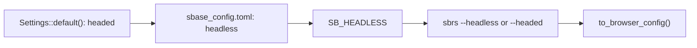

A headless browser runs without a window. It still loads pages, runs scripts and
takes screenshots and PDFs, but it draws nothing on a screen. A headed browser
opens a window you can watch. This page covers the default of each engine, how to
switch between the two modes, and what headless mode changes.

<Info>

**What you will learn**

- What each engine does by default (`BaseCase`, pure CDP, Playwright mode, `sbrs`, `sbrs-mcp`).
- How to switch in code, on the command line, with `SB_HEADLESS` and in the settings file.
- How Chrome's new headless mode differs from `chrome-headless-shell`.
- What gives a headless browser away, and what the stealth layer changes.
- How to run in containers and CI, and how to debug a run you cannot see.

</Info>

<Visibility for="agents">

Summary for AI exports: `BrowserConfig::default()` is headless and `Settings::default()` (the settings file, `SB_HEADLESS`, the `sbrs` command line) is headed. The pure CDP engine (`LaunchOptions`) and the `sbrs-mcp` `start_browser` tool are headless on Linux and headed elsewhere. Switch with `BrowserConfig::with_headless(bool)`, `LaunchOptionsBuilder::headless(bool)`, `sbrs --headless` / `--headed`, `SB_HEADLESS=true|false` or `headless = true` in `sbase_config.toml`. `BrowserConfig::from_env()`, the pure CDP engine and `sbrs-mcp` do not read `SB_HEADLESS`. Chromium sessions use `--headless=new`; Chrome's old headless mode is `Browser::ChromeHeadlessShell` (`--browser chs`), which cannot run UC mode. On Linux, `BrowserConfig::with_virtual_display` runs a headed browser on Xvfb.

</Visibility>

<Panel>

<Card title="Quick reference" icon="eye-slash">

- In code: `BrowserConfig::with_headless(bool)`
- Pure CDP: `LaunchOptionsBuilder::headless(bool)`
- Command line: `sbrs --headless` or `sbrs --headed`
- Variable: `SB_HEADLESS=true`
- Settings file: `headless = true`
- Old headless mode: `--browser chs`
- Headed on a Linux server: `with_virtual_display`

</Card>

</Panel>

## What headless mode does

Each engine turns headless mode into a browser flag:

| Browser and engine | Headless flags | Window size |
|---|---|---|
| Chrome, Edge and the other Chromium browsers, WebDriver engine | `--headless=new` and `--disable-gpu` | `--window-size=1280,720` (`390,844` with `mobile`) unless you set one, headless or headed |
| Chrome, pure CDP engine | `--headless=new` | none unless you set `window_size(width, height)` or a fingerprint gives a screen size |
| Firefox, WebDriver engine | `-headless` | the browser's own |
| Chromium, Playwright mode | rustwright's `headless` launch option | 1920 by 1080, maximised, unless you set one |
| Safari | none: Safari always opens a window | the browser's own |

<Columns cols={2}>

<Card title="Use headless mode" icon="eye-slash">

Use it when nobody watches the run:

- **CI and containers.** A server or container usually has no display, and a headed
  browser needs one.
- **Screenshots and PDFs.** These work without a window. The real-Chrome test suite
  takes a PNG, a PDF and an element screenshot from a headless Chrome.
- **Many browsers at once.** No windows open on your desktop.

</Card>

<Card title="Run headed" icon="window-maximize">

Run headed when someone has to see or use the window:

- **Watching a test.** Demo mode (`RunSettings::with_demo_mode`) outlines each
  element and pauses after each action so you can follow along (see
  [Run settings](/tutorials/run_settings)). `with_esc_end(true)` lets the person
  watching press ESC in the browser to end the test.
- **Recording.** `sbrs record` saves the clicks and typing you do in the browser.
  It is headed unless you pass `--headless`.
- **Clicking with the system pointer.** `Page::gui_click_captcha` and
  `Page::gui_captcha_plan` (feature `gui`) refuse a headless browser, because it
  has no window on the screen to click.
- **Plugins that need a window.** A browser plugin that declares
  `Requirements::HEADFUL` refuses a headless launch. `sbrs plugin info NAME` shows
  that as "a window, not headless".
- **Sites that block headless browsers.** See [Headless and stealth](#headless-and-stealth).

</Card>

</Columns>

In a headless browser, `post_message` and the other message helpers keep a message
on the page for at most 0.75 s, as Python SeleniumBase does, because nobody is
watching.

## Defaults

Each engine has its own default:

| Entry point | Default | How to change it |
|---|---|---|
| `BrowserConfig::default()` and `BrowserConfig::from_env()`, which `BaseCase::new` and `run_browser_test` take | <Badge color="green">Headless</Badge> | `with_headless(bool)`. Neither constructor reads `SB_HEADLESS`. |
| `Settings`: `sbase_config.toml`, `Settings::load()` and `to_browser_config()`, also used by the helpers `sbrs mkdir` writes | <Badge color="blue">Headed</Badge> (`headless = false`) | The file's `headless` key, then `SB_HEADLESS` |
| `sbrs` browser commands (`open`, `smoke`, `record`, ...) | <Badge color="blue">Headed</Badge> | `--headless` or `--headed`, `SB_HEADLESS`, the settings file |
| `sbrs devtools` | <Badge color="purple">By system</Badge> Headless on Linux, headed elsewhere | `--headless`, or the global `--headed` |
| Pure CDP engine (`LaunchOptions`) | <Badge color="purple">By system</Badge> Headless on Linux, headed on every other system | `LaunchOptionsBuilder::headless(bool)` |
| `PlaywrightSession::launch()` | <Badge color="blue">Headed</Badge> | `PlaywrightSession::launch_with_config(&config)` uses `config.headless`; `BaseCase::activate_playwright_mode` uses the case's configuration |
| `sbrs-mcp` `start_browser` (all three toolsets: `sb`, `driver` and `cdp`) | <Badge color="purple">By system</Badge> Headless on Linux, headed elsewhere | The tool's `headless` argument |
| Safari | <Badge color="blue">Headed</Badge> Always a window | Safari ignores the setting |

<Warning>

`BrowserConfig::default()` is headless, but `Settings::default()` is headed. A
test that builds `BrowserConfig::default()` runs without a window. The same test
built from `Settings::load()?.to_browser_config()` opens one when there is no
settings file and no `SB_HEADLESS`.

</Warning>

For `Settings` and the `sbrs` commands, each source below overrides the one
before it. A `BrowserConfig` you build in code with `with_headless` is final.



## Switch between headless and headed

<Tabs>

<Tab title="BrowserConfig" icon="code">

`with_headless(true)` runs without a window (the default), and `with_headless(false)`
opens one. A value you set in code is final: no variable or file changes it later.

```rust,no_run tests/headed.rs
use seleniumbase_rs::{run_browser_test, BrowserConfig, Result};

#[tokio::test]
async fn shows_the_title() -> Result<()> {
    // `false` opens a window; `true` (the default) runs without one.
    let config = BrowserConfig::default().with_headless(false);

    run_browser_test(config, async |sb| {
        sb.open("https://example.com").await?;
        sb.assert_title("Example Domain").await
    })
    .await
}
```

</Tab>

<Tab title="Pure CDP" icon="bolt">

`LaunchOptionsBuilder::headless(bool)` sets the mode. Leave it unset to get the
default for the system: headless on Linux, where there is usually no display, and
headed elsewhere. `LaunchOptions::is_headless()` shows which mode the options will
launch.

```rust,no_run src/main.rs
use seleniumbase_rs::sb_cdp::{Browser, LaunchOptions};

#[tokio::main]
async fn main() -> Result<(), Box<dyn std::error::Error>> {
    let options = LaunchOptions::builder().headless(true).build()?;
    assert!(options.is_headless());

    let browser = Browser::launch(options).await?;
    let page = browser.default_page().await?;
    page.goto("https://example.com").await?;
    std::fs::write("example.png", page.screenshot().await?)?;
    browser.close().await?;
    Ok(())
}
```

</Tab>

<Tab title="Command line" icon="terminal">

`--headless` and `--headed` are global options, so they go before the subcommand:

```bash Terminal
sbrs --headless open https://example.com
sbrs --headed open https://example.com
sbrs --headless --browser firefox test   # the tests see SB_HEADLESS=true
```

- A flag beats `SB_HEADLESS`, and `SB_HEADLESS` beats the settings file.
- If you pass both flags, `--headless` wins.
- These flags take no value: `--headless=false` is refused. Use `--headed`.
- A global option written after the subcommand is refused too.
- `sbrs test` passes the flag to the tests as `SB_HEADLESS`, so a test that loads
  `Settings` sees it.
- `sbrs devtools` also has its own `--headless` option, written after
  `devtools`.

</Tab>

<Tab title="Environment variable" icon="dollar-sign">

<ParamField body="SB_HEADLESS" type="boolean" default="unset">

`SB_HEADLESS` accepts `true`/`false`, `1`/`0`, `yes`/`no` and `on`/`off`. A blank
value counts as unset. Any other value is an `InvalidConfig` error
(`cannot parse bool: maybe`), and `sbrs` stops before it starts a browser.

</ParamField>

```bash Terminal
SB_HEADLESS=true cargo test --test ui
```

`SB_HEADLESS` is read by `Settings::load()`, `Settings::load_from(path)`,
`Settings::from_env()` and the `sbrs` browser commands. **It is not read by
`BrowserConfig::from_env()`, the pure CDP engine or `sbrs-mcp`.** To make a
`BaseCase` follow it, build the configuration from `Settings`:

```rust,no_run tests/helpers.rs
use seleniumbase_rs::{BrowserConfig, Result, Settings};

fn config() -> Result<BrowserConfig> {
    // sbase_config.toml if there is one, then the SB_* variables on top.
    Ok(Settings::load()?.to_browser_config())
}
```

For the pure CDP engine, read it yourself. The programs that
`sbrs import-playwright` and `sbrs import-puppeteer` write do this:

```rust,no_run src/main.rs
use seleniumbase_rs::config::settings::Settings;
use seleniumbase_rs::sb_cdp::LaunchOptions;

fn launch_options() -> Result<LaunchOptions, seleniumbase_rs::SeleniumBaseError> {
    let mut builder = LaunchOptions::builder();
    // Without SB_HEADLESS, the engine's default for the system stays.
    if std::env::var_os("SB_HEADLESS").is_some() {
        builder = builder.headless(Settings::from_env()?.headless);
    }
    builder.build()
}
```

</Tab>

<Tab title="Settings file" icon="gear">

<ParamField body="headless" type="boolean" default="false">

Run without a window. `SB_HEADLESS` and the `sbrs` flags override it.

</ParamField>

`Settings::load()` and `sbrs` look for `sbase_config.toml`, then
`.sbase_config.toml`, then `.sbase_config` (JSON) in the current directory:

<CodeGroup>

```toml sbase_config.toml
headless = true
```

```json .sbase_config
{ "headless": true }
```

</CodeGroup>

`SB_HEADLESS` overrides the file, and an `sbrs` flag overrides both. `sbrs --config
FILE` reads another file instead. See [Settings](/tutorials/settings_and_config).

</Tab>

<Tab title="MCP server" icon="robot">

The `start_browser` tool of every `sbrs-mcp` toolset takes a `headless` argument:
`true` forces headless and `false` forces headed. Without it, the browser is
headless on Linux and headed elsewhere. The server does not read `SB_HEADLESS`.

```json start_browser arguments
{ "headless": true }
```

See [MCP servers](/tutorials/mcp_server).

</Tab>

</Tabs>

## New headless mode and chrome-headless-shell

Setting `headless` on Chrome launches Chrome's new headless mode (`--headless=new`):
your installed Chrome with no window. This is what Python SeleniumBase's
`headless2` asks for. Chrome's old headless mode now exists only as a separate
build, `chrome-headless-shell`, which the WebDriver engine runs as
`Browser::ChromeHeadlessShell`:

<CodeGroup>

```rust Rust
use seleniumbase_rs::{Browser, BrowserConfig};

let config = BrowserConfig::default()
    .with_browser(Browser::ChromeHeadlessShell)
    .with_headless(true);
```

```bash Terminal
sbrs --browser chs --headless open https://example.com
```

</CodeGroup>

In the settings file and in `SB_BROWSER`, the name `chrome-headless-shell` works
as well as `chs`.

| | Chrome with `headless` | `chrome-headless-shell` |
|---|---|---|
| What runs | The Chrome installed on the machine | A separate build in `downloaded_drivers/chs/`, downloaded (stable channel) when missing |
| Driver | chromedriver for your Chrome | chromedriver for the shell's own version |
| UC mode | Yes | No: `InvalidConfig` "chrome-headless-shell cannot run the undetected (UC) mode" |
| Pure CDP engine | `headless(true)` | Name the program with `executable_path`, or `use_chromium(true)` finds `chrome-headless-shell` on the `PATH` after `chromium` and `chromium-browser` |
| Python option | `headless`, `headless2` | `headless1` |

## Headless and stealth

Pages can tell a headless Chrome from a headed one. The code and tests of this
crate deal with these signs:

- **The user agent.** A headless Chrome reports `HeadlessChrome` instead of
  `Chrome`. The pure CDP engine itself uses that to tell whether a browser it
  attaches to is headless.
- **No GPU.** The WebDriver engine passes `--disable-gpu` only to a headless
  browser. A browser without a GPU reports a software renderer that pages can tell
  apart from a real one.
- **Permissions.** `navigator.permissions.query` and `Notification.permission`
  give different answers for notifications.
- **Media queries and visibility.** The answers of `matchMedia`, and
  `document.hidden` and `visibilityState`.
- **The hairline check** that Modernizr runs.

The stealth layer changes these:

| Layer | What it does about headless |
|---|---|
| UC mode (`DriverMode::Uc`) | If you set no user agent and Chrome reports `HeadlessChrome`, it overrides the user agent to say `Chrome` over CDP. |
| A `Fingerprint` whose policy has `headless_fixes` on (`StealthPolicy::balanced()`, which every preset uses) | Runs the `headless`, `permissions` and `hairline` evasions and `Emulation.setFocusEmulationEnabled`: `matchMedia` gives a headed browser's answers, the page is visible, and the two permission answers agree. The outer window size is left to the `window_geometry` evasion. |
| A user agent from `with_user_agent`, `LaunchOptionsBuilder::user_agent` or a fingerprint | Replaces the `HeadlessChrome` user agent at launch. |
| `native_spoofing` on a WebDriver session (Chrome, Chromium, Edge) | Runs a patched copy of Chrome (`EnginePatch::chrome_binary()`), which also overwrites the `HeadlessChrome` marker in the binary. |
| Pure CDP engine without a user agent or fingerprint | Changes nothing: the user agent still says `HeadlessChrome`. |

None of this makes a headless browser identical to a headed one. The network audit
test (`tests/stealth_audit_network.rs`) only requires that, on CreepJS, a browser
with a fingerprint looks no more headless than the same Chrome without one. On its
first run (headless Chrome 155 on macOS), CreepJS still found two signs.

**Recommendation.** If a site still blocks a headless browser after these
measures, run headed with `with_headless(false)` (or `sbrs --headed`). On a server
with no display, give the headed browser a virtual display; see the last step below.
[UC mode](/tutorials/uc_mode#still-detected) lists the other measures.

## Containers and CI

<Steps>

<Step title="Turn headless mode on">

Set `SB_HEADLESS=true` for `sbrs` and for tests that load `Settings`. Keep
`BrowserConfig::default()` (already headless) or call `with_headless(true)` in
code. The pure CDP engine is headless on Linux unless you set `headless(false)`.
The repository's verification image sets `SB_HEADLESS=true` because the container
has no display.

</Step>

<Step title="Let Chrome start without its sandbox">

On Linux, the WebDriver engine passes `--no-sandbox` to Chromium browsers itself.
The pure CDP engine passes it only with `LaunchOptionsBuilder::no_sandbox(true)` or
when `SB_NO_SANDBOX` is set, which Chrome needs when it runs as root in a
container. The runtime image built from the `Dockerfile` runs as the non-root user
`sbrs`.

<Warning>

`--no-sandbox` weakens Chrome's isolation, so use it only in a container you
control.

</Warning>

</Step>

<Step title="Give the browser shared memory">

WebDriver sessions pass `--disable-dev-shm-usage`. The repository's own container
commands also start Docker with `--shm-size=1g`:

```bash
docker run --rm --shm-size=1g seleniumbase-rs --headless smoke 'data:text/html,<title>Smoke</title><h1>hi</h1>' --title-contains Smoke
```

The image's entry point is `sbrs`, so the arguments after the image name are
`sbrs` arguments.

</Step>

<Step title="Give a test that needs a window a virtual display">

On Linux, `BrowserConfig::with_virtual_display` starts Xvfb and opens the headed
browser on it. This is Python SeleniumBase's `--xvfb`. The screen is 1366 by 768
unless you pass another `VirtualDisplay`:

```rust,no_run
use seleniumbase_rs::browser::options::VirtualDisplay;
use seleniumbase_rs::{run_browser_test, BrowserConfig, Result};

#[tokio::test]
async fn runs_headed_on_a_server() -> Result<()> {
    let config = BrowserConfig::default()
        .with_headless(false)
        .with_virtual_display(VirtualDisplay::new(1920, 1080));

    run_browser_test(config, async |sb| {
        sb.open("https://example.com").await?;
        sb.assert_title("Example Domain").await
    })
    .await
}
```

- Xvfb must be installed (`apt install xvfb` on Debian or Ubuntu). It takes the
  first free display from `:99` to `:199` and stops when the session ends.
- A session ignores the virtual display, and logs that, if it is headless, if it is
  not on Linux, or if it connects to a driver this crate did not start.
- The pure CDP engine has no such option. Start `Xvfb` in the background and
  export `DISPLAY` before you launch the browser, as `docker/verify-linux.sh` does
  with `SBRS_XVFB=1`. That script does not use `xvfb-run`, which can wait forever
  for a signal that a background process ignores.

</Step>

</Steps>

## Debugging a headless run

- **Save what the browser shows.** `sb.save_screenshot("step.png")` saves a
  full-page screenshot in the logs directory (the name must be a plain file name),
  and `save_page_source_to_logs()` and `save_as_pdf_to_logs(name)` save the HTML and
  a PDF. In the pure CDP engine, `page.screenshot()` and `page.pdf()` return the
  bytes.
- **Check the mode in the log.** `BaseCase::new` and the session log `headless = true`
  or `false` at the `info` level (`init_tracing()`, then `RUST_LOG=info`).
- **Check what the page sees.** `sb.get_user_agent()` returns a user agent with
  `HeadlessChrome` in it when nothing replaced it.
- **Attach DevTools.** `BrowserConfig::with_remote_debug(true)` opens Chrome's
  remote debugger at `http://localhost:9222`, and `with_remote_debug_port(port)`
  opens it on another port. In the pure CDP engine, use
  `LaunchOptionsBuilder::debugging_port(9222)`. `sbrs devtools --headless --port 0
  --json` launches a headless Chrome and prints its DevTools endpoint. Anyone on
  the machine who can reach the port can drive the browser, so use it for
  debugging only.
- **Watch it.** Run the same test headed (`--headed`, `SB_HEADLESS=false` or
  `with_headless(false)`), with demo mode if the steps are too fast to follow.
- **Do not compare timings across modes.** Real Chrome behaves differently in
  headless and headed runs, so check which mode a test uses before you trust a
  timing. With `reuse_session`, a headless browser is never handed to a headed
  configuration, or the reverse: the mode is part of what a reused browser must
  match.

## Troubleshooting

<AccordionGroup>

<Accordion title="SB_HEADLESS=true has no effect">

Only `Settings::load()`, `Settings::load_from`, `Settings::from_env()` and the
`sbrs` browser commands read the variable. A program that builds
`BrowserConfig::default()` or `BrowserConfig::from_env()` is headless anyway. A
program that sets `with_headless(false)` stays headed. The pure CDP engine and
`sbrs-mcp` ignore the variable. On the command line, `--headed` beats it. Build
the configuration with `Settings::load()?.to_browser_config()`, and `export` the
variable (or put it before the command on the same line).

</Accordion>

<Accordion title="A window opens in CI, or Chrome fails because there is no display">

The settings file, `SB_HEADLESS` and `sbrs` are headed by default, and a headed
browser needs a display. Set `SB_HEADLESS=true`, pass `--headless` before the
subcommand, or give the browser a virtual display.

</Accordion>

<Accordion title="sbrs refuses --headless=false">

`--headless` and `--headed` take no value. Pass `--headed` to open a window, and
write global options before the subcommand: `sbrs --headless open URL`.

</Accordion>

<Accordion title="cannot parse bool: maybe">

`SB_HEADLESS` (or `headless` in the settings file) has a value that is not one of
`true`, `false`, `1`, `0`, `yes`, `no`, `on` or `off`. `sbrs` stops before it starts
a browser.

</Accordion>

<Accordion title="chrome-headless-shell cannot run the undetected (UC) mode">

`Browser::ChromeHeadlessShell` cannot run with `DriverMode::Uc`. Use Chrome with
`with_headless(true)`, which UC mode supports, or drop UC mode.

</Accordion>

<Accordion title="chrome-headless-shell is not installed">

The session looks for it under `downloaded_drivers/chs/` and downloads the stable
build there when it is missing. If the download fails, put the program there, or
name it with `BrowserConfig::with_browser_binary_path`.

</Accordion>

<Accordion title="Xvfb is not installed or not on the PATH">

`with_virtual_display` needs the `Xvfb` program. Install it (`apt install xvfb`)
or run headless. If no virtual display starts, check the log: the session skips it
for a headless browser, outside Linux, and with a driver it did not start itself.

</Accordion>

<Accordion title="a headless browser has no window on the screen to click">

`Page::gui_click_captcha` moves the system pointer, so it needs a window on the
screen. Launch the browser headed, or use `solve_captcha`, which clicks over
DevTools.

</Accordion>

<Accordion title="A plugin refuses the browser">

A plugin with `Requirements::HEADFUL` refuses a headless launch with a
`SeleniumBaseError::Plugin` error. `sbrs plugin info NAME` lists what a plugin
needs. Run headed, or drop that plugin. See [Browser plugins](/tutorials/plugins).

</Accordion>

<Accordion title="The site detects the headless browser">

See [Headless and stealth](#headless-and-stealth): use UC mode or a fingerprint
first, then run headed (on a virtual display on a server).

</Accordion>

</AccordionGroup>

## Coming from Python SeleniumBase

| Python option | Rust |
|---|---|
| `headless` | `BrowserConfig::with_headless(true)` |
| `headed` | `BrowserConfig::with_headless(false)` |
| `headless2` | `with_headless(true)`: Chrome's new headless mode (`--headless=new`) |
| `headless1` | `with_browser(Browser::ChromeHeadlessShell)` with `headless` on |
| `--xvfb` | `BrowserConfig::with_virtual_display` |
| `--xvfb-metrics=WIDTH,HEIGHT` | `VirtualDisplay::new(width, height)` (1366, 768 when not given) |

## Next steps

<Columns cols={2}>
  <Card title="Undetected (UC) mode" icon="user-secret" href="/tutorials/uc_mode">
    Hide the automation markers, headless or headed.
  </Card>
  <Card title="Docker" icon="docker" href="/help/docker">
    Build the image and run `sbrs` headless in a container.
  </Card>
  <Card title="Pure CDP" icon="code" href="/tutorials/pure_cdp">
    Drive Chrome without a driver, headless by default on Linux.
  </Card>
  <Card title="Settings" icon="gear" href="/tutorials/settings_and_config">
    The settings file, the `SB_*` variables and their order.
  </Card>
</Columns>
