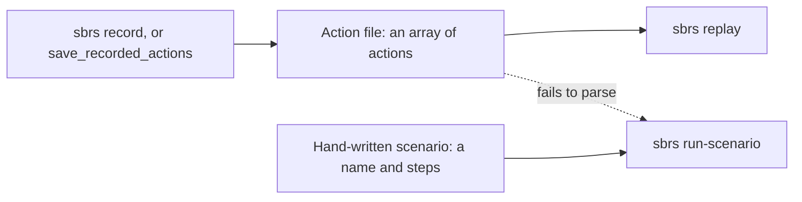

Recorder Mode captures your browser interactions and generates either a Rust
source file or a JSON action file that can be replayed later. It is a fast way
to bootstrap a UI test: point, click, type, assert, and then refine the
generated output.

<Info>

**What you will learn**

- How to record from the CLI and from code.
- What the generated Rust test looks like.
- How to export and replay JSON action files, and how they differ from the
  scenario files `run-scenario` reads.
- Tips for keeping generated tests maintainable.

</Info>

<Visibility for="agents">

Summary for AI exports: `sbrs record URL -o actions.json` captures clicks, typing, `<select>` changes and navigations into an action file that `sbrs replay` runs. From code, `BaseCase` records the actions it performs; `export_recording_as_rust()` returns a Rust program, `save_recording_to_logs()` saves JSON and Rust, and `ActionRecorder::to_rust_test(name)` returns a `#[tokio::test]`. `--rec-sb-cdp` writes pure CDP code instead. `sbrs run-scenario` reads hand-written scenarios, not action files.

</Visibility>

## Record from the CLI

`sbrs record` opens a browser on a URL, captures your clicks, typing, `<select>`
changes and page navigations while you use it, and saves them as an action file
when you press Ctrl-C (or after `--duration SECONDS`, or when you close the
browser):

```bash Terminal
cargo run --bin sbrs -- record https://seleniumbase.io/demo_page -o actions.json
cargo run --bin sbrs -- replay actions.json
```

Run it headed (the default), and put any global options such as `--browser`
before `record`. `replay` runs the file in a fresh browser and exits with status
1 if a step fails. See [Recorder CLI](/help/recorder_cli) for the file
format and the actions replay understands.

## Record from code

`BaseCase` records every action you perform through its API automatically. There
is no separate start/stop toggle for the default recorder; simply run the
interactions you want to capture and then export the recording. If you want only
part of a run, `start_recording()` marks a starting point and `stop_recording()`
returns the actions recorded since then.

```rust,no_run
use seleniumbase_rs::{BaseCase, BrowserConfig};

#[tokio::main]
async fn main() -> Result<(), Box<dyn std::error::Error>> {
    let mut sb = BaseCase::new(BrowserConfig::default()).await?;
    sb.open("https://seleniumbase.io/demo_page").await?;

    sb.click("#myButton").await?;
    sb.type_text("#myInput", "hello").await?;

    // Export the recorded actions as Rust source and JSON.
    let rust_test = sb.export_recording_as_rust()?;
    std::fs::write("my_test.rs", rust_test)?;

    // Or save both formats to the logs directory in one call.
    let (_json, _rust) = sb.save_recording_to_logs()?;

    sb.quit().await?;
    Ok(())
}
```

## Generated output

The recorder produces method calls such as:

```rust,no_run
# use seleniumbase_rs::BaseCase;
# async fn demo(sb: &mut BaseCase) -> Result<(), seleniumbase_rs::SeleniumBaseError> {
sb.click("#myButton").await?;
sb.type_text("#myInput", "hello").await?;
sb.assert_text("Success!", "body").await?;
# Ok(())
# }
```

<Warning>

Only some `BaseCase` methods record themselves: navigation and interaction ones
such as `open`, `click`, `type_text`, `clear`, `hover`, the `select_option_*`
methods and a few waits, and among assertions only `assert_text`. Calls to
other methods leave no trace in the recording.

</Warning>

`export_recording_as_rust` (and the `.rs` file `save_recording_to_logs` writes)
is a complete `#[tokio::main]` program: it imports `BaseCase` and
`BrowserConfig`, creates a `BaseCase` from `BrowserConfig::default()`, runs the
calls, and quits. To get a `#[tokio::test]` function instead, call
`ActionRecorder::to_rust_test(name)`, or `save_recording_as_test(dir, name)` to
write it to `dir/name.rs`. The generated code has no custom timeout and does not
use the `sb_test!` macro.

<Tip>

Always review the output before committing it to your suite.

</Tip>

## Pure CDP code (`--rec-sb-cdp`)

The same recording can be written for the pure CDP engine (`sb_cdp`, no
chromedriver) instead of `BaseCase`, as Python's `--rec-sb-cdp` does with
`sb_cdp` calls. `ActionRecorder::to_cdp_script()` returns a standalone
`#[tokio::main]` program, `to_cdp_test(name)` a `#[tokio::test]` function, and
`save_recording_as_cdp_test(dir, name)` writes that to `dir/name.rs`. For the
recording above the program is:

```rust,ignore
use seleniumbase_rs::sb_cdp::{Browser, LaunchOptions};

#[tokio::main]
async fn main() -> Result<(), Box<dyn std::error::Error>> {
    let browser = Browser::launch(LaunchOptions::builder().build()?).await?;
    let page = browser.default_page().await?;
    page.goto("https://seleniumbase.io/demo_page").await?;
    page.locator("#myButton").click().await?;
    page.locator("#myInput").type_text("hello").await?;
    browser.close().await?;
    Ok(())
}
```

`BaseCase::export_recording_as_cdp_rust()` returns it from a live test. To make
`export_recording_as_rust` and `save_recording_to_logs` write it, as the Python
flag does, turn the setting on with `BrowserConfig::with_rec_sb_cdp(true)`, the
`sbrs --rec-sb-cdp` flag or `SB_REC_SB_CDP=true`; the test itself still runs on
WebDriver, and only the generated code changes.

Every selector and value is written as a Rust string literal. 51 recorded
actions have a pure CDP call: `open`, the clicks, typing (`type_text`, which
empties the field first as `BaseCase::type_text` does, and `send_keys` for
`add_text`, which adds to what the field holds), the `select_option_*` methods, link
clicks (`link=` and `p_link=` selectors), drag and drop, the element waits, the
text, attribute and title assertions, history and reload, scrolling, cookies,
`localStorage`, `maximize_window`, `click_with_offset` (from the top-left corner,
or the centre when the recording says `x, y, center`) and `sleep`. The rest
(frame, window and alert switching, JavaScript clicks, `set_window_size`, and
so on) become a `// skipped:` comment that quotes the `BaseCase` call, so a gap
is never silent. Differences from the WebDriver program: a wait uses the pure
CDP engine's own timeout, not ten seconds, and the program is not written when
the test ends; you ask for it.

## JSON action files

Recorded actions can also be saved as JSON. From code:

```rust,no_run
# use seleniumbase_rs::BaseCase;
# fn demo(sb: &BaseCase) -> Result<(), seleniumbase_rs::SeleniumBaseError> {
sb.save_recorded_actions("recorded.json")?;
# Ok(())
# }
```

The file goes in the `latest_logs` folder (the name must be a plain file name),
and holds an array of `{ "name", "target", "value", "timestamp_ms" }` objects.
Replay it with the CLI:

```bash Terminal
cargo run --bin sbrs -- replay latest_logs/recorded.json
```

<Warning>

This is not the file `sbrs run-scenario` reads. That command takes a
hand-written scenario, an object with a `name` and a list of `steps` such as
`{ "action": "click", "css": "#myButton" }`; passing it an action file fails to
parse. See [Recorder CLI](/help/recorder_cli) for both formats.

</Warning>



Action files are portable and can be replayed by CI jobs without recompiling a
test binary. `replay` understands `goto`/`open`, `click`, `type`/`type_text`,
`select_option_by_value`, `assert_text`, `assert_title` and `assert_url`, and
skips any other action.

## Best practices

- Wait for elements to settle before acting; the recorder captures explicit waits automatically.
- Review the generated code and add assertions where needed.
- Use meaningful selectors in the application under test so generated locators remain stable.
- Run the generated test immediately to confirm it passes before editing it.

## Troubleshooting

<AccordionGroup>

<Accordion title="Recording is empty" icon="video-slash">

**Likely cause:** Actions were performed without a `BaseCase` method (e.g. raw JS).

**Fix:** Use `BaseCase` interaction methods so the internal recorder captures them.

</Accordion>

<Accordion title="Generated selector is brittle" icon="link-slash">

**Likely cause:** Page uses auto-generated IDs.

**Fix:** Replace recorded selectors with stable `data-testid` or class selectors.

</Accordion>

<Accordion title="Replay fails" icon="rotate-left">

**Likely cause:** Target application changed.

**Fix:** Regenerate or hand-edit the action file.

</Accordion>

<Accordion title="run-scenario rejects the saved file" icon="file-circle-xmark">

**Likely cause:** It is an action file, not a scenario.

**Fix:** Replay it with `sbrs replay`.

</Accordion>

<Accordion title="replay reports skipped steps" icon="forward-step">

**Likely cause:** The action is not one replay understands.

**Fix:** Use the generated Rust test instead, or hand-edit the file.

</Accordion>

</AccordionGroup>
