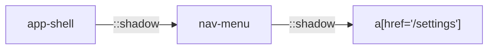

Selectors are the addresses your tests use to find elements on the page.
`seleniumbase-rs` accepts several formats and works out for itself which kind of
lookup the browser needs. Choosing the right selector is one of the most important
things you can do for test maintainability. This page also covers Web Components
(Shadow DOM) and the three syntax formats a check can be written in.

<Info>

**What you will learn**

- The selector formats supported by `BaseCase`.
- How `::shadow` selectors pierce Shadow DOM trees, which methods read them, how to chain shadow roots and how to keep an element inside a shadow root.
- What differs between the WebDriver engine and the pure CDP engine, and the limits of shadow-DOM automation.
- How to convert between CSS and XPath.
- Best practices for stable, readable selectors.
- How the same check looks as a Rust test, `sbrs` commands and a JSON scenario, and when to choose each.

</Info>

<Visibility for="agents">

Summary for AI exports: `BaseCase` reads a selector string by its prefix. `#` is an ID and `.` a class, a string that starts with `/`, `//`, `./`, `../`, `(` or an XPath axis is XPath, `link=` and `partial_link=` (and their short forms) match link text, and anything else is CSS. Prefixes are matched exactly. `Selector::auto` detects the strategy and `SelectorBuf::css(..)` states it where a method takes `impl Into<SelectorBuf>`. The `::shadow` combinator moves the search into the shadow root of the element on its left, and can be chained for nested Web Components, as in `sb.click("app-shell::shadow nav-menu::shadow a[href='/settings']")`. Every method that takes a selector reads it (`click`, `type_text`, `get_text`, `get_attribute`, `assert_element`, `assert_text`, `assert_exact_text`, `is_element_visible`, `wait_for_element_visible`, `find_elements`, ...) and waits for the element. A selector must end on an element inside the last shadow root. The older `shadow_click`, `shadow_type`, `shadow_get_text`, `shadow_get_attribute`, `assert_shadow_element` and `assert_shadow_text` are the same lookups, and `find_element("host::shadow inner")` returns the element inside the root as an `Element`. The WebDriver engine reaches closed roots; the pure CDP engine (`page.locator`) reaches open roots only. A check can be written in three formats: direct API calls in Rust (`BaseCase`, or `Locator` on the pure CDP engine), `sbrs` CLI commands such as `open`, `smoke` and `deferred`, and JSON scenarios run with `sbrs run-scenario --file`. Use the direct API for production tests, the CLI or JSON scenarios for CI smoke checks, and JSON scenarios for non-developer authors.

</Visibility>

## Supported formats

| Prefix | Meaning | Example |
|--------|---------|---------|
| `#` | ID | `#username` |
| `.` | Class (first match) | `.btn-primary` |
| `/`, `//`, `./`, `../`, `(` | XPath | `//div[@class='hero']` |
| an <Tooltip tip="The direction an XPath step walks from the current element, as in parent:: or following-sibling::.">XPath axis</Tooltip> | XPath | `parent::div`, `following-sibling::td` |
| `link=`, `link_text=`, `text=` | Exact link text | `link=Log in` |
| `partial_link=`, `partial_link_text=`, `partial_text=` | Partial link text | `partial_text=Privacy` |
| `p_link=`, `p_link_text=`, `p_text=` | Partial link text (short forms) | `p_text=Privacy` |
| (none) | CSS selector | `input[name='email']` |

Most `BaseCase` methods accept these strings directly. The library inspects the
selector to decide which kind of lookup to use, so the same method takes CSS,
XPath, or a prefixed link-text selector without you having to say which it is.

Any of the thirteen XPath axes may lead an expression, so `parent::div` and
`ancestor-or-self::form` are recognized as XPath. CSS pseudo-elements are not
confused with them, because a pseudo-element never begins with an axis name:
`div::before` and `::after` stay CSS.

<Warning>

The prefixes are matched exactly and everything after one is the text, so
`LINK=Home` (wrong case) and ` link=Home` (leading space) are CSS, and
`text=//div` is a link whose text is `//div`. An attribute selector such as
`[name=q]` or `input[name='q']` is CSS: there is no `name=` prefix.

</Warning>

If you need to force a particular strategy, build the `SelectorBuf` yourself
instead of relying on detection. It goes wherever a method takes a selector as
`impl Into<SelectorBuf>`: the methods of `Element` and `BrowserSession`, and
`Page::locator` and `Locator::locator` on the pure CDP engine.

```rust
use seleniumbase_rs::utils::selectors::SelectorBuf;

let row = sb.find_element("#cart .row").await?;

// Detected automatically: a string is read by the rules above.
let remove = row.find("link=Remove").await?;

// Or stated explicitly, where the guess would be wrong: `td[2]` is XPath for the
// second cell, but nothing in the text says so, and a string is read as CSS then.
let cell = row.find(SelectorBuf::xpath("td[2]")).await?;

// The selector builders start at the element too: of the two Save buttons of the page,
// only the one inside the panel.
let panel = sb.find_element("#panel").await?;
let save = panel.find(SelectorBuf::role("button", Some("Save"), false)).await?;
```

From an element, `find` and `find_all` search inside it. An XPath that starts at the root of the
page (`//td`, `(//td)[1]`, `id('x')`) matches the whole page from any element, so they refuse it
with `InvalidSelector`: write `.//td` for the descendants of the element. So is a union with such
a branch (`.//a | //b`, and the message names the branch), but not a `//` or a `|` inside a
predicate or a string (`.//a[@title='x | //y']`). A `p:contains("x")` selector is read as
`.//p[...]`, and the XPath of `SelectorBuf::role`, `text`, `label` and `containing_text` starts
with `.//` too, so they stay inside the element. An `<iframe>` element holds the frame, not the
frame's document: switch to the frame with `switch_to_frame` and find from the page.

## Examples

```rust
// ID
sb.type_text("#username", "alice").await?;

// CSS attribute selector
sb.type_text("input[name='q']", "seleniumbase").await?;

// Exact link text
sb.click("link=Sign up").await?;

// Partial link text
sb.click("partial_link=Privacy Policy").await?;

// XPath
sb.hover("//button[contains(text(), 'Menu')]").await?;
```

## Using `Selector` directly

If you prefer an explicit type, use the `Selector` enum or the `selector!` macro:

```rust
use seleniumbase_rs::{selector, Selector};

let s1 = selector!(css, "#submit");
let s2 = selector!(id, "username");
let s3 = selector!(link, "Home");
let s4 = selector!(partial_link, "Terms");
let s5 = selector!(xpath, "//button[text()='Go']");

assert_eq!(s1, Selector::Css("#submit"));
```

## Shadow DOM

Web Components often hide markup inside Shadow DOM trees. SeleniumBase for Rust
reads `::shadow` selectors in every method that takes a selector, as Python
SeleniumBase does, so you click, type into, read and assert on elements inside
a shadow root the same way as on any other element, and the call waits for the
element like any other.

### Basic usage

The `::shadow` combinator moves the search context into the shadow root of the
element on its left. Write it with or without a space before it: `my-app::shadow
button` and `my-app ::shadow button` are the same selector, and a space (or the
end of the text) must follow it.

```rust
sb.click("my-app::shadow button").await?;
sb.type_text("my-app::shadow input", "hello").await?;
sb.assert_text("hello", "my-app::shadow div.result").await?;
let text = sb.get_text("my-app::shadow div.result").await?;
```

Each fragment after `::shadow` is evaluated inside that shadow root, not the
top-level document. The first fragment can be any selector (CSS, `:contains()`
or XPath); the others are CSS, because WebDriver's search inside a shadow root
has no XPath.

### Which methods read it

All of them. A few that Python's own examples use:

| Method | What it does with `host::shadow inner` |
|---|---|
| `click`, `double_click`, `hover`, `js_click` | Wait for the element, then act on it. |
| `type_text`, `clear` | Wait for the element to be displayed, then clear and type. |
| `get_text`, `get_attribute` | Wait for the element, then read what the browser shows. A container that only slots its content gives the slotted text. |
| `assert_element`, `assert_element_present`, `assert_text`, `assert_exact_text` | Wait up to the case's timeout (`set_timeout`), then assert. |
| `is_element_visible`, `is_element_present`, `is_text_visible` | Look once; a host that is missing or has no shadow root is `false`, not an error. |
| `wait_for_element_visible`, `wait_for_element_present`, `find_element`, `find_elements` | Wait for the element, or list the matches in the innermost root. |

The `shadow_click`, `shadow_type`, `shadow_get_text`, `shadow_get_attribute`,
`assert_shadow_element` and `assert_shadow_text` methods of earlier versions
stay, as the same lookups: they wait with the case's timeout, and
`shadow_get_text` gives the text as the browser shows it.

### Nested shadow roots

Chain multiple `::shadow` fragments for nested Web Components.

```rust
sb.click("app-shell::shadow nav-menu::shadow a[href='/settings']").await?;
```

The first `::shadow` enters `app-shell`; the second enters the `nav-menu`
component inside it.



### Find elements inside shadow DOM

```rust
let elements = sb.find_elements("my-app::shadow li").await?;
for el in elements {
    println!("{}", el.text().await?);
}
```

The elements are the matches in the innermost root, as ordinary
`seleniumbase_rs::Element` handles, so you can call any supported method on
them after retrieval.

### The pure CDP engine

`page.locator(...)` reads the same selectors in the pure CDP engine, and so do
its waits and expectations. This is an addition: Python's CDP mode has no
`::shadow` selector.

```rust
let title = page.locator("my-app::shadow h1");
title.wait_for(State::Visible).await?;
page.locator("my-app::shadow input").type_text("hello").await?;
page.locator("my-app::shadow button").click().await?;
page.locator("my-app::shadow .result")
    .expect()
    .to_have_text("hello")
    .await?;
```

A step of a chain reads it too (`page.locator("main").locator("my-app::shadow
button")`), and a plain step does not enter a shadow root by itself.

### Keep an element inside a shadow root

`find_element` reads `host::shadow inner` like every other method, and gives
the node inside the root as an `Element`:

```rust
let button = sb.find_element("my-app::shadow button").await?;
button.click().await?;
```

A shadow root has no handle of its own: the selector reaches the same elements,
closed roots included. A search from an element (`element.find(..)`) does not
enter a shadow root; write the whole selector instead.

### Limitations

<Warning>

- The WebDriver engine (`BaseCase`) enters open and closed shadow roots, because the browser driver hands both out. The pure CDP engine (`page.locator`) enters open roots only: a page script cannot see a closed one, unless the fingerprint's `open_shadow_roots` has forced it open.
- A selector must end on an element inside the last shadow root: `my-app ::shadow` is refused at once, as in Python, instead of waiting for the timeout.
- CSS selectors inside shadow roots must match the local DOM; they do not leak out to the parent tree.
- Slots and distributed content stay in the light DOM: find slotted children with
  normal selectors. The text of a container in a shadow tree that only slots its
  content is the slotted text, as the browser shows it.
- The first fragment can be XPath or `:contains()` in the WebDriver engine, where
  it is looked up in the page; every fragment is CSS in the pure CDP engine.

</Warning>

## XPath to CSS

A simple XPath expression can be turned into the equivalent CSS selector:

```rust
use seleniumbase_rs::utils::selectors::xpath_to_css;

assert_eq!(xpath_to_css("//input[@type='text' and @name='q']")?, "input[type='text'][name='q']");
```

Only expressions with an exact CSS equivalent are converted: a tag (or `*`)
anywhere in the document, narrowed by attribute tests (`@id='x'`, `@href`)
joined with `and`. Anything else (`or`, `contains()`, `text()`, positions,
paths with several steps) is an `InvalidSelector` error, because a CSS selector
that quietly left part of the XPath out would match different elements. The
other direction is `BaseCase::convert_css_to_xpath`.

## Best practices

- **Prefer stable attributes**: `data-testid`, `name`, `id`, or ARIA roles are
  usually more stable than positional XPath or generated class names.
- **Avoid generated class names**: frameworks such as styled-components or CSS
  modules generate class names that change between builds.
- **Use link text for navigation**: `link=` and `partial_link=` match the text
  users see, which makes tests readable and resilient to markup changes.
- **Keep selectors short**: a selector with many descendants is brittle. Add
  stable attributes to the application under test when needed.
- **Document unusual selectors**: if a selector is non-obvious, add a comment
  explaining what it targets.

## Syntax formats

A check can be written in three ways: direct API calls in Rust, CLI commands,
and JSON-based scenarios. The tabs show the same check in each format.

<RequestExample>

```rust BaseCase
use seleniumbase_rs::{run_browser_test, tokio, BrowserConfig};

#[tokio::main]
async fn main() -> seleniumbase_rs::Result<()> {
    let config = BrowserConfig::from_env()?.with_headless(true);

    run_browser_test(config, async |sb| {
        sb.open("https://example.com").await?;
        let heading = sb.get_text("h1").await?;
        println!("{heading}");
        sb.assert_text("Example", "h1").await
    })
    .await
}
```

```rust Pure CDP
use seleniumbase_rs::sb_cdp::{Browser, LaunchOptions};
use seleniumbase_rs::tokio;

#[tokio::main]
async fn main() -> Result<(), seleniumbase_rs::SeleniumBaseError> {
    let browser = Browser::launch(LaunchOptions::builder().headless(true).build()?).await?;
    let page = browser.default_page().await?;

    page.goto("https://example.com").await?;
    let heading = page.locator("h1").text().await?;
    println!("{heading}");
    page.locator("h1").expect().to_contain_text("Example").await?;

    browser.close().await?;
    Ok(())
}
```

```bash sbrs
sbrs open https://example.com
sbrs smoke https://example.com --title-contains Example
```

```bash sbrs deferred
sbrs --url https://example.com deferred \
    --assert element=h1 --assert text=h1:Example
```

```json scenario.json
{
  "name": "basic_flow",
  "steps": [
    {"action": "open", "url": "https://example.com"},
    {"action": "assert_text", "css": "h1", "contains": "Example"}
  ]
}
```

```bash run-scenario
sbrs run-scenario --file scenario.json
```

</RequestExample>

<ResponseExample>

```text BaseCase
Example Domain
```

```text Pure CDP
Example Domain
```

```text sbrs
Title: Example Domain
Assertion passed: title contains 'Example'
```

```text sbrs deferred
Deferred assertion summary
--------------------------
PASS  element exists: h1
PASS  text "Example" in h1
--------------------------
total=2 passed=2 failed=0
```

```text run-scenario
Dashboard written: <path>
Scenario 'basic_flow' steps: total=2, passed=2, failed=0
Recording json: <path>
Recording script: <path>
```

</ResponseExample>

Every tab checks the same thing: the page at `https://example.com` has an `h1`
that contains `Example`. The program tabs print the heading; the `sbrs` tabs
print what the command prints (the lines come from the command's code, and
`<path>` stands for a file under `latest_logs/`). A failed check ends a Rust
program with an error and `sbrs` with a non-zero exit status.

### Direct API

The most flexible format. Use it for production tests and complex logic. With
`BaseCase`, the selector is an argument of every call (`sb.get_text("h1")`).
`run_browser_test` starts the browser, runs your closure and always quits the
browser, even when an assertion fails.

The [pure CDP engine](/tutorials/pure_cdp) has its own API, in which the
selector lives in a `Locator` instead of being passed to every call
(`page.locator("h1").text()`), and it needs no chromedriver.

### CLI commands

Useful for quick checks, CI one-liners, and ad-hoc debugging. Every `sbrs`
command starts its own browser and closes it when it finishes, so the one-liners
that make sense are the ones that take a URL: `open` prints the page title,
`smoke` asserts on it, and `deferred` runs several assertions and reports
every failure at once. The global `--url` flag names the page `deferred`
runs on.

For a flow with several steps, use a scenario or a Rust test.

### JSON scenario

Scenarios are portable and do not require recompiling a test binary. A scenario
is an object with a `name` and a list of `steps`; each step has an `action` and
the fields that action takes (`url`, `css`, `text`, `contains`, ...). The steps
run in order, a failed step is collected instead of stopping the run, and
`sbrs run-scenario` exits non-zero when any step failed.

The list of actions is in [Recorder CLI](/help/recorder_cli#run-a-json-scenario).
`sbrs mkrec` writes a different file, an array of recorded actions
(`recordings/NAME_rec.json`), which you replay with `sbrs replay`.

### Choosing a format

| Use case | Recommended format |
|---|---|
| Production regression tests | Direct API |
| CI smoke checks | CLI or JSON scenarios |
| Prototyping / demos | Recorder → Rust or JSON |
| Non-developer authors | JSON scenarios |


## Selector troubleshooting

<AccordionGroup>

<Accordion title="ElementNotFound" icon="magnifying-glass">

**Likely cause:** Selector is wrong or element not yet rendered.

**Fix:** Check the selector; add an explicit wait.

</Accordion>

<Accordion title="InvalidSelector" icon="triangle-exclamation">

**Likely cause:** Malformed XPath or CSS.

**Fix:** Validate syntax; escape quotes properly.

</Accordion>

<Accordion title="Stale element" icon="clock-rotate-left">

**Likely cause:** DOM was replaced after the element was found.

**Fix:** Re-find the element before each action.

</Accordion>

<Accordion title="Shadow DOM not pierced" icon="layer-group">

**Likely cause:** Shadow root is closed or selector format is wrong.

**Fix:** Verify the component uses open shadow DOM; use `::shadow`.

</Accordion>

<Accordion title="NoSuchElement inside shadow root" icon="ban">

**Likely cause:** The host has no shadow root yet (the component attaches it late), the selector inside the root does not match, or, in the pure CDP engine, the root is closed.

**Fix:** The calls wait for the element, so raise the timeout (`set_timeout`) for a slow component. For a closed root use the WebDriver engine, or ask the application to use open roots in test builds.

</Accordion>

<Accordion title="Selector matches parent instead of shadow element" icon="arrow-up">

**Likely cause:** Missing `::shadow` combinator.

**Fix:** Add `::shadow` before the nested selector.

</Accordion>

<Accordion title="Stale element on chained shadow query" icon="clock-rotate-left">

**Likely cause:** Component re-rendered.

**Fix:** Re-query the host element before each shadow step.

</Accordion>

</AccordionGroup>

## Related reading

<Columns cols={3}>

<Card color="#1a85d4" title="Utilities" icon="clock" horizontal href="/tutorials/utilities">

Waits, assertions, macros and the HTML inspector.

</Card>

<Card color="#199f43" title="Walkthrough" icon="rocket" horizontal href="/tutorials/getting_started">

Your first test with `BaseCase`.

</Card>

<Card color="#d47628" title="Pure CDP" icon="bolt" horizontal href="/tutorials/pure_cdp">

The driverless engine and its `Locator` API.

</Card>

<Card color="#a631be" title="Recorder CLI" icon="circle-dot" horizontal href="/help/recorder_cli">

The scenario file and the recorded action file.

</Card>

<Card color="#1a85d4" title="API Reference" icon="code" horizontal href="/tutorials/api_reference">

All methods that accept selectors.

</Card>

</Columns>
