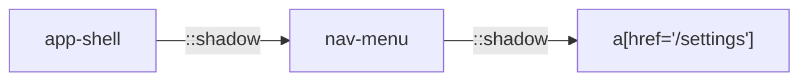

Web Components often hide markup inside Shadow DOM trees. SeleniumBase for Rust
reads `::shadow` selectors in every method that takes a selector, as Python
SeleniumBase does, so you click, type into, read and assert on elements inside
a shadow root the same way as on any other element, and the call waits for the
element like any other.

<Info>

**What you will learn**

- How `::shadow` selectors work, and which methods read them.
- How to chain shadow roots.
- How to query shadow roots directly with the `WebElement` methods.
- What differs between the WebDriver engine and the pure CDP engine, and the limits of shadow-DOM automation.

</Info>

<Visibility for="agents">

Summary for AI exports: the `::shadow` combinator moves the search into the shadow root of the element on its left, and can be chained for nested Web Components, as in `sb.click("app-shell::shadow nav-menu::shadow a[href='/settings']")`. Every method that takes a selector reads it (`click`, `type_text`, `get_text`, `get_attribute`, `assert_element`, `assert_text`, `assert_exact_text`, `is_element_visible`, `wait_for_element_visible`, `find_elements`, ...) and waits for the element. A selector must end on an element inside the last shadow root. The older `shadow_click`, `shadow_type`, `shadow_get_text`, `shadow_get_attribute`, `assert_shadow_element` and `assert_shadow_text` are the same lookups, and `get_shadow_root` returns a root as a `WebElement`. The WebDriver engine reaches closed roots; the pure CDP engine (`page.locator`) reaches open roots only.

</Visibility>

## Basic usage

The `::shadow` combinator moves the search context into the shadow root of the
element on its left. Write it with or without a space before it: `my-app::shadow
button` and `my-app ::shadow button` are the same selector, and a space (or the
end of the text) must follow it.

```rust
sb.click("my-app::shadow button").await?;
sb.type_text("my-app::shadow input", "hello").await?;
sb.assert_text("hello", "my-app::shadow div.result").await?;
let text = sb.get_text("my-app::shadow div.result").await?;
```

Each fragment after `::shadow` is evaluated inside that shadow root, not the
top-level document. The first fragment can be any selector (CSS, `:contains()`
or XPath); the others are CSS, because WebDriver's search inside a shadow root
has no XPath.

## Which methods read it

All of them. A few that Python's own examples use:

| Method | What it does with `host::shadow inner` |
|---|---|
| `click`, `double_click`, `hover`, `js_click` | Wait for the element, then act on it. |
| `type_text`, `clear` | Wait for the element to be displayed, then clear and type. |
| `get_text`, `get_attribute` | Wait for the element, then read what the browser shows. A container that only slots its content gives the slotted text. |
| `assert_element`, `assert_element_present`, `assert_text`, `assert_exact_text` | Wait up to the case's timeout (`set_timeout`), then assert. |
| `is_element_visible`, `is_element_present`, `is_text_visible` | Look once; a host that is missing or has no shadow root is `false`, not an error. |
| `wait_for_element_visible`, `wait_for_element_present`, `find_elements` | Wait for the element, or list the matches in the innermost root. |
| `get_shadow_root(selector)` | Returns the shadow root of the element, as a `WebElement`, for your own queries. |

The `shadow_click`, `shadow_type`, `shadow_get_text`, `shadow_get_attribute`,
`assert_shadow_element` and `assert_shadow_text` methods of earlier versions
stay, as the same lookups: they wait with the case's timeout, and
`shadow_get_text` gives the text as the browser shows it.

## Nested shadow roots

Chain multiple `::shadow` fragments for nested Web Components.

```rust
sb.click("app-shell::shadow nav-menu::shadow a[href='/settings']").await?;
```

The first `::shadow` enters `app-shell`; the second enters the `nav-menu`
component inside it.



## Find elements inside shadow DOM

```rust
let elements = sb.find_elements("my-app::shadow li").await?;
for el in elements {
    println!("{}", el.text().await?);
}
```

The elements are the matches in the innermost root, as ordinary
`seleniumbase_rs::drivers::WebElement` handles, so you can call any supported
method on them after retrieval.

## The pure CDP engine

`page.locator(...)` reads the same selectors in the pure CDP engine, and so do
its waits and expectations. This is an addition: Python's CDP mode has no
`::shadow` selector.

```rust
let title = page.locator("my-app::shadow h1");
title.wait_for(State::Visible).await?;
page.locator("my-app::shadow input").type_text("hello").await?;
page.locator("my-app::shadow button").click().await?;
page.locator("my-app::shadow .result")
    .expect()
    .to_have_text("hello")
    .await?;
```

A step of a chain reads it too (`page.locator("main").locator("my-app::shadow
button")`), and a plain step does not enter a shadow root by itself.

## Query the shadow root directly

For complex logic, fetch the shadow root and call the `WebElement` methods on it
directly:

```rust
use seleniumbase_rs::drivers::By;

let root = sb.get_shadow_root("my-app").await?;
let button = root.find(By::Css("button")).await?;
button.click().await?;
```

## Limitations

<Warning>

- The WebDriver engine (`BaseCase`) enters open and closed shadow roots, because the browser driver hands both out. The pure CDP engine (`page.locator`) enters open roots only: a page script cannot see a closed one, unless the fingerprint's `open_shadow_roots` has forced it open.
- A selector must end on an element inside the last shadow root: `my-app ::shadow` is refused at once, as in Python, instead of waiting for the timeout.
- CSS selectors inside shadow roots must match the local DOM; they do not leak out to the parent tree.
- Slots and distributed content stay in the light DOM: find slotted children with
  normal selectors. The text of a container in a shadow tree that only slots its
  content is the slotted text, as the browser shows it.
- The first fragment can be XPath or `:contains()` in the WebDriver engine, where
  it is looked up in the page; every fragment is CSS in the pure CDP engine.

</Warning>

## Troubleshooting

<AccordionGroup>

<Accordion title="NoSuchElement inside shadow root" icon="ban">

**Likely cause:** The host has no shadow root yet (the component attaches it late), the selector inside the root does not match, or, in the pure CDP engine, the root is closed.

**Fix:** The calls wait for the element, so raise the timeout (`set_timeout`) for a slow component. For a closed root use the WebDriver engine, or ask the application to use open roots in test builds.

</Accordion>

<Accordion title="Selector matches parent instead of shadow element" icon="arrow-up">

**Likely cause:** Missing `::shadow` combinator.

**Fix:** Add `::shadow` before the nested selector.

</Accordion>

<Accordion title="Stale element on chained shadow query" icon="clock-rotate-left">

**Likely cause:** Component re-rendered.

**Fix:** Re-query the host element before each shadow step.

</Accordion>

</AccordionGroup>
