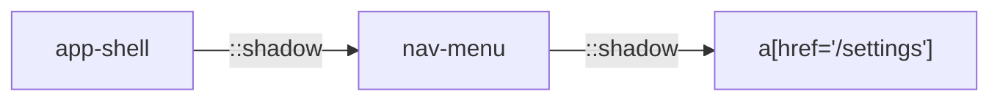

Web Components often hide markup inside Shadow DOM trees. SeleniumBase for Rust
can pierce through open shadow roots with `::shadow` selectors, making it easy
to interact with buttons, inputs, and lists that are otherwise invisible to a
traditional CSS or XPath search.

<Info>

**What you will learn**

- How `::shadow` selectors work.
- How to chain shadow roots.
- How to query shadow roots directly with the `WebElement` methods.
- The limits of shadow-DOM automation.

</Info>

<Visibility for="agents">

Summary for AI exports: the `::shadow` combinator moves the search into the shadow root of the element on its left, and can be chained for nested Web Components, as in `sb.shadow_click("app-shell ::shadow nav-menu ::shadow a[href='/settings']")`. The methods are `shadow_click`, `shadow_type`, `shadow_get_text`, `shadow_find_elements` and `get_shadow_root`. Only open shadow roots can be reached.

</Visibility>

## Basic usage

The `::shadow` combinator moves the search context into the shadow root of the
element on its left.

```rust
sb.shadow_click("my-app ::shadow button").await?;
sb.shadow_type("my-app ::shadow input", "hello").await?;
let text = sb.shadow_get_text("my-app ::shadow div.result").await?;
```

Each fragment after `::shadow` is evaluated inside that shadow root, not the
top-level document.

## Supported shadow methods

| Method | Description |
|---|---|
| `shadow_click(selector)` | Click an element inside a shadow root. |
| `shadow_type(selector, text)` | Type text into an input inside a shadow root. |
| `shadow_get_text(selector)` | Read the visible text of a shadow element. |
| `shadow_find_elements(selector)` | Return all matching shadow elements. |
| `get_shadow_root(selector)` | Return the `ShadowRoot`/`WebElement` context for further queries. |

## Nested shadow roots

Chain multiple `::shadow` fragments for nested Web Components.

```rust
sb.shadow_click("app-shell ::shadow nav-menu ::shadow a[href='/settings']").await?;
```

The first `::shadow` enters `app-shell`; the second enters the `nav-menu`
component inside it.



## Find elements inside shadow DOM

```rust
let elements = sb.shadow_find_elements("my-app ::shadow li").await?;
for el in elements {
    println!("{}", el.text().await?);
}
```

These elements are ordinary `seleniumbase_rs::drivers::WebElement` handles, so
you can call any supported method on them after retrieval.

## Query the shadow root directly

For complex logic, fetch the shadow root and call the `WebElement` methods on it
directly:

```rust
use seleniumbase_rs::drivers::By;

let root = sb.get_shadow_root("my-app").await?;
let button = root.find(By::Css("button")).await?;
button.click().await?;
```

## Limitations

<Warning>

- Only **open** shadow roots are accessible. Closed shadow roots cannot be pierced by WebDriver or CDP.
- CSS selectors inside shadow roots must match the local DOM; they do not leak out to the parent tree.
- Slots and distributed content are still rendered in the light DOM; use normal
  selectors for slotted children unless they themselves host a shadow root.

</Warning>

## Troubleshooting

<AccordionGroup>

<Accordion title="NoSuchElement inside shadow root" icon="ban">

**Likely cause:** Root is closed.

**Fix:** Use CDP DOM access if available, or ask the application to use open roots in test builds.

</Accordion>

<Accordion title="Selector matches parent instead of shadow element" icon="arrow-up">

**Likely cause:** Missing `::shadow` combinator.

**Fix:** Add `::shadow` before the nested selector.

</Accordion>

<Accordion title="Stale element on chained shadow query" icon="clock-rotate-left">

**Likely cause:** Component re-rendered.

**Fix:** Re-query the host element before each shadow step.

</Accordion>

</AccordionGroup>
