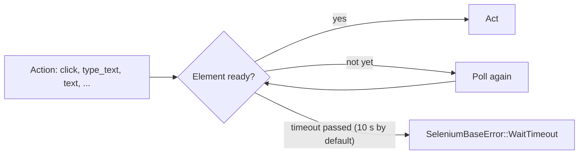

The utilities of `seleniumbase-rs` are the parts you use in almost every test but
that are not the browser itself: the waits and assertions that make a test wait
for the page, the macros that cut the boilerplate, the HTML inspector that
checks the markup of a page, and the Gherkin scenarios that run feature files as
tests. Each has its own section below.

<Info>

**What you will learn**

- How actions wait for their element, and how to wait and assert explicitly, softly and with a time limit.
- How to build selectors with `selector!`, declare a test with `sb_test!`, use the config and fingerprint macros, and how the action macros map to `BaseCase` methods.
- How to run an HTML inspection, which checks are performed, how to use it in CI, and the scope and limits of static analysis.
- How to write a `.feature` file and bind a scenario to a test function.
- How steps use the browser (`sb`), what the built-in steps already do, and what happens when a step fails.
- How to run scenarios from `cargo test`, `sbrs test` and `sbrs behave-gui`, and how to move from the removed `seleniumbase_rs::behave` module.

</Info>

<Visibility for="agents">

BrowserConfig::default()

</Visibility>

## Waits and assertions

Browser tests fail most often because they interact with elements before the
page is ready. `seleniumbase-rs` provides implicit waiting in many action
methods, plus explicit waits and assertions that retry until a condition is met
or a timeout expires.

This section explains the waiting model, the available assertion helpers, soft
assertions, and common mistakes to avoid.

### Smart waiting in actions

`BaseCase` actions wait for their element before acting, <Tooltip tip="Checking again at short intervals until the condition holds or the timeout passes.">polling</Tooltip> until it is
ready or the timeout passes (10 seconds by default; see
[Default timeout](#default-timeout)):

| Action | Waits for the element to be |
| --- | --- |
| `click`, `double_click`, `context_click` | visible and enabled |
| `type_text`, `send_keys`, `clear`, `hover`, `drag_and_drop` | visible |
| `text`, `attribute`, `submit`, `set_value`, `select_option_by_*` | present |



*What an action does while it waits.*

If the element never gets there, the action fails with
`SeleniumBaseError::WaitTimeout`, which names the selector and the state it was
waiting for. You do not need a manual wait before every action, but explicit
waits are still useful for precise timing or for waiting on dynamic state.

<Note>

The wait is a poll, not a WebDriver implicit wait, so checks such as
`is_element_present` still answer at once instead of waiting out the timeout
when the element is absent.

</Note>

### Explicit waits

Use explicit waits when the default implicit wait is not enough or when you want
to wait for a specific condition other than visibility.

```rust
// Wait for element to exist in the DOM
sb.wait_for_element_present("#results", 10).await?;

// Wait for element to be visible
sb.wait_for_element_visible(".spinner", 5).await?;

// Wait for element to become invisible
sb.wait_for_element_not_visible(".loading", 15).await?;

// Wait for element to be clickable
sb.wait_for_element_clickable("#checkout", 10).await?;

// Wait for element to be removed from the DOM
sb.wait_for_element_absent(".error", 5).await?;

// Wait for document.readyState === 'complete'
sb.wait_for_ready_state_complete().await?;
```

<Info>

Timeouts are in seconds and are passed as `u64` values. Some methods also have
a `_default` variant that uses the configured implicit timeout.

</Info>

### Text and title waits

Wait for text or page title conditions:

```rust
// Wait until the given text is visible inside the selector
sb.wait_for_text("Welcome", "body", 10).await?;

// Wait until text is no longer visible anywhere on the page
sb.wait_for_text_not_visible("Loading", "body", 10).await?;

// Wait until the page title equals the expected value
sb.assert_title("Dashboard").await?;

// Wait until the page title contains the expected substring
sb.assert_title_contains("Dashboard").await?;
```

### Assertions

Assertions return `Result<(), SeleniumBaseError>` and stop the test on failure.
The text assertions take the text first and the selector second, as in Python,
and wait for it for up to the default timeout (see below) before they fail.

```rust
// Title assertions
sb.assert_title("My App").await?;
sb.assert_title_contains("My App").await?;

// Text assertions
sb.assert_text("Welcome!", "body").await?;
sb.assert_text_visible("Welcome!", "body").await?;
sb.assert_text_not_visible("Error", "body").await?;
sb.assert_exact_text("Hello, Alice", "#greeting").await?;

// Element assertions
sb.assert_element("#success").await?;
sb.assert_element_present("#success").await?;
sb.assert_element_visible("#success").await?;
sb.assert_element_absent(".error").await?;

// Attribute assertion
sb.assert_attribute("#logo", "src", "/logo.png").await?;

// Link and page health assertions
sb.assert_link_text("Home").await?;
sb.assert_no_404_errors().await?;
```

### Soft assertions

Soft assertions collect failures and report them at the end of the test instead
of stopping immediately. This is useful for validation-heavy tests where you
want to see all failures at once.

```rust
sb.deferred_assert_element("#header").await?;
sb.deferred_assert_text("Terms", "footer").await?;
sb.deferred_assert_exact_text("Ready", "#status").await?;

// Process all deferred assertions; this is where failures are raised.
sb.process_deferred_asserts().await?;
```

If any deferred assertion failed, `process_deferred_asserts` returns an error
containing all of the failures.

### Default timeout

You can change how long actions and some other methods wait:

```rust
let old = sb.set_timeout(30).await?;
```

`set_timeout` returns the previous value so you can restore it later.
`set_default_timeout(seconds)` changes the same default (1 to 60 seconds) and
`reset_default_timeout()` puts it back.

### Time limit for the whole test

```rust
sb.set_time_limit(120)?;
```

Once the test has run longer than the limit, counted from creating the
`BaseCase`, its next `open`, readiness wait or element action fails with a
time-limit error, and waits are cut to the time left.

<Warning>

A test that does none of those is not interrupted; wrap the test in
`tokio::time::timeout` for a hard stop.

</Warning>

### Anti-patterns

<Warning>

- **Do not use `tokio::time::sleep` to wait for pages**. It makes tests slow and
  does not eliminate timing races. Use explicit waits instead.
- **Do not assert on exact styling**. Assert on content, attributes, and state.
- **Do not silently swallow assertion failures**. Let errors propagate with `?`
  so the test runner reports them.

</Warning>

### Wait and assertion checklist

- [ ] Rely on the actions' built-in waiting instead of adding sleeps.
- [ ] Explicit waits are used for dynamic state changes.
- [ ] Timeouts are chosen based on realistic page timing, not worst-case guesses.
- [ ] Soft assertions are followed by `process_deferred_asserts`.
- [ ] Tests do not contain fixed sleeps.

## Macros

`seleniumbase-rs` exports a set of convenience macros from the crate root. They
reduce boilerplate for selectors, test setup, common interactions, and
assertions. Because the action macros expand `.await` internally, use them
inside an `async` function or closure.


This section catalogs every public macro and shows when to prefer macros over the
explicit method API.

```rust
use seleniumbase_rs::{
    cdp_config, fingerprint, sb_assert_not_visible, sb_assert_text, sb_assert_title,
    sb_assert_title_contains, sb_assert_url, sb_assert_url_contains, sb_assert_visible,
    sb_click, sb_config, sb_fill_form, sb_hover, sb_js, sb_open, sb_quit, sb_scroll_to,
    sb_select, sb_screenshot, sb_test, sb_type, sb_wait_and_click, sb_wait_for,
    sb_with_timeout, selector, uc_config,
};
```

### `selector!`

Builds a `Selector` variant at compile time.

```rust
use seleniumbase_rs::{selector, Selector};

let s = selector!(css, "#submit");
assert_eq!(s, Selector::Css("#submit"));

let s = selector!(xpath, "//button[text()='Go']");
let s = selector!(id, "username");
let s = selector!(link, "Home");
let s = selector!(partial_link, "Terms");
```

### `sb_test!`

Generates a `#[tokio::test]` async function that runs the supplied block with
`run_browser_test`: it creates a
`BaseCase`, runs the block, and always calls `quit()` before
returning. The test fails if the block returns an `Err`.

```rust,no_run
use seleniumbase_rs::sb_test;

sb_test!(visit_example, seleniumbase_rs::BrowserConfig::default(), |sb| {
    sb.open("https://example.com").await?;
    sb.assert_title("Example Domain").await?;
    Ok(())
});
```

The `|sb| { ... }` part only looks like a closure. The macro creates the
`BaseCase`, binds it to the name you give (a `&mut BaseCase`), and runs your
block inside an async closure whose result type is
`Result<(), SeleniumBaseError>`; use `?` on crate methods and finish with
`Ok(())`. It calls `quit` whether or not the block failed (or panicked), and
then panics with the error if the block returned one. A block that ends with
`skip_test` passes, as it does under `run_browser_test`.

<Warning>

The macro quits for you, so do not call `sb_quit!` inside it.

</Warning>

### `uc_config!`

Returns a `BrowserConfig` with UC mode enabled.

```rust
use seleniumbase_rs::uc_config;

let config = uc_config!();
```

### `cdp_config!`

Returns a `BrowserConfig` with CDP mode enabled.

```rust
use seleniumbase_rs::cdp_config;

let config = cdp_config!();
```

### `sb_config!`

Builds a `BrowserConfig` using common field
permutations. Fields can be chained in any order supported by the macro.

```rust
use seleniumbase_rs::{sb_config, Browser, DriverMode};

let config = sb_config! {
    mode: DriverMode::Uc,
    headless: true,
    browser: Browser::Chrome,
};
```

### `fingerprint!`

Returns a built-in `Fingerprint` preset.

```rust
use seleniumbase_rs::fingerprint;

let fp = fingerprint!(windows);
let fp = fingerprint!(edge); // Windows with Edge's user agent and Client Hints
let fp = fingerprint!(macos);
let fp = fingerprint!(linux);
let fp = fingerprint!(android);
let fp = fingerprint!(ios);
let fp = fingerprint!(safari); // same preset as ios
```

### Action macros

These macros call the corresponding `BaseCase` method and
await it. Without a trailing message the macro evaluates to the method's
`Result`, so follow it with `?` (a bare call compiles but ignores the failure and
draws an `unused_must_use` warning).

<Warning>

With a trailing message the macro unwraps the `Result` with `.expect(message)`,
which panics on failure.

</Warning>

| Macro | Calls |
|---|---|
| `sb_open!(sb, url)` | `sb.open(url).await` |
| `sb_click!(sb, selector)` | `sb.click(selector).await` |
| `sb_type!(sb, selector, text)` | `sb.type_text(selector, text).await` |
| `sb_hover!(sb, selector)` | `sb.hover(selector).await` |
| `sb_scroll_to!(sb, selector)` | `sb.scroll_to(selector).await` |
| `sb_wait_for!(sb, selector)` | `sb.wait_for_element_visible_default(selector).await` |
| `sb_wait_and_click!(sb, selector)` | wait then `sb.click(selector).await` |
| `sb_select!(sb, selector, text)` | `sb.select_option_by_text(selector, text).await` |
| `sb_assert_text!(sb, expected, selector)` | `sb.assert_text(expected, selector).await` |
| `sb_assert_title!(sb, expected)` | `sb.assert_title(expected).await` (the whole title) |
| `sb_assert_title_contains!(sb, expected)` | `sb.assert_title_contains(expected).await` |
| `sb_assert_url!(sb, expected)` | `sb.assert_url(expected).await` (the whole URL) |
| `sb_assert_url_contains!(sb, expected)` | `sb.assert_url_contains(expected).await` |
| `sb_assert_not_visible!(sb, selector)` | fails if the element is visible |
| `sb_screenshot!(sb, path)` | `sb.save_screenshot_to_path(path).await` |
| `sb_js!(sb, script)` | `sb.execute_script(script).await` |
| `sb_quit!(sb)` | `sb.quit().await` |
| `sb_assert_visible!(sb, selector)` | `sb.assert_element_visible(selector).await` |

### Form and timeout macros

`sb_fill_form!` types into multiple fields in sequence and returns a
`Result`, so it works with the `?` operator inside tests:

```rust,no_run
use seleniumbase_rs::sb_fill_form;

async fn demo(sb: &mut seleniumbase_rs::BaseCase) -> seleniumbase_rs::Result<()> {
    sb_fill_form!(sb, "#username" => "alice", "#password" => "secret")?;
    Ok(())
}
```

`sb_with_timeout!` temporarily sets the default wait timeout (the one the
actions and `sb_wait_for!` use) for the enclosed block and restores it
afterwards. The block must produce a `Result`, and the macro returns that
`Result`, so finish with `?`:

```rust,no_run
use seleniumbase_rs::{sb_click, sb_wait_for, sb_with_timeout};

async fn demo(sb: &mut seleniumbase_rs::BaseCase) -> seleniumbase_rs::Result<()> {
    sb_with_timeout!(sb, 30, {
        sb_wait_for!(sb, "#slow-element")?;
        sb_click!(sb, "#slow-element")
    })?;
    Ok(())
}
```

A complete test with the macros (each action macro ends in `?`):

```rust,no_run
use seleniumbase_rs::{
    sb_assert_visible, sb_click, sb_open, sb_screenshot, sb_test, sb_type,
};

sb_test!(login_with_macros, seleniumbase_rs::BrowserConfig::default(), |sb| {
    sb_open!(sb, "https://example.com/login")?;
    sb_type!(sb, "#username", "alice")?;
    sb_type!(sb, "#password", "secret")?;
    sb_click!(sb, "#submit")?;
    sb_assert_visible!(sb, "#dashboard")?;
    sb_screenshot!(sb, "dashboard.png")?;
    Ok(())
});
```

### When to use macros

<Columns cols={2}>

<Card color="#1a85d4" title="Use macros for" icon="bolt">

- Quick, linear test scripts where the shorter syntax improves readability.
- Compile-time selectors that never change.
- One-liner actions that would otherwise be dominated by `.await?` noise.

</Card>

<Card color="#199f43" title="Prefer the explicit method API" icon="sliders">

When you need fine-grained error handling, custom timeouts, or non-trivial control flow.

</Card>

</Columns>

## HTML inspector

The HTML Inspector scans a page for common accessibility and markup issues. It
is a fast static check that can catch missing attributes, invalid references,
and structural problems before they reach production.

### Run an inspection

<Tabs>

<Tab title="From a page" icon="globe">

`BaseCase::inspect_html` takes the current page source and inspects it:

```rust,no_run
use seleniumbase_rs::BaseCase;
async fn demo(sb: &BaseCase) -> Result<(), seleniumbase_rs::SeleniumBaseError> {
    let inspection = sb.inspect_html().await?;
    assert!(inspection.is_clean(), "{inspection:?}");
    Ok(())
}
```

`BaseCase::assert_no_html_issues` does the same and fails with an
`AssertionFailed` error that lists every `[rule] message`.

</Tab>

<Tab title="From an HTML string" icon="code">

The inspector needs no browser. `HtmlInspector::inspect` takes any HTML string:

```rust
use seleniumbase_rs::api::html_inspector::HtmlInspector;

fn main() -> Result<(), seleniumbase_rs::SeleniumBaseError> {
    let html = r#"<html lang="en"><head><title>T</title></head>
                  <body></body></html>"#;
    let inspection = HtmlInspector::inspect(html)?;
    assert!(inspection.issues.iter().any(|issue| issue.rule == "image-alt"));
    Ok(())
}
```

</Tab>

</Tabs>

### Checks performed

Every finding has a stable rule ID and a severity. `is_clean()` is true only
when there are no findings at all, warnings included; `has_errors()` is true
when at least one finding has `InspectionSeverity::Error`.

| Rule ID | Severity | What it flags |
|---|---|---|
| `document-lang` | <Badge color="red">error</Badge> | The `html` element has no non-empty `lang`. |
| `document-title` | <Badge color="red">error</Badge> | The document has no non-empty `title`. |
| `meta-viewport` | <Badge color="orange">warning</Badge> | No viewport meta tag whose content contains `width=device-width`. |
| `skip-link` | <Badge color="orange">warning</Badge> | No link to `#maincontent` or `#content`. |
| `image-alt` | <Badge color="red">error</Badge> | An `img` without an `alt` attribute (use `alt=""` for decoration). |
| `interactive-name` | <Badge color="red">error</Badge> | A link (`a[href]`) or button without a static accessible name (text, `aria-label`, `title`, `alt`, or a valid `aria-labelledby`). |
| `link-text` | <Badge color="orange">warning</Badge> | A link with no visible text, or with generic text: "click here", "here", "read more", "more", "link" or "details". |
| `nested-interactive` | <Badge color="red">error</Badge> | A button inside a link. |
| `form-control-label` | <Badge color="red">error</Badge> | A form control without a `label`, wrapping `label`, `aria-label`, or valid `aria-labelledby` reference. |
| `radio-group-legend` | <Badge color="orange">warning</Badge> | A named radio group of two or more not inside a `fieldset` with a `legend`. |
| `duplicate-id` | <Badge color="red">error</Badge> | An ID used more than once. |
| `invalid-aria-reference` | <Badge color="red">error</Badge> | `aria-labelledby` or `aria-describedby` naming an ID that does not exist. |
| `empty-heading` | <Badge color="orange">warning</Badge> | A heading with no text. |
| `heading-order` | <Badge color="orange">warning</Badge> | A heading level that jumps by more than one. |
| `page-h1` | <Badge color="orange">warning</Badge> | No `h1`, or more than one. |
| `table-headers` | <Badge color="orange">warning</Badge> | A table with no `th` cell. |
| `main-landmark` | <Badge color="orange">warning</Badge> | No `main` element or `role="main"`. |

### Access results

```rust
use seleniumbase_rs::api::html_inspector::InspectionResult;
fn print_issues(inspection: InspectionResult) {
    let issues = inspection.issues;
    for issue in issues {
        println!(
            "{:?} {} at {:?}: {}",
            issue.severity, issue.rule, issue.selector, issue.message
        );
    }
}
```

`selector` is an `Option<String>`: a best-effort selector for the element, or
`None` for document-level findings.

### Use in CI

Fail a build when new markup issues appear:

```rust
use seleniumbase_rs::api::html_inspector::InspectionResult;
fn gate(inspection: InspectionResult) {
    if !inspection.is_clean() {
        std::process::exit(1);
    }
}
```

<Tip>

To fail only on errors and let warnings through, test `inspection.has_errors()`
instead.

</Tip>

### Why it matters

Clean HTML improves accessibility, SEO, and test reliability.

### Scope and limitations

The inspector uses an HTML5 parser and deterministic static rules. Stable rule
IDs and best-effort element selectors make findings suitable for CI allowlists.
It does not execute JavaScript, compute styles or contrast, test keyboard
behavior, or inspect the browser accessibility tree.

<Warning>

Use it as an early check alongside browser-based accessibility testing such as
axe-core and manual keyboard and assistive-technology review. A clean result is
not a claim of WCAG conformance.

</Warning>


## Gherkin scenarios with rstest-bdd

Gherkin feature files run as ordinary `cargo test` tests through
[rstest-bdd](https://docs.rs/rstest-bdd), with the browser as a fixture. This
replaces the in-house `seleniumbase_rs::behave` runner, which no longer exists.
Product owners, QA engineers and developers share the `.feature` files, and the
steps are Rust functions that use the same `sb` API as any other test.

### Set up

```toml Cargo.toml
[dev-dependencies]
seleniumbase-rs = { git = "https://github.com/MustCodeAl/seleniumbase-rs", features = ["testing", "bdd"] }
# The Gherkin macros look this crate up in the manifest of the crate they expand in
# and panic when it is missing. No file below names it.
rstest-bdd = "0.6"
```

The step and scenario macros, the `rstest` attribute they expand to and the Tokio
runtime all come from `seleniumbase_rs`, so the `use` lines below name no other
crate. `rstest-bdd` is the one line that cannot go: see
[Imports and dependencies](/tutorials/getting_started#the-lines-that-stay).

### A feature, its steps and its scenario

<CodeGroup>

```gherkin tests/features/login.feature
Feature: Login

  Background:
    Given the login page is displayed

  Scenario: Valid login
    When I sign in as "demo"
    Then the title is "Welcome"

  Scenario Outline: Several users
    When I sign in as "<user>"
    Then the title is "<title>"

    Examples:
      | user  | title   |
      | demo  | Welcome |
      | admin | Admin   |
```

```rust tests/login.rs
use seleniumbase_rs::testing::bdd::{given, sb, scenario, then, when, SbCase};
// The `scenario` attribute expands to paths that start with `rstest::`.
use seleniumbase_rs::testing::rstest;
use seleniumbase_rs::tokio;
// `Result` is written out in full below: the steps' macros name `std`'s `Result`.

#[scenario(path = "tests/features/login.feature", name = "Valid login")]
#[tokio::test(flavor = "multi_thread")]
async fn valid_login(#[future(awt)] sb: SbCase) {}

#[scenario(path = "tests/features/login.feature", name = "Several users")]
#[tokio::test(flavor = "multi_thread")]
async fn several_users(#[future(awt)] sb: SbCase) {}

#[given("the login page is displayed")]
async fn login_page(sb: &mut SbCase) -> seleniumbase_rs::Result<()> {
    sb.open("https://example.com/login").await?;
    sb.breakpoint("Paused at the login page.").await
}

#[when("I sign in as {user:string}")]
async fn sign_in(sb: &mut SbCase, user: String) -> seleniumbase_rs::Result<()> {
    sb.type_text("#user", &user).await
}

#[then("the title is {title:string}")]
async fn title_is(sb: &mut SbCase, title: String) -> seleniumbase_rs::Result<()> {
    sb.assert_title(&title).await
}
```

</CodeGroup>

`SbCase` derefs to `BaseCase`, so every `sb.` method is there. The fixture
launches the browser from the run configuration (the settings file and the
`SB_*` variables that `sbrs test` sets) and closes it when the scenario ends,
whatever happened. For a pure CDP browser use `sb_cdp: SbCdpCase`, which derefs
to a `Page`.

<Note>

Write the fixture as `#[future(awt)] sb: SbCase`. Plain `#[future]` does not
compile with rstest-bdd 0.6, and `harness = ...` cannot be combined with an
`async fn` scenario, so there is no harness to add.

</Note>

### Built-in steps

Python's `behave` package ships a library of browser steps, so a feature file
can drive a page without any step code. The same library comes with the `bdd`
feature: 98 actions, each under every wording it has in Python. A scenario that
uses only them needs just the binding:

<CodeGroup>

```gherkin tests/features/shop.feature
Feature: Shop

  Scenario: Open the shop
    Given Open "https://example.com/"
    When Type text "demo" into "#user"
    And Click 'button#go'
    Then Assert title "Example Domain"
    And Assert text "Hello" in "#msg"
```

```rust tests/shop.rs
use seleniumbase_rs::testing::bdd::{sb, scenario, SbCase};
use seleniumbase_rs::testing::rstest;
use seleniumbase_rs::tokio;

#[scenario(path = "tests/features/shop.feature", name = "Open the shop")]
#[tokio::test(flavor = "multi_thread")]
async fn open_the_shop(#[future(awt)] sb: SbCase) {}
```

</CodeGroup>

Launching an `SbCase` links the built-in steps into the test binary, and your own
`#[given]`, `#[when]` and `#[then]` functions can sit beside them in the same
crate. The wording follows Python's:

- A step has no keyword of its own. `Given`, `When`, `Then`, `And` and `But`
  all reach the same step.
- A quoted argument is written in double or single quotes, so `Open "https://a.test"`,
  `Open 'https://a.test'` and `User opens URL "https://a.test"` are the same
  step. Text arguments understand the escapes `\n`, `\t`, `\"`, `\'` and `\\`.
- A step that waits for something waits 10 seconds, Python's `LARGE_TIMEOUT`.

| Actions | They cover |
|---|---|
| Navigation | open, refresh, back and forward, new windows and drivers, alerts, cookies and storage, downloads |
| Elements | click, type, select, hover, drag, check boxes, keys, the JavaScript and jQuery variants |
| Assertions | elements, text, the title and the URL, and the waits |
| Deferred assertions | `Deferred assert ...` steps and `Process deferred asserts` |
| Frames | iframes and their content |
| Other | sleep, screenshots, page source and PDF, demo mode, CDP mode |

`seleniumbase_rs::testing::bdd::steps::builtin_steps()` lists every action with its
patterns, and `matching_actions("Click 'button#go'")` tells which actions read a
line of text (exactly one for a well-formed step, none when no built-in step
reads it).

<Note>

The built-in steps act on an `SbCase` (WebDriver). A pure CDP scenario
(`sb_cdp: SbCdpCase`) has none, so write its steps with `#[given]`, `#[when]` and
`#[then]`. `Download '...' to downloads` takes the file name from the end of the
URL, because the browser saves the file under that name.

</Note>

### When a step fails

A step that returns `Err` or panics fails the scenario. Before the browser
closes, with the page still open, the fixture writes
`latest_logs/<test id>/screenshot.png`, `page_source.html` and
`basic_test_info.txt` (`--no-screenshot`, `--list-fail-page`, `--pdb` and
`--final-debug` work as in any other test).

<Warning>

A scenario's steps run once. `--reruns` does not apply, and `--time-limit` is the
browser's own limit (the next open, wait or action fails once it has run out),
not a hard stop. Use the `multi_thread` flavor of `#[tokio::test]`: with the
default one, a connection that a step opens late is driven by the test's
runtime, which waits while the browser closes.

</Warning>

### Tags, Background, outlines and tables

These are rstest-bdd's: `Background` steps run before each scenario, an outline
becomes one test per example row, a step can take a data table with
`#[datatable]`, and `scenarios!("tests/features", tags = "@smoke and not @slow")`
binds every scenario of a folder at once. See the
[rstest-bdd guide](https://github.com/leynos/rstest-bdd/blob/main/docs/users-guide.md).

### From the command line

`cargo test login` runs the scenarios whose test name contains `login`;
`sbrs test -k login` does the same with the run options of `sbrs test`, and every
other flag of [`sbrs test`](/help/test_options) works on scenarios too:

```bash Terminal
sbrs test --co                          # list the scenarios as tests, run nothing
sbrs test -m smoke --headless           # the tests in a module named smoke
sbrs test -k "login or signup" --env qa --dashboard
sbrs test --pdb                         # stop in a prompt when a step fails
```

Behave's own command line maps onto these flags, and `sbrs behave-options`
prints the table: `-D headless` is `sbrs test --headless`, `-D env=qa` is
`sbrs test --env qa`, `--dry-run` is `--co`, `--stop` is `--runner nextest`, and
`--tags` is `scenarios!(dir, tags = "...")` at compile time or `-m` with a module
name. `-q` (`--no-snippets`) has no meaning, because rstest-bdd checks every step
at compile time. The [test options page](/help/test_options#the-behave-options)
has the whole table.

`sbrs behave-gui` (build with the `tui` feature) lists the feature files under
`features/`, runs the scenarios you mark with `cargo test` and shows the result
of each. See [Behave Commander](/help/behave-gui).

`sbrs behave-gui --new` needs no feature: it prompts for a feature name, title,
scenarios and steps and writes `features/<name>.feature`.

### Moving from `seleniumbase_rs::behave`

| Removed | Now |
|---|---|
| `StepRegistry`, `AsyncStepRegistry`, `register_step` | `#[given]`, `#[when]`, `#[then]` functions |
| `run_feature_file`, `run_feature_file_async` | `#[scenario(path = "...")]` or `scenarios!("dir")` on a test function |
| `RunFilter` | `scenarios!(.., tags = "...")`, or `cargo test <name>` |
| `register_common_browser_steps` | the [built-in browser steps](#built-in-steps), registered when a scenario launches an `SbCase` |
| `BaseCase` behind an `Arc<Mutex<..>>` | `sb: &mut SbCase` in a step |
| `without_session` placeholders | `Browser::new_mocked()` with `SbCdpCase::launch_with_browser` (feature `test-util`) |


## Troubleshooting

<AccordionGroup>

<Accordion title="Macro expansion error" icon="code">

**Likely cause:** Used outside an `async` function.

**Fix:** Wrap the call in an async block or `sb_test!`.

</Accordion>

<Accordion title="sb_test! not found" icon="magnifying-glass">

**Likely cause:** Macro not imported.

**Fix:** Import `seleniumbase_rs::sb_test`.

</Accordion>

<Accordion title="Action macro panics" icon="bomb">

**Likely cause:** A trailing message was given, so a failure is unwrapped with `expect` (for example because the selector did not match).

**Fix:** Drop the message and use `?`, or add an explicit `sb_wait_for!` first or raise the timeout.

</Accordion>

<Accordion title="Warning that a Result must be used" icon="triangle-exclamation">

**Likely cause:** An action macro without a message was called without `?`.

**Fix:** Add `?`: the failure is otherwise ignored.

</Accordion>

<Accordion title="selector! type mismatch" icon="crosshairs">

**Likely cause:** Wrong variant name.

**Fix:** Use `css`, `xpath`, `id`, `link`, or `partial_link`.

</Accordion>

</AccordionGroup>


## Related reading

<Columns cols={2}>

<Card color="#1a85d4" title="Selectors" icon="crosshairs" href="/tutorials/selectors">

Choosing stable element locators.

</Card>

<Card color="#199f43" title="API Reference" icon="code" href="/tutorials/api_reference">

Complete list of wait and assertion methods.

</Card>

</Columns>
