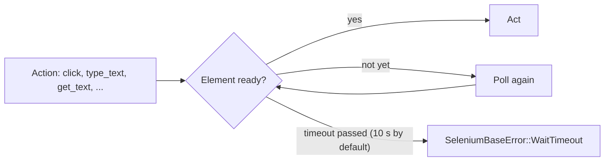

Browser tests fail most often because they interact with elements before the
page is ready. `seleniumbase-rs` provides implicit waiting in many action
methods, plus explicit waits and assertions that retry until a condition is met
or a timeout expires.

This page explains the waiting model, the available assertion helpers, soft
assertions, and common mistakes to avoid.

<Visibility for="agents">

Summary for AI exports: `BaseCase` actions wait for their element (visible and enabled for `click`, visible for `type_text`, present for `get_text`) for 10 seconds by default, then fail with `SeleniumBaseError::WaitTimeout`. Use `wait_for_element_present`, `wait_for_element_visible`, `wait_for_element_not_visible`, `wait_for_element_clickable`, `wait_for_element_absent`, `wait_for_ready_state_complete` and `wait_for_text` for explicit waits. The text assertions take the text first and the selector second. Soft assertions (`deferred_assert_*`) are raised by `process_deferred_asserts`. Change the default wait with `set_timeout`, and do not use `tokio::time::sleep` to wait for pages.

</Visibility>

## Smart waiting in actions

`BaseCase` actions wait for their element before acting, <Tooltip tip="Checking again at short intervals until the condition holds or the timeout passes.">polling</Tooltip> until it is
ready or the timeout passes (10 seconds by default; see
[Default timeout](#default-timeout)):

| Action | Waits for the element to be |
| --- | --- |
| `click`, `double_click`, `context_click` | visible and enabled |
| `type_text`, `send_keys`, `clear`, `hover`, `drag_and_drop` | visible |
| `get_text`, `get_attribute`, `submit`, `set_value`, `select_option_by_*` | present |

<Frame caption="What an action does while it waits.">



</Frame>

If the element never gets there, the action fails with
`SeleniumBaseError::WaitTimeout`, which names the selector and the state it was
waiting for. You do not need a manual wait before every action, but explicit
waits are still useful for precise timing or for waiting on dynamic state.

<Note>

The wait is a poll, not a WebDriver implicit wait, so checks such as
`is_element_present` still answer at once instead of waiting out the timeout
when the element is absent.

</Note>

## Explicit waits

Use explicit waits when the default implicit wait is not enough or when you want
to wait for a specific condition other than visibility.

```rust
// Wait for element to exist in the DOM
sb.wait_for_element_present("#results", 10).await?;

// Wait for element to be visible
sb.wait_for_element_visible(".spinner", 5).await?;

// Wait for element to become invisible
sb.wait_for_element_not_visible(".loading", 15).await?;

// Wait for element to be clickable
sb.wait_for_element_clickable("#checkout", 10).await?;

// Wait for element to be removed from the DOM
sb.wait_for_element_absent(".error", 5).await?;

// Wait for document.readyState === 'complete'
sb.wait_for_ready_state_complete().await?;
```

<Info>

Timeouts are in seconds and are passed as `u64` values. Some methods also have
a `_default` variant that uses the configured implicit timeout.

</Info>

## Text and title waits

Wait for text or page title conditions:

```rust
// Wait until the given text is visible inside the selector
sb.wait_for_text("Welcome", "body", 10).await?;

// Wait until text is no longer visible anywhere on the page
sb.wait_for_text_not_visible("Loading", "body", 10).await?;

// Wait until the page title equals the expected value
sb.assert_title("Dashboard").await?;

// Wait until the page title contains the expected substring
sb.assert_title_contains("Dashboard").await?;
```

## Assertions

Assertions return `Result<(), SeleniumBaseError>` and stop the test on failure.
The text assertions take the text first and the selector second, as in Python,
and wait for it for up to the default timeout (see below) before they fail.

```rust
// Title assertions
sb.assert_title("My App").await?;
sb.assert_title_contains("My App").await?;

// Text assertions
sb.assert_text("Welcome!", "body").await?;
sb.assert_text_visible("Welcome!", "body").await?;
sb.assert_text_not_visible("Error", "body").await?;
sb.assert_exact_text("Hello, Alice", "#greeting").await?;

// Element assertions
sb.assert_element("#success").await?;
sb.assert_element_present("#success").await?;
sb.assert_element_visible("#success").await?;
sb.assert_element_absent(".error").await?;

// Attribute assertion
sb.assert_attribute("#logo", "src", "/logo.png").await?;

// Link and page health assertions
sb.assert_link_text("Home").await?;
sb.assert_no_404_errors().await?;
```

## Soft assertions

Soft assertions collect failures and report them at the end of the test instead
of stopping immediately. This is useful for validation-heavy tests where you
want to see all failures at once.

```rust
sb.deferred_assert_element("#header").await?;
sb.deferred_assert_text("Terms", "footer").await?;
sb.deferred_assert_exact_text("Ready", "#status").await?;

// Process all deferred assertions; this is where failures are raised.
sb.process_deferred_asserts().await?;
```

If any deferred assertion failed, `process_deferred_asserts` returns an error
containing all of the failures.

## Default timeout

You can change how long actions and some other methods wait:

```rust
let old = sb.set_timeout(30).await?;
```

`set_timeout` returns the previous value so you can restore it later.
`set_default_timeout(seconds)` changes the same default (1 to 60 seconds) and
`reset_default_timeout()` puts it back.

## Time limit for the whole test

```rust
sb.set_time_limit(120)?;
```

Once the test has run longer than the limit, counted from creating the
`BaseCase`, its next `open`, readiness wait or element action fails with a
time-limit error, and waits are cut to the time left.

<Warning>

A test that does none of those is not interrupted; wrap the test in
`tokio::time::timeout` for a hard stop.

</Warning>

## Anti-patterns

<Warning>

- **Do not use `tokio::time::sleep` to wait for pages**. It makes tests slow and
  does not eliminate timing races. Use explicit waits instead.
- **Do not assert on exact styling**. Assert on content, attributes, and state.
- **Do not silently swallow assertion failures**. Let errors propagate with `?`
  so the test runner reports them.

</Warning>

## Wait and assertion checklist

- [ ] Rely on the actions' built-in waiting instead of adding sleeps.
- [ ] Explicit waits are used for dynamic state changes.
- [ ] Timeouts are chosen based on realistic page timing, not worst-case guesses.
- [ ] Soft assertions are followed by `process_deferred_asserts`.
- [ ] Tests do not contain fixed sleeps.

## Related reading

<Columns cols={2}>

<Card title="Selectors" icon="crosshairs" href="/tutorials/selectors">

Choosing stable element locators.

</Card>

<Card title="API Reference" icon="code" href="/tutorials/api_reference">

Complete list of wait and assertion methods.

</Card>

</Columns>
